<!-- kfm-showcase:start -->

  <a href="README.md#see-it-in-action"><picture><source media="(prefers-color-scheme: dark)" srcset="docs/brand/readme/kfm-banner-changelog-dark.svg" /></picture></a>

<!-- kfm-showcase:end -->

# Changelog

<!-- kfm-showcase:start -->

  
  
  
  

<!-- kfm-showcase:end -->

KFM records notable repository changes in this file. It is a human-readable repository history, not a release manifest, promotion decision, proof pack, correction notice, rollback card, or publication record.

> [!IMPORTANT]
> A changelog entry, commit, pull request, merge, tag, GitHub release, badge, or passing workflow does not by itself establish a governed KFM release or publish KFM knowledge. Governed release, correction, withdrawal, and rollback decisions belong under [`release/`](release/); released public-safe carriers belong under [`data/published/`](data/published/).

## Record boundaries

| Record | Responsibility |
|---|---|
| `CHANGELOG.md` | Concise, reviewable summary of notable repository changes. |
| Git commits and pull requests | Exact byte-level and review history for repository work. |
| [`release/`](release/) | Append-only release, promotion, correction, withdrawal, and rollback decisions. |
| [`data/published/`](data/published/) | Released public-safe carriers after the applicable evidence, policy, validation, review, correction, and rollback gates. |

## Entry contract

- Add material work under [`Unreleased`](#unreleased) using `Added`, `Changed`, `Fixed`, `Deprecated`, `Removed`, or `Security` headings as applicable.
- Link the pull request or immutable commit supporting each entry. Name the affected surface and keep implementation, validation, release, deployment, and publication claims separate.
- Create a dated, versioned section only when a governed release record identifies the release, scope, review state, correction path, and rollback target. A merge or tag alone is insufficient.
- Keep `Security` entries public-safe. Do not include credentials, exploit-enabling detail, restricted payloads, living-person or genomic data, private review notes, or harmful-precision locations; follow [`SECURITY.md`](SECURITY.md) for private-first reporting.
- Correct material mistakes with a visible follow-up entry. Do not silently rewrite historical claims or remove lineage without evidence and review.

## Coverage notice

The previous changelog recorded only the initial implementation milestones through 2026-05-09. This modernization preserves those seed entries but does not invent a retrospective backfill for later repository activity. Use the repository's [commit history](https://github.com/bartytime4life/Kansas-Frontier-Matrix/commits/main) and [merged pull requests](https://github.com/bartytime4life/Kansas-Frontier-Matrix/pulls?q=is%3Apr+is%3Amerged) to reconstruct repository changes, and use [`release/`](release/) for governed release state.

## Unreleased

### Security

- Root pnpm workspace: `picomatch` 4.0.7, the only locked version, is patched in-tree against the unpatched ReDoS advisory [GHSA-fc5q-39xc-vjpf](https://github.com/advisories/GHSA-fc5q-39xc-vjpf) (high). It is reached only through `vite` and `vitest` dev tooling. The patch carries the upstream fix from [micromatch/picomatch#264](https://github.com/micromatch/picomatch/pull/264), applied with pnpm `patchedDependencies` (`configs/dependency-patches/`). A regression test covers the advisory's inputs. The `npm-audit` classifier accepts that one advisory only through an expiring exception bound to the patch and lockfile hashes; every other finding still fails the job. Remove the patch when a fixed release exists.

### Added

- Explorer third coverage pass (`apps/site/source`; [note](apps/site/source/docs/explorer-old-and-new-data-2026-11-18.md#third-coverage-pass-after-merge)): starters for the remaining layers that had neither a starter nor a guide.
  - Starters for the water table and wells, eastern Kansas aquifers, slopes and landforms, fire detections up close, and survey divisions up close.
  - A new guide for slopes and landforms.
  - The menu now has 29 starters and `/explore` has 16 guides.
  - Every layer used is an existing public context source.
- Explorer second coverage pass (`apps/site/source`; [note](apps/site/source/docs/explorer-old-and-new-data-2026-11-18.md#second-coverage-pass-after-merge)): starters and guides for layers that had neither.
  - Guides for the other KGS aquifers and for lightning and the sky.
  - Starters for bridges before 1950, declared disasters and alerts, and federal mineral leases.
  - The menu now has 24 starters and `/explore` has 15 guides.
  - Every layer used is an existing public context source.
- Explorer older and newer layers together (`apps/site/source`; [note](apps/site/source/docs/explorer-old-and-new-data-2026-11-18.md)): eight new themed starters, now 20 in six menu groups, bring older aquifer, seismic, survey, rail, lightning and river layers together with the November layers. Eight more plain-language guides bring `/explore` to 13, covering storms, fire, aquifers, earthquakes, land cover, rivers, roads and survey lines. Science lab phenomena link to their public map layers, and a sitemap and robots file are added. Every layer is an existing public context source; no provider, dataset, admission or release is added.
- SQL feed operations and installed release record ([#5891](https://github.com/bartytime4life/Kansas-Frontier-Matrix/pull/5891)); a water readiness assessment that does not activate anything ([#5887](https://github.com/bartytime4life/Kansas-Frontier-Matrix/pull/5887)); temporal replay and synthetic recovery proof ([#5888](https://github.com/bartytime4life/Kansas-Frontier-Matrix/pull/5888)); and a drought multi-clock evidence rehearsal on synthetic fixtures ([#5890](https://github.com/bartytime4life/Kansas-Frontier-Matrix/pull/5890)). Each keeps its receipt's review pending; none is a release.
- Private Studio local administration (`tools/local_data/intake_studio/studio-admin.sh`; [#5886](https://github.com/bartytime4life/Kansas-Frontier-Matrix/pull/5886)): a menu-driven program on the Studio PC to change any account's password, add/enable/disable users, change roles, clear sign-in lockouts, sign out all sessions and read account activity. Passwords are accepted only at a hidden terminal prompt. The launcher now reads owner-private data workspace settings (`~/.config/kfm-intake-studio/workspace.json`) so Working Data and the Library are mounted and **Send to KFM** can move held reviews; the Overview shows whether Working Data is connected. Local synthetic tests only; not an installed-machine verification.
- Public Explorer (GoDaddy Node composition, branch `a0-hosted-ai-web-20261017`): SPC fire-weather outlook, CPC seasonal drought outlook, PAD-US public and protected lands and clickable public National Register places, with legend chips, NEW markers, four themed starters and Surprise me — a trimmed port of [#5829](https://github.com/bartytime4life/Kansas-Frontier-Matrix/pull/5829) that skips layers the composition already had in richer form ([#5830](https://github.com/bartytime4life/Kansas-Frontier-Matrix/pull/5830)). Published by the owner on 2026-11-13; public build identity matched `43ea4988` ([runbook readback](docs/runbooks/godaddy-node-hosting.md#public-readback-2026-11-13)). External context only; no admission or release.
- Walk-in hunting access overview (`apps/site/source`; mirrors the hosted composition change in [#5924](https://github.com/bartytime4life/Kansas-Frontier-Matrix/pull/5924)): below zoom 8, numbered circles count the walk-in hunting tracts in an area and total their recorded acres and archery-only tracts; from zoom 8 only the tracts are drawn. The circles come from a display-only source that carries no tract names, contract references or notes. External context only. [Guide and boundaries](apps/site/source/docs/kdot-bridge-clusters-20261115.md)
- Trail sites as numbered clusters (hosted composition [#5909](https://github.com/bartytime4life/Kansas-Frontier-Matrix/pull/5909) and `apps/site/source`): nearby trail sites are counted in one circle that splits on zoom. Hovering a circle says how many sites it holds, how many are NPS-certified and which trails they are on; a site on a shared corridor counts toward each trail it names. External context only. Published and verified live on 2026-11-19. [Guide and boundaries](apps/site/source/docs/kdot-bridge-clusters-20261115.md) · [Readback](docs/runbooks/godaddy-node-hosting.md#public-readback-2026-11-19)
- National Register markers as numbered clusters (hosted composition [#5872](https://github.com/bartytime4life/Kansas-Frontier-Matrix/pull/5872) and `apps/site/source`): nearby markers are counted in one circle that splits on zoom. Hovering a circle lists how many landmarks, buildings, districts, sites, structures and objects it holds; a circle holding a National Historic Landmark keeps the light ring. External context only. Published and verified live on 2026-11-18. [Guide and boundaries](apps/site/source/docs/kdot-bridge-clusters-20261115.md) · [Readback](docs/runbooks/godaddy-node-hosting.md#public-readback-2026-11-16)
- Kansas bridges guide (hosted composition [#5873](https://github.com/bartytime4life/Kansas-Frontier-Matrix/pull/5873) and `apps/site/source`): a fifth plain-language guide page, `/explore/kansas-bridges`, opening the map with the state, historic and closed bridge layers. Published and verified live on 2026-11-18. [Readback](docs/runbooks/godaddy-node-hosting.md#public-readback-2026-11-16)
- KDOT bridge layers as numbered clusters (hosted composition and `apps/site/source`): the five bridge layers are read as records and drawn as circles that count the bridges in an area and split on zoom, coloured by recorded build year. Selecting a bridge shows its KDOT record. External context only; recorded values are not a safety determination. Published and verified live on 2026-11-15. [Guide and boundaries](apps/site/source/docs/kdot-bridge-clusters-20261115.md) · [Readback](docs/runbooks/godaddy-node-hosting.md#public-readback-2026-11-15)
- Plain-language map guides (hosted composition and `apps/site/source`): `/explore` and four guide pages for frontier trails, historic places, hunting and wildlife areas, and drought and water, each opening the map with its layers. The hosted composition lists them in its sitemap. Published and verified live on 2026-11-15. [Readback](docs/runbooks/godaddy-node-hosting.md#public-readback-2026-11-15)
- Explorer discovery layers in `apps/site/source` (repository source; not yet deployed): SPC severe-storm and fire-weather outlooks, MRMS past-24-hour radar rainfall, WPC 5-day rain forecast, CPC seasonal drought outlook, NLCD 2021 land cover, PAD-US 4.0 public and protected lands, plus two clickable bounded feeds — NWS Kansas local storm reports (72 h) and public National Register of Historic Places listings. Adds inline legend chips, NEW markers, five themed starters (Storm watch, Rain & drought, Fire season, Heritage trail, Land cover & open lands) and a Surprise me starter. All remain external context only; no admission, release or deployment. [Guide and boundaries](apps/site/source/docs/explorer-discovery-layers-2026-11-13.md)
- Explorer outdoor-access and soil layers in `apps/site/source` (repository source; mirrors the hosted composition change of the same date): clickable KDWP public wildlife areas and Walk-In Hunting Access tracts through a bounded, paged adapter that never requests landowner contract identifiers, plus NRCS SSURGO soil map units at zoom 12 and closer. The local companion source cap rises from 57 to 60. External context only; no admission, release or deployment. [Guide and boundaries](apps/site/source/docs/explorer-outdoor-access-soil-layers-2026-11-13.md)
- Frontier trails layer and **Trails west** starter (hosted composition and `apps/site/source`): NPS National Trails alignments of the Santa Fe, Oregon, California and Pony Express National Historic Trails, plus the Chisholm and Western cattle-trail study routes, where they cross Kansas. Public, unrestricted NPS rows only; no free-text fields. External context only. [Guide and boundaries](apps/site/source/docs/explorer-frontier-trails-2026-11-14.md)
- Trail sites layer (hosted composition and `apps/site/source`): public NPS points of interest along the Santa Fe, Oregon, California and Pony Express trails in Kansas (forts, crossings, ruts, museums), with history text and NPS links. Sites NPS describes as private are left out, and contact fields and access notes are never published. The Trails west starter now uses trail sites. [Guide and boundaries](apps/site/source/docs/explorer-frontier-trails-2026-11-14.md#trail-sites-layer)
- Local photo/PDF preparation studio under `tools/local_data/intake_studio/`: manual uploads, explicit camera capture, sandboxed local OCR, held placement proposals, separate duplicate provenance and checksum exports. Includes a [setup and handoff guide](docs/runbooks/local-intake-studio.md) and regression tests. Repository implementation only; no automatic capture, source admission, public embedding or deployment.

- Illustrated, visitor-first project home with animated, theme-aware SVG artwork under [`docs/brand/readme/`](docs/brand/readme/README.md): Explorer walkthrough, feature tour, time depth, source lanes, Focus Mode gate trace, capability board, trust membrane and trust path ([#4942](https://github.com/bartytime4life/Kansas-Frontier-Matrix/pull/4942), [#4945](https://github.com/bartytime4life/Kansas-Frontier-Matrix/pull/4945)).
- Social preview card, artwork gallery and encyclopedia cover visuals ([#4946](https://github.com/bartytime4life/Kansas-Frontier-Matrix/pull/4946)).
- Page banners, badge rows, topic graphics and footer navigation for documents linked from the project home: doctrine, security, installation, local-data runbook and tools, acquisition runbook, verification backlog, brand, changelog, code of conduct and three encyclopedia chapters. Artwork is illustrative; each page's text remains authoritative, and no release or publication is implied.
- Raw-data intake pipeline for the private local store: content profiling of RAW and QUARANTINE files, placement recommendations across local store, intake database, WORK review lane, Git metadata cards and GitHub release candidates, a GitHub storage guard keeping 20 GB of the 100 GB limit for code and interface work, the loopback Intake Desk on `127.0.0.1:8771`, and a read-only Explorer summary in `apps/site/source` (repository source; not yet deployed). Recommendations only; no admission, upload, release or publication ([#4984](https://github.com/bartytime4life/Kansas-Frontier-Matrix/pull/4984), [runbook](docs/runbooks/raw-data-intake.md)).
- Local Qwen companion evaluation in `apps/site/source` (repository source; not yet deployed): `npm run eval:qwen-local` runs a fixed set of questions through the running loopback bridge against the real model and checks each reply against the governance rules and the expected outcome, including whether the installed knowledge pack is current. It prints IDs and outcomes, not question or answer text, and is a local diagnostic rather than evidence or release.
- Local Qwen question-gate corpus in `apps/site/source` (repository source; not yet deployed): 149 labelled questions, written separately from the gate's unit tests, across personal location, street address, precise location, sensitive sites, water safety, emergencies, legal and medical, excavation, ownership, layer metadata, definitions, history, environment, web addresses and status labels. `npm run eval:qwen-gate` reports the under-block rate (0) and over-block rate (1 of 76, documented), and a test holds both. Building it found and fixed two gaps: first-person distress ("I'm trapped by flood water", "we are on the county road and stranded") now abstains, while map and history wording such as "my dataset is missing" or "how many people were injured" does not, and "What is the difference between latitude and longitude?" is interpreted.

### Changed

- Explorer topics and catalog (`apps/site/source`): trail layers also appear under Transportation, rainfall estimates and forecasts under Hazards, and SSURGO soils under Engineering. `/topics` links related guides and marks internal links with →. The hazard hold notes now state which storm and drought layers are available. NEW markers expire on January 1, 2027.
- One catalog category per official source (`apps/site/source`; commit `8c40a378`): an exhaustive category map replaces a fallback that put unlisted sources under "Weather & hazards".
- Explorer Next runtime 16.4.2 → 16.4.6 by Dependabot ([#5876](https://github.com/bartytime4life/Kansas-Frontier-Matrix/pull/5876)), with water conformance reconciled to the committed runtime ([#5883](https://github.com/bartytime4life/Kansas-Frontier-Matrix/pull/5883)).
- Refreshed repository, installation, contributor and wiki documentation for the
  November 11 Explorer checkpoint; added a complete Explorer guide index,
  Observatory recovery guide and documentation maintenance procedure. Repaired
  22 local navigation failures and routine app metadata omissions; one frozen
  catalog anchor remains an explicit proposal.
  [Audit scope and remaining debt](docs/reports/documentation-currentness-review-20261111.md)
  keep historical qualification, native wiki sync and deployment separate.

- Local Qwen question gate in `apps/site/source` (repository source; not yet deployed) is now an allowlist: a question is interpreted only when every sentence is about the map, its data or a mapped subject (or asks a definition, history, comparison or explanation), and any first-person wording is about the map itself rather than the asker's place, people or plans. On a second held-out set the keyword rules alone missed 16 of 40 sensitive questions (40%); on a third set written after the allowlist was built they missed 16 of 40 again, against 6 of 40 (15%) for the first allowlist, which the every-sentence rule then closed. The gate also abstains on care and symptom words (hospital, bitten, symptoms), sheltering ("ride it out") and requests for the real points behind generalized sites. The abstention message now says the companion interprets only questions about the map and, in an emergency, to call 911. Both new held-out sets are kept and tested.
- Local Qwen knowledge pack cross-domain ideas in `apps/site/source` (repository source; not yet deployed): 32 ideas across 30 of the 45 domain pairings (up from 9), every domain in at least three, and the three offered per question now favour pairs that touch the question's domains.
- Local Qwen knowledge pack glossary in `apps/site/source` (repository source; not yet deployed): definitions for source kinds, connection states and the map-context fields the model reads (for example selected versus displayed, and retrieval versus observation time), five more governance terms, and 55 technical terms across all ten domains (discharge versus gage height, NWS warning versus watch, PLSS township and range, wind direction convention and more), sent only for relevant domains.
- Local Qwen knowledge pack in `apps/site/source` (repository source; not yet deployed): six exploration ideas for every source domain (60 in all, up from 26), nine cross-domain ideas offered only when both of their domains are in view, and more project ideas. Ideas stay framed as questions rather than findings, and a test checks they carry no EvidenceRefs or precise locations.
- Local Qwen companion contract v2 in `apps/site/source` (repository source; not yet deployed): the loopback bridge now reaches Ollama for view-level questions and returns a structured interpretation (observations, cautious readings, evidence gaps, follow-up questions) under `ABSTAIN`, never as evidence or an `ANSWER`. The model is grounded in a generated KFM knowledge pack of source metadata (cadence, freshness, what each source is not) plus a curated glossary and exploration ideas. Ollama's tested release is now a floor instead of an exact pin, the context window is explicit, safety and precision-seeking questions skip the model, and every reply carries a redacted receipt. See the [Site README](apps/site/source/README.md#interpretation-and-the-kfm-knowledge-pack-contract-v2).
- Explorer site audit in `apps/site/source` (repository source; not yet deployed): additive D1 indexes and a row-value cursor for the data-submission lists, a branded 404 page, baseline response headers, and fixes for the serious accessibility findings: link contrast, ARIA roles, keyboard access to the Qwen conversation, a `<dl>` structure and a missing `main` landmark. See [audit notes](apps/site/source/docs/explorer-site-audit-2026-10-09.md).
- Explorer interface refresh in `apps/site/source` (repository source; not yet deployed to the Site): navy theme, first-visit quick start, offline Kansas orientation on the local basemaps, a single zoom control set, and removal of a fixed place label and two mobile layout overlaps. See [refresh notes](apps/site/source/docs/explorer-interface-refresh.md).
- Modernized the root changelog into an evidence-bounded repository-history contract with entry categories, source-link expectations, security guidance, a historical coverage notice, and an explicit release/publication boundary.

### Fixed

- Follow-up to the Explorer older-and-newer layers change (`apps/site/source`; [note](apps/site/source/docs/explorer-old-and-new-data-2026-11-18.md#follow-up-corrections-after-merge)). Two fixes:
  - The owner release console no longer treats an unreadable successful reply as "no package active". Before, that enabled activation while the real state was unknown.
  - KDWP paging keeps the pages it already read when the shared time budget cuts a later page short.
- `MapLibre perf governance` now expects the `vitest` 5.1.0 that `packages/maplibre` has pinned since Dependabot's [#5797](https://github.com/bartytime4life/Kansas-Frontier-Matrix/pull/5797). It still pins exactly one reviewed version, matched in the manifest and the lockfile importer. The check had failed on every run since the bump.
- Explorer reliability (`apps/site/source`; [note](apps/site/source/docs/explorer-old-and-new-data-2026-11-18.md#reliability-and-performance)). The GOES refresh no longer restarts when an unrelated layer is toggled. Lightning, soil-moisture, fire-day, release-console, Observatory and radar-manifest reads have byte limits and timeouts. Lightning and reviewed-water polls pause in hidden tabs. KDWP paging finishes inside the browser's read limit. Short laptop windows keep the full render budget. Layer toggles have stable accessible names, and the bridge connections name their feeds.
- Water-feed capture reuse after the store is relocated ([#5889](https://github.com/bartytime4life/Kansas-Frontier-Matrix/pull/5889)).
- DeFlock outage answers (hosted composition, [#5906](https://github.com/bartytime4life/Kansas-Frontier-Matrix/pull/5906)): while the provider is known to be failing, re-checks run in the background and every request gets the outage sentence at once, instead of one visitor per cooldown window waiting up to 25 seconds. The first request after a restart still waits. Published and verified live on 2026-11-19. [Readback](docs/runbooks/godaddy-node-hosting.md#public-readback-2026-11-19)
- Layers panel focus (hosted composition [#5870](https://github.com/bartytime4life/Kansas-Frontier-Matrix/pull/5870) and `apps/site/source`): closing Layers no longer pulls keyboard focus back from a control the visitor has since moved to. Published and verified live on 2026-11-16. [Readback](docs/runbooks/godaddy-node-hosting.md#public-readback-2026-11-16)
- Feed outage explanations (hosted composition and `apps/site/source`): when a provider is down, the layer card now says what is unavailable and when it is checked next, instead of a generic error. Feed failures answer 503 with a JSON explanation; the host had been replacing 502 bodies. Published and verified live on 2026-11-15. [Readback](docs/runbooks/godaddy-node-hosting.md#public-readback-2026-11-15)
- Catalog categories (hosted composition and `apps/site/source`): about 25 map sources, including KDOT roads, rail and bridges, were filed under "Weather & hazards" when a feature was selected. Each source now has its own category.
- Chat with KFM (hosted composition): ordinary answers that repeat a proper name, such as "the Santa Fe Trail", are no longer discarded as "did not pass the public output checks". Real repetition loops are still rejected. Published and verified live on 2026-11-14. [Readback](docs/runbooks/godaddy-node-hosting.md#public-readback-2026-11-14)
- Walk-In Hunting Access feed (hosted composition and `apps/site/source`): stopped requesting and publishing KDWP's free-text `NOTES` field, which held landowner contract numbers, payment rates and conservation-contract expiries. The fix was published and verified live on 2026-11-13. [Readback](docs/runbooks/godaddy-node-hosting.md#public-readback-2026-11-13-later)
- Public Explorer: a basemap tile that failed mid-flight, zoom or resize no longer leaves "Some basemap tiles are unavailable" over a complete settled view, and Kansas Sky no longer tears down its aircraft renderer on transient style-readiness drops; each with a regression that fails before and passes after ([#5833](https://github.com/bartytime4life/Kansas-Frontier-Matrix/pull/5833); addresses [#5779](https://github.com/bartytime4life/Kansas-Frontier-Matrix/issues/5779) and [#5737](https://github.com/bartytime4life/Kansas-Frontier-Matrix/issues/5737), production confirmation pending). Globe-view circle sizes now start at zoom 4 ([#5831](https://github.com/bartytime4life/Kansas-Frontier-Matrix/pull/5831), [#5832](https://github.com/bartytime4life/Kansas-Frontier-Matrix/pull/5832)).

- Local intake verifies original size and SHA-256 before duplicate reuse and downloads, preserving damaged objects for recovery. The launcher detects older running copies by bundled-code identity instead of silently treating them as the checkout version. Includes integrity and startup regressions; see the [studio runbook](docs/runbooks/local-intake-studio.md#integrity-and-recovery).

- Local Qwen question gate in `apps/site/source` (repository source; not yet deployed): a held-out set of 60 questions written independently from the policy found that the gate missed 4 of 30 sensitive questions (13%) and withheld 5 of 30 ordinary ones (17%), against 0% and 1.4% on its author's own corpus. It now also abstains on driving, crossing, camping or boating advice ("can I still drive across it?", "would that be dangerous?"), third-person emergencies ("his truck got swept off the road", "my dad still isn't back", "the river is rising, what do we do") and present evacuation guidance, and it interprets past evacuations, the evacuation-zone layer, "walk me through", "emergency spillway", "roughly how many … by county" and definition questions that run over several clauses. The held-out set is kept beside the corpus and both are tested.
- Local Qwen companion in `apps/site/source` (repository source; not yet deployed): requests for street addresses, ZIP codes, lat/lon or UTM values (questions about what those terms mean, and PLSS section-scale description, still pass), "precisely" and "pinpoint" wording, questions that locate, list or show burials, mounds, archaeological sites, nests, leks, dens or roosts (counts, county-level summaries and policy questions are still interpreted), "safe to drink" or "can I drink", and more personal places ("my basement", "my neighborhood", "where I'm staying") now abstain before the model as `SENSITIVE_QUESTION_NOT_INTERPRETED`. A probe found 21 of 26 such questions reached the model before; ordinary view questions, including `PUBLIC_SAFE`, highway numbers and county-level questions, are still interpreted.
- Local Qwen knowledge pack cross-domain ideas in `apps/site/source` (repository source; not yet deployed): when three or more domains are on the map, the three ideas offered now go to the pairs the question matches most closely, so a question about flood zones and the alluvial aquifer gets that pair's idea rather than two about the river beside it.
- Local Qwen knowledge pack matching in `apps/site/source` (repository source; not yet deployed): question words now match source metadata and cross-domain idea text across simple plurals ("county" finds "counties"), and each idea's own words count toward its rank, so "How many gauges are active in each county?" gets the gauges-per-county idea. Plural forms of ignored words stay ignored ("What maps are visible?" no longer pulls in unrelated sources).
- Local Qwen companion in `apps/site/source` (repository source; not yet deployed): questions that ask for exact or personal locations in everyday words ("where exactly", "wells near me", "nearest well to my house", "is my property in a flood zone?") now abstain before the model, matching the documented exact-location rule; previously only literal phrases such as "exact location" or "GPS" did.

## Legacy seed milestones — 2026-05-08 to 2026-05-09

These entries preserve the scope and wording of the original changelog as repository lineage. They describe implementation work recorded at the time; they do not establish that the described state remains current or that a governed release or publication occurred.

### Added

- 2026-05-08 — [`66c9ee3`](https://github.com/bartytime4life/Kansas-Frontier-Matrix/commit/66c9ee3b490dec2b2f834d07b316116609f35df8): recorded the initial greenfield scaffolding upload.
- 2026-05-09 — `PR-001` ([`9aa78e4`](https://github.com/bartytime4life/Kansas-Frontier-Matrix/commit/9aa78e40a46673ec9399d4bb508209dea5226c95)): wired the local JSON Schema `$ref` resolver, made `make schemas` and `make test` executable, and activated three CI workflows.

### Changed

- 2026-05-09 — `PR-002` ([`cd27539`](https://github.com/bartytime4life/Kansas-Frontier-Matrix/commit/cd275394f8949ab7cfb61cf63b5b4fa03066aa38)): established the validator/test floor, added governed-API smoke and response-envelope shape coverage to `api-test`, and converted domain-alias schemas to `unevaluatedProperties` for `allOf`/`$ref` composition.

### Fixed

- 2026-05-09 — `PR-003` ([`ccd3fe8`](https://github.com/bartytime4life/Kansas-Frontier-Matrix/commit/ccd3fe8c333b2d11ad5c1a4189f20821f2577e27)): corrected the **CONFIRMED** invalid-fixture/schema floor mismatch by tightening schemas and seeded the **PROPOSED** hydrology `wbd_huc12` source spine with ADR-0026.

<!-- kfm-showcase:start -->

  

  <a href="README.md"><b>↩ Project home</b></a> ·
  <a href="README.md#see-it-in-action">See it in action</a> ·
  <a href="README.md#take-the-tour">Tour</a> ·
  <a href="README.md#things-to-try">Things to try</a> ·
  <a href="README.md#faq">FAQ</a> ·
  <a href="docs/brand/readme/README.md">Artwork</a>

<!-- kfm-showcase:end -->
