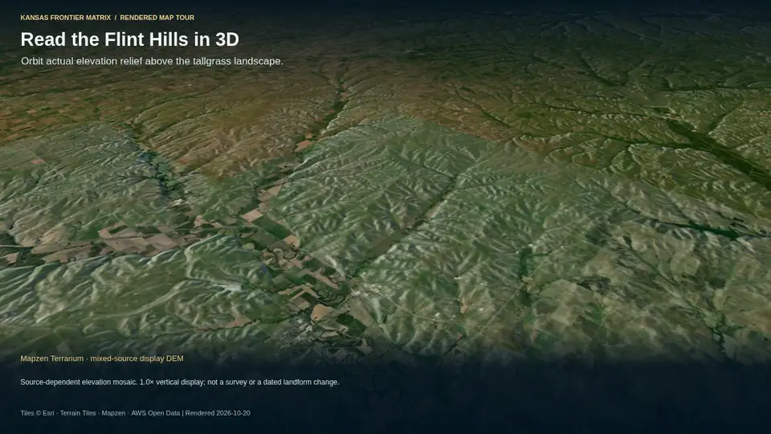
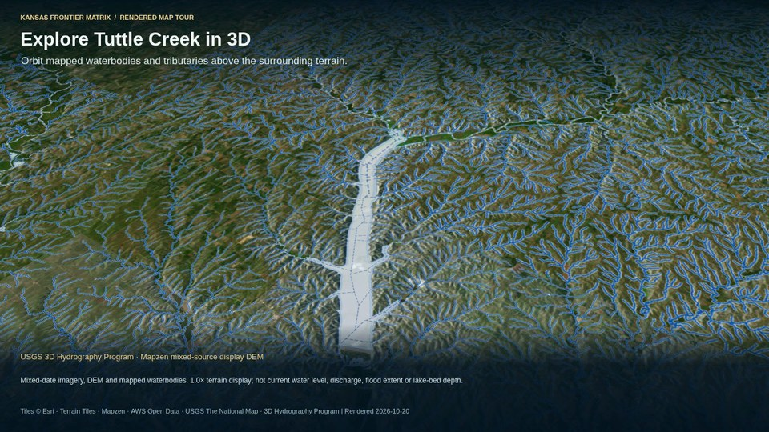
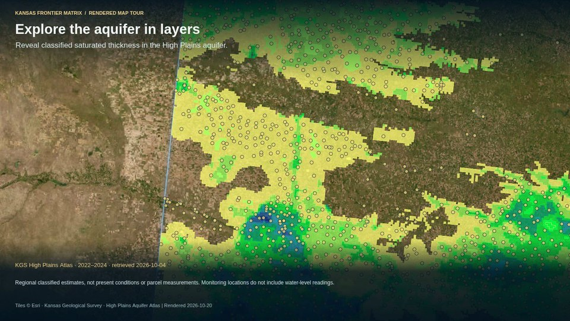
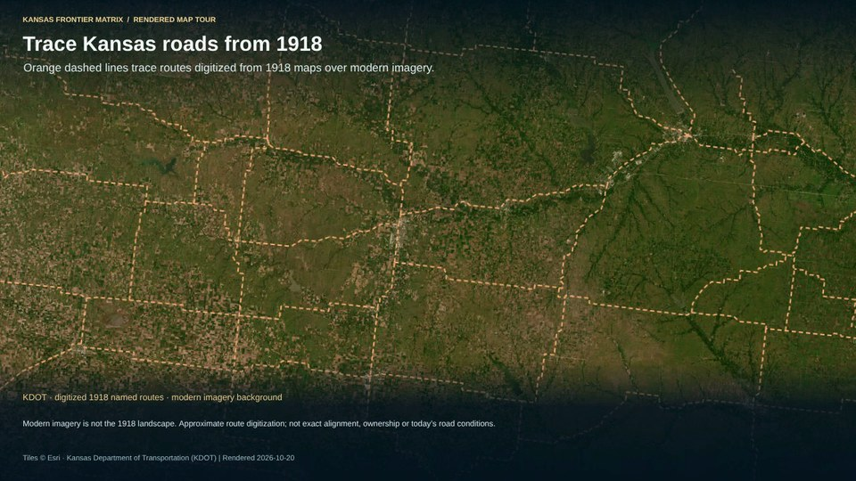
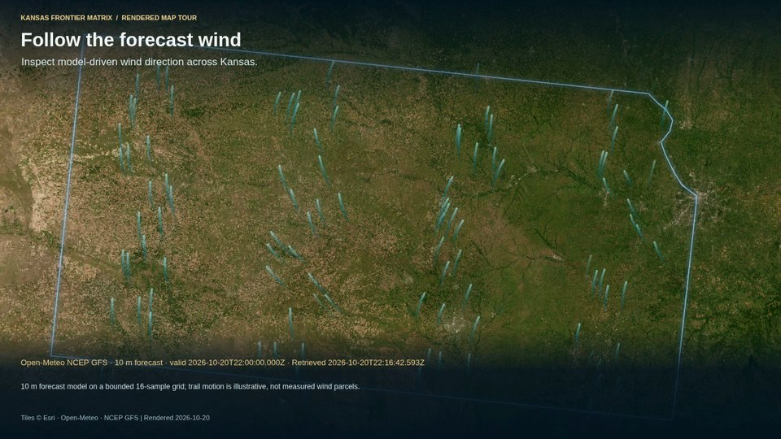
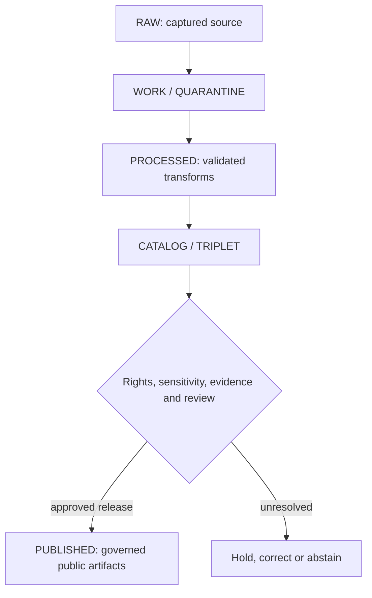

<!-- [KFM_META_BLOCK_V2]
doc_id: kfm://doc/root-readme
title: Kansas Frontier Matrix — Project Home
type: repository-readme
version: v3.6.0
status: source-grounded documentation candidate; independent review pending
owners: ["@bartytime4life"]
created: 2026-05-11
updated: 2026-10-29
policy_label: public
current_path: README.md
owning_root: repository-root
responsibility: repository-wide identity, orientation, contribution, and validation entry point
truth_posture: cite-or-abstain; implementation and validation claims retain exact source identities
base_commit: 17f106d558674ec92a11809bcf3a06c82453777e
hosted_commit: bbcec824fe57e6be0409ba1e35d737fa99581560
media_commit: 974d3b340e619effc91d8da98cf9e67d95119df9
related:
  - docs/doctrine/directory-rules.md
  - docs/adr/ADR-0029-adopt-directory-governance-standard-v2.md
  - docs/runbooks/godaddy-node-hosting.md
  - docs/wiki/Home.md
  - docs/reports/documentation-showcase-qualification-20261027.md
notes:
  - "Recorded display tours are derivatives, not real-time speed benchmarks, live observations, scientific validation or released datasets."
  - "Public Node composition, monorepo and preserved Sites source are different trees."
  - "A native wiki sync remains separate from review of this source packet."
[/KFM_META_BLOCK_V2] -->


# Kansas Frontier Matrix

**Place. Time. Evidence.**

Explore Kansas from river valleys to the ground beneath them. Move through maps,
source dates and recorded observations. Keep the evidence close enough to inspect.

[Open the Explorer](https://kansasfrontiermatrix.com/) · [Watch the visual tour](docs/wiki/visual-tour.md) · [Run the program](#try-it-yourself) · [Read the wiki](docs/wiki/Home.md) · [Inspect the checks](docs/reports/documentation-showcase-qualification-20261027.md)

<picture><source media="(prefers-reduced-motion: reduce)" srcset="docs/brand/readme/kfm-tour-terrain.jpg" /></picture>

*Actual Explorer renderer output: Flint Hills terrain, captured October 20, 2026.
Mixed-source elevation and imagery; 1.0× vertical display. This seven-second rendered
tour is not a recording of real-time performance. [Still image](docs/brand/readme/kfm-tour-terrain.jpg) · [Source and attribution](docs/brand/readme/README.md#recorded-map-tours--october-27-2026).*

## See it in action

**Five glimpses of the program. One source trail for every view.** Select a picture
for its moving tour. Dates and limitations stay visible in the captured image.
Only the hero animates inline; gallery thumbnails are still images.

<table>
<tr>
<td width="50%" valign="top"><a href="docs/brand/readme/kfm-tour-water.webp"></a><br/><strong>Follow the water</strong><br/>Mapped tributaries over Tuttle Creek terrain. Water geometry does not establish present discharge, flood extent or lake-bed depth.</td>
<td width="50%" valign="top"><a href="docs/brand/readme/kfm-tour-groundwater.webp"></a><br/><strong>Look beneath the plains</strong><br/>KGS High Plains classified saturated thickness, 2022–2024. Regional estimates, not parcel measurements or current well levels.</td>
</tr>
<tr>
<td width="50%" valign="top"><a href="docs/brand/readme/kfm-tour-history.webp"></a><br/><strong>Trace an earlier network</strong><br/>Digitized 1918 road routes on explicitly modern imagery. Approximate route alignment, not a reconstructed historic landscape.</td>
<td width="50%" valign="top"><a href="docs/brand/readme/kfm-tour-wind.webp"></a><br/><strong>Read the atmosphere</strong><br/>October 20 GFS 10 m forecast-grid trails. Illustrative motion driven by the model; not measured air parcels or today's forecast.</td>
</tr>
</table>

[Full tour and source guides](docs/wiki/visual-tour.md) · [Exact input/output hashes](docs/brand/readme/showcase-media.json)

## Why KFM

A map becomes more useful when it can explain **where, when, what supports the
result, and what remains unknown**. KFM connects spatial exploration to source
context, temporal limits, inspectable records and reversible engineering.

The interface is an active build. Provider context, admitted evidence, AI discussion
and released KFM data have different authority. A polished map never removes those
differences. [Trust membrane](docs/doctrine/trust-membrane.md) · [Truth posture](docs/doctrine/truth-posture.md).

## Take the tour

The current welcome contains **19 categories in four groups**, verified against the
[category source](https://github.com/bartytime4life/Kansas-Frontier-Matrix/blob/bbcec824fe57e6be0409ba1e35d737fa99581560/app/layer-workspaces.ts) and the public welcome on October 27.
These are navigation choices; this count does not certify every layer or provider.

| Start with | Explore next | Read the implementation guide |
|---|---|---|
| Water & watersheds | Station observations, hydrography and modeled guidance | [Water paths](https://github.com/bartytime4life/Kansas-Frontier-Matrix/blob/bbcec824fe57e6be0409ba1e35d737fa99581560/docs/water-flow-paths.md) |
| Aquifers & groundwater | Aquifer extents, classified estimates and monitoring locations | [Groundwater](https://github.com/bartytime4life/Kansas-Frontier-Matrix/blob/bbcec824fe57e6be0409ba1e35d737fa99581560/docs/aquifers-groundwater.md) |
| Terrain & elevation | Relief, slope, imagery and scene controls | [Terrain](https://github.com/bartytime4life/Kansas-Frontier-Matrix/blob/bbcec824fe57e6be0409ba1e35d737fa99581560/docs/terrain-surface.md) |
| Weather & climate | Wind, radar, satellite and dated lightning products | [Weather](https://github.com/bartytime4life/Kansas-Frontier-Matrix/blob/bbcec824fe57e6be0409ba1e35d737fa99581560/docs/governed-weather.md) · [Lightning](https://github.com/bartytime4life/Kansas-Frontier-Matrix/blob/bbcec824fe57e6be0409ba1e35d737fa99581560/docs/lightning-flash-loop.md) |
| History & transportation | Historic route references, map editions and construction records | [Transport history](https://github.com/bartytime4life/Kansas-Frontier-Matrix/blob/bbcec824fe57e6be0409ba1e35d737fa99581560/docs/transport-construction-history.md) |
| Evidence & research tools | Sources, comparison, saved investigations and draft reports | [Research tools](https://github.com/bartytime4life/Kansas-Frontier-Matrix/blob/bbcec824fe57e6be0409ba1e35d737fa99581560/docs/map-research-tools.md) |

## Things to try

1. Open [the Explorer](https://kansasfrontiermatrix.com/), choose **Water & watersheds**, and inspect a tour's source/date/limitation caption.
2. Open its map and inspect the available layers. Distinguish mapped channels from a station observation or a forecast.
3. Explore **Aquifers & groundwater**. Read the regional class legend before drawing a local conclusion.
4. Use **Time**, **Layers** and the research tools to keep the chosen place and source period explicit.

These are exploration prompts. Network availability and installed/admitted coverage
still determine what a particular request can return.

## Travel through time

KFM offers several kinds of time: observation time, source edition, forecast valid
time and historical reference. A control's selected year does not make every visible
layer valid in that year. Missing imagery stays missing; modern backgrounds remain
modern. [History comparison](https://github.com/bartytime4life/Kansas-Frontier-Matrix/blob/bbcec824fe57e6be0409ba1e35d737fa99581560/docs/history-comparison.md) · [Calendar and time sweep](https://github.com/bartytime4life/Kansas-Frontier-Matrix/blob/bbcec824fe57e6be0409ba1e35d737fa99581560/docs/compact-calendar-time-sweep.md).

## Where the data comes from

The program integrates attributed external-provider context, with separate capture,
validation and governed release machinery in the monorepo. The tour manifest names
USGS, KGS, KDOT, Mapzen, Esri and Open-Meteo/GFS roles for these particular views.
Provider rights and attribution remain attached; KFM's code license does not
relicense provider data. [Connectors](connectors/README.md) · [Curated-source installer](docs/runbooks/github-data-baseline.md).

## How KFM protects meaning

This is the **governed lifecycle**, not a claim that every public provider overlay
has completed it. [Lifecycle law](docs/doctrine/lifecycle-law.md) and
[the trust membrane](docs/doctrine/trust-membrane.md) define the boundary.



Promotion is a governed transition. `EvidenceRef` resolves through an
`EvidenceBundle`; maps, tiles, graphs, summaries and AI remain carriers.
The governed outcome vocabulary is **ANSWER / ABSTAIN / DENY / ERROR**.

Historical private enrichment: [USGS water](docs/runbooks/historical-water-enrichment.md) and
[NOAA monthly climate normals](docs/runbooks/historical-climate-normals-enrichment.md)
replay preserved captures into pinned WORK review packages with release authority disabled.

## Build status at a glance

**Verified October 27, 2026, for the declared revision and environment.**

| Evidence | Result | Scope |
|---|---|---|
| Public Node source `bbcec824` | Exact-lock `npm ci`, production build and TypeScript completed | Local Linux execution host; no hosted-source parity claim |
| Node application suite | **1,934 passed · 19 skipped · 0 failed** out of 1,953 tests | Existing program tests; synthetic/isolated coverage is not real-provider acceptance |
| Five documentation tours | Source hashes, finite playback, dimensions, duration and decoded motion checked | Derived recorded display pixels; not live readings or an FPS benchmark |
| Public welcome | Category screen and water-tour selection inspected in Chrome | Bounded browser observation, not whole-site or device acceptance |
| Remaining acceptance | **NEEDS VERIFICATION** | Provider health, full accessibility/device matrix, sustained performance, scientific validation and release closure |

Commands, skip boundaries and review limits are in the [qualification record](docs/reports/documentation-showcase-qualification-20261027.md).

## Which source should I use?

| Work | Source |
|---|---|
| Public Explorer UI, server routes and hosted AI | Separate [`a0-hosted-ai-web-20261017` tree](https://github.com/bartytime4life/Kansas-Frontier-Matrix/tree/bbcec824fe57e6be0409ba1e35d737fa99581560); this edition tested `bbcec824fe57e6be0409ba1e35d737fa99581560` |
| Contracts, schemas, connectors, validators and release support | This monorepo's `main`; root npm commands report intentional `WORKFLOW_HOLD` |
| Preserved Sites lineage | [apps/site/](apps/site/README.md), with its own source, lockfile and checks |
| Wiki orientation | Reviewable [docs/wiki/](docs/wiki/README.md); native sync follows source review |

[Hosting/source runbook](docs/runbooks/godaddy-node-hosting.md). A later main merge or
site publication has its own identity; it does not retroactively change this test run.

## Try it yourself

Use a separate checkout for the **public Node composition**. These are the tested
source revision and build commands; application startup/provider setup remain
separate from the tests performed here.

```bash
git clone --single-branch --branch a0-hosted-ai-web-20261017 https://github.com/bartytime4life/Kansas-Frontier-Matrix.git kfm-public-review
cd kfm-public-review
git checkout --detach bbcec824fe57e6be0409ba1e35d737fa99581560
npm ci
npm run build
PORT=5187 npm start
```

Use Node.js `>=22.13.0`. Chat requires separately configured server-side inference;
provider map layers require network access. Read the [hosting runbook](docs/runbooks/godaddy-node-hosting.md)
before changing settings. The [installation guide](docs/installation.md) covers the
monorepo, preserved Sites app and separate local-data tools.

## Start here

| You want to… | Open |
|---|---|
| See the experience | [Visual tour](docs/wiki/visual-tour.md) |
| Evaluate the engineering | [Case studies](docs/wiki/engineering-case-studies.md) · [This edition's tests](docs/reports/documentation-showcase-qualification-20261027.md) |
| Find a responsibility root | [Repository map](#repository-map) · [Directory Rules](docs/doctrine/directory-rules.md) |
| Run source or store local data | [Installation](docs/installation.md) · [Local data store](docs/runbooks/local-pc-data-store.md) |
| Review trust or contribute | [Doctrine](docs/doctrine/README.md) · [CONTRIBUTING](CONTRIBUTING.md) · [SECURITY](SECURITY.md) |

## Contributing

Choose a bounded, reversible improvement. Inspect governing material and source,
state exact base/head, check overlap, run proportionate validation and open a draft
with remaining unknowns and rollback. [Contributor guide](CONTRIBUTING.md).

## FAQ

**Is the Explorer public?** The website was reachable and its welcome inspected in
this session. That observation does not certify uptime or every route.

**Are the moving images live?** No. They are dated renderer tours. Their camera
motion is assembled from captured frames, and wind trails are illustrative.

**Does a map layer mean KFM has released the data?** No. External context and
governed releases retain separate identities. See [lifecycle law](docs/doctrine/lifecycle-law.md).

**What does AI contribute?** The public app has [server-mediated discussion](https://github.com/bartytime4life/Kansas-Frontier-Matrix/blob/bbcec824fe57e6be0409ba1e35d737fa99581560/docs/public-hosted-ai.md).
Generated discussion is interpretive and unverified; it cannot replace evidence,
policy, approval or release state. Current live model/worker operation was not tested here.

## Current posture

An active, inspectable build with a runnable public application source and extensive
bounded tests. Read [Project Status](docs/wiki/Project-Status.md) for the source split
and exact qualification. Neither visual polish nor a passing test suite establishes
production readiness, security certification or scientific validity.

## Repository map

| Responsibility | Owning root |
|---|---|
| Human doctrine, design, decisions and runbooks | [docs/](docs/README.md) |
| Deployable apps and reusable adapters | [apps/](apps/README.md) · [packages/](packages/README.md) |
| Meaning, shape and admissibility | [contracts/](contracts/README.md) · [schemas/](schemas/README.md) · [policy/](policy/README.md) |
| Source capture and transformations | [connectors/](connectors/README.md) · [pipelines/](pipelines/README.md) |
| Lifecycle records and release decisions | [data/](data/README.md) · [release/](release/README.md) |
| Verification and operator tooling | [tests/](tests/README.md) · [tools/](tools/README.md) |

Placement follows adopted [Directory Rules](docs/doctrine/directory-rules.md) and
[ADR-0029](docs/adr/ADR-0029-adopt-directory-governance-standard-v2.md).

## Validation

Run the command for the component under review. This edition ran `npm test`
(build plus Node tests) and `node_modules/.bin/tsc --noEmit` in the pinned standalone
application. Root npm scripts intentionally fail with `WORKFLOW_HOLD`; they are
not substitute application checks. See [performed checks and limitations](docs/reports/documentation-showcase-qualification-20261027.md)
and [Development and Validation](docs/wiki/Development-and-Validation.md).

## Governing principles

Evidence outranks fluency. Public access crosses governed boundaries. Sensitive
material fails closed. Generation and approval stay separate. Corrections,
supersession and rollback remain traceable. [KFM doctrine](docs/doctrine/README.md).

## A finished KFM with a Science Pack

**PROPOSED north-star:** a versioned, governed cross-domain science workbench.
There is no claim here that a single installable, admitted, scientifically qualified
Science Pack exists. [Verification backlog](docs/registers/VERIFICATION_BACKLOG.md).

The [scientific-analysis guide](docs/architecture/scientific-analysis.md) develops
seven directions for that program: measurement support, uncertainty propagation,
spatial and temporal validation, Bayesian model checking, causal study design,
inverse problems, and experimental design. Four Kansas study proposals show how
to test an idea before treating it as a capability. These are research designs,
not newly implemented analytical services.

## Current edges and non-goals

This documentation update changes presentation, navigation and source-bound claims.
It does not admit data, configure inference, change access, deploy the app, merge
code or authorize a release. The retained legacy SVGs are explicitly illustrative;
the five new tour previews are recorded display derivatives with their own manifest.

## Project references

[Documentation](docs/README.md) · [Wiki sources](docs/wiki/README.md) · [Source/hosting](docs/runbooks/godaddy-node-hosting.md) · [LICENSE](LICENSE) · [CITATION.cff](CITATION.cff) · [CHANGELOG](CHANGELOG.md) · [Verification backlog](docs/registers/VERIFICATION_BACKLOG.md)

## Last evidence review

Monorepo `17f106d558674ec92a11809bcf3a06c82453777e` and standalone application `bbcec824fe57e6be0409ba1e35d737fa99581560`;
October 27, 2026. Media is pinned independently at `974d3b340e619effc91d8da98cf9e67d95119df9`.
The [qualification record](docs/reports/documentation-showcase-qualification-20261027.md) is the detailed account of this edition's
execution, source limits, placement, risks and rollback. Native wiki synchronization
and independent review remain separate steps.
