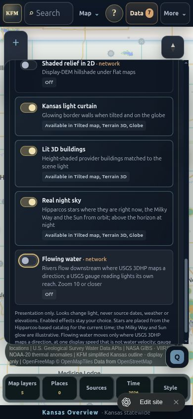
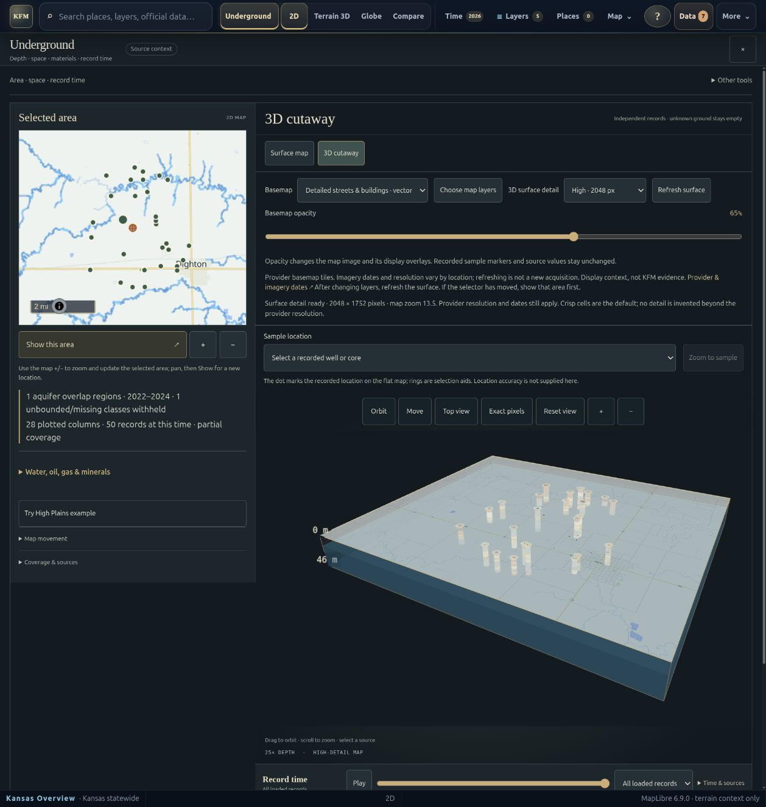

# Site v232 source mirror verification — 2026-10-11

This review candidate imports the v232 fixes from clean Site source
`2e35af50b61655cf2775f8db33b13b8055cc5779` onto GitHub main
`8e2afd9d13512f7634dc3e9bf2ed1edd37705d29`. The same owner-private Site project is
`appgprj_6aa0b1c41bc08191bfd86003920f1631`, saved version **232**, deployment
`appgdep_6acbf0168b24819185b1c741309af0f6` (`succeeded`).

The [source verification record](source/docs/explorer-scene-verification-20261011.md)
records the prior actual browser journeys and synthetic performance measurement.
The [mirror receipt](../../data/receipts/generated/site-v232-privacy-scene-overlay-20261011.json)
binds the complete current mirror inventory to source hashes and retained overlays.
Source and overlay review remains **PENDING**. Recorded byte parity does not
establish human acceptance or hosted equivalence.

## Fixes and integration

- Reports and newly saved workspaces suppress private viewport/analysis geometry,
  point coordinates and coordinate-bearing measurement labels. Both the current
  privacy state and immediate browser-location ref guard are covered by actual
  report-builder regressions using synthetic coordinates. Existing saved data is
  retained; ordinary public exports still contain their intended geometry.
- Historical-map search initialization does not read a private camera while
  requests are held. Clearing privacy after Fit Kansas uses the generalized
  Kansas fallback; deliberate public-center searches remain supported. Actual
  initializer/request-effect regressions cover both journeys without real GPS.
- Scene cards distinguish Off, paused, waiting and supported views; stable switch
  names keep associated descriptions. The final CSS specificity repair leaves
  all seven cards at opacity 1. Keyboard and phone observations are recorded below.
- Capped river geometry counts only represented reaches and gauge cues and
  explicitly retains loaded-versus-drawn coverage. Gauge-only sourcedata changes
  notify listeners once after metrics are computed. Terrain queue preparation
  computes distance once per vertex without changing exact ordering.
- v230 governed-water integrity checks carried in v232 recompute captured inner
  candidate, record and validation identities, preserve Python numeric spelling,
  and reject invalid revision chronology or inconsistent latest observations.
  The merge retains the repository's exported `same()` and shared `releaseGate()`
  interfaces used by weather.

The 17-path Site delta was applied, with only `app/governed-water.ts` requiring
manual reconciliation of an exported shared helper. `app/page.tsx` retains the
newer Reviewed daily weather control. All 21 repository-only weather paths and
the other seven inherited overlay files retain their base bytes; the two
reconciled overlay files retain their integration behavior. Both canonical
basemap tool mappings remain unchanged. The new inventory records **954 mirror
files: 924 identical, nine inherited overlay files and 21 repository-only files**.
The source has 935 tracked paths, including the two tools mapped outside the mirror.
The predecessor receipt is preserved verbatim; only the content-parity selector
moves to the new pending receipt.

## Validation of this mirror candidate

All commands ran in an isolated clone with its own locked dependencies. The
build finished before the Node tests. Python used a fresh venv with the
repository's hash-locked `water-pilot` installation profile; an initial attempt
in an unrelated pre-existing venv could not collect tests because dependencies
were missing and was not counted as validation.

| Check | Command | Result |
| --- | --- | --- |
| Production build | `cd apps/site/source && npm run build` | PASS |
| TypeScript | `cd apps/site/source && node_modules/.bin/tsc --noEmit -p .` | PASS |
| Whole-app lint | `cd apps/site/source && npm run lint` | PASS, zero errors; 64 warnings remain |
| Full application tests | `cd apps/site/source && node --test tests/*.test.mjs` after build | 1,069 passed, zero failed or skipped |
| Python water/release/API/mirror/startup tests | `python -m pytest -q tests/connectors/usgs/water_data tests/domains/hydrology/test_usgs_water_normalizer.py tests/packages/release tests/packages/connectors_core apps/governed-api/tests tests/tools/test_water_job.py tests/tools/test_water_release.py tests/qa/test_site_mirror.py tests/qa/test_site_smoke.py` | 317 passed |
| Isolated local backend | `SITE_PORT=4178 bash apps/site/smoke-local.sh` | 76 checks across 59 routes; nine provider-only routes listed, not probed |
| Recorded mirror bytes | `python tools/qa/site_mirror.py --check` | PASS, 954 files; review acceptance NOT_EVALUATED |
| Repository topology | `python tools/validators/directory_governance/validate_repository_topology.py --repo-root .` | PASS, zero new drift/invariant failures; 113 baselined warnings |
| Generated authoring receipt | `python tools/validators/validate_generated_receipt.py data/receipts/generated/genrec-site-v232-source-mirror-20261011.json` | Shape and final artifact SHA-256 bindings PASS; human review pending |
| Patch whitespace | `git diff --cached --check` | PASS |

The application suite includes the four actual-builder/initializer privacy
regressions, water identity/staging regressions, weather regressions, real
sourcedata notification callback tests, segment-cap accounting, reduced-motion,
hidden-tab and cleanup checks. The mirror receipt records aggregate results and
SHA-256 hashes of local logs. Raw logs and private audit artifacts are not added.

## Previously captured browser evidence

These screenshots were visually inspected before copying. They show the public
High Plains example and effect states; real GPS was not requested. They are
source/browser evidence from the prior Site verification, rather than a browser
acceptance claim for the merged repository weather overlay.

Published v232 at measured 390 × 844 CSS pixels. The 320 × 640 check also had no
horizontal overflow. Space toggled water; Escape returned focus to the trigger.
All seven effect cards had computed opacity 1. Battery saver and original effect
preferences survived reload on the isolated origin before restoration.

The reconciled v230 source candidate carrying the v232 patch retained its
2048 × 1752 surface at map zoom 13.5 through a Through-2000 record update and
completion. The source record documents the High Plains example's explicit
partial coverage. This screenshot is evidence for that journey, not every
provider/device sequence or a new mirror browser run.

## Preservation and review limits

The user checkout, dirty source candidate and unrelated worktrees were not
modified. Existing ports 4173/4175, local data, preferences and settings were
preserved. The backend smoke used a fresh throwaway D1/R2 state and its own port,
then stopped only its process group. This PR adds no storage migration, binding
change, dependency/lockfile change, service cutover, Site deployment or data
activation. It grants no source admission, release or publication authority.

Human review, hosted equivalence, screen-reader/touch hardware, OS reduced-motion
settings, WebGL-loss recovery and long-session/performance acceptance remain
separate. Bounded static review and repaired findings are not a whole-system
security clearance. The terrain benchmark measures synthetic queue ordering,
not frame rate or provider latency.

Rollback: revert this PR as a unit, including the content-parity selector and
new receipt. The predecessor receipt and the live owner-private Site remain
available; no local data reset or migration rollback is needed.
