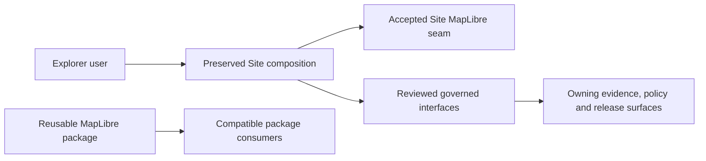

<!-- [KFM_META_BLOCK_V2]
doc_id: kfm://doc/adr-0005-apps-explorer-web-canonical-map-first-shell
adr_id: ADR-0005
title: "ADR-0005 — Explorer browser composition and trust boundary"
type: adr
version: v2.0
status: proposed
effective_decision_status: proposed
owners: ["@bartytime4life"]
reviewers_required: ["Architecture steward", "Site subsystem owner", "API and security reviewers", "Docs steward"]
created: 2026-05-09
updated: 2026-11-19
policy_label: public
truth_posture: "PROPOSED composition decision; source observations at a pinned revision"
responsibility_root: docs/
owning_root: docs/
responsibility: "Propose Explorer composition ownership while preserving accepted renderer boundaries and separate source, release and operational decisions."
current_path: docs/adr/ADR-0005-apps-explorer-web-is-the-canonical-map-first-shell.md
supersedes: []
superseded_by: []
evidence_snapshot:
  repository: bartytime4life/Kansas-Frontier-Matrix
  base_commit: c47f52e185bd1c6540801af8551c75cf12e6cbb6
  prior_record_blob: 8a57e48d4edbf5ca342d57e8ca89f2d9200366a9
  historical_implementation_commit: ca79de9b61b0a2da948940b07c89c558f480470e
  retirement_commit: 1142ff16c50af20dd3496bbea79b694d6cbd809b
related:
  - docs/adr/INDEX.md
  - docs/adr/ADR-0006-maplibre-boundary--only-maplibreadapter-imports-maplibre.md
  - "docs/adr/ADR-0007 — MapLibre GL JS Is the Sole Browser-Side Renderer.md"
  - docs/adr/ADR-0050-bounded-site-subsurface-three-scenes.md
  - docs/reports/adr-review-2026-11-19.md
  - apps/site/source/AGENTS.md
notes:
  - "Rewrites an unaccepted proposal; preserves permanent ID, legacy filename, anchors and prior Git history. No acceptance or operational transition."
[/KFM_META_BLOCK_V2] -->

# ADR-0005 — Explorer browser composition and trust boundary

**Proposed decision:** use the preserved `apps/site/source/` application as the
existing Explorer composition home. Keep shared MapLibre implementation in
`packages/maplibre/` and use the Site seam already permitted by ADR-0006 §2.6.
Do not recreate the retired `apps/explorer-web/` shell as a competing application.

This is a rewrite of an **unaccepted proposal**. It selects no deployment,
audience, source admission or release. Its permanent ID and legacy filename are
retained so existing links continue to resolve.

## Status

| Field | State |
|---|---|
| Source and effective status | `proposed`; unchanged |
| Decision owner and review route | `@bartytime4life`; architecture, Site, API, security and docs review required |
| Implementation observation | Site source exists; the proposed old shell is retired |
| Accepted constraints | ADR-0006 including its Site exception; ADR-0007; ADR-0029; ADR-0048 |
| Supersession | None; revises this proposal, not an accepted decision |
| Operational effect | None |

## Repository evidence

Review base: `main@c47f52e185bd1c6540801af8551c75cf12e6cbb6`.

| Evidence | Observation and limit |
|---|---|
| `apps/explorer-web/` | Absent. Retirement commit `1142ff16c50af20dd3496bbea79b694d6cbd809b` removed its implementation, policy guard and workflows. Historical commands are not current checks. |
| [`apps/site/source/app/page.tsx`](../../apps/site/source/app/page.tsx) and [`package.json`](../../apps/site/source/package.json) | Existing Explorer source with its own build, routes and manifest; not proof of the current hosted revision. |
| [`apps/site/source/AGENTS.md`](../../apps/site/source/AGENTS.md) | Preserve same-Site project `appgprj_6aa0b1c41bc08191bfd86003920f1631`, unpublished source and storage bindings. |
| [`MapLibre Site seam`](../../apps/site/source/app/maplibre-seam.ts) | Local seam exists under the accepted ADR-0006 exception. Package and Site manifests both declare `maplibre-gl` 6.9.0. |
| [`apps/governed-api/`](../../apps/governed-api/README.md) | Separate governed API application remains. This review does not establish that every Site route is integrated with it. |
| [`apps/README.md`](../../apps/README.md#current-app-map) | Current app inventory also includes operator/review/land-record surfaces. Those are distinct duties, not duplicate Explorer shells. |
| [ADR review](../reports/adr-review-2026-11-19.md) | Records the review scope, dispositions and unresolved Three.js exception. |

The earlier Living Atlas evidence at
`ca79de9b61b0a2da948940b07c89c558f480470e` describes the retired app. Its inline
fixtures, browser runs and import guards do not establish current Site coverage.
The previous document is retained in Git history at the review base.

## Context

The old proposal named a shell that no longer exists. A correction banner was
added, but the main decision, badges and implementation tables still described
that shell as mounted and current. Starting another shell from those directions
would duplicate the preserved Site and lose its existing integration boundaries.

The decision needed now is application composition ownership. It is distinct
from renderer-family selection, model/provider orchestration, source admission,
public release and the currently hosted application.

## Proposed decision

1. Keep Explorer routing, map/time/layer/selection state, accessibility, local
   workspace state and application-specific presentation in `apps/site/source/`.
2. Preserve its same-Site identity and advanced unpublished source. Reconcile
   changes through reviewed successor receipts; never replace it with an older
   monorepo shell or another Site.
3. Keep reusable MapLibre implementation in `packages/maplibre/`. The separately
   built Site uses its one runtime seam, one stylesheet seam and own manifest as
   already permitted by accepted ADR-0006 §2.6.
4. Do not introduce another normal browser-map renderer through this ADR.
   Three.js subsurface use requires the separate proposed
   [ADR-0050](./ADR-0050-bounded-site-subsurface-three-scenes.md); its presence in
   source is not accepted exception evidence.
5. Do not recreate `apps/explorer-web/` as a second independently writable
   Explorer application. A later relocation or consolidation needs its own
   reviewed compatibility and preservation plan.

## Authority and delivery boundary

| Concern | Proposed boundary |
|---|---|
| Public dynamic claims | Follow the reviewed governed API/envelope path. ADR-0004 and ADR-0025 remain proposals; this review does not declare every current Site API route conformant. |
| External context and owner captures | Keep provider provenance, explicit limitations, owner checks, quarantine/review state and separate release decisions. Successful JSON or a rendered result does not grant publication authority. |
| Static public artifacts | Require the owning release, integrity, rights/sensitivity, correction and rollback support. A static file is not an independent source of permission. |
| Models and AI | Remain downstream of reviewed evidence/policy/orchestration. Existing direct-provider code is implementation to assess, not approval created by this ADR. |
| Operator and review apps | Retain their separate roles and access boundaries; do not fold them into public Explorer composition by naming convention. |
| Canonical data and release | Remain with their existing owning contracts, schemas, policy, lifecycle and release surfaces. |

## Renderer boundary

MapLibre remains the normal browser-map family under accepted ADR-0007. The Site
exception in ADR-0006 is a packaging/acquisition exception, not a blanket peer
renderer, plug-in, network-source or publication exception. Preserve the exact
Site seam paths and their acquisition checks. Do not require rebuilding the
retired consumer to demonstrate current conformance.

## Canonical architecture if accepted

This is the proposed responsibility map, not a claim that every runtime path
already follows it. The preserved separately built Site and reusable package
have different build boundaries; the diagram does not add an import edge.

## Operational invariants

Preserve source identity, owner/private boundaries, storage bindings, privacy,
finite failure states, source observation times and review/withdrawal state.
Keep renderer and request cleanup bounded. Never infer source admission,
accuracy, safe conditions or release from a map, a fixture, a screenshot or CI.
No physical storage migration is part of this proposal.

## Consequences

Maintainers get one discoverable Explorer composition home and stop following
retired commands. The independently built Site still needs local seam checks and
receipt maintenance. Package reuse is limited by the Site build boundary.
Current API/provider and peer-renderer conformance remain separate work; naming
the app does not resolve them.

## Alternatives considered

| Option | Assessment |
|---|---|
| Preserve Site composition and its explicit seam | Selected proposal: retains working source and same-Site identity without inventing a second shell. |
| Restore `apps/explorer-web/` | Rejected as this proposal's direction: duplicates the retired consumer and requires an unplanned source/storage/preservation migration. |
| Force Site onto the reusable package immediately | Deferred: accepted ADR-0006 documents that the separately built Site cannot currently consume it; requires a proven build and capability migration. |
| Leave the obsolete proposal unchanged | Retains conflicting currentness claims and retired validation commands. |

## Implementation, migration and compatibility

This revision changes documentation only. Keep the ADR ID, file path and old
section anchors. On acceptance, reconcile application/root guidance with the
selected composition; inventory Site API and renderer paths; close the scoped
conformance questions before dependent changes. Do not move or delete app
source, rewrite old receipts, alter external mirror names or change storage.
Any future relocation must preserve a recovery point, inbound links, bindings,
advanced Site source and a tested rollback.

## Validation and acceptance

The ADR index validator checks identity/status/link coherence. The review report
records the focused tests run for this packet. Those checks do not accept this
proposal or verify the hosted Site.

Acceptance requires a recorded owner/architecture decision on composition,
confirmation of the Site preservation/build boundary, and an implementation
inventory that separates governed public data from external/owner-only context.
Browser, provider, deployment and storage acceptance remain separately scoped.
No new runtime implementation is claimed by this rewrite.

## Rollback and supersession

Revert the documentation packet and its index/receipt changes together if its
facts are wrong. The previous proposed text remains available in Git history.
No accepted decision is superseded and no operational rollback is executed.
A future material change to accepted architecture needs a scoped accepted
successor or exception with linked history.

## Open verification backlog

- Record acceptance or rejection of this revised composition proposal.
- Review ADR-0050 before treating Three.js use as a conforming exception.
- Map current Site API/provider routes to their actual trust and audience gates.
- Verify browser support, current hosted revision and provider/storage behavior
  only in separately authorized proof lanes.

## Change history

| Date | Revision |
|---|---|
| 2026-11-19 | Rewrote the unaccepted retired-shell proposal around the preserved Site composition, kept the permanent ID/path/anchors, and retained historical evidence references. No status transition. |
