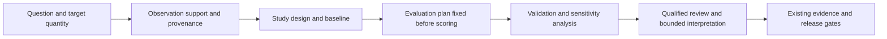

<!-- [KFM_META_BLOCK_V2]
doc_id: kfm://doc/architecture/scientific-analysis
title: Scientific Analysis - Questions, Methods, and Validation
type: architecture
version: v0.2.0
status: proposed; explanatory design guide; review required
owners: ["@bartytime4life"]
created: 2026-10-29
updated: 2026-11-26
policy_label: public
owning_root: docs/
responsibility: Explain how scientific study design, uncertainty, and validation can connect KFM domains without creating a second contract or policy authority.
truth_posture: "CONFIRMED inspected references and repository interfaces; PROPOSED analytical studies; NEEDS VERIFICATION scientific qualification and runtime integration"
related:
  - ./spatial-foundation.md
  - ./cross-domain/README.md
  - ./cross-domain/vegetation-stress.md
  - ../standards/PROVENANCE.md
  - ../../contracts/validation/precommitted_evaluation_record.md
  - ../../contracts/evidence/planning_proxy_uncertainty_assessment.md
  - ../../contracts/governance/model_card_envelope.md
  - ../wiki/README.md
[/KFM_META_BLOCK_V2] -->

# Scientific analysis: questions, methods, and validation

KFM can connect maps to scientific investigations by making the question,
measurement model, assumptions, comparison, and possible failure visible together.
This guide develops that **PROPOSED** analysis program. It does not establish an
installed Science Pack, a qualified model, admitted observations, or an analysis API.

**Evidence checkpoint:** repository `main@01bf54386be6d4c727373726587e32a24a73e6af`,
inspected October 29, 2026. External references below explain methods; their
inclusion is not KFM adoption or software conformance. The November 26 worked
example below has its own execution boundary; the October interface inventory
remains historical and is not requalified by running a documentation snippet.

## Begin with a question that could be wrong

Describe the target quantity, population or region, spatial support, time window,
and intended use before selecting a model. Separate a descriptive question
("where do these recorded conditions overlap?"), a predictive question ("what
would be observed at a withheld station?"), and a causal question ("what would
change under a specified intervention?"). They require different evidence.



This is a proposed research workflow, not an implemented execution graph.

## Seven useful scientific directions

### 1. Treat observations as measurements with support

A result belongs to an observed property, feature or sample, procedure, and time.
A soil sample, satellite footprint, stream gauge, and county statistic have
different supports. Resampling them onto one grid does not make those supports
equivalent. The OGC observation and sampling model provides useful vocabulary
for recording these distinctions. [S1](#reference-s1)

**KFM proposal:** carry units, coordinate reference system, vertical reference
where applicable, sampling geometry, observation interval, procedure, detection
limits, and missingness into comparisons. State whether a value is measured,
derived, modeled, or a contextual proxy. Do not interpret a missing observation
as a measured zero. Use the existing [spatial foundation](spatial-foundation.md)
and owning contracts rather than introducing a new observation schema here.

### 2. Propagate uncertainty, including dependence

For a differentiable measurement model `y = f(x)`, a first-order approximation is
`u²(y) = J Σ Jᵀ`: `J` contains sensitivities and `Σ` contains input variances and
covariances. Shared calibration and processing can create correlated errors.
Dropping covariance requires justification. [S2](#reference-s2)

For nonlinear transformations, propagate a defensible joint input distribution
through the model with Monte Carlo simulation; inspect numerical convergence
and sensitivity to distribution assumptions. More simulations cannot repair
an omitted error source or an unsuitable measurement model. [S3](#reference-s3)

**KFM proposal:** distinguish measurement, geolocation, temporal, parameter,
and structural uncertainty. Label the interval type and assumptions. Keep
scenario spread separate from a calibrated probability interval.

### 3. Test spatial and temporal transfer explicitly

Randomly holding out neighboring records can leave substantial dependence
between training and evaluation data. Choose spatial, temporal, or grouped
holdouts to match the intended prediction task; blocking can itself introduce
extrapolation, which must be disclosed. [S4](#reference-s4)

**KFM proposal:** compare an analytical model with simple persistence, seasonal,
or regional baselines on the same locked evaluation set. Fit preprocessing,
feature selection, and tuning inside the training process. Reserve the final
holdout for evaluation. Report station or region coverage, error, bias, and
failure cases, not just one pooled score. Check whether conclusions survive
reasonable changes in aggregation scale and boundary definitions.

### 4. Use Bayesian models as inspectable hypotheses

Bayesian inference combines a declared likelihood and prior into a posterior.
The workflow also needs prior predictive checks, computational diagnostics,
posterior predictive checks, and model comparison. [S5](#reference-s5)

**KFM proposal:** investigate partial pooling where sparse stations or regions
share a defensible process. Record prior sensitivity and held-out behavior.
Pooling across incompatible instruments, supports, or source roles needs a
scientific argument. A narrow posterior under a misspecified model is not
evidence of universal certainty; a model probability is not an AI confidence
badge or an authorization decision.

### 5. Keep causal attribution separate from map association

A causal study needs a defined intervention, outcome, comparison, time origin,
and identification assumptions. Consistency, exchangeability, and positivity
are central considerations; a diagram alone cannot establish them. [S6](#reference-s6)

**KFM proposal:** begin watershed or land-cover studies with a causal diagram
and a written account of confounding, selection, timing, and plausible spillovers.
Where these assumptions cannot be supported, report bounded association and
abstain from causal attribution. Do not infer a private operator's responsibility
from aggregate geography. Use the existing
[cross-domain boundaries](cross-domain/README.md).

### 6. Preserve alternative subsurface and process explanations

Inverse problems can admit multiple parameter combinations consistent with the
available observations. Calibration does not eliminate predictive uncertainty;
model simplification and parameter constraints also matter. USGS guidance on
PEST examines these distinctions and the value of additional observations.
[S7](#reference-s7)

**KFM proposal:** compare plausible groundwater or geological realizations,
document identifiability limits, and test predictions on withheld observations.
Check units, feasible parameter bounds, and physical balances where the model
actually represents those processes. A visually smooth 3D surface is a
representation choice, not independent evidence of subsurface continuity.

### 7. Design experiments and collect informative evidence

Experimental design starts with objectives, controlled factors, responses,
and an advance plan. Blocking, randomization, and confirmatory runs can help
separate effects from nuisance variation. [S8](#reference-s8)

**KFM proposal:** use synthetic experiments to compare candidate methods before
requesting new observations. Then evaluate which permitted measurements would
best distinguish the competing explanations. Document cost, sampling bias,
access, rights, and sensitivity. Do not generalize a laboratory or simulation
experiment into a causal claim about an observational landscape without an
appropriate design.

## A small uncertainty calculation

**Synthetic teaching example, not Kansas measurements.** Two water-level estimates
with the same spatial support, averaging duration, and vertical reference are
`before = 10.0 m` and `after = 9.5 m` in their respective observation windows.
Each has standard uncertainty `0.2 m`. Suppose a justified error model gives
correlation `ρ = 0.75` between their errors.

```text
change = after - before = -0.5 m
u²(change) = 0.2² + 0.2² - 2 × 0.75 × 0.2 × 0.2 = 0.02 m²
u(change) = sqrt(0.02) = 0.141421... m
```

Assuming independence instead gives `0.282843... m`. The example illustrates
why covariance matters for a difference; correlation does not always reduce
uncertainty for other functions. These are standard uncertainties, not a
stated 95% interval. Without a supported correlation model, record that gap.

## Four bounded Kansas study proposals

All four are **PROPOSED designs**, not performed experiments or released products.

| Study | First comparison | Evidence and validation needed | Interpretation to withhold |
|---|---|---|---|
| Watershed rainfall and flow | A declared flow target against persistence and a seasonal baseline | Compatible observation intervals, catchment support, quality flags, forward-time and held-out-catchment evaluation; investigate error and bias | Flood safety, causal land-use attribution, or operational forecasts from context alone |
| Soil, vegetation, and heat | A declared vegetation proxy against a seasonally matched baseline | Land-cover and phenology context, cloud and missingness treatment, spatial holdouts, sensitivity to aggregation; retain proxy identity | Plant disease, field-level crop loss, or a direct root-zone measurement from surface context |
| Groundwater and geology | Alternative process/parameter realizations against withheld observations | Coordinate and vertical references, provenance, feasible constraints, identifiability and predictive checks | A uniquely known subsurface, private-well inference, or certainty from an interpolated rendering |
| Historical transport maps | A stated feature on two source editions after documented registration | Edition identity, control-point residuals, positional uncertainty, missing-sheet coverage, independent checks | A road opening/closure date from a pixel difference or a gap between editions |

For vegetation work, reuse the
[existing cross-domain proposal](cross-domain/vegetation-stress.md). Historical
map study retains the [current source/rights boundary](../../apps/site/source/docs/HISTORIC_ROAD_MAP_STUDY.md).
No study authorizes admission, collection, public use, or a new release.

## Existing repository anchors and their limits

These paths were inspected at the evidence checkpoint. Their existence does
not establish an integrated scientific engine; the targeted code/tests were
not executed as part of this literature-and-documentation review.

| Existing surface | Reusable boundary | What it does not prove |
|---|---|---|
| [PrecommittedEvaluationRecord](../../contracts/validation/precommitted_evaluation_record.md) and its [validator](../../tools/validators/validate_precommitted_evaluation_record.py) | Fixture-only commit/reveal, declared outcome coverage, timing, and exact Brier scoring | Authentic external observations, independent review, or scientific calibration |
| [PlanningProxyUncertaintyAssessmentCandidate](../../contracts/evidence/planning_proxy_uncertainty_assessment.md) and its [validator](../../tools/validators/evidence/validate_planning_proxy_uncertainty_assessment.py) | Coherence of proxy, uncertainty, and limitation declarations | Numerical uncertainty propagation, proxy fitness, or evidence resolution |
| [ModelCardEnvelope](../../contracts/governance/model_card_envelope.md) | Existing candidate model documentation and governance interface | A model training service or validation of a scientific theory |
| [SuitabilityModel](../../contracts/domains/habitat/suitability_model.md) | Existing habitat candidate and its explicitly bounded structural/model-card checks | A fitted habitat model, enforced complete scientific fields, or demonstrated ecological accuracy |

Keep a study's evaluation plan in its existing owning contract/workflow when
applicable. This page creates no new scientific record format, schema, registry,
policy, receipt family, or release gate.

## A practical next experiment

### Run a synthetic rainfall/flow comparison

**CONFIRMED teaching calculation; PROPOSED use with real Kansas observations.**
This standard-library example turns the study-design advice into a repeatable
comparison. All values and catchment names are invented. The generator is an
arbitrary linear relationship with small noise, deliberately favorable to a
linear predictor within catchment A; catchment B has a different level and
response. It does not simulate a watershed, conserve water, represent Kansas,
or provide an independent test of a discovered hydrological relationship.

The choices below are fixed in the example. The author knows the generator;
this is not an independently witnessed precommit or a blind scientific trial.
The straight-line fit follows [NIST least squares](#reference-s9); the separate
holdouts illustrate matching the test to its intended transfer question
([S4](#reference-s4)).

| Design choice | Exact teaching protocol |
|---|---|
| Target and support | Fictional catchment-average daily mean flow on target day `d`, in `m³/s`; previous-day rainfall rate in `mm/day` |
| Forecast origin | End of day `d-1`; that day's rainfall and flow are available. No target-day observation is an input. |
| Fit | Catchment A target days 1-80; ordinary least squares with an intercept and previous-day rain |
| Time holdout | Catchment A target days 81-120, testing a future period in the same catchment |
| Catchment holdout | Catchment B target days 1-80, testing an unseen catchment in the training period; B days 81-120 are unused |
| Comparators | Persistence uses the preceding flow at each origin, including B's own observed history; training mean uses A's fit rows only. These have different information requirements. |
| Metrics | MAE, RMSE, and mean signed error, all in `m³/s`; positive signed error means overprediction |
| Tuning | None. No refit, clipping, seed search, or method selection after reading either holdout |
| Teaching decision rule | Claim successful transfer only if candidate RMSE beats persistence on **both** holdouts. This is a toy comparison rule, not a scientific significance test or KFM release gate. |

The first time-holdout row can use A day 80's flow as a predictor because it is
known at that forecast origin. Target-row IDs are disjoint; legitimate shared
boundary history is not a promise that all predictor values are disjoint.
An actual seasonal baseline needs a declared season and adequate history; this
120-day toy uses a training-mean baseline and makes no seasonal-skill claim.

Run the complete block in a shell with Python 3.12 or later. It prints a table,
uses no third-party packages, reads no files, makes no network requests, and
writes no artifacts:

```bash
python3 - <<'PY'
from collections import namedtuple
from math import sqrt
from random import Random
from statistics import fmean

Row = namedtuple('Row', 'site day rain previous observed')


def catchment(site, seed, level, response):
    rng, previous, rows = Random(seed), level, []
    for day in range(1, 121):
        rain = 12 * rng.random()  # Previous day's synthetic rain, mm/day.
        observed = level + response * rain + 0.4 * (rng.random() - 0.5)
        rows.append(Row(site, day, rain, previous, observed))
        previous = observed
    return rows


def fit(rows):
    xbar, ybar = fmean(r.rain for r in rows), fmean(r.observed for r in rows)
    sxx = sum((r.rain - xbar) ** 2 for r in rows)
    assert sxx > 0
    slope = sum((r.rain - xbar) * (r.observed - ybar) for r in rows) / sxx
    return ybar - slope * xbar, slope


a = catchment('A', 20261126, 8.0, 1.5)
b = catchment('B', 20261127, 20.0, 0.2)
train = a[:80]  # Target days 1-80 in catchment A only.
evaluations = [('future-A', a[80:]), ('unseen-B', b[:80])]
train_ids = {(r.site, r.day) for r in train}
assert all(r.site == 'A' and r.day <= 80 for r in train)
for _, rows in evaluations:
    assert rows and not (train_ids & {(r.site, r.day) for r in rows})

intercept, slope = fit(train)
training_mean = fmean(r.observed for r in train)
methods = [
    ('persistence', lambda r: r.previous),
    ('train-mean', lambda r: training_mean),
    ('rain-linear', lambda r: intercept + slope * r.rain),
]
print('evaluation   n method          MAE    RMSE    bias  (m^3/s)')
for name, rows in evaluations:
    for method, predict in methods:
        errors = [predict(r) - r.observed for r in rows]
        mae = fmean(abs(e) for e in errors)
        rmse = sqrt(fmean(e * e for e in errors))
        bias = fmean(errors)  # Positive means overprediction.
        print(f'{name:10} {len(rows):3d} {method:12} {mae:7.3f} {rmse:7.3f} {bias:7.3f}')
PY
```

A documentation execution on November 26, 2026 with CPython 3.12.14 produced:

```text
evaluation   n method          MAE    RMSE    bias  (m^3/s)
future-A    40 persistence    5.995   7.290  -0.032
future-A    40 train-mean     5.090   5.776  -1.190
future-A    40 rain-linear    0.099   0.112  -0.018
unseen-B    80 persistence    0.837   1.053  -0.027
unseen-B    80 train-mean     4.435   4.504  -4.435
unseen-B    80 rain-linear    5.104   6.318  -3.924
```

The candidate has small future-A error under its favorable generating mechanism,
but fails the stated transfer rule on unseen-B: RMSE `6.318 m³/s` exceeds
persistence's `1.053 m³/s`. Report that failure alongside the favorable result.
The hand-built change in level/response demonstrates one way transfer can fail;
it does not diagnose a real catchment. Do not pool these two holdouts into one
score or turn the descriptive errors into calibrated uncertainty, significance,
flood safety, causal land-use effects, or operational forecast accuracy.

### Challenge the recipe before using observations

Check the evaluation machinery separately from the scientific result:

- Recompute the printed metrics from the residuals. Prediction and truth must
  stay paired by catchment and target day; unequal sample counts remain visible.
- Fit again after replacing held-out outcome labels with impossible sentinels;
  fitted coefficients must be unchanged. For the sequential persistence test,
  keep previously observed flow fixed: it is allowed information at each origin.
  This is an audit intervention, not a physically consistent replacement dataset.
- Keep the negative catchment result. Changing the generator, split, seed, model,
  or thresholds after inspection creates another exploratory run; record that
  change and require new, untouched evaluation evidence for confirmation.

These checks establish only the bounded calculation and information separation.
They do not implement or verify KFM's commit/reveal records, evidence resolution,
model contracts, scientific qualification, or release controls. The source/rights,
measurement support, missingness, dependence, uncertainty, and independent review
needed for a real study remain **NEEDS VERIFICATION**.

A useful real-study review packet would link exact source inputs and rights
decisions, configuration and dependency identity, transformations, split
membership, evaluation outputs, limitations, qualified review, and the applicable
correction/rollback path. Reproducibility can expose a mistake without making a
scientific conclusion correct. AI may help draft a hypothesis or explain a result;
it cannot supply missing measurements or serve as independent review.

## Primary references

S1-S8 were originally checked October 29, 2026. S4 was revisited and S9 checked
November 26, 2026 for the worked example. They support the methods above, not
claims of KFM adoption, runtime operation, or qualification.

<a id="reference-s1"></a>

- **S1:** OGC, [Observations, Measurements, and Samples](https://www.ogc.org/standards/om/), Abstract Specification Topic 20, version 3.0, OGC 20-082r4 / ISO 19156:2023. Observation and sampling concepts; no KFM conformance claim.

<a id="reference-s2"></a>

- **S2:** JCGM, [Guide to the expression of uncertainty in measurement, JCGM 100:2008](https://www.bipm.org/documents/20126/2071204/JCGM_100_2008_E.pdf), especially section 5. Correlated inputs and combined standard uncertainty.

<a id="reference-s3"></a>

- **S3:** JCGM, [Propagation of distributions using a Monte Carlo method, JCGM 101:2008](https://www.bipm.org/documents/20126/2071204/JCGM_101_2008_E.pdf), sections 7-8. Distribution propagation and numerical validation.

<a id="reference-s4"></a>

- **S4:** Roberts et al. (2017), [Cross-validation strategies for data with temporal, spatial, hierarchical, or phylogenetic structure](https://onlinelibrary.wiley.com/doi/full/10.1111/ecog.02881), *Ecography* 40, 913-929, DOI 10.1111/ecog.02881. Match validation design to prediction purpose and dependence.

<a id="reference-s5"></a>

- **S5:** Gelman et al. (2020), [Bayesian Workflow](https://arxiv.org/abs/2011.01808), methodological preprint. Iterative model building, checking, computation, and comparison.

<a id="reference-s6"></a>

- **S6:** Hernán and Robins (2020), [Causal Inference: What If](https://miguelhernan.org/whatifbook), author-maintained book and materials; revised editions are available through that page. Causal questions and identification assumptions.

<a id="reference-s7"></a>

- **S7:** Doherty, Hunt, and Tonkin (2010), [Approaches to highly parameterized inversion: a guide to using PEST for model-parameter and predictive-uncertainty analysis](https://www.usgs.gov/publications/approaches-highly-parameterized-inversion-a-guide-using-pest-model-parameter-and), USGS SIR 2010-5211, DOI 10.3133/sir20105211. Parameter constraints, predictive uncertainty, and model limitations.

<a id="reference-s8"></a>

- **S8:** NIST/SEMATECH, [What is experimental design?](https://www.itl.nist.gov/div898/handbook/pri/section1/pri11.htm) and its linked design guidance. Planned factors, responses, and experiments.

<a id="reference-s9"></a>

- **S9:** NIST/SEMATECH, [Least Squares](https://www.itl.nist.gov/div898/handbook/pmd/section4/pmd431.htm), section 4.4.3.1. Straight-line coefficient estimators used in the synthetic worked example; no hydrological-validity claim.

## Placement and change boundary

The owning root is `docs/`: cross-cutting human explanation belongs in the
existing `docs/architecture/` lane under
[Directory Rules](../doctrine/directory-rules.md), adopted by
[ADR-0029](../adr/ADR-0029-adopt-directory-governance-standard-v2.md).
The wiki is a reader-oriented projection of this explanation. Contract meaning,
machine shape, admissibility, execution, and release stay with their existing
owners. Revert the documentation change for source rollback; any native-wiki
correction is a separate normal forward publication.
