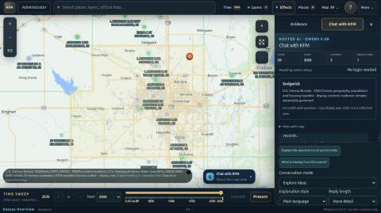
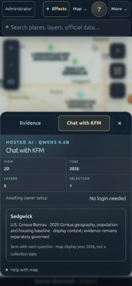
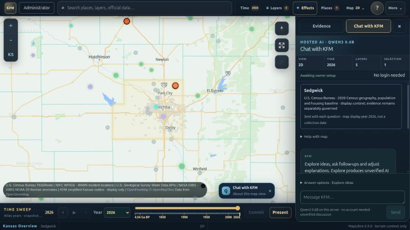
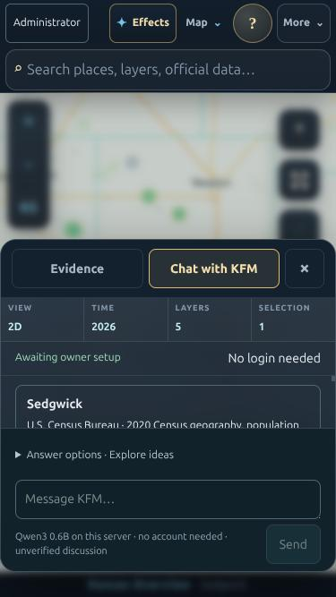

<!-- [KFM_META_BLOCK_V2]
doc_id: kfm://doc/site/chat-composer-reach-20261018
title: Keep the Chat with KFM question box reachable at every viewport
type: implementation-verification-record
version: v0.2
status: draft
owning_root: docs/
responsibility: Record this standalone application's bounded chat-layout repair, its evidence, limits and rollback.
truth_posture: CONFIRMED local rendered observations named below; NEEDS VERIFICATION hosted preview and production acceptance.
[/KFM_META_BLOCK_V2] -->

# Keep the Chat with KFM question box reachable at every viewport

Recorded 2026-10-18. Draft application change on the standalone GoDaddy Node
composition. Not deployment, publication, model qualification or data admission.

## 2026-10-21 candidate: conversation space and explicit AI identity

**Status: authored candidate, not deployed.** Current authoring base is
`a0-hosted-ai-web-20261017@a2755f07efe4bd01c2ed89b2cd392dc1d7b27ad9`,
Git tree `cc40874d1cfe1253d534af32a9d6564bd0885e0c`. The isolated authoring tree
was reconstructed and its complete Git tree hash matched that remote tree.
This section supersedes earlier layout descriptions for this candidate only;
the historical verification below remains dated evidence.

The live site was inspected at desktop and 390×844 on 2026-10-21. The phone
chat showed stacked scope, identity and help blocks above the conversation.
The candidate gives the conversation a larger desktop column (400–600 px),
with an optional reading width up to 840 px. It removes the repeated outer
heading and four-cell map strip from visual layout while retaining the dialog
name. The selected context title and time remain visible in one expandable
context row. Help, history/expiry information and answer controls are in
Options; suggested questions leave the thread once the first turn exists.

An explicit **AI assistant** badge, **AI DISCUSSION · UNVERIFIED** turn labels,
and the pinned **AI can make mistakes · check sources** line distinguish
interpretation from source evidence. Headings and simple lists render through
React text nodes; model HTML is never interpreted as markup. Citations,
withdrawal checks, evidence labels, input modes, Stop, continuation, exports,
context partitioning and source rechecks retain their original enforcement.

Phone navigation offers Map, Evidence, AI chat and More chat / Less chat.
The default sheet leaves map context above it; More chat expands its reading
area. Map closes the sheet through the existing cancellation and focus-return
path. The map camera and completed thread are retained. Compact opening focus
moves to the visible Map control rather than the hidden desktop close button.
The existing MapLibre ResizeObserver handles desktop column-size changes.

Owning responsibilities are the existing `app/`, `server/`,
`scripts/home-inference/`, `tests/` and `docs/` roots. No new authority root,
data source, schema, release or policy home is introduced. The named Directory
Rules PDF was resolved but its reader/materialization was unavailable. The
canonical `docs/doctrine/directory-rules.md` and accepted ADR-0029 were instead
inspected at main commit `17d6dc8119ba3352c19ea161e9ec73abaef72d9b`.
ADR-0029 adopts the exact draft-labeled doctrine bytes (blob
`fd49a0b83e55cef52c1124281f093e263526898d`); the draft label alone does not
reverse that acceptance. Sections 5 and 10 route by owning responsibility and
colocate app configuration with its consumer. This change edits existing files
inside the separately deployable app and retains the inherited adapter-kit
placement; it does not declare that every existing path is conforming or
create a new topology ruling. The source PDF remains unread in this session.

Validation: focused component/public-handler/export and signed in-memory
gateway tests pass locally, including a response beyond the former 4 KB cap,
UTF-8 output bounds, unsafe tails, continuation isolation, cancellation and
source withdrawal. Production build and TypeScript checks pass locally.
Exact counts and remote CI belong to the PR evidence. Real-socket suites and
local runtime startup were attempted but blocked by `listen EPERM`; a local
static-file browser preview was also blocked by browser URL policy. Therefore
candidate rendered geometry, mobile keyboard behavior, full HTTP transport,
and production rendering remain **NEEDS VERIFICATION**, not passing checks.

Rollback: revert this candidate's application/UI commit. No persistent schema
or data migration is involved. AI budget rollout and rollback are documented
in `scripts/home-inference/README.md`; existing PC settings are not replaced by
the sample profile. Keep the PR in draft until exact-head CI and rendered
phone/desktop acceptance complete. No merge, deployment or PC service change
was performed by authoring this candidate.

## Starting point

| Surface | Identity | Meaning |
| --- | --- | --- |
| Authoring base | `a0-hosted-ai-web-20261017@9aa26f1ec7724253c05a605b3f6b96d9c454d0aa` | Standalone Node app including merged #5251 county search and investigation exports. |
| Monorepo main | `907cc58c72844bf56923b63c970b83a202fa5e75` | Different layout and responsibilities; not touched. |
| Public application | `https://kansasfrontiermatrix.com/` | Anonymous browser, 2026-10-18. `/api/build` returns branded 404; exact deployed source **UNKNOWN** here (runbook records `4b3cc83`, NEEDS VERIFICATION). |
| Open PRs | none at authoring | No overlap. |

## Journey walk and chosen slice

Local production build of the authoring base, `PORT=4191 npm start`, in-app
Chromium, 2026-10-18. The AI model was not configured locally ("Awaiting owner
setup"); that is an environment limit, not a finding.

| Step | Public site | Candidate (local) |
| --- | --- | --- |
| 1. Choose a place | **FAILS** — "Sedgwick", "Wichita", "Topeka", "Douglas County" return no match; only source names match. | Works for counties ("Sedgwick" → Sedgwick County). City names do not resolve ("Lawrence" → no match; "Wichita" → Wichita County only). |
| 2. Understand available data | Not reached by search. | Evidence Drawer opens with source, 2020 edition, retrieval time, limits, "not KFM evidence". Strong. |
| 3. Inspect evidence | — | Data / metadata / trace / correction state visible. Strong. |
| 4. Ask a context-aware question | — | **FAILS by layout.** The context card is correct, but the message box and Send are clipped below the panel at 1024×768, 1366×768, 1440×900 and 375×812. Only 1920×1080 fits. |
| 5. Save / export | — | Per-turn Copy / Markdown / JSON actions exist (#5251) but sit in the same clipped chat. |

Step 1 on the public site is already fixed in the candidate and awaits owner
publication. Step 4 is the weakest link in the candidate: a visitor on a common
laptop or any phone cannot type a question. That is the slice.

### Cause (CONFIRMED, 1366×768)

The chat region is 506 px tall. Its non-shrinking children total 693 px:
toolbar 38, context card 149, guide 34, composer **423**, footer 49. Only the
conversation log can shrink, so it collapses to 32 px and the composer overflows
an `overflow: hidden` parent. Commit `8f9f00d` ("Keep HUD chat composer visible
while conversation scrolls") intended the opposite; later context, guide, prompt
and option additions (#5230, #5233, #5251) accumulated in the fixed regions.

## Experience brief

- **Visitor:** someone who has picked a county and wants to ask about it, on a
  laptop, tablet or phone.
- **Problem:** the question box is invisible and unreachable by pointer.
- **Direction:** a pinned question bar. The question box, the Send/Search button
  and the current mode's trust line are always visible at the bottom of the chat.
  Everything else — context card, help, welcome, conversation, suggested
  questions — lives in one scroll region above it. Less-used answer options
  (mode, style, length, evidence filters) fold into one disclosure whose summary
  always names the current mode.
- **Non-goals:** no copy rewrite, no model, server, policy, data or export change;
  no redesign of the Evidence tab or panel chrome.

### Visual specification (Creative Lead acting in the design role)

- Pinned bar order: options summary row → textarea → action row (trust line left,
  Send right). Existing tokens, borders (`#30424f`), focus ring (`#e3c883`, 3 px)
  and ≥ 44 px targets.
- The options summary reads `Answer options · Explore ideas` or
  `Answer options · Find evidence`, so mode is visible as words, not colour.
- Opened options scroll internally (bounded height) and never push the
  textarea out of view.
- Scroll region keeps the context card first, so "what this question concerns"
  is the first thing above the conversation.

## Acceptance criteria

1. With a county selected and the chat tab open, the textarea and Send/Search are
   fully visible without scrolling at 1920×1080, 1440×900, 1366×768, 1024×768,
   768×1024, 390×844 and 375×667.
2. Everything else in the chat is reachable by wheel/touch scroll and by Tab; no
   chat content is clipped by an `overflow: hidden` ancestor.
3. New turns still scroll into view.
4. Current mode and its disclosure ("unverified discussion" / "released records")
   remain visible without opening options.
5. The submitted form still carries mode, style, depth, term, place, start and end.
6. Existing tests pass; a regression test covers the pinned-bar structure.
7. Keyboard focus order is scroll region → options → textarea → Send; Escape and
   focus-visible behaviour are unchanged.

## Implementation

| File | Change |
| --- | --- |
| `app/assistant/workspace.tsx` | Context, help, conversation log, suggested questions and the footer disclosure share one scroll region (`.body`). The form keeps an "Answer options · {mode}" disclosure (mode, style, length, mode hint, evidence filters), the textarea and the action row. All seven submitted fields stay inside the form. Autoscroll now brings the end of the latest turn into view in the scroll region. Explore-mode action line gains "· unverified discussion". |
| `app/assistant/workspace.module.css` | `.body` is the only shrinking region (`flex:1 1 0%`); the log no longer scrolls on its own; options scroll internally with a bounded height; 44 px summary and buttons; compact padding below 820 px height. |
| `app/inspection-panel.css` | Compact sheet only (≤ 1100 px): the duplicate "Chat with KFM" heading is visually hidden but kept as the dialog's accessible name; the context strip stays on one row. Desktop is unchanged. |
| `tests/chat-composer-reach.test.mjs` | Rendered-markup and stylesheet regression tests for the structure above. |

Design decisions taken during implementation: the scroll region gives up space
first (`0%` basis); options may shrink so the textarea never does; autoscroll
targets the end of the log rather than the bottom of the region so the context
card is not scrolled away on open.

## Rendered acceptance (CONFIRMED, local production build)

Rebuilt candidate, `PORT=4191 npm start`, in-app Chromium with viewport
emulation, Sedgwick County chosen by search, Chat opened from the Evidence
Drawer. "Visible" means the element's box lies inside the viewport and every
clipping ancestor.

| Viewport | Before: Send | After: textarea / Send / options (closed) | After (options open) | Scroll region height before → after |
| --- | --- | --- | --- | --- |
| 1920×1080 | visible | visible / visible / visible | all visible | not measured → 586 |
| 1440×900 | clipped | visible | all visible | — → 406 |
| 1366×768 | clipped | visible | all visible | 32 (log) → 308 |
| 1024×768 | clipped | visible | all visible | — → 158 |
| 768×1024 | not measured | visible | all visible | — → 253 |
| 390×844 | not measured | visible | all visible | — → 141 |
| 375×667 / 375×812 | absent from view (375×812) | visible (375×667) | all visible | — → 58 |

No horizontal document overflow at any size. Keyboard order from the
conversation log: suggested questions → "Answer options" → message box → Send.
The options summary switches between "Explore ideas" and "Find evidence" with
the mode select, and the action line switches to "Released records · no model
required". Context strip labels do not overflow at 375 px.

Public site, same day, 1366×768, nothing selected: composer visible but the
conversation log is 63 px tall. Cramped chat is **inherited**; full clipping
appears when a selected-record context card is present, which county search
(#5251) makes the common path.

Not verified: a real AI turn (no model configured locally, so Send stays
disabled — the turn autoscroll is covered by unit tests only), touch scrolling on
a physical phone, screen-reader output, and the hosted preview. No motion was
added, so reduced-motion behaviour is unchanged.

## Validation

| Check | Result |
| --- | --- |
| `npx tsc --noEmit --incremental false` | PASS |
| `npx eslint app/assistant/workspace.tsx` | PASS, 0 errors, 0 warnings |
| `node --test tests/chat-composer-reach.test.mjs tests/assistant-*.test.mjs tests/pc-ai-http.test.mjs tests/mobile-compatibility.test.mjs` (after rebuild, `8971f5a`) | 52/52 PASS (also run with `tests/underground-load-boundary.test.mjs`: pass) |
| `npm run build` | PASS |
| `git diff --check` | PASS |
| Full `node --test tests/*.test.mjs`, clean build at `8971f5a` | 1,334 pass, 51 fail, 1 skipped of 1,386 |
| Same suite on unchanged base `9aa26f1`, separate clean worktree | 1,326 pass, 51 fail, 1 skipped of 1,378 |
| Failure diff (sorted test names) | **Identical 51 failures; none introduced.** The added tests pass. Sampled inherited causes are `fetch failed` in built-route tests in this sandbox. |

Failure attribution note: an earlier full run on a non-clean `dist/` failed
`underground-load-boundary` because the asset-staging step intentionally retains
prior builds' hashed chunks (three Underground chunks after three local
rebuilds). It passes after `rm -rf dist public/assets` and one build. This is a
local repeated-build artifact, not a change effect.

## Performance (independent reviewer, before this change)

The candidate is +2.3% initial-route JS and +10% HTML versus the published site;
county search costs ~0.14 ms per debounced query with no network; each save is
one rechecking GET. This change is CSS and markup reordering, adds no request,
dependency or motion, and was not separately measured. Inherited findings are
in the backlog below.

## Review

Independent code review (correctness, accessibility, security), read-only, by an
agent that authored none of this code. First pass on `ccafdf2`: no blockers, no
security findings.

| Finding | Resolution |
| --- | --- |
| F1 medium: notices sat outside the scroll region and could squeeze or clip the composer on phones. | Fixed in `60ca266` (notices lead the scroll region). |
| F2 medium: autoscroll ran on every 2 s poll, pulling readers away from the context card or help. | Fixed in `60ca266`: `shouldAutoscroll` scrolls for a new question always, and for a status/result change only when the reader was near the end. Truth-table test. |
| F3 low–medium: some trust copy moved behind closed options. | Fixed in `60ca266`: the pinned line names each mode's boundary ("unverified discussion", "not admitted evidence", "unsupported answers withheld"). |
| F4 low: one-row context strip ellipsizes values on phones without a tooltip. | Accepted; backlogged (owner of `page.tsx`). Screen readers get the full text. |
| Creative Lead follow-up: an alert inside the scroll region could be out of view. | `a556000`, then refined in `8971f5a` after recheck. |
| Recheck R1 medium: scrolling to every alert meant a brief poll failure moved the reader to the top and the finished reply was not brought into view. | Fixed in `8971f5a`: only an error from the visitor's own action is revealed; status-poll messages and the background status alert stay in place; the reveal scroll does not count as the reader leaving the end. Helper test. |
| Recheck R2 low: reader position goes stale when layout changes without a scroll event. | Accepted; at most a few extra scrolls per job. |
| Recheck R3 low: a reply finishing while the region is unmounted is not scrolled to later. | Accepted; same as before this change. |

Rendered checks of the fixes, 375×667, with the browser's `fetch` replaced in
the page to simulate states the local server cannot produce (no model is
configured). These are simulations, not hosted behaviour:

- AI configured but not ready, plus a failed send (429): composer, Search and
  the options row stay visible; the alert is revealed (scroll 629 → 0) above the
  standing notice; the draft is kept.
- A job whose first status poll fails and whose second completes: no jump on the
  failure (scroll 765, log end in view); the reply comes into view on recovery
  (scroll 900, log end in view).
- A failed send after that reply: alert revealed (900 → 0), draft kept.

Performance baseline: separate reviewer (above). Product acceptance: Creative
Lead, rendered checks above. The R1 fix in `8971f5a` was authored by the Creative
Lead and checked in the browser and by tests, not by a further independent
recheck. No release authorization is requested or implied.

## Proposed backlog (not in this change)

- PROPOSED: resolve Kansas city/town names (Wichita, Lawrence, Topeka) to a place
  with an honest source; today "Wichita" offers only Wichita County, which is ~200
  miles from the city. Needs a released gazetteer source, not geocoding guesswork.
- PROPOSED: before the Census county feed arrives, search says "No current
  place … matches" instead of "Places still loading". Show an honest loading
  state.
- PROPOSED (perf reviewer, INHERITED): the county feed is re-fetched from Census
  on every page load (Cloudflare `DYNAMIC`, ~0.6–0.9 s). Memoize the fixed 2020
  edition server-side for 24 h. Owner: backend/hosting.
- PROPOSED (perf reviewer, INHERITED): hashed assets are served gzip, not brotli,
  and without `immutable`. Owner: hosting.
- PROPOSED (perf reviewer): `SiteAssistant` in the root layout now loads a 33 kB
  chunk on every route; lazy-load it on first open. Owner: frontend.
- PROPOSED: on phones the scroll region is 58 px at 375×667; consider a taller
  chat sheet when the composer is focused.
- NEEDS VERIFICATION: "Find evidence" says "no model required" but Search is
  disabled when the hosted model is not configured. Check whether evidence
  search should stay available without the model.

## Rollback

Revert this commit. No database, model, data, DNS or audience change.

## Find keyboard navigation — October 31, 2026 Central

CONFIRMED source gap at hosted branch `9db5be500c6e48ec83b9b4ab377e0f77118f9b6a`:
Arrow Down could enter the first result, but result buttons had no arrow-key
navigation. Find submit only repeated the query. The public Explorer reproduced
the first-result focus stall using `water`; its deployed source identity was not
established by that UI check.

The candidate uses the existing native buttons. Find or Enter in the field
focuses the first current match. Arrow Down/Up moves between matches; Arrow Up
from the first returns to the unchanged draft. Home/End reaches the first/last
match. The last result stays bounded. Enter, Space, Tab and Escape retain native
activation or the enclosing panel's behavior. Focusing never chooses a source.

In the field, Arrow Down hands off only at a collapsed caret at the end of the
draft. Composition, key-code 229, modified keys, consumed events and selections
retain native text editing. Stale/empty results never receive focus. No AI call,
provider request, result ordering, evidence state or map change is added by
keyboard navigation. When results have not arrived, Find keeps the existing
query-update behavior and does not arrange a delayed focus jump.

Placement follows this standalone composition's `AGENTS.md` and accepted main
ADR-0029/adopted Directory Rules: the existing `app/` component owns interaction,
`tests/` owns conformance and `docs/` owns this guidance. The supplied Directory
Rules PDF was also consulted; the accepted ADR's pinned v2 text governs where
older wording differs. Four existing files change, with no new responsibility
root, dependency, schema, policy, store or release lane.

Validation status is reported in the PR against its exact head. Three new
component regressions failed before the application change and passed afterward.
The browser matrix adds a native-key/Find-button journey at 1366×768, 390×844 and
375×667, including focus visibility in the result scroll region. Authored browser
coverage is not an execution claim. Physical-device, screen-reader and deployed
candidate acceptance remain NEEDS VERIFICATION until separately established.

Rollback is a reviewed revert of these four files; drafts and stored settings
need no migration. Authoring and self-review do not constitute independent review,
merge, deployment or publication approval.

### Isolated markup harness correction

PR #5674 was merged outside this agent as
`2e69221653da540598901779b1cbd71a2a317079`. Its exact-head core-delivery job
reported 2,425 passing, three failing and 24 skipped ordinary tests. All three
failures were `ReferenceError: handleDiscoveryResultKeyDown is not defined` in
the isolated `global-search-status.test.mjs` markup VM. They reproduced locally
against the merged source before this correction. That early test failure
prevented the broader job from reaching the new county-search browser journeys;
the separate welcome/draft and performance jobs passed.

The markup VM now supplies an explicit callback binding which throws if invoked.
Static rendering must not dispatch keyboard events; the existing full-component
tests execute the real handler. Source-state, stale-result, empty-query,
polite-status, escaping and markup assertions are unchanged. No application
behavior, assertion, skip or provider fixture is changed to clear the failure.

The correction uses the existing `tests/` conformance and `docs/` guidance homes
under the same Directory Rules basis above. Validation belongs to its new PR's
exact head; preceding results are not reused as new-head CI. Revert this two-file
follow-up to roll back the harness change, which restores the three known errors.
No stored-data migration or deployment is involved.
