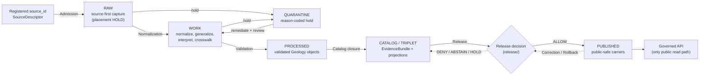

<!-- [KFM_META_BLOCK_V2]
doc_id: kfm://doc/geology-data-lifecycle
title: Geology — Data Lifecycle
type: standard
version: v2.0.0
prior_version: v1.2
status: draft
owners: TODO — Geology domain steward; Directory Rules owner
created: 2026-05-16
updated: 2026-10-11
policy_label: public
owning_root: docs/
responsibility: "Human-readable Geology lifecycle doctrine (phase gates, trust objects, knowledge-character and sensitivity handling per phase); not policy, evidence, review, release, or publication authority."
truth_posture: "CONFIRMED doctrine citations and repository presence as inspected at fa89f2e3 / PROPOSED Geology lane application / HOLD physical source-first RAW placement and operational promotion / UNKNOWN external payloads, runtime, release, and publication state"
related:
  - docs/doctrine/lifecycle-law.md
  - docs/doctrine/directory-rules.md
  - docs/doctrine/trust-membrane.md
  - data/raw/README.md
  - data/raw/geology/README.md
  - docs/domains/geology/README.md
  - docs/domains/geology/CANONICAL_PATHS.md
  - docs/domains/geology/SENSITIVITY.md
  - docs/domains/geology/POLICY.md
  - docs/domains/geology/PRESERVATION_MATRIX.md
  - docs/domains/geology/SOURCE_ROLE_MATRIX.md
  - docs/domains/geology/SOURCE_REGISTRY.md
  - docs/domains/geology/IDENTITY_MODEL.md
  - docs/domains/geology/RELEASE_INDEX.md
  - docs/adr/ADR-0030-geology-resource-character-vocabulary.md
  - docs/runbooks/geology/PROMOTION_RUNBOOK.md
  - docs/runbooks/geology/ROLLBACK_RUNBOOK.md
tags: [kfm, geology, natural-resources, lifecycle, governance, sensitivity, source-role]
notes:
  - "2026-10-11 (v2.0.0): replaces a near-copy of CANONICAL_PATHS.md that shared its doc_id; keeps the Atlas §24.6 lifecycle-gate material"
  - "Path placement is owned by CANONICAL_PATHS.md; this doc links to it and does not restate the path map."
  - "RAW capture identity is source-first (Directory Rules DIR-SOURCE-001); physical RAW placement is HOLD and data/raw/geology/ is a compatibility/reference lane only."
  - "Pins CONTRACT_VERSION = 3.0.0 per docs/doctrine/ai-build-operating-contract.md."
[/KFM_META_BLOCK_V2] -->

# Geology — Data Lifecycle

> How Geology and Natural Resources material moves through **RAW → WORK / QUARANTINE → PROCESSED → CATALOG / TRIPLET → PUBLISHED**: the gate at each edge, the trust objects each gate needs, and how source role, knowledge character, and sensitivity survive every transition.

| Field | Value |
|---|---|
| **Status** | `draft` · version `v2.0.0` (prior `v1.2`) |
| **Owners** | TODO — Geology domain steward; Directory Rules owner |
| **Last updated** | 2026-10-11 |
| **Authority basis** | [Lifecycle Law](../../doctrine/lifecycle-law.md) · [Directory Rules](../../doctrine/directory-rules.md) §11–§12 · Atlas v1.1 §10.H–§10.I, §24.5.3, §24.6 |
| **Evidence boundary** | Repository files read at checkout `fa89f2e3` (2026-10-11). No pipeline, policy evaluator, release, or deployed runtime was exercised. |
| **Placement** | Paths for every lifecycle lane live in [`CANONICAL_PATHS.md`](./CANONICAL_PATHS.md); this doc does not restate them. |

---

## Contents

1. [Purpose and scope](#1-purpose-and-scope)
2. [Authority and evidence basis](#2-authority-and-evidence-basis)
3. [Lifecycle at a glance](#3-lifecycle-at-a-glance)
4. [Gate sequence (Atlas §24.6)](#4-gate-sequence-atlas-246)
5. [Phase-by-phase handling](#5-phase-by-phase-handling)
6. [Source role and knowledge character through the lifecycle](#6-source-role-and-knowledge-character-through-the-lifecycle)
7. [Sensitivity through the lifecycle](#7-sensitivity-through-the-lifecycle)
8. [Geology transforms that need receipts](#8-geology-transforms-that-need-receipts)
9. [Versioning, correction, supersession, and rollback](#9-versioning-correction-supersession-and-rollback)
10. [Publication and the trust membrane](#10-publication-and-the-trust-membrane)
11. [Anti-patterns](#11-anti-patterns)
12. [Validation and verification](#12-validation-and-verification)
13. [Drift and open items](#13-drift-and-open-items)
14. [Changelog](#14-changelog)
15. [Related docs](#15-related-docs)

---

## 1. Purpose and scope

This document applies the KFM lifecycle invariant to the Geology and Natural Resources lane. It answers four questions a steward or reviewer has at each transition:

1. What must exist before Geology material may cross this edge?
2. Which trust objects (receipts, reports, decisions, bundles, manifests) does the crossing produce?
3. How do source role, knowledge character (occurrence ≠ deposit ≠ estimate ≠ reserve ≠ permit ≠ production …), and sensitivity tier stay intact through the crossing?
4. What happens when the crossing fails?

| This doc decides | This doc defers to |
|---|---|
| Geology-specific gate application, per-phase handling, and which receipts Geology transforms need | **Lifecycle shape, stage names, per-stage receipts** → [`lifecycle-law.md`](../../doctrine/lifecycle-law.md) |
| How knowledge character and source role are preserved per phase | **Vocabulary itself** → [ADR-0030](../../adr/ADR-0030-geology-resource-character-vocabulary.md) (proposed) and [`SOURCE_ROLE_MATRIX.md`](./SOURCE_ROLE_MATRIX.md) |
| Where generalization and redaction sit in the lifecycle | **Tier defaults and reviewers** → [`SENSITIVITY.md`](./SENSITIVITY.md); **lane posture** → [`POLICY.md`](./POLICY.md); **machine decisions** → `policy/` |
| What the lifecycle requires of correction and rollback | **Operational procedure** → [`PROMOTION_RUNBOOK.md`](../../runbooks/geology/PROMOTION_RUNBOOK.md), [`ROLLBACK_RUNBOOK.md`](../../runbooks/geology/ROLLBACK_RUNBOOK.md); **release records** → `release/` |
| — | **File and directory placement** → [`CANONICAL_PATHS.md`](./CANONICAL_PATHS.md) and Directory Rules §11–§12 |

[Back to top](#top)

---

## 2. Authority and evidence basis

| Claim | Source read | Label |
|---|---|---|
| Lifecycle invariant `(Pre-RAW) → RAW → WORK / QUARANTINE → PROCESSED → CATALOG / TRIPLET → PUBLISHED`; publication is a governed transition, not a copy | `docs/doctrine/lifecycle-law.md` §2, §6 | **CONFIRMED doctrine** |
| Lifecycle is a state machine; not every artifact visits every directory; promotion is never inferred from a copy, move, filename, job completion, or alias | `docs/doctrine/directory-rules.md` §11.2 (`DIR-DATA-002`–`004`) | **CONFIRMED doctrine** |
| Source-first capture identity; one `source_id`; no duplicated RAW bytes across domains | Directory Rules §12.3 (`DIR-SOURCE-001`–`004`); `data/raw/README.md` | **CONFIRMED doctrine** |
| Exact physical RAW placement | `data/raw/README.md`; `data/raw/geology/README.md` | **HOLD** |
| Seven-gate sequence and closure rule | Atlas v1.1 §24.6.1–§24.6.2 (in-repo Consolidated Atlas) | **CONFIRMED doctrine**; artifact minimums **PROPOSED** |
| Geology pipeline shape and sensitivity sentence | Atlas v1.1 §10.H, §10.I | **CONFIRMED doctrine / PROPOSED lane application** |
| Tier scheme and tier transitions | Atlas v1.1 §24.5.1 (scheme **PROPOSED**), §24.5.3 (transitions); `SENSITIVITY.md` §2, §7; `POLICY.md` §7 | **PROPOSED** scheme / **CONFIRMED** transition doctrine |
| Resource-character vocabulary (seven tokens) | ADR-0030 | **PROPOSED** (ADR status `proposed`) |
| Current Geology candidate, proof, policy, and release state | `docs/runbooks/geology/PROMOTION_RUNBOOK.md` "Current repository posture"; `.github/workflows/domain-geology.yml` | **CONFIRMED HOLD** — no candidate, proof, active policy, or release |

> [!IMPORTANT]
> Nothing in this document admits a source, activates a connector, evaluates policy, closes evidence, or releases anything. Repository presence of a README, schema, or validator is recorded as presence only.

[Back to top](#top)

---

## 3. Lifecycle at a glance

Reading rules (Directory Rules §11.2):

- Valid material **need not** pass through QUARANTINE; TRIPLETS are optional when no graph projection is required (`DIR-DATA-002`).
- QUARANTINE returns only to WORK, and only through remediation plus review (Lifecycle Law §3.3).
- PUBLISHED requires CATALOG **plus** proof **plus** a release decision; a pipeline never writes it on its own (`DIR-DATA-003`; Lifecycle Law §3.6).

[Back to top](#top)

---

## 4. Gate sequence (Atlas §24.6)

### 4.1 Seven lifecycle gates

The seven-gate sequence below is reproduced from the Atlas v1.1 **§24.6 Master Pipeline Gate Reference** (subsection 24.6.1, "Lifecycle gates"). Each transition fails closed when its required artifacts are absent.

| Gate | Required artifact(s) (PROPOSED minimum) | Failure-closed outcome |
|---|---|---|
| Admission (→ RAW) | `SourceDescriptor` (role, authority, rights, sensitivity, cadence); payload/reference hash | Source not admitted; logged as candidate awaiting steward |
| Normalization (RAW → WORK/QUARANTINE) | `TransformReceipt`; `ValidationReport` (working set); `PolicyDecision` | Quarantine with reason; never silent promotion |
| Validation (WORK → PROCESSED) | `ValidationReport` pass; `RedactionReceipt` (if sensitivity applies); `AggregationReceipt` (if applies) | Stay in WORK; structured FAIL outcome |
| Catalog closure (PROCESSED → CATALOG/TRIPLET) | `CatalogMatrix` entry; `EvidenceBundle`; graph/triplet projections | HOLD at PROCESSED; no public edge |
| Release (CATALOG/TRIPLET → PUBLISHED) | `ReleaseManifest`; rollback target; correction path; `ReviewRecord` if required (release authority distinct from author when materiality applies) | HOLD at CATALOG; no public surface change |
| Correction (PUBLISHED → PUBLISHED′) | `CorrectionNotice`; `ReviewRecord`; invalidation list; `ReleaseManifest` update or supersession | Stale-state announcement; no silent edit |
| Rollback (PUBLISHED → prior release) | `RollbackCard`; `CorrectionNotice`; `ReleaseManifest` reverts; downstream derivative invalidation | Held at current state until rollback validated |

*(Source: Atlas v1.1 §24.6.1 lifecycle gates; Directory Rules §11 phase rules. The in-repo Atlas renders this heading as "8. Master Pipeline Gate Reference" with a `VERIFY` comment; its contents list names it §24.6.)*

### 4.2 Closure rule (Atlas §24.6.2)

Per §24.6.2, a transition is closed only when (i) the artifacts exist, (ii) every `EvidenceRef` → `EvidenceBundle`, `source_id` → `SourceDescriptor`, and `model_id` → `ModelRunReceipt` **resolves** (not just references), and (iii) the policy gate recorded its decision. Missing any of these preserves the prior state. The same section states that PUBLISHED is the only state from which the governed API may emit `ANSWER`.

### 4.3 How the gates relate to Lifecycle Law receipts

The Atlas gates name *gate artifacts*; Lifecycle Law §4 names a *per-stage receipt*. Both apply; neither replaces the other.

| Stage | Lifecycle Law receipt (§3–§4) | Public exposure (§4) |
|---|---|---|
| Pre-RAW | `EventRunReceipt` | `DENY` |
| RAW | `IntakeReceipt` (hash, retrieval time, `spec_hash`, `source_id`) | `DENY` |
| WORK | `TransformReceipt` | `DENY` |
| QUARANTINE | `QuarantineReceipt` (reason, originating stage, evidence pointers) | `DENY` |
| PROCESSED | `ProcessingReceipt` **plus** `ValidationReport` | `DENY` |
| CATALOG / TRIPLET | `CatalogBuildReceipt` / `GraphBuildReceipt` | Released records only |
| PUBLISHED | `PublicationReceipt` with backing `ReleaseManifest` and `ProofPack` | Public via governed routes |

The PROPOSED reason-code catalog in Atlas §24.6.3 (`RIGHTS_UNKNOWN`, `SENSITIVITY_UNRESOLVED`, `ROLE_COLLAPSE`, `ROLLBACK_TARGET_MISSING`, …) is the vocabulary Geology holds should use until an accepted policy profile replaces it.

[Back to top](#top)

---

## 5. Phase-by-phase handling

Each subsection lists the entry gate, Geology-specific handling, and the current repository state of the lane (presence only).

### 5.0 Pre-RAW — admission

- **Entry.** A candidate source is registered once as a `SourceDescriptor` under `data/registry/sources/` (`DIR-SOURCE-003`). `data/registry/geology/sources/` is a generated compatibility view, not an independent writer (`DIR-SOURCE-004`; its README declares `canonical-writes-under-data-registry-sources; no-independent-writes`).
- **Geology handling.** Role is fixed per descriptor at admission, not chosen per query ([`README.md`](./README.md) §9). A KGS umbrella source is split into separate descriptors per role rather than flattened ([`data/raw/geology/README.md`](../../../data/raw/geology/README.md) source-family backlog).
- **Watchers.** Source-drift watchers (KGS, KCC, USGS NGMDB) observe and emit run receipts and candidate decisions only; they never write CATALOG or PUBLISHED ([`PRESERVATION_MATRIX.md`](./PRESERVATION_MATRIX.md) §3; Lifecycle Law §3.0).
- **Current state.** **CONFIRMED** one Geology descriptor at `data/registry/sources/geology/kgs-m118-surficial-geology.source.json` (KGS Map M-118; `rights_status: unknown`; described as a proposed inactive descriptor). `control_plane/source_authority_register.yaml` is projection-only with no entries (`PROMOTION_RUNBOOK.md`). No Geology source is admitted or active.

### 5.1 RAW — source-first capture

- **Entry gate.** Admission: `SourceDescriptor` + payload/reference hash (§4.1). Lifecycle Law receipt: `IntakeReceipt`.
- **Capture identity.** One registered `source_id`, one immutable source-first capture. A capture that supports Geology and another domain (for example 3DEP terrain, documented by both Geology and Hydrology RAW READMEs) is **one** capture referenced by both lanes, never two copies (`DIR-SOURCE-001`; `data/raw/geology/README.md`).
- **Physical placement — HOLD.** No accepted writer or path contract exists. Do **not** infer `data/raw/geology/` (or any child) as the capture home and do not invent a RAW path. `data/raw/geology/` is a compatibility/reference index only and must never receive payloads (`data/raw/README.md`; `data/raw/geology/README.md`).
- **What RAW must carry** (where material): source-native identifiers, source time, retrieval time, version, original coordinate precision and units, geometry/support metadata, aggregation unit, model-run reference, citation, rights, sensitivity hints, digest ([`PRESERVATION_MATRIX.md`](./PRESERVATION_MATRIX.md) §3; `data/raw/geology/README.md`).
- **RAW does not decide** what a source means, whether rights permit reuse, whether an occurrence is a deposit, whether a permit proves operation, or whether a compiled map is observed fact (`data/raw/geology/README.md` Scope).
- **Current state.** **CONFIRMED** no tracked non-README files under `data/raw/` Geology lanes. External or untracked stores: **UNKNOWN**.

### 5.2 WORK / QUARANTINE — transformation and hold

- **Entry gate.** Normalization: `TransformReceipt`, working-set `ValidationReport`, `PolicyDecision` (§4.1). A governed reference may enter WORK only when descriptor, rights posture, role, product identity, citation, hash, and minimal validation support suffice (`data/raw/geology/README.md` exit gates).
- **WORK handles** schema, geometry, depth, unit, time, and identity normalization; source-role reconciliation; stratigraphic alignment; and redaction/generalization work (`data/work/geology/README.md`). Identity contributions fixed here: `object_role`, `temporal_scope`, candidate `spec_hash` ([`IDENTITY_MODEL.md`](./IDENTITY_MODEL.md) "Identity Through the Lifecycle").
- **QUARANTINE holds** material whose rights, role, sensitivity, model basis, aggregation unit, geometry/support, citation, digest, or schema is unresolved. **CONFIRMED** child lane: `rights_unknown/` (license, terms, proprietary status, or publication permission unresolved). Exit is reprocessing plus review, never direct promotion (Lifecycle Law §3.3).
- **Geology triggers for quarantine** include: unresolved KGS LAS or other rights-controlled content; exact subsurface point geometry without a generalization decision; a record whose knowledge character cannot be determined from evidence (ADR-0030 D5 forbids inferring it from weak signals); a production or estimate record without its aggregation unit or method.
- **Current state.** **CONFIRMED** README-only lanes (`data/work/geology/`, `data/quarantine/geology/`, `data/quarantine/geology/rights_unknown/`); pipeline specs under `pipeline_specs/geology/` are `PROPOSED_INACTIVE` / `NOT_IMPLEMENTED`; `pipelines/domains/geology/*/` hold READMEs only.

### 5.3 PROCESSED — validated Geology objects

- **Entry gate.** Validation: `ValidationReport` pass, plus `RedactionReceipt` and/or `AggregationReceipt` where they apply (§4.1). Lifecycle Law requires `ProcessingReceipt` **and** `ValidationReport`.
- **Geology handling.** `spec_hash` is final and `EvidenceRef` is minted here (`IDENTITY_MODEL.md`). Each record carries exactly one knowledge character and its source role (§6). Public-safe candidate geometry may exist alongside, never instead of, the restricted canonical record.
- **Not public.** PROCESSED is "validated" but not catalogued, proved, released, or public (`data/processed/geology/README.md`).
- **Current state.** **CONFIRMED** README-only lane.

### 5.4 CATALOG / TRIPLET — closure and projection

- **Entry gate.** Catalog closure: `CatalogMatrix` entry, `EvidenceBundle`, projections; all references resolve (§4.1–§4.2).
- **Geology handling.** Catalog and graph projections inherit each record's tier and character; a graph edge may relate an occurrence to a deposit or an extraction site to a permit only as an explicit, evidence-bound relation that preserves both identities (ADR-0030 D7). Catalog presentation, interpreted maps, regulatory records, and resource claims do not become sovereign truth (`data/catalog/domain/geology/README.md`).
- **Current state.** **CONFIRMED** `data/catalog/domain/geology/README.md` and `data/triplets/geology/.gitkeep` only. `tools/validators/domains/geology/validate_catalog_matrix.py` delegates to the shared closure validator (fixtures only). Directory Rules §12.3 lists `data/catalog/domain/` as a migration candidate (see §13).

### 5.5 PUBLISHED — public-safe carriers

- **Entry gate.** Release: `ReleaseManifest`, rollback target, correction path, `ReviewRecord` where required (§4.1); the full eleven-step transition in Lifecycle Law §6.1 applies.
- **Geology handling.** Public carriers are generalized or aggregated where the tier requires; `RealityBoundaryNote` + `RepresentationReceipt` accompany interpretive 3D or cross-section surfaces ([`SENSITIVITY.md`](./SENSITIVITY.md) §7). Domain release gates (source-role anti-collapse, resource-class anti-collapse, public-safe geometry, borehole/well-log rights, AI evidence-before-model) are listed in [`RELEASE_INDEX.md`](./RELEASE_INDEX.md) §6.2 as **PROPOSED** test surfaces.
- **Current state.** **CONFIRMED HOLD.** Published Geology lanes hold READMEs/`.gitkeep` only; `release/candidates/geology/` holds only its README; no Geology `PromotionDecision` or `ReleaseManifest` surfaced (`PROMOTION_RUNBOOK.md`: `NO_ACTIVE_CANDIDATE_VERIFIED` → operational promotion **HOLD**).

[Back to top](#top)

---

## 6. Source role and knowledge character through the lifecycle

Two independent axes must survive every transition. **Source role** says how knowledge was produced; **knowledge character** says what kind of claim the record makes. Neither may be inferred from the other (ADR-0030 D3, D5; [`SOURCE_ROLE_MATRIX.md`](./SOURCE_ROLE_MATRIX.md) §2).

### 6.1 Source roles

| Role | Meaning ([`SOURCE_ROLE_MATRIX.md`](./SOURCE_ROLE_MATRIX.md) §2) | Geology example ([`IDENTITY_MODEL.md`](./IDENTITY_MODEL.md); [`SOURCE_REGISTRY.md`](./SOURCE_REGISTRY.md)) |
|---|---|---|
| `observed` | Direct reading tied to place and time | LAS log curves; field lithology; geochemistry assay |
| `regulatory` | Determination by a governing body | KCC oil-and-gas filings; permits |
| `modeled` | Derived from inputs/assumptions; uncertainty preserved | Interpreted well tops; resource estimates; geophysical inversions |
| `aggregate` | Summary over a unit; per-record fidelity lost | County or basin production rollups; occurrence density |
| `administrative` | Agency compilation for registration/accounting | Well rosters; NGMDB index entries; operator-of-record lists |
| `candidate` | Awaiting validation | Quarantined connector output |
| `synthetic` | Simulated, reconstructed, or AI-generated | Synthetic subsurface surface; fixture records |

The role is set at admission (§5.0) and carried unchanged to PUBLISHED. A modeled record that requires `role_model_run_ref` must resolve it to a `ModelRunReceipt` before catalog closure (§4.2; `SOURCES.md` field table).

### 6.2 Knowledge characters and where each is fixed

| Character | Fixed at | Must not become | Basis |
|---|---|---|---|
| Occurrence (`MINERAL_OCCURRENCE`) | WORK, from source evidence | Deposit, quantity, reserve, permit, production, ownership | ADR-0030 vocabulary; `MineralOccurrence` contract |
| Deposit (`RESOURCE_DEPOSIT`) | WORK | Estimate, reserve, production, title | ADR-0030; `ResourceDeposit` contract |
| Estimate (`RESOURCE_ESTIMATE`) | WORK, with method, date, confidence, framework | Direct observation; reserve by default; production | ADR-0030; `PRESERVATION_MATRIX.md` §7 |
| Reserve (`RESERVE`) | Only under a cited scheme and qualified review | Estimate, deposit, KFM certification | ADR-0030 (**unadmitted** object family) |
| Permit (`PERMIT`) | WORK, issuer- and jurisdiction-bound | Proof of resource, extraction, production, or compliance | ADR-0030 (**unadmitted**) |
| Operation / extraction site | WORK (`ExtractionSite`) | Inferred from a permit (Permit → Operation collapse) | `SOURCE_REGISTRY.md` §8 row 4 |
| Production (`PRODUCTION`) | WORK, time-bounded, reporting grain explicit | Deposit, estimate, reserve, permit validity, current operation | ADR-0030 (**unadmitted**); `production_material_change` contract is process-only |
| Compiled map | Admission (role `administrative` or interpreted map) | Field observation or point truth | `SOURCE_REGISTRY.md` §8 row 7; M-118 descriptor `authority_notes` |
| Model / modeled potential (`MODELED_POTENTIAL`) | WORK, with versioned inputs and uncertainty | Occurrence, deposit, estimate quantity | ADR-0030 (**unadmitted**) |
| Interpretation (cross-section, tops, age model) | WORK, with interpretation version | Attestation or observed structure | `README.md` §14; `PRESERVATION_MATRIX.md` §8 |
| Legal / title | Never in Geology | Any geologic claim; Geology never owns ownership, lease, permit-title, or operator truth | `SOURCE_REGISTRY.md` §8 row 8; Atlas §10 non-ownership |

> [!CAUTION]
> ADR-0030 is **proposed**. Its seven tokens are not accepted; only `MINERAL_OCCURRENCE`, `RESOURCE_DEPOSIT`, and `RESOURCE_ESTIMATE` have draft object families and fixture coverage. `RESERVE`, `PRODUCTION`, `PERMIT`, and `MODELED_POTENTIAL` records have no admitted object family, so a lifecycle run that produces one **HOLD**s at WORK rather than being forced into one of the three existing schemas.

### 6.3 Gate behavior on collapse

Collapse is a gate failure, not a quality note. At Validation, Catalog closure, and Release, a record whose role or character would be upcast fails closed (Atlas §24.6.3 `ROLE_COLLAPSE`, `ROLE_DOWNCAST_FORBIDDEN`). The collapse pairs that fail closed for Geology (aggregate → per-place, modeled → observed, regulatory → observed, administrative → observed, candidate → public, synthetic → observed, AI text → evidence) are tabulated in [`SOURCE_ROLE_MATRIX.md`](./SOURCE_ROLE_MATRIX.md) §5 (Grid C).

[Back to top](#top)

---

## 7. Sensitivity through the lifecycle

### 7.1 Default posture

> "Exact borehole, sample, sensitive resource, well-log, and private well locations default to restricted or generalized public geometry. Occurrence, deposit, estimate, permit, production, and reserve claims must remain distinct." — Atlas v1.1 §10.I, restated in [`POLICY.md`](./POLICY.md) §2.

[`SENSITIVITY.md`](./SENSITIVITY.md) §3 adds: "Default-deny on ingest: an object enters at T4 until a `SourceDescriptor` + rights review establish a higher-trust default." Tier is independent of phase — "a `WellLog` at T4 is still preserved through every phase; it is the *release* that is denied" (§2).

### 7.2 Where generalization and redaction happen

| Concern | Phase | Mechanism | Receipt / record | Source |
|---|---|---|---|---|
| Exact borehole / core / well-log location | WORK → PROCESSED | Coordinate generalization (cell-binning) or fuzzing | `RedactionReceipt` | `SENSITIVITY.md` §7; `PRESERVATION_MATRIX.md` §8 |
| Private water-well (WWC5) point + owner join | WORK | Generalize geometry; suppress owner join | `RedactionReceipt` | `POLICY.md` §5 |
| Extraction-targetable resource coordinates | WORK | Generalize or deny; publish aggregated density only | `RedactionReceipt` / `AggregationReceipt` | `SENSITIVITY.md` §4, §6 |
| Rights-restricted content (e.g., licensed LAS curves) | QUARANTINE until cleared | No transform releases it; rights clearance only | `PolicyDecision` + `ReviewRecord` | `POLICY.md` §5; `SENSITIVITY.md` §4 |
| Operator / owner attributes | WORK | Attribute suppression | `RedactionReceipt` (kept/removed fields) | `PRESERVATION_MATRIX.md` §8 |
| Release audience change | Release gate | Tier transition | See note below | Atlas §24.5.3 |

Renderer or style filters are **not** a protection mechanism: hiding a layer client-side does not redact the tile; receipts must reflect a change at the data layer ([`PRESERVATION_MATRIX.md`](./PRESERVATION_MATRIX.md) §8). A join can raise sensitivity — classify the join result, not the inputs; the join itself needs an `AggregationReceipt` or `RedactionReceipt` ([`SENSITIVITY.md`](./SENSITIVITY.md) §6).

> [!NOTE]
> The Atlas **§24.5.3** tier-transition rule governs every audience change: a tier **upgrade** toward more public always needs both a transform receipt and a `ReviewRecord` (e.g., `T4 → T1` needs `RedactionReceipt + ReviewRecord`; `T1 → T0` needs `ReleaseManifest + ReviewRecord`), while a **downgrade** toward less public needs only a `CorrectionNotice` — correction alone is sufficient to remove or restrict. *(v1.2 cited this as §24.5.2; the in-repo Atlas places per-domain tiers at §24.5.2 and transitions at §24.5.3.)*

### 7.3 Tier defaults that matter for gates

`GeologicUnit` / `Lithology` = **T0** and `MineralOccurrence` / `ResourceEstimate` = **T0 aggregate / T2 detail** are grounded in Atlas §24.14. Exact-location `Borehole`, `WellLog`, `CoreSample`, `GeochemistrySample` = **T4** and rights-controlled LAS content = **T4 until rights cleared** are **PROPOSED** ([`SENSITIVITY.md`](./SENSITIVITY.md) §5). The ai-build operating contract §23.2 matrix has no Geology row; the most restrictive applicable row plus the §23.3 default govern — a missing row is never an implicit allow (`SENSITIVITY.md` §4).

[Back to top](#top)

---

## 8. Geology transforms that need receipts

Only transforms the repository documents are listed. Receipt object families are named by doctrine; their Geology schemas are mostly absent or scaffold-only (§12).

| Transform | Phase | Role / character effect | Receipt(s) | Source |
|---|---|---|---|---|
| Map compilation / cartographic generalization (vertex reduction, scale snap) | WORK | Stays compiled map; scale variant only | `TransformReceipt` (cartographic) or `RedactionReceipt` (sensitivity-driven) | `PRESERVATION_MATRIX.md` §8 |
| Coordinate generalization or fuzzing of subsurface points | WORK | Same character; lower precision | `RedactionReceipt` (cell size or radius, method, reason) | `PRESERVATION_MATRIX.md` §8; `SENSITIVITY.md` §7 |
| Well-log interpretation to tops | WORK | `observed` log curves → `modeled` interpreted tops; curves and tops carry separate rights envelopes | `TransformReceipt`; `ModelRunReceipt` via `role_model_run_ref` | `IDENTITY_MODEL.md` source table; `SOURCES.md`; `PRESERVATION_MATRIX.md` §6 |
| Aggregation (county / basin / play rollup of production or occurrences) | WORK | Output role `aggregate`; never joined back to a single well | `AggregationReceipt` (geometry_scope, time_scope, method, suppression_rule, output_unit) | `PRESERVATION_MATRIX.md` §8; `SOURCE_ROLE_MATRIX.md` §5 |
| Production snapshot comparison | WORK | Process evidence only; not character admission | `ProductionMaterialChange` (`NO_CHANGE` / `REVIEW` / `HOLD` / `ERROR`) | ADR-0030; `contracts/domains/geology/production_material_change.md` |
| Resource-estimate framework crosswalk | WORK | Estimate stays estimate; framework preserved | Explicit crosswalk receipt (named, not schematized) | `PRESERVATION_MATRIX.md` §7, Q8 |
| 3DEP terrain → geomorphology derivatives | WORK | Derivative requires source-role and transform receipts even though terrain is public-safe at standard resolutions | `TransformReceipt` | `data/raw/geology/README.md` source-family backlog |
| Interpretation versioning (cross-section, age model, correlation) | WORK | Within tier; does not move tier | `DatasetVersion` annotation | `PRESERVATION_MATRIX.md` §8 |
| Reality-boundary annotation (3D, reconstruction-heavy cross-section) | Release gate | Marks interpretive vs measured content | `RepresentationReceipt` + `RealityBoundaryNote` | `SENSITIVITY.md` §7 |

[Back to top](#top)

---

## 9. Versioning, correction, supersession, and rollback

**Identity and versions.** Identity is constant across phases for one logical object; what changes is the set of artifacts carrying it ([`IDENTITY_MODEL.md`](./IDENTITY_MODEL.md)). Every promotion emits a new governed state or version and is never inferred from a copy, move, filename, or alias (`DIR-DATA-004`). RAW is never edited in place; source corrections arrive as new captures (Lifecycle Law §3.1).

**Correction triggers** ([`PRESERVATION_MATRIX.md`](./PRESERVATION_MATRIX.md) §10):

| Event | Required artifacts | Lifecycle effect |
|---|---|---|
| Source erratum (KGS, USGS, KCC) | `CorrectionNotice` linked to the source's `EvidenceBundle` | Supersession entry; tier may be re-evaluated |
| Rights change (revocation, embargo) | `PolicyDecision` + `RollbackCard` | Withdraw; T0/T1 may demote to T4 |
| Steward review revoked | `ReviewRecord` (revocation) + `CorrectionNotice` | Return to default tier; descendants tracked |
| Class-collapse error (estimate published as reserve) | `CorrectionNotice` + `ReleaseManifest` revision | Republish under correct character; wrong release retained for audit |
| Geometry over-exposure (exact borehole published) | `RollbackCard` + `RedactionReceipt` | Immediate T0/T1 → T4; republish only after re-review |

**Rollback placement.** Directory Rules `DIR-RELEASE-003` places `RollbackCard` only under `release/rollback_cards/`, with executed rollback receipts under `data/receipts/rollback/`; `DIR-RELEASE-004` deprecates generic `data/rollback/` as an ambiguous authority lane. `data/rollback/geology/README.md` exists as data-plane support documentation and proves no rollback instance ([`ROLLBACK_RUNBOOK.md`](../../runbooks/geology/ROLLBACK_RUNBOOK.md) §4).

**Current state.** **CONFIRMED** shared `RollbackCard` contract, closed schema, no-network validator (`tools/validators/release/validate_rollback_card.py`), and synthetic-only rehearsal mechanics. **HOLD** any claim that Geology rollback is operational; a Geology-specific rollback drill is not established (`ROLLBACK_RUNBOOK.md` §4).

[Back to top](#top)

---

## 10. Publication and the trust membrane

- **Governed API only.** No public client, normal UI surface, or released AI surface may reach RAW, WORK, QUARANTINE, canonical/internal stores, graph internals, vector indexes, source APIs, or model runtimes (Atlas §24.6.2; [`trust-membrane.md`](../../doctrine/trust-membrane.md)). Explorer, review console, and 3D renderers consume the same `EvidenceBundle`; they are not alternate truth paths ([`README.md`](./README.md) §13).
- **Two-tier release.** `release/` holds decision authority (`ReleaseManifest`, `PromotionDecision`, `CorrectionNotice`, `RollbackCard`); `data/published/` holds released payloads; proofs support but never replace the decision (`DIR-RELEASE-006`; Lifecycle Law §7).
- **Watchers and connectors are not publishers.** A watcher may say "something changed"; only a `PromotionDecision` reaches public state (Lifecycle Law §3.0).
- **AI.** Governed AI reads only released `EvidenceBundle`s, emits an `AIReceipt`, and must `ABSTAIN` or `DENY` rather than collapse knowledge characters ([`POLICY.md`](./POLICY.md) §10).
- **Fail-closed promotion.** Unclear rights, unresolved source role, missing evidence, unresolved sensitivity, or absent release state blocks public promotion ([`POLICY.md`](./POLICY.md) §2, CONFIRMED doctrine).

[Back to top](#top)

---

## 11. Anti-patterns

| Anti-pattern | Why it fails | Doctrine |
|---|---|---|
| Lifecycle skip — RAW or WORK output written straight to `data/published/` or a PMTiles/API carrier | Bypasses validation, policy, evidence, catalog, and release; "the shortcut is the defect" | Lifecycle Law §3.3, §6; `data/raw/geology/README.md` "Forbidden shortcut" |
| Connector or watcher publishes | Watchers are candidate producers only | Lifecycle Law §3.0; `PRESERVATION_MATRIX.md` §3 |
| Collapsing knowledge characters (occurrence → deposit, estimate → reserve, permit → operation, production → reserve) | Character is a deny rule, not a quality issue | ADR-0030 anti-collapse rules; `SOURCE_REGISTRY.md` §8 |
| Upcasting source role (aggregate cited per well; modeled tops labelled observed; KCC filing as observed production) | Grid C collapse pairs fail closed | `SOURCE_ROLE_MATRIX.md` §5 |
| Duplicating a source capture into `data/raw/geology/` | Violates source-first identity | `DIR-SOURCE-001`; `data/raw/geology/README.md` |
| Protecting exact boreholes with a client-side style filter | Tile still carries exact geometry | `PRESERVATION_MATRIX.md` §8 |
| Promoting because no §23.2 Geology row exists | Missing row is fail-open error | `SENSITIVITY.md` §4 |
| Silent re-publication after a correction | Corrections are public and citable | `PRESERVATION_MATRIX.md` §10; Atlas §24.6.1 Correction gate |
| Treating a green bounded workflow as release readiness | Fixture profiles prove only their fixtures | `README.md` §15; `PROMOTION_RUNBOOK.md` |

[Back to top](#top)

---

## 12. Validation and verification

### 12.1 Present in the repository (CONFIRMED presence; bounded scope)

| Surface | Path | What it proves |
|---|---|---|
| Domain workflow | `.github/workflows/domain-geology.yml` | Runs four no-network fixture profiles; `build-proof-geology` and `publish-dry-run-geology` record explicit `WORKFLOW_HOLD` |
| Resource-class distinction | `tools/validators/domains/geology/validate_resource_class_distinction.py`; `tests/domains/geology/test_source_role_anti_collapse.py`; `fixtures/domains/geology/resource_class/` | Three-character synthetic profile rejects reserve/permit/production/model/observation/location collapse |
| Public-safe geometry assessment | `tools/validators/geology/public_safe_geometry/validate_public_safe_geometry.py`; `tests/domains/geology/test_public_safe_geometry.py` | Metadata-only cases; returns `HOLD` / `DENY` / `ERROR`; performs no transform |
| Production material change | `tools/validators/domains/geology/validate_production_material_change.py`; `tests/domains/geology/test_production_material_change.py` | Version-pinned snapshot metadata comparison |
| AEM campaign candidate | `tools/validators/domains/geology/validate_aem_campaign.py`; `tests/domains/geology/test_aem_campaign.py` | Announcement-bounded candidate context only |
| Catalog / evidence / descriptor adapters | `validate_catalog_matrix.py`, `validate_evidence_bundle.py`, `validate_source_descriptor.py` (same directory) | Delegate to shared validators; fixture mode in CI |
| Shared rollback candidate validation | `tools/validators/release/validate_rollback_card.py` | Candidate schema and local consistency; no execution |

### 12.2 Present only as scaffolds or placeholders

- `tools/validators/domains/geology/validate_public_safe_geometry.py` — "PROPOSED placeholder" (the working validator is the `tools/validators/geology/` copy above).
- `policy/domains/geology/*.rego` — default-deny scaffolds (e.g., `public-geometry.rego`: "Status: PROPOSED scaffold"); no accepted bundle, evaluator, or consumer (`PROMOTION_RUNBOOK.md`).
- `schemas/contracts/v1/domains/geology/geoprivacy_transform_receipt.schema.json` and `rollback_card.schema.json` — `PROPOSED` scaffold / greenfield placeholder.
- `pipeline_specs/geology/*.yaml` — `PROPOSED_INACTIVE`, `NOT_IMPLEMENTED`.

### 12.3 PROPOSED, not found

- Geology schemas for `TransformReceipt`, `AggregationReceipt`, and `ModelRunReceipt` (no matching filename under `schemas/`); shared `schemas/contracts/v1/receipts/redaction_receipt.schema.json` (`PROPOSED_INACTIVE`, fixture-only) and `representation_receipt.schema.json` (fixture-first, shape and local consistency only) exist.
- A shared `resource_character` schema (ADR-0030: absent).
- A Geology rollback drill, proof producer, candidate dossier, and release dry-run command (workflow holds; `ROLLBACK_RUNBOOK.md` §4).

[Back to top](#top)

---

## 13. Drift and open items

| ID | Item | Label |
|---|---|---|
| DL-01 | [`CANONICAL_PATHS.md`](./CANONICAL_PATHS.md) and [`SOURCE_REGISTRY.md`](./SOURCE_REGISTRY.md) §7 still show a domain-first RAW template (`data/raw/geology/<source_id>/<run_id>/`), which conflicts with `DIR-SOURCE-001` and the HOLD in `data/raw/README.md` | **NEEDS VERIFICATION** — owner of those docs to reconcile |
| DL-02 | Physical source-first RAW placement, writer contract, and legacy domain-lane disposition | **HOLD** (`data/raw/README.md`) |
| DL-03 | `data/rollback/geology/` vs `DIR-RELEASE-003`/`004` (`RollbackCard` under `release/rollback_cards/`; generic `data/rollback/` deprecated) | **NEEDS VERIFICATION** — classify before any migration; no bulk move |
| DL-04 | `data/catalog/domain/geology/` vs subtype-first `data/catalog/domains/` (Directory Rules §12.3 lists `data/catalog/domain/` as a migration candidate) | **NEEDS VERIFICATION** |
| DL-05 | Receipt vocabularies differ: Lifecycle Law per-stage receipts vs Atlas §24.6.1 gate artifacts vs implemented A–G readiness names (ADR-0018 proposed) | **NEEDS VERIFICATION** — this doc applies both lists; no merge asserted |
| DL-06 | Atlas §24.6 heading renders as "8." in the in-repo Atlas (`VERIFY` comment) | **NEEDS VERIFICATION** |
| DL-07 | ADR-0030 acceptance; object families for `RESERVE`, `PRODUCTION`, `PERMIT`, `MODELED_POTENTIAL` | **PROPOSED** / **HOLD** |
| DL-08 | T0–T4 tier scheme adoption (ADR-S-05) and generalization cell sizes (`PRESERVATION_MATRIX.md` Q3) | **PROPOSED** |
| DL-09 | Rights and current terms for every Geology source family (KGS, NGMDB/GeMS, KCC, WWC5, LAS, MRDS, 3DEP) | **NEEDS VERIFICATION** |
| DL-10 | Named owners for this doc and lifecycle roles | **NEEDS VERIFICATION** — do not invent |
| DL-11 | Live connectors, external payload stores, runtime, and deployed public routes | **UNKNOWN** |

[Back to top](#top)

---

## 14. Changelog

| Version | Date | Change |
|---|---|---|
| **v2.0.0** | 2026-10-11 | Rewrote as a genuine lifecycle doc. New `doc_id` `kfm://doc/geology-data-lifecycle` and title "Geology — Data Lifecycle" resolve the duplicate `doc_id` shared with `CANONICAL_PATHS.md`. Removed the copied path-placement material (lane tree, path templates, forbidden placements, naming drift, placement checklist) in favor of links to `CANONICAL_PATHS.md`. **Kept** the Atlas §24.6.1 seven-gate table (including the Rollback row and release-authority note) and the §24.6.2 closure rule (§4). Corrected the tier-transition citation from §24.5.2 to §24.5.3 (§7.2). Added source-first RAW posture with physical placement HOLD, knowledge-character and source-role handling per phase, Geology transform/receipt table, correction and rollback placement, validation inventory with CONFIRMED/PROPOSED split, and a drift register. Added `owning_root`, `responsibility`, `truth_posture`, and `prior_version` metadata. |
| v1.2 | 2026-06-03 | (as a near-copy of `CANONICAL_PATHS.md`) Anchored gate table to Atlas §24.6.1; added Rollback gate row and §24.6.2 closure rule; added tier-transition NOTE. |

[Back to top](#top)

---

## 15. Related docs

- [`docs/doctrine/lifecycle-law.md`](../../doctrine/lifecycle-law.md) — lifecycle invariant, per-stage receipts, eleven-step publication transition
- [`docs/doctrine/directory-rules.md`](../../doctrine/directory-rules.md) — §11 data/release planes; §12.3 source identity
- [`docs/doctrine/trust-membrane.md`](../../doctrine/trust-membrane.md) — public read boundary
- [`data/raw/README.md`](../../../data/raw/README.md) · [`data/raw/geology/README.md`](../../../data/raw/geology/README.md) — source-first RAW contract and Geology compatibility/reference lane
- [`CANONICAL_PATHS.md`](./CANONICAL_PATHS.md) — Geology path placement
- [`README.md`](./README.md) — Geology lane landing
- [`SENSITIVITY.md`](./SENSITIVITY.md) · [`POLICY.md`](./POLICY.md) — tiers, deny register, transforms
- [`PRESERVATION_MATRIX.md`](./PRESERVATION_MATRIX.md) — per-phase preservation, transforms, correction events
- [`SOURCE_ROLE_MATRIX.md`](./SOURCE_ROLE_MATRIX.md) · [`SOURCE_REGISTRY.md`](./SOURCE_REGISTRY.md) — roles, collapse pairs, admission
- [`IDENTITY_MODEL.md`](./IDENTITY_MODEL.md) — identity through the lifecycle
- [`RELEASE_INDEX.md`](./RELEASE_INDEX.md) — Geology release gates
- [`ADR-0030`](../../adr/ADR-0030-geology-resource-character-vocabulary.md) — proposed resource-character vocabulary
- [`PROMOTION_RUNBOOK.md`](../../runbooks/geology/PROMOTION_RUNBOOK.md) · [`ROLLBACK_RUNBOOK.md`](../../runbooks/geology/ROLLBACK_RUNBOOK.md) — operational procedure and current holds

---

Doc: `docs/domains/geology/DATA_LIFECYCLE.md` · Version: v2.0.0 (draft) · Last updated: 2026-10-11 · `CONTRACT_VERSION = "3.0.0"` · Authority: Lifecycle Law; Directory Rules §11–§12 · [Back to top](#top)
