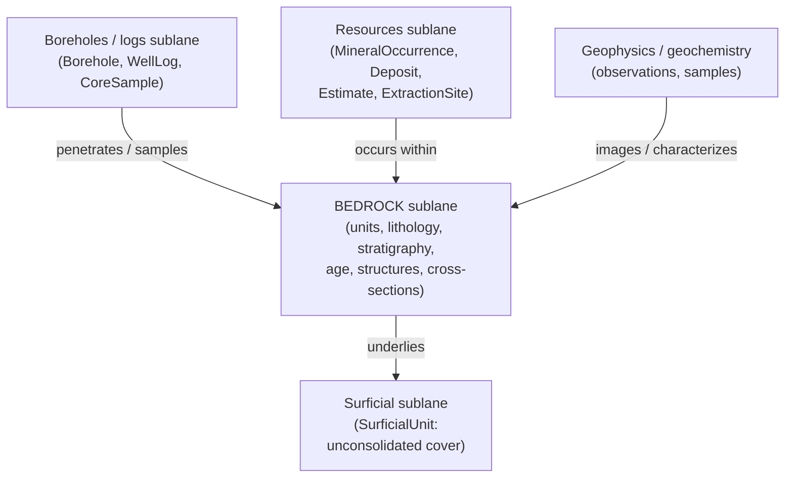
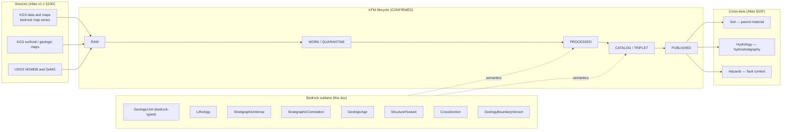

<!-- [KFM_META_BLOCK_V2]
doc_id: kfm://doc/geology-sublane-bedrock
title: Geology — Bedrock Sublane
type: standard
version: v1.2
status: draft
owners: <geology-domain-steward> · <docs-steward>   # placeholder — confirm in CODEOWNERS
created: 2026-06-04
updated: 2026-10-12
policy_label: public
owning_root: docs/
responsibility: "Human-facing scoped slice of the geology lane for bedrock geology (units, lithology, stratigraphy, age, structures, cross-sections); not evidence, policy, release, or publication authority."
truth_posture: "Doctrine statements are CONFIRMED where cited to Atlas Ch. 10; sublane layout, paths, tiers beyond §24.14, and products are PROPOSED or NEEDS VERIFICATION."
related:
  - docs/domains/geology/README.md
  - docs/domains/geology/SCOPE.md
  - docs/domains/geology/SOURCES.md
  - docs/domains/geology/SENSITIVITY.md
  - docs/domains/geology/SOURCE_ROLE_MATRIX.md
  - docs/domains/geology/PRESERVATION_MATRIX.md
  - docs/domains/geology/RELEASE_INDEX.md
  - docs/domains/geology/surficial.md
  - docs/domains/geology/sublanes/README.md
  - docs/domains/geology/sublanes/bedrock_geology.md
  - docs/runbooks/geology/BEDROCK_REVIEW.md
  - docs/doctrine/ai-build-operating-contract.md
  - docs/doctrine/directory-rules.md
  - docs/registers/DRIFT_REGISTER.md
tags: [kfm, geology, bedrock, sublane, stratigraphy, governance]
notes:
  - "2026-10-12: merged unique content from docs/domains/geology/sublanes/bedrock.md (which shared this doc_id) — owner-directed duplicate removal"
  - "2026-10-12: merged unique content from docs/domains/geology/sublanes/bedrock_geology.md (third bedrock draft, doc_id kfm://doc/geology-sublane-bedrock-geology) — owner-directed duplicate removal; OQ-GEOL-BED-05 resolved"
  - Sublane slice of the geology lane scoped to BEDROCK geology. Owns bedrock units, lithology, stratigraphy, age, structures, and cross-sections; explicitly excludes surficial cover (the surficial sublane) and subsurface point records (the boreholes/logs sublane).
  - Doctrine-adjacent; pins CONTRACT_VERSION = "3.0.0".
  - Bedrock/surficial split is CONFIRMED (Atlas §10.A identity; §10.G names a distinct "bedrock unit map" viewing product). Object-family naming drift (§10.B short vs §10.E/§10.C Reference forms) surfaced as CONFLICTED.
  - Bedrock units are the lowest-sensitivity geology content (mostly T0); subsurface/resource detail is out of this sublane. All repo paths PROPOSED.
[/KFM_META_BLOCK_V2] -->

# Geology — Bedrock Sublane

> The bedrock slice of the geology lane (`[DOM-GEOL]`): mapped bedrock units, their lithology, the stratigraphy and age that order them, and the structures and cross-sections that deform and section them. This sublane is mostly public-safe T0 content. It does **not** own surficial cover, subsurface point records, or resource claims — those are sibling sublanes.

| Field | Value |
|---|---|
| **Status** | `draft` |
| **Owners** | `<geology-domain-steward>` · `<docs-steward>` *(placeholders — confirm in CODEOWNERS)* |
| **Parent lane** | Geology / Natural Resources — `[DOM-GEOL]`, Atlas Ch. 10 |
| **Sublane scope** | Bedrock geology (Atlas §10.A bedrock/surficial split; §10.G "bedrock unit map") |
| **Default sensitivity** | Mostly **T0** (`GeologicUnit`/`Lithology` CONFIRMED T0 per §24.14) |
| **Version** | v1.2 |
| **Updated** | 2026-10-12 |

> 2026-10-12: merged unique content from `docs/domains/geology/sublanes/bedrock.md` (which shared this doc_id) — owner-directed duplicate removal

> 2026-10-12: merged unique content from `docs/domains/geology/sublanes/bedrock_geology.md` (third bedrock draft, own doc_id) — owner-directed duplicate removal

> [!IMPORTANT]
> This sublane doc is a **scoped slice**, not a second copy of the lane. The lane-wide boundary, sources, sensitivity, and release rules live in `SCOPE.md`, `SOURCES.md`, `SENSITIVITY.md`, and `RELEASE_INDEX.md`; this doc narrows them to bedrock. Where this doc and a lane-wide doc disagree, the lane-wide doc governs and the conflict is logged in `docs/registers/DRIFT_REGISTER.md`.

> [!NOTE]
> **Merged from `sublanes/bedrock.md` (v2, 2026-06-03).** That file carried this doc's `doc_id` and is now a redirect stub. Its unique content is folded in: repo fit and inputs (§1.1–§1.2), the ubiquitous-language/identity table and identity rule (§2.1), extra exclusions, the anti-collapse warning, and the lifecycle/cross-lane map (§3.1), the full Atlas §10D source ledger, source-role warning, license gate, and activation tip (§4), extra sensitivity rules (§5), extra viewing products (§6.1), and three new sections — spatial & temporal model (§8), pipeline shape (§9), cross-lane relations (§10) — plus its open questions, verification items, changelog, definition-of-done items, and Appendices A–B. Naming disagreements between the two drafts are recorded, not resolved (§2, OQ-GEOL-BED-02). A **third** bedrock draft, [`sublanes/bedrock_geology.md`](./sublanes/bedrock_geology.md) (v1, 2026-06-03, own `doc_id`), was merged in v1.2 and is also a redirect stub now. It largely paralleled `sublanes/bedrock.md`; its unique content is the API/contract/schema surfaces, governed-AI posture, and validator list (§9.1–§9.2), the per-object-class tier table (§5.1), extra checklist items (Appendix A), and its open questions (OQ-GEOL-BED-14, -15). Its `sublanes/surficial_geology.md` and `sublanes/boreholes_wells.md` sibling paths were not carried over because those files do not exist (the real files are `surficial.md` / `sublanes/surficial.md` and `sublanes/boreholes-wells.md`).

---

## Contents

- [1. What the bedrock sublane is](#1-what-the-bedrock-sublane-is)
- [2. Object families this sublane owns](#2-object-families-this-sublane-owns)
- [3. Sublane boundaries (what bedrock is NOT)](#3-sublane-boundaries-what-bedrock-is-not)
- [4. Bedrock source feeds](#4-bedrock-source-feeds)
- [5. Sensitivity posture](#5-sensitivity-posture)
- [6. Viewing product: the bedrock unit map](#6-viewing-product-the-bedrock-unit-map)
- [7. Bedrock-specific anti-collapse](#7-bedrock-specific-anti-collapse)
- [8. Spatial & temporal model](#8-spatial--temporal-model)
- [9. Pipeline shape (RAW → PUBLISHED)](#9-pipeline-shape-raw--published)
- [10. Cross-lane relations](#10-cross-lane-relations)
- [11. Open questions & verification](#8-open-questions--verification)
- [12. Related docs](#9-related-docs)
- [Appendix A · Reviewer checklist](#appendix-a)
- [Appendix B · Anti-pattern register](#appendix-b)

---

## 1. What the bedrock sublane is

**CONFIRMED doctrine (Atlas §10.A).** The geology lane's one-line identity governs "**bedrock**/surficial geology, stratigraphy, lithology, structures, …" — bedrock and surficial are named as distinct halves at the top of the lane. The bedrock sublane is the half concerned with the **consolidated rock record**: the mapped units of solid rock, their material character, the stratigraphic and chronologic framework that orders them, and the structural features and cross-sections that deform and depict them.

Bedrock is the **anchor sublane** of geology: it is the lowest-sensitivity, most-published content (bedrock unit polygons at map scale), and the other sublanes attach to it — surficial cover sits on it, boreholes penetrate it, resources occur within it, hydrostratigraphy reframes it.

> [!NOTE]
> "Bedrock" here means the rock-record framework, not depth. A unit can crop out at the surface and still be bedrock; what makes it *surficial* sublane content is being unconsolidated cover (alluvium, loess, glacial deposits), which `SurficialUnit` carries — see [§3](#3-sublane-boundaries-what-bedrock-is-not).

Doctrine basis (merged): the geology lane owns **bedrock/surficial geology, stratigraphy, lithology, structures, geomorphology** and associated subsurface/observational context, and pairs **polygons for units, lines for structures/cross-sections, points for boreholes/samples** (Atlas v1.1 §10A–B; ENCY §7.8). "Bedrock" is a **map sublane**, not a separate bounded context: it reuses the lane's canonical object families with semantics narrowed to consolidated rock. Public-safe, generalized **bedrock unit map** delivery is in scope.

### 1.1 Repo fit (PROPOSED, merged from `sublanes/bedrock.md` §2)

**Directory Rules basis:** §12 Domain Placement Law (geology is a lane segment inside responsibility roots, never a root folder; `docs/domains/<domain>/` is a directory, but neither a `sublanes/` child nor a flat `SUBLANE-*.md` prefix is enumerated); §5 Canonical Root Tree (`docs/` is the human-facing control-plane root); §4 Placement Protocol Step 3; §13.1 / ADR-0001 (`schemas/contracts/v1/...` is the canonical schema home; `contracts/` holds semantic Markdown only).

**Upstream:** `docs/doctrine/directory-rules.md`; `docs/doctrine/ai-build-operating-contract.md` (`CONTRACT_VERSION = "3.0.0"`); `docs/domains/geology/README.md`; Atlas v1.1 Ch. 10; `kfm_encyclopedia.pdf` §7.8.

**Downstream (PROPOSED homes):** `contracts/domains/geology/` (semantic contracts for `GeologicUnit`, `StratigraphicInterval`, …); `schemas/contracts/v1/domains/geology/` (JSON Schemas per ADR-0001 default — the sublanes index uses `schemas/contracts/v1/geology/`; both directories exist, see OQ-GEOL-BED-07); `policy/domains/geology/`; `tests/domains/geology/` and `fixtures/domains/geology/`; `data/published/layers/geology/`; `pipeline_specs/geology/`.

### 1.2 Inputs (merged from `sublanes/bedrock.md` §3)

Material that **belongs** in or is referenced by this sublane:

- **Bedrock map data** from KGS and USGS — geologic map polygons (unit codes, lithology, age, source map).
- **Stratigraphic nomenclature** for Kansas bedrock (formation / member / group references).
- **Lithologic descriptions** attached to mapped units.
- **Structural overlays** (`StructureFeature`: faults, contacts) when delivered with a bedrock map.
- **Map metadata** — series, vintage, scale, attribution, license, interpretation version.
- **`CrossSection` interpretations** through bedrock units.
- **Generalization receipts** describing how exact polygon geometry was transformed to public-safe form.

> [!TIP]
> Inputs enter via the standard **`SourceDescriptor` → source-activation decision** path. A KGS bedrock map series is not implicitly active; it requires a recorded source role, license review, attribution, and a recorded activation decision before connectors emit to RAW. *(The outcome object name `SourceActivationDecision` is PROPOSED — verify against `contracts/`.)*

[↑ Back to top](#top)

---

## 2. Object families this sublane owns

The bedrock-relevant subset of the lane's `§10.B` owns-list plus the bedrock `§10.C` terms.

> [!CAUTION]
> **Object-family naming drift (CONFLICTED).** Names use the §10.B short forms; §10.C/§10.E use variant forms (`StructureFeature` for `Fault Structure`; `GeologyBoundaryVersion`; `StratigraphicCorrelation`). Canonical set unresolved — see [§8](#8-open-questions--verification) and `SCOPE.md`.

| Object family | What it carries in the bedrock sublane |
|---|---|
| `Geologic Unit` | A mapped body of consolidated rock with attribution (the core bedrock object). |
| `Lithology` | The material character of a bedrock unit (limestone, shale, sandstone, …). |
| `Stratigraphic Interval` | A named interval with bounded contacts ordering the bedrock record. |
| `Geologic Age` | The chronostratigraphic / geochronologic time-scope of a unit or interval, with uncertainty. |
| `StratigraphicCorrelation` *(§10.C)* | The correlation of intervals across locations (interpretive). |
| `Fault Structure` / `StructureFeature` *(§10.E)* | Structural lines/surfaces deforming the bedrock, with sense-of-slip and confidence. |
| `CrossSection` | A 2D interpretive section through the bedrock record (interpretation-versioned). |
| `GeologyBoundaryVersion` *(§10.C)* | The versioned boundary geometry of a bedrock unit (provenance of the line itself). |

> [!NOTE]
> `HydrostratigraphicUnit` is the **bridge** object to hydrology and is owned by the lane, but it is the geology↔hydrology reframing of the bedrock/aquifer framework rather than a pure bedrock object; it is governed primarily through the cross-lane edge (`SCOPE.md §4`), not this sublane.

> [!NOTE]
> **Merge conflict recorded (2026-10-12).** `sublanes/bedrock.md` v2 took a firmer position than this file: it treats **`StructureFeature`** as the Atlas v1.1 §10C canonical name and calls `FaultStructure` (and by extension the `Fault Structure` short form) **drift**. This file lists both as CONFLICTED. Both positions are kept; resolution stays with OQ-GEOL-BED-02. The merged draft also used spaced Atlas casings for sibling families (`Well LogReference`, `Geochemistry SampleReference`, `Mineral Occurrence`, `Resource Deposit`, `Extraction Site`) and asked that they not be silently renamed. `sublanes/bedrock_geology.md` (merged v1.2) took the same position as `sublanes/bedrock.md`: Atlas v1.1 §10C/E casing, `FaultStructure` deliberately not used.

### 2.1 Ubiquitous language and identity (merged from `sublanes/bedrock.md` §6)

CONFIRMED terms (Atlas v1.1 §10C, §10E; cross-domain spine §2.2); PROPOSED field realizations until the geology schema is mounted.

| Term | Bedrock-sublane meaning | Identity (PROPOSED) |
|---|---|---|
| `GeologicUnit` | A consolidated-rock mapping unit (formation/member/group) as carried by a specific bedrock map series. | `source_id + object_role + temporal_scope + normalized_digest` |
| `Lithology` | Rock-type descriptor of a bedrock unit. | A **descriptor of** a `GeologicUnit`, not a free-standing map object. |
| `StratigraphicInterval` | A formal lithostratigraphic interval referenced by a unit. | Same basis as `GeologicUnit`. |
| `StratigraphicCorrelation` | A correlation assertion across mapped units; **interpretive** — never raised to canonical map fact without evidence. | Same basis. |
| `GeologicAge` | A chronostratigraphic age (period / epoch / stage) attached to a bedrock unit. | Vocabulary-bounded; tracked against the source map's age system. |
| `StructureFeature` | A structural feature delivered with the bedrock map (fault trace, fold, contact). | Same basis. |
| `CrossSection` | Interpretive section through bedrock units; carries its own evidence and interpretation version. | Same basis. |
| `GeologyBoundaryVersion` | Interpretation version and uncertainty for a bedrock map; each refit / rebound is a new version, not an overwrite. | Same basis. |

> [!IMPORTANT]
> A bedrock map polygon's identity is **bound to its source map series and vintage**, not to the rock itself. Re-mapping the same outcrop produces a new `GeologyBoundaryVersion`, not a correction of the prior unit's truth value.

[↑ Back to top](#top)

---

## 3. Sublane boundaries (what bedrock is NOT)

The bedrock sublane sits among sibling sublanes. The boundaries below keep bedrock from absorbing them.

| Not in this sublane | Owning sublane | Why the line matters |
|---|---|---|
| `SurficialUnit` (alluvium, loess, glacial cover) | Surficial sublane | Surficial cover is unconsolidated and separately mapped; the §10.G "surficial unit map" is a distinct product. |
| `Borehole`, `WellLog`, `CoreSample` (subsurface points) | Boreholes/logs sublane | These are point records with deny-by-default exact geometry; bedrock units are public polygons. Mixing them imports T4 sensitivity into a T0 sublane. |
| `MineralOccurrence`, `ResourceDeposit`, `ResourceEstimate`, `ExtractionSite`, `ReclamationRecord` | Resources sublane | A unit is *where* rock is; a resource is a *claim about value/recoverability* in it. Claim classes stay distinct (`SCOPE.md §5`). |
| `GeophysicalObservation`, `GeochemistrySample` | Geophysics/geochemistry sublane | These characterize the bedrock but are observations/samples, not the mapped unit. |
| Hydrology measurements, soils, hazard risk, ownership | Other lanes | Lane-level non-ownership (`SCOPE.md §3`). |
| Soil map units, components, horizons, properties *(merged)* | Soil lane (`docs/domains/soil/`) | `SoilMapUnit`, `SoilComponent`, … stay soil-owned. |
| Aquifer / hydrostratigraphic *measurements* *(merged)* | Hydrology lane (`docs/domains/hydrology/`) | Geology contributes `Hydrostratigraphic Unit` context only. |
| Hazard / risk assessment derived from bedrock structure *(merged)* | Hazards lane (`docs/domains/hazards/`) | Geology contributes context, not risk. |
| Mineral / lease ownership, title, operator records *(merged)* | People / Land lane (`docs/domains/people-dna-land/`) | Geology cannot prove ownership. |
| Cross-cutting governance (`EvidenceBundle`, `RunReceipt`, `ReleaseManifest` semantics) *(merged)* | `contracts/evidence/`, `contracts/runtime/`, `contracts/release/` *(PROPOSED homes)* | Shared semantics, not bedrock-owned. |

> [!WARNING]
> The defining bedrock-sublane error is **importing a borehole's exact location into a bedrock map**. A bedrock `GeologicUnit` polygon is public-safe T0; a `Borehole` point is T4 by default. The unit is bedrock-sublane content; the borehole that confirmed it is boreholes-sublane content with its own sensitivity gate.

> [!WARNING]
> **Anti-collapse (merged).** A bedrock map polygon is **not** a verified exact unit outcrop, **not** a verified subsurface presence at depth, and **not** a resource estimate. Promotion across that boundary requires evidence, source-role discipline, and a release decision — not visual proximity on a map (Atlas v1.1 §10B).

### 3.1 Sublane map: sources, lifecycle, cross-lane (PROPOSED, merged from `sublanes/bedrock.md` §5)

Illustrative; reflects doctrine relationships, not a verified runtime graph.

The lifecycle `RAW → WORK / QUARANTINE → PROCESSED → CATALOG / TRIPLET → PUBLISHED` is CONFIRMED doctrine (Directory Rules §0; Atlas v1.1 §1 and §10H); nothing in the sublane bypasses it. Concrete lane paths are in `CANONICAL_PATHS.md` (some are disputed — see `CONTINUITY_INVENTORY.md`).

[↑ Back to top](#top)

---

## 4. Bedrock source feeds

The bedrock-relevant subset of the lane's `§10.D` source families (full typology in `SOURCES.md`).

| Source family | Typical role | Feeds (bedrock) |
|---|---|---|
| KGS data & geologic maps | authority / observation | `GeologicUnit`, `Lithology`, `StratigraphicInterval`, `StructureFeature`, `CrossSection` |
| USGS NGMDB / GeMS | authority / aggregate / modeled | `GeologicUnit`, `StratigraphicInterval`, `GeologicAge` |
| KGS geophysics (where it constrains structure) | observation / modeled | `StructureFeature`, `CrossSection` *(as supporting evidence, not the unit)* |
| KGS surficial geology and geologic maps *(merged)* | as source role requires | Bedrock components of geologic maps only; surficial content routes to the surficial sublane |
| USGS 3DEP terrain *(merged)* | `terrain_context` only | Visual context — **never** a unit-identity source |

Atlas §10D families that are **out of bedrock scope** (merged; listed so the sublane does not silently co-opt them): KGS oil and gas wells and production; KCC oil and gas regulatory data; KGS/KDHE WWC5 and water-well program; KGS LAS digital well logs and well tops; USGS MRDS. For every §10D family the Atlas posture is "authority / observation / context / model **as source role requires**", rights and current terms **NEEDS VERIFICATION**, and **sensitive joins fail closed**.

> [!NOTE]
> The **surficial** KGS feed (`SOURCES.md` family 2) feeds the surficial sublane, not this one. KGS oil-and-gas, LAS well logs, WWC5, and MRDS feed the boreholes/logs and resources sublanes. The bedrock sublane's feeds are predominantly the **authority/observation map sources**, which is part of why it is the lowest-sensitivity sublane.

> [!WARNING]
> **Source roles cannot be inferred from convenience (merged).** A geophysical anomaly is not a confirmed bedrock unit. A borehole encountering a lithology is not a remapped unit boundary. Promotion of evidence across these roles is a **governed state transition**, not a join.

> [!CAUTION]
> **License / attribution gate (NEEDS VERIFICATION, merged).** The Atlas marks KGS / USGS "rights and current terms" as NEEDS VERIFICATION. KGS / USGS-derived COGs and tile artifacts MUST NOT publish until license and attribution are settled; bedrock layers MUST fail release when license, source series, or attribution is missing. (MapLibre-dossier clause IDs cited in an earlier draft — `ML-057-008`, `ML-062-028..033` — were never verified and are not relied on.)

[↑ Back to top](#top)

---

## 5. Sensitivity posture

| Object family | Default tier | Basis |
|---|---|---|
| `GeologicUnit`, `Lithology` | **T0** | CONFIRMED default — Atlas §24.14 |
| `StratigraphicInterval`, `GeologicAge`, `StratigraphicCorrelation` | T0 | PROPOSED (routine public map content; §10.I) |
| `StructureFeature` / `Fault Structure` | T0 / T1 *(detailed seismotectonic detail T2)* | PROPOSED |
| `CrossSection` | T0 / T1 — **`RealityBoundaryNote` required if reconstruction-heavy** | PROPOSED; interpretive-surface rule |
| `GeologyBoundaryVersion` | T0 | PROPOSED (provenance of a public line) |

> [!IMPORTANT]
> Bedrock is the **public face** of the geology lane: bedrock unit maps are the routine, citeable, T0 product. The one sensitivity nuance is **interpretation**, not location — a reconstruction-heavy `CrossSection` requires a `RealityBoundaryNote` so a drawn surface is not read as observed structure (`SENSITIVITY.md`; Grid C **S→O** in `SOURCE_ROLE_MATRIX.md`). Exact-location sensitivity does not arise in this sublane because point records live elsewhere.

Additional rules (merged from `sublanes/bedrock.md` §11; Atlas v1.1 §10; ENCY §7.8; operating contract §23.2):

- **Bedrock unit polygons** are public-safe **when generalized** — release is permitted once rights, attribution, license, and source role are settled.
- **Resource estimates, extraction sites, exact borehole locations, well-log details, sensitive proprietary geometry** stay in other sublanes with deny-by-default or restricted defaults and MUST NOT be promoted via this sublane.
- **Default-deny on missing release inputs:** unclear rights, unresolved source role, missing evidence, unresolved sensitivity, or absent release state **blocks public promotion** (CONFIRMED doctrine).

> [!IMPORTANT]
> **A bedrock map is not a resource map.** A user clicking a bedrock polygon sees the **bedrock unit identity** plus its `EvidenceBundle` — never a resource estimate, extraction location, or borehole location, unless those are independently released by their own sublanes.

### 5.1 Tier by object class, with transforms and gates (PROPOSED, merged from `sublanes/bedrock_geology.md` §12)

Atlas v1.1 §10I; ENCY §7.8; operating contract §23.2; T0–T4 tier scheme (PROPOSED, ADR-S-05).

| Object class | Default tier | Allowed transform | Required gates |
|---|---|---|---|
| Bedrock unit polygon (generalized) | **T0 / T1** | Generalization where scale demands it. | Standard release gates; `RedactionReceipt` if generalized. |
| Bedrock `StructureFeature` overlay | **T0 / T1** | Generalization; uncertainty classes. | Standard release gates. |
| Exact borehole / sample / well-log location | **T2–T4** *(sibling sublanes)* | Generalize / restrict; never on the bedrock layer. | `RedactionReceipt` + `ReviewRecord` + `PolicyDecision`. |

> [!NOTE]
> **Merge conflict recorded (2026-10-12).** The merged draft put bedrock unit polygons at **T0 / T1** and exact borehole / sample / well-log / private-well locations at **T2–T4** ("restricted or generalized"). This file puts `GeologicUnit` at **T0** (CONFIRMED, §24.14) and a `Borehole` point at **T4 by default** (§3). Both are kept; see OQ-GEOL-BED-15 and `CONTINUITY_INVENTORY.md` D-05, which records the same lane-level disagreement.

[↑ Back to top](#top)

---

## 6. Viewing product: the bedrock unit map

**PROPOSED viewing product (Atlas §10.G).** §10.G names "bedrock unit map" as a distinct domain viewing product, separate from the surficial unit map and the structure/fault view.

| Aspect | Bedrock unit map |
|---|---|
| Primary geometry | `GeologicUnit` polygons (bedrock) |
| Overlays | `StructureFeature` lines; `StratigraphicInterval` / `GeologicAge` attribution; `CrossSection` lines |
| Layer artifacts | PMTiles / GeoJSON + `LayerManifest` + `TileArtifactManifest` (per `RELEASE_INDEX.md §9`) |
| Cross-cutting | Evidence Drawer, time-aware state, trust badges, correction/stale-state view, governed Focus Mode (CONFIRMED, §10.G) |
| Release tier | T0 public-safe |

> [!NOTE]
> The bedrock unit map binds to the lane's release surface: `release_id → layer_id (bedrock) → viewing_mode`. That chain is what makes a published bedrock map auditable end-to-end (`RELEASE_INDEX.md §9`).

### 6.1 Derived and companion views (PROPOSED, merged from `sublanes/bedrock.md` §9)

| Product | Geometry | Purpose |
|---|---|---|
| Lithology view | Polygon (derived) | Re-symbolize the bedrock unit map by lithology class. |
| Geologic age view | Polygon (derived) | Recolor by chronostratigraphic age. |
| Bedrock structure overlay | Line | `StructureFeature` (faults, contacts) with uncertainty classes. |
| Cross-section view | Line + 2D section | Interpretive sections; carries representation receipt and evidence burden. |
| Interpretation-version diff | Polygon (compare) | Compare two `GeologyBoundaryVersion` instances; flag changed polygons. |
| Uncertainty view | Polygon (style overlay) | Visualize unit / boundary uncertainty classes. |

Every bedrock product also participates in the **sensitivity-redacted view** (CONFIRMED cross-cutting set, Atlas §10G; MAP-MASTER; GAI). The sublane defines no renderer of its own; it consumes the same governed map shell / Evidence Drawer / `AIReceipt` envelope as every other lane. Delivery format for released layers per the merged draft: GeoParquet + COG/PMTiles.

[↑ Back to top](#top)

---

## 7. Bedrock-specific anti-collapse

The lane-wide anti-collapse rules (`SOURCE_ROLE_MATRIX.md §5`) apply; the bedrock-specific cases:

| Collapse to deny | Why it's wrong | Guardrail |
|---|---|---|
| **Modeled unit polygon → observed bedrock** | An interpreted/compiled unit boundary presented as a measured contact | Modeled descriptor with `role_model_run_ref`; never relabeled observed (Grid C **M→O**) |
| **Cross-section → observed structure** | A drawn interpretive section read as measured subsurface fact | `RealityBoundaryNote` + `RepresentationReceipt`; synthetic/interpretive flagged (Grid C **S→O**) |
| **Bedrock unit ↔ surficial unit** | Treating mapped bedrock as the unconsolidated cover above it (or vice versa) | Distinct `GeologicUnit` vs `SurficialUnit` families; the bedrock/surficial split (§10.A) |
| **Unit boundary as a fixed truth** | Citing one `GeologyBoundaryVersion` as the only/eternal boundary | Boundary is versioned; cite the version + its `EvidenceBundle` |
| **Bedrock unit → resource claim** | Implying value/recoverability from the presence of a unit | Resource claim classes are separate (`SCOPE.md §5`); a unit is not a deposit |

> [!TIP]
> **Geologic age ≠ time of mapping (merged).** Geologic age (Cretaceous, Permian, …) and time-of-mapping are different; the sublane carries **both**. Confusing them is a classic anti-collapse failure that the temporal model in §8 prevents.

[↑ Back to top](#top)

---

## 8. Spatial & temporal model

*Merged from `sublanes/bedrock.md` §8.* CONFIRMED doctrine (Atlas v1.1 §10E; ENCY §7.8):

- **Geometry** — polygons for bedrock units (`GeologicUnit`); lines for `StructureFeature` (faults, contacts) and `CrossSection` traces; cross-sections as interpretive 2D sections; **3D surfaces / voxels** only when justified, with representation receipts.
- **Interpretation versioning** — every refit produces a new `GeologyBoundaryVersion`; prior versions are preserved in lineage, not overwritten.
- **Uncertainty** — tracked at the unit and at the boundary line (approximate, inferred, concealed).
- **Temporal handling** — "source, observed, valid, retrieval, release, and correction times stay distinct where material": `source_time` (source map publication), `observed_time` (field-mapping date when known), `valid_time` (when the unit is considered current), `retrieval_time` (KFM pull), `release_time` (KFM release), `correction_time` (correction notice applied).

[↑ Back to top](#top)

---

## 9. Pipeline shape (RAW → PUBLISHED)

*Merged from `sublanes/bedrock.md` §10.* CONFIRMED doctrine; PROPOSED sublane application. Promotion is a **governed state transition, not a file move** (Directory Rules §0; Atlas v1.1 §10H). Executable pipeline docs: `pipelines/domains/geology/bedrock_units/README.md`; maturity is assessed in `docs/runbooks/geology/BEDROCK_REVIEW.md`.

| Stage | Bedrock-sublane handling | Gate |
|---|---|---|
| **RAW** | Capture KGS / USGS bedrock map source payload (geometry as delivered + sidecar metadata) with source role, rights, sensitivity, citation, time, hash. | `SourceDescriptor` exists. |
| **WORK / QUARANTINE** | Normalize CRS, geometry, attribute schema, unit-code crosswalk, age vocabulary, lithology vocabulary, identity, evidence, rights, policy. Hold failures (missing attribution, license unconfirmed, unknown unit code). | Validation + policy gate pass, or quarantine reason recorded. |
| **PROCESSED** | Emit validated `GeologicUnit` objects, `Lithology` descriptors, `GeologicAge` assignments, `StructureFeature` overlays, and public-safe candidate geometry; emit `EvidenceRef` and `ValidationReport`; close digest. | `EvidenceRef`, `ValidationReport`, digest closure exist. |
| **CATALOG / TRIPLET** | Emit catalog records, `EvidenceBundle`s, graph/triplet projections (`GeologicUnit` ↔ `Lithology` ↔ `GeologicAge` ↔ `StratigraphicInterval`), and release candidates. | Catalog / proof closure passes. |
| **PUBLISHED** | Serve released public-safe bedrock layer artifacts (GeoParquet + COG/PMTiles) through governed APIs and a `ReleaseManifest`. | `ReleaseManifest`, correction path, rollback target, review / policy state exist. |

> [!CAUTION]
> **Watcher-as-non-publisher.** A bedrock watcher that detects a KGS map-series update **MAY emit a candidate `PromotionDecision`**; it MUST NOT write to processed or published geology paths directly. Promotion is reserved to the governed pipeline.

### 9.1 API, contract & schema surfaces (PROPOSED, merged from `sublanes/bedrock_geology.md` §11)

Governed surfaces per Atlas v1.1 §10J. All routes are **UNKNOWN** until verified in the repo (OQ-GEOL-BED-14); outcomes are the canonical finite set.

| Surface | DTO / schema | Finite outcomes | Status |
|---|---|---|---|
| Geology feature / detail resolver | `GeologyDecisionEnvelope` | `ANSWER` / `ABSTAIN` / `DENY` / `ERROR` | PROPOSED; exact route UNKNOWN |
| Geology layer manifest resolver | `LayerManifest` / domain layer descriptor | `ANSWER` / `DENY` / `ERROR` | PROPOSED; public-safe release only |
| Geology Evidence Drawer payload | `EvidenceDrawerPayload` + `EvidenceBundle` projection | `ANSWER` / `ABSTAIN` / `DENY` / `ERROR` | PROPOSED; evidence- and policy-filtered |
| Geology Focus Mode answer | `Runtime Response Envelope` + `AIReceipt` | `ANSWER` / `ABSTAIN` / `DENY` / `ERROR` | PROPOSED; AI never root truth |
| Schema responsibility root | `schemas/contracts/v1/` | finite validator outcomes | PROPOSED; slug per OQ-GEOL-BED-07 and ADR-0001 |

> [!NOTE]
> **Governed AI behavior (Atlas §10L).** AI may summarize released geology `EvidenceBundle`s, compare evidence, explain limitations, and draft steward-review notes. AI MUST `ABSTAIN` when evidence is insufficient and `DENY` where policy, rights, sensitivity, or release state blocks the request. `EvidenceBundle` outranks generated language.

### 9.2 Validators, tests, and fixtures (PROPOSED, Atlas §10K; merged)

None verified against the repo:

- Source-role validators (a map source is not silently a subsurface authority).
- Resource-class anti-collapse tests (no `ResourceEstimate` / `Mineral Occurrence` content on a bedrock layer).
- Public-safe geometry tests (generalization rule applied; receipt emitted).
- Borehole / well-log rights tests (sibling sublanes; the bedrock layer must not surface them).
- Catalog closure tests (`EvidenceRef` resolves to a populated `EvidenceBundle`).
- AI evidence-before-model tests (`EvidenceBundle` outranks generated language).

[↑ Back to top](#top)

---

## 10. Cross-lane relations

*Merged from `sublanes/bedrock.md` §12.* CONFIRMED doctrine (Atlas v1.1 §10F). Each relation MUST preserve **ownership, source role, sensitivity, and `EvidenceBundle` support** — none are joins of convenience.

| Related lane | Relation | Constraint |
|---|---|---|
| **Soil** | Bedrock unit → soil **parent material** / surficial context | Does **not** replace soil map unit truth. |
| **Hydrology** | Bedrock unit → **hydrostratigraphy** / aquifer context (`Hydrostratigraphic Unit`) | Does **not** replace hydrologic measurements or aquifer extent claims. |
| **Hazards** | `StructureFeature` → **fault / landslide / subsidence** context | Context only; Hazards owns risk. |
| **People / Land** | Bedrock unit ↔ lease / parcel / operator records | A unit **cannot prove** mineral title, lease validity, or production. |
| **Archaeology** | Bedrock outcrop ↔ rockshelter / quarry context | Geologic context only; Archaeology owns site claims and exact-coordinate denial. |

[↑ Back to top](#top)

---

## 11. Open questions & verification

*(Anchor `#8-open-questions--verification` is kept from v1 for link stability.)*

### Open questions register

| ID | Question | Owner role | Resolution path |
|---|---|---|---|
| OQ-GEOL-BED-01 | Confirm the bedrock object-family set vs the surficial set — is `SurficialUnit` cleanly partitioned from `GeologicUnit`, or is it a sub-type? | `<geology-domain-steward>` | Schema review of `contracts/domains/geology/`; SCOPE OQ-GEOL-SCOPE-03 |
| OQ-GEOL-BED-02 | Resolve object-family naming drift (`Fault Structure`/`StructureFeature`; `GeologyBoundaryVersion`; `StratigraphicCorrelation`). | `<geology-domain-steward>` | ADR or schema PR; drift entry |
| OQ-GEOL-BED-03 | Ratify the bedrock tier rows beyond the two §24.14-grounded ones (structures, cross-sections, boundary versions). | `<geology-domain-steward>` + `<policy-steward>` | ADR-S-05 extension |
| OQ-GEOL-BED-04 | Confirm the "bedrock unit map" viewing product, its layer manifests, and Evidence Drawer payload. | `<geology-domain-steward>` | `apps/governed-api/` + `schemas/contracts/v1/map/` |
| OQ-GEOL-BED-05 | ~~Reconcile the remaining third bedrock draft `sublanes/bedrock_geology.md`.~~ **RESOLVED 2026-10-12 (v1.2):** merged here; that path is a redirect stub. Inbound-link repointing is tracked by the docs steward. Also closes the bedrock half of `CONTINUITY_INVENTORY.md` D-09 and `BEDROCK_REVIEW.md` BEDROCK-OPEN-001, and the merged draft's own OQ-GEOL-BEDROCK-06 ("`bedrock_geology.md` vs `bedrock.md` — only one canonical"). | docs steward + `<geology-domain-steward>` | Done — owner-directed merge |
| OQ-GEOL-BED-06 | Accept `sublanes/` subfolder vs flat `SUBLANE-*.md` prefix under `docs/domains/geology/` (was OQ-GEOL-BEDROCK-01 in the merged draft). | docs steward + directory-rules owner | ADR amending Directory Rules §12; DRIFT_REGISTER entry until resolved |
| OQ-GEOL-BED-07 | Confirm geology contract/schema homes — `schemas/contracts/v1/domains/geology/` (ADR-0001 default, merged draft) vs `schemas/contracts/v1/geology/` (sublanes index); both directories exist (was OQ-GEOL-BEDROCK-02). | `<geology-domain-steward>` | Repo inspection + ADR-0001 check |
| OQ-GEOL-BED-08 | Designate the default authoritative KGS bedrock map series and scale (was OQ-GEOL-BEDROCK-03). | `<geology-domain-steward>` + source authority | Source-activation decision under the source registry |
| OQ-GEOL-BED-09 | Resolve KGS/USGS license + attribution for COG/PMTiles publication (was OQ-GEOL-BEDROCK-04). | rights reviewer | License review record; close Atlas §10D NEEDS VERIFICATION |
| OQ-GEOL-BED-10 | Canonical age vocabulary (ICS chart edition / KGS local nomenclature) for `GeologicAge`. | `<geology-domain-steward>` | Vocabulary file under `control_plane/` or `schemas/` |
| OQ-GEOL-BED-11 | Generalization rule for the public-safe bedrock unit map (target scale, simplification tolerance, attribute redaction). | `<geology-domain-steward>` + `<policy-steward>` | Policy entry under `policy/domains/geology/` + generalization-receipt fixture |
| OQ-GEOL-BED-12 | How `GeologyBoundaryVersion` diffs surface in the Evidence Drawer and correction notices; whether `CrossSection`s need a representation receipt distinct from the source map's. | `<geology-domain-steward>` | Evidence Drawer payload contract; correction-notice schema; ADR on 2.5D/3D representation receipts |
| OQ-GEOL-BED-13 | Exact name of the source-activation outcome object (`SourceActivationDecision` is PROPOSED). | `<geology-domain-steward>` | `contracts/` inspection |
| OQ-GEOL-BED-14 | Confirm the finite-outcome resolver routes for the geology surfaces in §9.1 (Atlas §10J marks routes TBD/UNKNOWN). From `bedrock_geology.md` OQ-GEOL-BEDROCK-05. | `<geology-domain-steward>` + API owner | Repo route inspection under `apps/governed-api/` |
| OQ-GEOL-BED-15 | Reconcile default tiers: bedrock unit polygon T0 (§5, §24.14) vs T0/T1 (§5.1); exact borehole / well-log points T4 by default (§3) vs T2–T4 (§5.1). | `<geology-domain-steward>` + sensitivity reviewer | `SENSITIVITY.md` + ADR-S-05; aligns with `CONTINUITY_INVENTORY.md` D-05 |

> The `sublanes/bedrock.md` draft's OQ-GEOL-BEDROCK-05 (`StructureFeature` vs `FaultStructure` drift sweep) is folded into OQ-GEOL-BED-02. **ID collision:** `sublanes/bedrock_geology.md` used the same ID, OQ-GEOL-BEDROCK-05, for a different question (resolver routes), now OQ-GEOL-BED-14. Its OQ-GEOL-BEDROCK-01…04 match OQ-GEOL-BED-06…09, and its OQ-GEOL-BEDROCK-06 is resolved under OQ-GEOL-BED-05.

### Open verification backlog

These items remain `NEEDS VERIFICATION` before this document promotes from `draft` to `published`:

1. The bedrock/surficial object partition (OQ-GEOL-BED-01).
2. The canonical bedrock object-family name set (OQ-GEOL-BED-02).
3. The bedrock unit map viewing-product wiring (OQ-GEOL-BED-04).
4. Sublane doc layout (OQ-GEOL-BED-06); the third bedrock draft is resolved (OQ-GEOL-BED-05).
5. Geology contract/schema homes against the repo and ADR-0001 (OQ-GEOL-BED-07).
6. Default KGS bedrock map series and scale (OQ-GEOL-BED-08).
7. KGS/USGS license and attribution for tile/COG publication (OQ-GEOL-BED-09).
8. Source-activation outcome object name (OQ-GEOL-BED-13).
9. `GeologicAge` vocabulary and the public-safe generalization rule + receipt fixture (OQ-GEOL-BED-10, -11).
10. MapLibre-dossier clause IDs governing geology tile publication (unverified; not relied on).
11. Resolver route names for geology surfaces (OQ-GEOL-BED-14) and the tier-default conflict (OQ-GEOL-BED-15).

## Changelog v1.1 → v1.2 (2026-10-12)

| Change | Type (per contract §37) | Reason |
|---|---|---|
| Merged unique content from `sublanes/bedrock_geology.md` (v1, own `doc_id` `kfm://doc/geology-sublane-bedrock-geology`); that path is now a redirect stub | reconciliation | Owner-directed duplicate removal; resolves OQ-GEOL-BED-05 and the merged draft's OQ-GEOL-BEDROCK-06 |
| Added §5.1 tier-by-object-class table, §9.1 API/contract/schema surfaces + governed-AI note, §9.2 validators/tests list, Appendix A items | new | Content existed only in `bedrock_geology.md` |
| Added OQ-GEOL-BED-14 (resolver routes) and OQ-GEOL-BED-15 (tier-default conflict); recorded the OQ-GEOL-BEDROCK-05 ID collision | new | Preserve open questions; record conflicts instead of dropping them |

<b>History carried from the merged draft — <code>sublanes/bedrock_geology.md</code> changelog v0 → v1 (2026-06-03)</b>

| Change | Type | Reason |
|---|---|---|
| New sublane doc created at `docs/domains/geology/sublanes/bedrock_geology.md` | new | First bedrock-geology sublane doc under the requested filename. |
| Object families set to Atlas v1.1 §10C/E canonical casing (`StructureFeature`, `SurficialUnit`, …) | new | Terminology fidelity; `FaultStructure` deliberately not used. |
| Source families set to the Atlas §10D ledger with bedrock-relevance flags | new | Mirror the actual lane ledger. |
| Added API/contract/schema surfaces from Atlas §10J–L | new | Surface governed resolvers, finite outcomes, and AI posture. |
| Added T0–T4 tier mapping for bedrock object classes | new | Ground sensitivity in the per-domain matrix. |

## Changelog v1 → v1.1 (2026-10-12)

| Change | Type (per contract §37) | Reason |
|---|---|---|
| Merged unique content from `sublanes/bedrock.md` (v2), which shared this `doc_id`; that path is now a redirect stub | reconciliation | Owner-directed duplicate removal (KFM-TOPO-016 waiver retired for this pair) |
| Added §8 spatial & temporal model, §9 pipeline shape, §10 cross-lane relations; renumbered open questions to §11 and related docs to §12 (v1 anchors kept) | new | Content existed only in the merged draft |
| Added OQ-GEOL-BED-05 … -13 (merged-draft questions renumbered; third draft `bedrock_geology.md` flagged) | new | Preserve every open question from both drafts |
| Recorded the `StructureFeature` vs `Fault Structure` naming disagreement instead of resolving it | clarification | The two drafts disagreed; resolution stays with OQ-GEOL-BED-02 |
| Added `owning_root`, `responsibility`, `truth_posture`; fixed `related` paths | housekeeping | Meta-block validator `required` profile |

<b>History carried from the merged draft — <code>sublanes/bedrock.md</code> changelog v1 → v2 (2026-06-03)</b>

| Change | Type | Reason |
|---|---|---|
| `FaultStructure` → `StructureFeature` across the doc | reconciliation | Align to Atlas v1.1 §10C/E; prior form was drift. |
| Expanded source families to the Atlas §10D ledger | gap closure | v1 named only generic "KGS"/"USGS". |
| Removed unverified MapLibre-dossier clause IDs (`ML-057-008`, `ML-062-028..033`) | reconciliation | Could not be verified. |
| Added `CONTRACT_VERSION = "3.0.0"` pin, companion sections, object-family fidelity block | housekeeping / new | Doctrine-doc companion pattern. |
| Labeled `SourceActivationDecision` as PROPOSED | clarification | Exact name not verified against `contracts/`. |

## Changelog v0 → v1

| Change | Type (per contract §37) | Reason |
|---|---|---|
| Initial bedrock sublane doc authored | new | First geology sublane slice; scope bedrock vs the surficial/borehole/resource siblings |
| Bedrock/surficial split grounded to §10.A + §10.G | clarification | Use the corpus's explicit bedrock vs surficial distinction and the named "bedrock unit map" product |
| Object-family naming drift surfaced as CONFLICTED | new | Consistent with the rest of the geology suite |

> **Backward compatibility.** New file; no prior anchors to preserve. Section anchors introduced here should be treated as stable.

## Definition of done

This document is done enough to enter the repository when:

- it is placed according to Directory Rules (under `docs/domains/geology/`);
- a geology domain steward reviews it;
- the bedrock object-family set matches the dossier (or the dossier is updated in lockstep);
- it is linked from `docs/domains/geology/README.md` and `SCOPE.md`;
- it does not conflict with accepted ADRs;
- any conflict with lane-wide docs or the dossier is logged in `docs/registers/DRIFT_REGISTER.md`;
- the `GENERATED_RECEIPT.json` planned in the authoring notes is wired into CI;
- future changes follow `ai-build-operating-contract.md §37` lifecycle;
- the sublane-folder question (OQ-GEOL-BED-06) is resolved; the bedrock-doc duplication (OQ-GEOL-BED-05) was resolved in v1.2, so this is the only authoritative bedrock doc *(merged)*;
- the filename and sublane-folder questions are logged in `docs/registers/DRIFT_REGISTER.md` *(merged from `bedrock_geology.md`)*;
- the `StructureFeature` naming drift is logged in `docs/registers/DRIFT_REGISTER.md` *(merged)*.

[↑ Back to top](#top)

---

## 12. Related docs

*(Anchor `#9-related-docs` is kept from v1 for link stability.)*

- `docs/domains/geology/SCOPE.md` — lane boundary; owned object families; claim-class distinctness.
- `docs/domains/geology/SOURCES.md` — full source-family typology (bedrock feeds are a subset).
- `docs/domains/geology/SENSITIVITY.md` — tier classification & decision lattice.
- `docs/domains/geology/SOURCE_ROLE_MATRIX.md` — anti-collapse grids (Grid C referenced in §7).
- `docs/domains/geology/PRESERVATION_MATRIX.md` — per-family preservation rules.
- `docs/domains/geology/RELEASE_INDEX.md` — release surface; published bedrock layers (§9).
- `docs/domains/geology/README.md` — lane landing page.
- `ai-build-operating-contract.md` — operating law (`CONTRACT_VERSION = "3.0.0"`).
- Atlas Ch. 10 §10.A (bedrock/surficial identity); §10.B / §10.C (object families); §10.G (bedrock unit map viewing product); §10.I (sensitivity); §24.14 (tier defaults).
- Sibling sublane docs *(PROPOSED)*: `SUBLANE-SURFICIAL.md`, `SUBLANE-BOREHOLES.md`, `SUBLANE-RESOURCES.md`.
- Existing sibling docs *(merged list)*: [`surficial.md`](./surficial.md); [`sublanes/README.md`](./sublanes/README.md) (sublanes index); [`sublanes/structures.md`](./sublanes/structures.md), [`sublanes/stratigraphy.md`](./sublanes/stratigraphy.md), [`sublanes/boreholes-wells.md`](./sublanes/boreholes-wells.md), [`sublanes/resources.md`](./sublanes/resources.md).
- [`sublanes/bedrock.md`](./sublanes/bedrock.md) — redirect stub; merged here 2026-10-12.
- [`sublanes/bedrock_geology.md`](./sublanes/bedrock_geology.md) — redirect stub; merged here 2026-10-12 (v1.2).
- [`docs/runbooks/geology/BEDROCK_REVIEW.md`](../../runbooks/geology/BEDROCK_REVIEW.md) — bedrock review runbook (Appendix A's promotion target).
- Cross-lane: [`docs/domains/hydrology/README.md`](../hydrology/README.md), [`docs/domains/soil/README.md`](../soil/README.md), [`docs/domains/hazards/README.md`](../hazards/README.md).
- [`docs/registers/DRIFT_REGISTER.md`](../../registers/DRIFT_REGISTER.md) — terminology drift + sublane-folder routing.
- `kfm_encyclopedia.pdf` §7.8 — Geology and Natural Resources.

---

<b>Appendix A · Bedrock-sublane reviewer checklist (PROPOSED; merged from <code>sublanes/bedrock.md</code>)</b>

A non-normative checklist for PRs that touch bedrock-sublane artifacts (merged from `sublanes/bedrock.md` and `sublanes/bedrock_geology.md`); the fuller review procedure is `docs/runbooks/geology/BEDROCK_REVIEW.md`.

- [ ] **Source activation** — `SourceDescriptor` exists; activation decision records role, rights, license, attribution.
- [ ] **Source role** — bedrock map source declared as a map authority; not silently used as a subsurface authority.
- [ ] **Schema home** — JSON Schema under `schemas/contracts/v1/...` (slug per OQ-GEOL-BED-07).
- [ ] **Identity** — `GeologicUnit` identity binds `source_id + object_role + temporal_scope + normalized_digest`.
- [ ] **Interpretation versioning** — every refit produces a new `GeologyBoundaryVersion`; prior versions preserved.
- [ ] **Temporal fields** — source / observed / valid / retrieval / release / correction times carried where material.
- [ ] **Public-safe geometry** — generalization rule applied; generalization receipt (`RedactionReceipt` where generalized) emitted.
- [ ] **Finite outcomes** — resolvers return `ANSWER` / `ABSTAIN` / `DENY` / `ERROR` only *(merged from `bedrock_geology.md`)*.
- [ ] **Anti-collapse** — no resource, extraction, or borehole-detail content rides in on the bedrock layer.
- [ ] **Evidence closure** — `EvidenceRef` resolves to a populated `EvidenceBundle`.
- [ ] **Release inputs** — `ReleaseManifest`, correction path, rollback target, review/policy state all present.
- [ ] **License / attribution** — KGS / USGS attribution and license text carried in the `LayerManifest`.
- [ ] **Terminology** — `StructureFeature` per the merged draft (naming still CONFLICTED — OQ-GEOL-BED-02); Atlas casing preserved.
- [ ] **Cross-lane** — soil / hydrology / hazards joins preserve ownership, source role, and `EvidenceBundle` support.

<b>Appendix B · Anti-pattern register (illustrative; merged from <code>sublanes/bedrock.md</code>)</b>

| Anti-pattern | Symptom | Fix |
|---|---|---|
| **Map-as-truth** | A bedrock polygon is treated as verified subsurface presence at depth. | Restate as a *mapped* unit at the source scale; require borehole / geophysics evidence for depth claims. |
| **Lithology = unit** | UI labels the polygon "Limestone" without referencing the `GeologicUnit`. | Render unit identity first (e.g., "Stone Corral Fm"); `Lithology` is a descriptor of the unit. |
| **Silent re-bound** | A new KGS release overwrites the prior unit polygon without a new `GeologyBoundaryVersion`. | Treat every refit as a new version; preserve prior in lineage; emit a `CorrectionNotice` if a published artifact changes. |
| **License skipped** | A KGS-derived COG / PMTiles bundle goes to release without recorded license / attribution. | Fail release; require license review and attribution in the `LayerManifest`. |
| **Resource bleed** | A bedrock layer surfaces resource-estimate attributes on click. | Strip resource attributes; route resource claims through the resources sublane. |
| **Term drift** | A doc reuses `FaultStructure`. | Use `StructureFeature` per Atlas §10C/E (pending OQ-GEOL-BED-02); log drift in DRIFT_REGISTER. |
| **Watcher publishes** | A bedrock watcher writes to processed or published geology paths. | Watcher emits a candidate `PromotionDecision` only; promotion is governed. |

---

*Last updated: 2026-10-12 · Version: v1.2 · Status: `draft` · `CONTRACT_VERSION = "3.0.0"` · `[DOM-GEOL]` · sublane: bedrock*

[↑ Back to top](#top)
