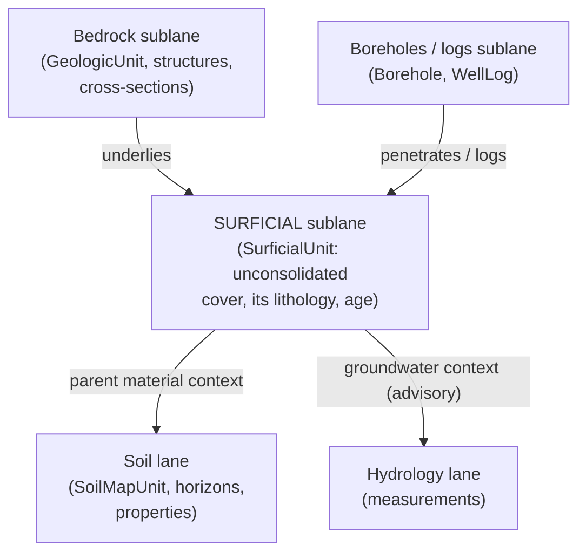
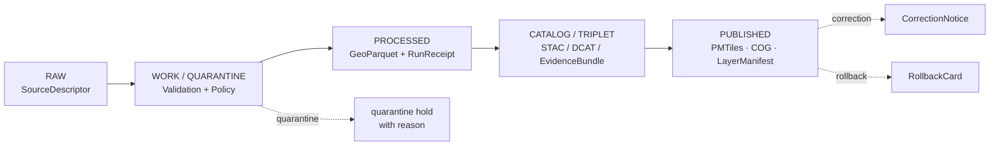

<!-- [KFM_META_BLOCK_V2]
doc_id: kfm://doc/geology-sublane-surficial
title: Geology — Surficial Sublane
type: standard
version: v1.1
status: draft
owners: <geology-domain-steward> · <docs-steward>   # placeholder — confirm in CODEOWNERS
created: 2026-06-04
updated: 2026-10-12
policy_label: public
owning_root: docs/
responsibility: "Human-facing scoped slice of the geology lane for surficial geology (unconsolidated cover, SurficialUnit) and its cross-lane context edges; not evidence, policy, release, or publication authority."
truth_posture: "Doctrine statements are CONFIRMED where cited to Atlas Ch. 10; sublane layout, paths, tiers beyond §24.14, sources outside §10.D, and products are PROPOSED or NEEDS VERIFICATION."
related:
  - docs/domains/geology/README.md
  - docs/domains/geology/SCOPE.md
  - docs/domains/geology/SUBLANE-BEDROCK.md
  - docs/domains/geology/SOURCES.md
  - docs/domains/geology/SENSITIVITY.md
  - docs/domains/geology/SOURCE_ROLE_MATRIX.md
  - docs/domains/geology/UI_MAP_SURFACES.md
  - docs/domains/geology/sublanes/README.md
  - docs/domains/geology/sublanes/surficial.md
  - docs/doctrine/ai-build-operating-contract.md
  - docs/doctrine/directory-rules.md
  - docs/standards/PMTILES.md
  - docs/standards/PROV.md
  - docs/registers/DRIFT_REGISTER.md
tags: [kfm, geology, surficial, sublane, quaternary, governance]
notes:
  - "2026-10-12: merged unique content from docs/domains/geology/sublanes/surficial.md (former doc_id kfm://doc/domains/geology/sublanes/surficial; its footer already named this file's doc_id) — owner-directed duplicate removal"
  - Sublane slice of the geology lane scoped to SURFICIAL geology — unconsolidated surface cover (SurficialUnit). Sibling to the bedrock sublane.
  - Doctrine-adjacent; pins CONTRACT_VERSION = "3.0.0".
  - Bedrock/surficial split is CONFIRMED (Atlas §10.A identity; §10.G names a distinct "surficial unit map" viewing product; §10.C records SurficialUnit as a distinct term).
  - Surficial's primary cross-lane role is feeding Soil parent-material context (§10.F / cross-lane tables); this differs from the bedrock sublane's structural edge.
  - Object-family naming drift (SurficialUnit as distinct family vs sub-type of Geologic Unit) surfaced as CONFLICTED. All repo paths PROPOSED.
[/KFM_META_BLOCK_V2] -->

# Geology — Surficial Sublane

> The surficial slice of the geology lane (`[DOM-GEOL]`): mapped bodies of **unconsolidated surface cover** — alluvium, loess, glacial deposits, colluvium — that sit on the bedrock framework. This is mostly public-safe T0 content. Its defining job is to supply **parent-material context to Soil** and surficial/groundwater context to neighbors, without becoming those lanes' truth.

| Field | Value |
|---|---|
| **Status** | `draft` |
| **Owners** | `<geology-domain-steward>` · `<docs-steward>` *(placeholders — confirm in CODEOWNERS)* |
| **Parent lane** | Geology / Natural Resources — `[DOM-GEOL]`, Atlas Ch. 10 |
| **Sublane scope** | Surficial geology (Atlas §10.A bedrock/surficial split; §10.G "surficial unit map"; §10.C `SurficialUnit`) |
| **Default sensitivity** | Mostly **T0** (public-safe surface mapping) |
| **Primary cross-lane role** | Parent-material context to Soil (`§10.F`) |
| **Version** | v1.1 |
| **Updated** | 2026-10-12 |

> 2026-10-12: merged unique content from `docs/domains/geology/sublanes/surficial.md` (former doc_id `kfm://doc/domains/geology/sublanes/surficial`) — owner-directed duplicate removal

> [!IMPORTANT]
> This sublane doc is a **scoped slice**, not a second copy of the lane. The lane-wide boundary, sources, sensitivity, and release rules live in `SCOPE.md`, `SOURCES.md`, `SENSITIVITY.md`, and `RELEASE_INDEX.md`; this doc narrows them to surficial geology. Where this doc and a lane-wide doc disagree, the lane-wide doc governs and the conflict is logged in `docs/registers/DRIFT_REGISTER.md`.

> [!NOTE]
> **Merged from `sublanes/surficial.md` (v0.2, 2026-06-03; meta updated 2026-10-12).** That file covered the same surficial sublane (its footer already cited this file's doc_id, `kfm://doc/geology-sublane-surficial`, and its definition of done placed it at this flat path) and is now a redirect stub. Its unique content is folded in: scope and non-ownership detail (§1, §3), repo fit and co-lane companions (§1.1), the ubiquitous-language table (§2.1), extra source rows and the source-role note (§5), extra cross-lane edges (§4.1), the tier-by-concern table (§6.1), map-delivery detail (§7.1), and three new sections — spatial & temporal model (§9), pipeline shape (§10), publication/correction/rollback (§11) — plus its open questions, verification items, changelog, definition-of-done items, and related standards. Disagreements between the drafts are recorded in §12 (OQ-GEOL-SURF-09 … -12), not silently resolved. This matches how the bedrock half of `CONTINUITY_INVENTORY.md` D-09 was settled (flat `SUBLANE-BEDROCK.md` canonical; `sublanes/` files are stubs).

---

## Contents

- [1. What the surficial sublane is](#1-what-the-surficial-sublane-is)
- [2. Object families this sublane owns](#2-object-families-this-sublane-owns)
- [3. Sublane boundaries (what surficial is NOT)](#3-sublane-boundaries-what-surficial-is-not)
- [4. The parent-material edge to Soil](#4-the-parent-material-edge-to-soil)
- [5. Surficial source feeds](#5-surficial-source-feeds)
- [6. Sensitivity posture](#6-sensitivity-posture)
- [7. Viewing product: the surficial unit map](#7-viewing-product-the-surficial-unit-map)
- [8. Surficial-specific anti-collapse](#8-surficial-specific-anti-collapse)
- [9. Spatial & temporal model](#9-spatial--temporal-model)
- [10. Pipeline shape (RAW → PUBLISHED)](#10-pipeline-shape-raw--published)
- [11. Publication, correction, and rollback](#11-publication-correction-and-rollback)
- [12. Open questions & verification](#9-open-questions--verification)
- [13. Related docs](#10-related-docs)

---

## 1. What the surficial sublane is

**CONFIRMED doctrine (Atlas §10.A).** The geology lane's one-line identity governs "bedrock/**surficial** geology, stratigraphy, lithology, structures, …" — bedrock and surficial are named as distinct halves at the top of the lane. The surficial sublane is the half concerned with the **unconsolidated cover**: the mapped bodies of sediment and weathered material (alluvium, loess, glacial drift, colluvium, residuum) that overlie the bedrock framework.

If the bedrock sublane is the lane's anchor, surficial is its **interface to the living surface**: it is what soils form in, what shallow groundwater moves through, and what agriculture grows on. Its governance value is mostly as *context for neighbor lanes* — supplied as context, never as the neighbor's canonical truth.

> [!NOTE]
> "Surficial" means unconsolidated cover, not "at the surface." A bedrock unit can crop out at the surface and remain bedrock-sublane content; what makes a unit *surficial* is being the unconsolidated material `SurficialUnit` carries. The split is by material/consolidation, not by depth.

Merged scope detail (`sublanes/surficial.md` §1): the Geology domain **CONFIRMED owns** bedrock/surficial geology, stratigraphy, lithology, structures, geomorphology, boreholes, well logs, cores, geophysics, geochemistry, mineral/resource distinctions, extraction/reclamation context, public-safe layers, and bounded AI. This sublane owns the depiction, evidence support, lifecycle, and release of surficial map units (Quaternary alluvium, terrace deposits, eolian/loess cover, glacial materials where applicable, colluvium, residuum), the surficial-context fraction of `GeologyBoundaryVersion`, and the cross-lane bridges from surficial material into adjacent lanes.

> [!IMPORTANT]
> **Anti-collapse principle (CONFIRMED doctrine, merged).** Bedrock, surficial geology, stratigraphy, lithology, structures, geomorphology, boreholes, geophysics, geochemistry, mineral occurrences, extraction sites, and public-safe resource layers are kept **distinct** within Geology. A surficial polygon is not a soil mapunit; a Quaternary cover is not a bedrock unit; and neither is automatically a public truth claim. The *decomposition* of Geology into named sublanes is a CONFIRMED corpus pattern; whether each becomes a literal directory is PROPOSED (§1.1).

### 1.1 Repo fit and co-lane companions (merged from `sublanes/surficial.md` §2)

| Concern | Rule | Status |
|---|---|---|
| Domain lives as a **segment** inside a responsibility root, not as a root folder | `directory-rules.md` §3, §4 Step 3, §12 | CONFIRMED rule |
| Human-facing explanation goes under `docs/` | `directory-rules.md` §4 Step 1 | CONFIRMED rule |
| Geology lane appears as `docs/domains/geology/...` | `directory-rules.md` §4 Step 3 | CONFIRMED rule |
| `sublanes/` as an intra-domain segment | Not defined in `directory-rules.md`; flat `docs/domains/geology/surficial.md` is permitted by the existing lane rule | **PROPOSED** convention — ADR recommended (OQ-GEOL-SURF-05) |
| Co-lane homes for schemas, policy, fixtures, lifecycle data | `directory-rules.md` §4 Step 3 | CONFIRMED rule; per-sublane sub-segments PROPOSED until ADR |
| New canonical sibling / compatibility root / divergent schema home requires an ADR | `directory-rules.md` §2.4 | CONFIRMED rule |

Co-lane companions. The merged draft listed these as PROPOSED; as of 2026-10-12 the following directories **exist** in the repo (presence only — content maturity not reviewed): `contracts/domains/geology/sublanes/surficial/`, `schemas/contracts/v1/domains/geology/sublanes/surficial/`, `policy/domains/geology/sublanes/surficial/`, `tests/domains/geology/sublanes/surficial/`, `fixtures/domains/geology/sublanes/surficial/`, `data/published/layers/geology/surficial/`, `data/registry/sources/geology/`, `release/candidates/geology/`; plus the pipeline home `pipelines/domains/geology/surficial_units/`. Note the asymmetry: the docs file is flat while those companions use a `sublanes/surficial/` segment — tracked under OQ-GEOL-SURF-05. If the repo contradicts these placements, open a `docs/registers/DRIFT_REGISTER.md` entry rather than silently conforming (`directory-rules.md` §2.5).

[↑ Back to top](#top)

---

## 2. Object families this sublane owns

The surficial sublane's core object is `SurficialUnit`; the lithology, stratigraphy, age, and boundary-version machinery is shared with the lane but applied to surficial bodies.

> [!CAUTION]
> **Object-family naming drift (CONFLICTED).** `SurficialUnit` is recorded in §10.C/§10.E but is **not** a separate entry in the §10.B owns-list (which lists `Geologic Unit`). Whether `SurficialUnit` is a distinct owned family or a sub-type of `Geologic Unit` is unresolved — see [§9](#9-open-questions--verification) and `SCOPE.md` / `UBIQUITOUS_LANGUAGE.md`.

| Object family | What it carries in the surficial sublane |
|---|---|
| `SurficialUnit` | A mapped body of unconsolidated surface cover (alluvium, loess, glacial, colluvium, residuum). The core surficial object. |
| `Lithology` | The material character of a surficial unit (sand, silt, clay, gravel mixtures). |
| `Stratigraphic Interval` | Where surficial deposits have a Quaternary stratigraphy, the named intervals ordering them. |
| `Geologic Age` | The (typically Quaternary) time-scope of a surficial unit, with uncertainty. |
| `GeologyBoundaryVersion` *(§10.C)* | The versioned boundary geometry of a surficial unit. |

> [!NOTE]
> The surficial sublane does **not** typically own structures (`Fault Structure`) or interpretive `CrossSection`s — those are bedrock-sublane content. Surficial bodies are mapped as cover, not as deformed/sectioned rock.

### 2.1 Ubiquitous language and referenced objects (merged from `sublanes/surficial.md` §3, §5)

Identity basis for every row (PROPOSED): `source id + object role + temporal scope + normalized digest`; source, observed, valid, retrieval, release, and correction times stay distinct where material (CONFIRMED).

| Term | Status | Definition / role here |
|---|---|---|
| `SurficialUnit` | CONFIRMED term / PROPOSED field realization | A delimited body of unconsolidated or semi-consolidated material at or near the land surface (alluvium, terrace, eolian, loess, colluvium, residuum, glacial where applicable). Owned here. |
| `GeologyBoundaryVersion` | CONFIRMED term / PROPOSED field realization | Versioned snapshot of unit boundaries, including the surficial subset; carries source authority, vintage, and digest. Shared with the lane. |
| `Lithology` *(of surficial cover)* | CONFIRMED term / PROPOSED field realization | Compositional character (sand, silt, clay, gravel, loess, organic) — referenced, not duplicated, when units share a controlled vocabulary. |
| `Hydrostratigraphic Unit` *(surficial fraction)* | CONFIRMED term / PROPOSED field realization | Surficial cap of a hydrostratigraphic frame (e.g., alluvial aquifer cover); **advisory context** for Hydrology, which owns measurement truth. Shared with the lane. |
| `BoreholeReference` *(surficial intersection)* | CONFIRMED term / PROPOSED field realization | A borehole / well-log reference used to constrain surficial thickness/contacts. **Referenced, not owned** — the boreholes facet is canonical. |
| Surficial Map Unit *(public-safe derivative)* | PROPOSED | Generalized release-stage derivative of `SurficialUnit` for public delivery (PMTiles/COG), with explicit generalization and rights provenance. |
| Quaternary Context | PROPOSED (definitional) | The temporal frame most surficial units fall in; tracked via `temporal_scope`, not a substitute for stratigraphic correlation truth. |

> [!NOTE]
> KFM casing is preserved (`SurficialUnit`, `GeologyBoundaryVersion`, `Hydrostratigraphic Unit`, `BoreholeReference`); do not rewrite to generic equivalents. Cross-sublane references resolve through **`EvidenceRef → EvidenceBundle`**, not direct joins: a claim like "alluvial cover thickness here is ~6 m" is supported by borehole references (role = observation), terrain context (role = model), and the source map (role = authority). `EvidenceBundle` outranks generated language, renderer state, and tile content (CONFIRMED doctrine).

[↑ Back to top](#top)

---

## 3. Sublane boundaries (what surficial is NOT)

| Not in this sublane | Owning sublane / lane | Why the line matters |
|---|---|---|
| `GeologicUnit` (bedrock), structures, cross-sections | Bedrock sublane | Bedrock is consolidated rock; surficial is the cover on it. The §10.A split is by material. |
| `SoilMapUnit`, horizons, soil properties | **Soil lane** `[DOM-SOIL]` | Surficial geology is the *parent material*; the soil that forms in it is Soil's. Geology supplies context, never a soil property (§4). |
| Hydrology measurements (shallow groundwater levels/quality) | **Hydrology lane** `[DOM-HYD]` | Surficial units provide *groundwater context (advisory)*; they never restate a hydrology measurement. |
| `Borehole`, `WellLog` (subsurface points) | Boreholes/logs sublane | Point records with deny-by-default geometry; surficial units are public polygons. |
| Agriculture suitability / crop claims | **Agriculture lane** `[DOM-AG]` | Surficial + soil-parent context is *advisory, not regulatory or aggregate* (§10.F cross-lane table). |
| Hazards risk (landslide, subsidence, liquefaction) *(merged)* | **Hazards lane** | Surficial context informs but does not own risk (CONFIRMED doctrine). |
| Regulatory flood zones, aquifer water-level truth *(merged)* | **Hydrology lane** | Hydrology retains canonical authority. |
| Archaeology sites; ownership / lease / permit / title claims; UI / AI statements *(merged)* | Archaeology; People / Land; UI / AI surfaces | Outside canonical Geology truth (CONFIRMED doctrine). |

> [!WARNING]
> The defining surficial-sublane error is **letting surficial geology become soil truth**. The relation to Soil is "parent material relation without replacing lithology truth" — surficial supplies *what the soil formed in*; it does not assert the soil's classification, horizons, or properties. Crossing that line collapses two lanes.

[↑ Back to top](#top)

---

## 4. The parent-material edge to Soil

**CONFIRMED doctrine (Atlas §10.F; cross-lane tables).** This is the surficial sublane's signature cross-lane relationship and the main thing that distinguishes it from the bedrock sublane (whose signature edge is structural→hazards).

| Direction | Relation | Constraint |
|---|---|---|
| Geology → Soil | "parent material and surficial context" | Geology supplies the surficial body as the material soil formed in; Soil owns the soil objects. |
| Soil → Geology | "parent material relation without replacing lithology truth" | The relation references geology's lithology as context; it does not let soil restate geology, nor geology restate soil. |
| Geology → Hydrology | "Surficial unit and lithology provide groundwater context (advisory)" | Advisory context only; never a hydrology measurement. |
| Geology → Agriculture | "Resource and soil-parent material context (advisory; not regulatory or aggregate)" | Advisory; the source role stays observed/authority, never relabeled aggregate or regulatory. |

> [!IMPORTANT]
> Every one of these edges is **advisory context** that preserves ownership, source role, sensitivity, and `EvidenceBundle` support. The surficial sublane is unusually edge-heavy precisely because surface cover is where geology, soil, hydrology, and agriculture meet — which makes boundary discipline the sublane's central governance task.

### 4.1 Other cross-lane edges (merged from `sublanes/surficial.md` §9)

| Related lane | Relation | Constraint | Status |
|---|---|---|---|
| **Hydrology** *(alternate wording)* | Surficial unit and lithology provide **hydrostratigraphy / aquifer context** (advisory); Hydrology owns measurements and regulatory hydrology. | Same as §4 row; both phrasings kept (OQ-GEOL-SURF-11). | CONFIRMED doctrine |
| **Hazards** | Surficial geology provides **landslide / subsidence / liquefaction context**; Hazards owns risk classification. | Preserve ownership, source role, sensitivity, `EvidenceBundle` support. | CONFIRMED doctrine |
| **Archaeology** | Quaternary stratigraphic context may bound interpretation; Archaeology owns sites and applies **deny-by-default for exact locations**. | Never expose archaeological coordinates as a side-effect of surficial detail. | CONFIRMED (sensitivity); join PROPOSED |
| **Spatial Foundation** | Receives CRS, scale, geometry, and layer/representation grammar. | Renderer / Focus surfaces stay downstream of released evidence. | CONFIRMED doctrine |
| **People / Land** | Lease, parcel, operator relations **cannot prove deposits**; advisory only. | Preserve ownership, source role, sensitivity, `EvidenceBundle` support. | CONFIRMED doctrine |

> [!NOTE]
> Each cross-lane edge is governed by **both** lanes: a surficial-to-Hydrology link must satisfy this sublane's evidence rules **and** Hydrology's measurement-authority and source-role rules. Atlas v1.0's per-domain cross-lane section stays authoritative for the full edge list; conflicts go to `docs/registers/DRIFT_REGISTER.md`.

[↑ Back to top](#top)

---

## 5. Surficial source feeds

The surficial-relevant subset of the lane's `§10.D` source families (full typology in `SOURCES.md`).

| Source family | Typical role | Feeds (surficial) |
|---|---|---|
| **KGS surficial geology & geologic maps** *(§10.D family 2)* | authority / observation | `SurficialUnit`, `Lithology`, `GeologicAge` — the dedicated surficial feed |
| KGS data & geologic maps (umbrella) | authority / observation | `SurficialUnit` where surficial mapping is included |
| USGS NGMDB / GeMS | authority / aggregate | surficial map compilations |
| USGS 3DEP terrain *(INFERRED — not in §10.D)* | observation / modeled | geomorphic context for surficial units *(PROPOSED addition; see `SOURCES.md` Q3)*. Merged detail: terrain derivatives (slope, curvature, relative relief) aid delineation; public-domain but **EXTERNAL** lineage and STAC metadata gates apply; a terrain-derivative classification is **model** output and must be labelled so. |
| KGS/KDHE WWC5 and water-well program *(merged; CONFLICTED — see note)* | observation / context (adjacent) | drillers' logs constrain surficial thickness/contacts — surficial use PROPOSED |
| Soil parent material *(Soil lane; merged)* | adjacent / advisory only | adjacent lineage only — Geology does **not** consume Soil as truth; Soil owns |

> [!NOTE]
> The **KGS surficial geology** family (`§10.D` family 2) is the dedicated feed for this sublane — it is the surficial counterpart to the bedrock-map feed. The oil-and-gas, LAS, WWC5, and MRDS families feed the boreholes/logs and resources sublanes, not this one.

> [!NOTE]
> **Merge conflict recorded (2026-10-12).** The merged draft listed WWC5 drillers' logs as an adjacent surficial input (constraining thickness/contacts); this file routes WWC5 to the boreholes/logs sublane. Both kept — the reconciling reading is that WWC5 stays boreholes-owned and reaches surficial only as a `BoreholeReference` through an `EvidenceBundle` (§2.1). See OQ-GEOL-SURF-10. Rights, current terms, and freshness for every family are NEEDS VERIFICATION; sensitive joins fail closed.

> [!IMPORTANT]
> Each source carries a **source role** (authority, observation, context, model) that gates how derived claims may be presented. A KGS surficial map can be cited as **authority** for its mapped extent; a terrain-derivative classification is at best **model** output (merged).

[↑ Back to top](#top)

---

## 6. Sensitivity posture

| Object family | Default tier | Basis |
|---|---|---|
| `SurficialUnit`, `Lithology` | **T0** | PROPOSED (routine public surface mapping; `GeologicUnit`/`Lithology` CONFIRMED T0 at §24.14, and surficial maps are comparable public content) |
| `StratigraphicInterval`, `GeologicAge` (Quaternary) | T0 | PROPOSED |
| `GeologyBoundaryVersion` | T0 | PROPOSED (provenance of a public line) |

> [!IMPORTANT]
> Surficial geology is, like bedrock, a **public-safe** sublane: surficial unit maps are routine, citeable T0 content, and the sublane contains no exact-location point records (those are the boreholes/logs sublane). The sensitivity attention for surficial is **not** location exposure but **cross-lane mislabeling** — ensuring surficial context is never published *as* a soil property, a hydrology measurement, or an agricultural recommendation (§4).

### 6.1 Tier by concern, including joins (merged from `sublanes/surficial.md` §10)

The surficial sublane is broadly public-suitable when sources are cited, generalization is recorded, and rights are confirmed — but **not** unconditionally public.

| Concern | Posture | Tier | Basis |
|---|---|---|---|
| Surficial unit / lithology baseline | Public-safe, no transform required | **T0** | CONFIRMED corpus tier reference (Atlas §24.5 / §24.14) |
| Public tile derivative of surficial polygons | Public-safe **after** topology-aware generalization; transform recorded | **T0 → T1 on generalization** | CONFIRMED generalization doctrine — conflicts with §7 "Release tier T0" (OQ-GEOL-SURF-09) |
| Source rights and licensing (KGS / USGS / NGMDB) | Current terms NEEDS VERIFICATION; default deny on rights ambiguity | — | CONFIRMED corpus rule (Rights and License Verification Gate) |
| Joins to **extraction sites** / active mining or leasing | Restrict; coordinate with Resources/Reclamation; advisory only | T0 aggregate / **T2** detail | CONFIRMED (resource anti-collapse; Atlas §24.14) |
| Joins to **archaeology** via surficial stratigraphy | **Deny-by-default** for exact archaeological coordinates | **T4** | CONFIRMED (`KFM-P1-IDEA-0031`) |
| Joins to **infrastructure** via surficial substrate | Critical-asset detail restricted; surficial coverage itself public-safe | **T4** detail | CONFIRMED (Settlements/Infrastructure deny-default) |
| Joins to **person / parcel** identifiers | Living-person and person-parcel joins fail closed | **T4** | CONFIRMED (People/Land deny-default) |
| **Generalization** for public tiles | Topology-aware simplification with a recorded transform receipt; never style-only hiding of sensitive geometry | — | CONFIRMED ("No sensitive geometry hidden only by style filters") |
| **Vintage / freshness** marking | Required on every released layer; stale-state view available | — | CONFIRMED cross-cutting doctrine |

> [!WARNING]
> **Cite-or-abstain.** A surficial claim not supported by a resolvable `EvidenceBundle` does not become public truth; the governed API returns `ABSTAIN` rather than fluent prose when an `EvidenceRef` fails to resolve.

[↑ Back to top](#top)

---

## 7. Viewing product: the surficial unit map

**PROPOSED viewing product (Atlas §10.G).** §10.G names "surficial unit map" as a distinct domain viewing product, separate from the bedrock unit map.

| Aspect | Surficial unit map |
|---|---|
| Primary geometry | `SurficialUnit` polygons |
| Overlays | `Lithology` / `GeologicAge` attribution; optional parent-material annotation for the Soil cross-link |
| Layer artifacts | PMTiles / GeoJSON + `LayerManifest` + `TileArtifactManifest` (per `RELEASE_INDEX.md §9`) |
| Cross-cutting | Evidence Drawer, time-aware state, trust badges, correction/stale-state view, governed Focus Mode (`UI_MAP_SURFACES.md §4`) |
| Release tier | T0 public-safe |

> [!NOTE]
> The surficial unit map and the bedrock unit map are **distinct layers** (§10.A split; §10.G distinct products). A combined "geology" basemap that silently merges them erases the bedrock/surficial distinction — keep them as separate, separately-attributed layers that a user can toggle.

### 7.1 Delivery detail (merged from `sublanes/surficial.md` §8)

- A canonical processed **GeoParquet** is the vector truth (CONFIRMED source evidence: "store GeoParquet as the single source of truth and derive Tippecanoe/PMTiles from it").
- A public **PMTiles** layer derived from that GeoParquet (per [`docs/standards/PMTILES.md`](../../standards/PMTILES.md) and the MapLibre delivery doctrine). **KGS M-118** is a CONFIRMED candidate source for a topology-safe serverless PMTiles surficial layer.
- Optional **COG** companions for terrain derivatives (slope, hillshade, relief) when they support unit interpretation.
- A **LayerManifest** links the layer to its catalog source (STAC/DCAT) and render hints; tiler version, flags, zoom range, and input digest are recorded in the bound `TileArtifactManifest`.
- The lane's full viewing-product set (PROPOSED): bedrock unit map; **surficial unit map**; structure/fault view; stratigraphy/correlation view; borehole public-generalized view; mineral occurrence/deposit summary; extraction/reclamation context. The cross-cutting set also includes the **sensitivity-redacted view**.

> [!IMPORTANT]
> **No popup as Evidence Drawer substitute.** A click on a surficial polygon resolves through the governed API to an `EvidenceBundle`; a popup may summarize and link, but the claim resolves in the Drawer.

[↑ Back to top](#top)

---

## 8. Surficial-specific anti-collapse

The lane-wide anti-collapse rules (`SOURCE_ROLE_MATRIX.md §5`) apply; the surficial-specific cases:

| Collapse to deny | Why it's wrong | Guardrail |
|---|---|---|
| **Surficial unit → soil** | Treating mapped surface cover as the soil that formed in it | Distinct `SurficialUnit` (geology) vs `SoilMapUnit` (Soil); parent-material relation only (§4) |
| **Surficial unit → bedrock unit** | Treating unconsolidated cover as the consolidated rock beneath | Distinct `SurficialUnit` vs `GeologicUnit`; the §10.A material split |
| **Surficial context → hydrology measurement** | Presenting "groundwater context (advisory)" as a measured water level/quality | Advisory context tag; Hydrology owns measurements (§4) |
| **Advisory context → aggregate/regulatory** | Relabeling advisory surficial/parent-material context as an aggregate or regulatory claim for Agriculture | Source role preserved (observed/authority); "advisory; not regulatory or aggregate" (§10.F) |
| **Modeled surficial surface → observed** | A geomorphic model surface presented as a mapped observed unit | `ModelRunReceipt`; never relabeled observed (Grid C **M→O**) |

[↑ Back to top](#top)

---

## 9. Spatial & temporal model

*Merged from `sublanes/surficial.md` §6.*

**Geometry (CONFIRMED doctrine, applied):** polygons for surficial units; lines for surficial contacts when delivered separately; points only when a surficial sample is the object (rare — usually a `BoreholeReference` instead); rasters only for terrain-derivative companions, never as a substitute for mapped polygons.

**Generalization rule (CONFIRMED source evidence; implementation PROPOSED):** public delivery passes through topology-aware simplification (Mapshaper / TopoJSON-style shared-arc) before tiling, to preserve shared boundaries and avoid cracks. Public PMTiles MUST descend from a canonical processed GeoParquet, not from raw downloads. See [`docs/standards/PMTILES.md`](../../standards/PMTILES.md).

**Temporal model:**

- **Geologic time** — Quaternary frame is typical; capture in `temporal_scope` on identity, not as a substitute for stratigraphic correlation.
- **Source vintage** — every release carries the source map's publication and digital release date.
- **System time** — observed, valid, retrieval, release, and correction times remain distinct (CONFIRMED doctrine).
- **Interpretation version** — track revisions explicitly when a surficial polygon is re-delineated (a new `GeologyBoundaryVersion`).

<strong>Geometry-and-precision quick reference</strong> (illustrative)

| Use | Geometry | Public-precision posture | Note |
|---|---|---|---|
| Polygon unit map | Polygon | Generalized for public PMTiles | Topology-aware simplification before tile build |
| Unit boundary contact | LineString | Generalized | Boundary line digest tied to the polygon |
| Borehole-derived thickness point | Point | **Referenced**, not the canonical object | Borehole facet is canonical |
| Terrain derivative (slope, relief) | Raster (COG) | Public-safe with COG profile + STAC | **Model** role; never observation |
| 3D subsurface volume | Volume / voxel | Conditional only; reality-boundary controls apply | Per `MAP-MASTER` 2D-default doctrine |

*Illustrative; not a schema declaration.*

[↑ Back to top](#top)

---

## 10. Pipeline shape (RAW → PUBLISHED)

*Merged from `sublanes/surficial.md` §7.* CONFIRMED doctrine / PROPOSED sublane application. Promotion is a **governed state transition**, not a file move. Executable pipeline docs: `pipelines/domains/geology/surficial_units/README.md`.

| Stage | Handling | Gate |
|---|---|---|
| **RAW** | Capture immutable source payload or reference with source role, rights, sensitivity, citation, time, and hash. | `SourceDescriptor` exists |
| **WORK / QUARANTINE** | Normalize schema, geometry, time, identity, evidence, rights, and policy; hold failures. | Validation and policy gate pass, or quarantine reason recorded |
| **PROCESSED** | Emit validated normalized objects, receipts, and public-safe candidates (canonical GeoParquet of surficial polygons). | `EvidenceRef`, `ValidationReport`, digest closure exist |
| **CATALOG / TRIPLET** | Emit catalog records (STAC/DCAT), `EvidenceBundle`s, graph/triplet projections, release candidates. | Catalog/proof closure passes |
| **PUBLISHED** | Serve released public-safe artifacts (PMTiles, COG, generalized GeoJSON) through governed APIs and manifests. | `ReleaseManifest`, correction path, rollback target, review/policy state exist |

> [!WARNING]
> **Watcher-as-non-publisher (CONFIRMED invariant).** A watcher or connector for KGS, NGMDB, or any surficial source emits to RAW or QUARANTINE only; it does **not** write to processed, catalog, published, or `release/`. Promotion is a governed decision (`PolicyDecision → PromotionDecision → ReleaseManifest`), not a side-effect of a fetch. (The merged draft named `data/raw/` / `data/quarantine/` as the watcher targets; `CONTINUITY_INVENTORY.md` D-02 disputes per-domain RAW placement — not resolved here.)

[↑ Back to top](#top)

---

## 11. Publication, correction, and rollback

*Merged from `sublanes/surficial.md` §11.* Surficial publication requires the full release object set (CONFIRMED doctrine, applied):

- **SourceDescriptor** for every input source family used (KGS, NGMDB, …).
- **EvidenceBundle** resolving each public claim (unit identity, mapped extent, vintage).
- **ValidationReport** covering schema, geometry validity, topology, CRS, temporal scope, and policy gates.
- **RunReceipt(s)** for the deterministic GeoParquet → PMTiles / COG build.
- **PolicyDecision** and **PromotionDecision** for governed state transitions.
- **ReleaseManifest** binding the above to a release id, with `spec_hash` reproducibility.
- **LayerManifest** binding the released MapLibre layer to its catalog source and render hints.
- **CorrectionNotice** template and **RollbackCard** prepared **before** release.

> [!IMPORTANT]
> **No release without a rehearsed rollback.** A release plan lacking a runnable `RollbackCard` is an unreviewed publication path, not a release. The Corrections lane provides the public notice channel when a release later proves incorrect.

[↑ Back to top](#top)

---

## 12. Open questions & verification

*(Anchor `#9-open-questions--verification` is kept from v1 for link stability.)*

### Open questions register

| ID | Question | Owner role | Resolution path |
|---|---|---|---|
| OQ-GEOL-SURF-01 | Is `SurficialUnit` a distinct owned family or a sub-type of `Geologic Unit`? (Drives whether this sublane has its own object family.) | `<geology-domain-steward>` | Schema review; resolves with SCOPE OQ-GEOL-SCOPE-03 / BED OQ-GEOL-BED-01 |
| OQ-GEOL-SURF-02 | Confirm the parent-material edge contract with Soil — what does geology emit and what does Soil consume? | `<geology-domain-steward>` + `<soil-domain-steward>` | Cross-lane contract doc; CROSS_LANE_RELATIONS reconciliation |
| OQ-GEOL-SURF-03 | Should USGS 3DEP terrain be admitted as a surficial-geomorphic source (it is not in §10.D)? | `<geology-domain-steward>` | Dossier-extension review (mirrors `SOURCES.md` OQ-GEOL-SRC-03) |
| OQ-GEOL-SURF-04 | Confirm the "surficial unit map" viewing product and that it renders as a layer distinct from the bedrock unit map. | `<geology-domain-steward>` + `<ui-steward>` | `apps/governed-api/` + `schemas/contracts/v1/map/` |
| OQ-GEOL-SURF-05 | `sublanes/` segment vs flat `docs/domains/geology/<name>.md` (was OQ-GEOL-SUR-01). The **file-level duplicate is resolved** (2026-10-12: flat file canonical, `sublanes/surficial.md` a stub); the **folder convention** remains open, and co-lane companions already use `…/sublanes/surficial/` segments (§1.1). | Docs steward + architecture | ADR in `docs/adr/`; drift entry for the docs-flat vs companions-segmented asymmetry |
| OQ-GEOL-SURF-06 | Canonical `SurficialUnit` schema home and contract path (was OQ-GEOL-SUR-03); `schemas/contracts/v1/domains/geology/sublanes/surficial/` and `contracts/domains/geology/sublanes/surficial/` now exist. | Schema steward | Inspect those dirs per ADR-0001; cf. `SUBLANE-BEDROCK.md` OQ-GEOL-BED-07 |
| OQ-GEOL-SURF-07 | Where do generalization receipts live — `data/receipts/` vs `data/proofs/` (was OQ-GEOL-SUR-04)? | Release steward | ADR on the receipts/proofs split |
| OQ-GEOL-SURF-08 | Which policy IDs govern surficial deny-default joins? `KFM-P1-IDEA-0031` is the verified corpus card; `KFM-IDX-POL-001/002` are unverified (was OQ-GEOL-SUR-05). | Policy steward | `policy/sensitivity/` inspection + register reconciliation |
| OQ-GEOL-SURF-09 | Release tier of the public surficial layer: T0 (§7) vs "T0 → T1 on generalization" (§6.1). | `<geology-domain-steward>` + sensitivity reviewer | `SENSITIVITY.md` + ADR-S-05 |
| OQ-GEOL-SURF-10 | Is WWC5 / water-well data an adjacent surficial input (merged draft) or boreholes-only (this file)? | `<geology-domain-steward>` + source steward | `SOURCES.md` routing decision |
| OQ-GEOL-SURF-11 | Hydrology edge wording: "groundwater context (advisory)" (§4) vs "hydrostratigraphy / aquifer context" (§4.1); and whether the surficial fraction of `Hydrostratigraphic Unit` is shared-owned here (merged draft) or governed only through the cross-lane edge (as `SUBLANE-BEDROCK.md` §2 treats it). | `<geology-domain-steward>` + `<hydrology-domain-steward>` | Cross-lane contract doc |
| OQ-GEOL-SURF-12 | Policy label: this file is `public`; the merged draft was `public-with-gates`. Kept `public` (canonical's value); the gates are documented in §6.1. | Policy steward | Confirm label vocabulary |

> The merged draft's OQ-GEOL-SUR-02 ("does `docs/domains/geology/README.md` exist?") is **resolved** — the file exists. Its OQ-GEOL-SUR-01/03/04/05 are now OQ-GEOL-SURF-05…08.

### Open verification backlog

These items remain `NEEDS VERIFICATION` before this document promotes from `draft` to `published`:

1. The `SurficialUnit` family-vs-subtype decision (OQ-GEOL-SURF-01).
2. The Soil parent-material edge contract (OQ-GEOL-SURF-02).
3. The surficial unit map viewing-product wiring (OQ-GEOL-SURF-04).
4. KGS surficial source current rights, vintage, and connector status (`data/registry/sources/geology/`, `SourceDescriptor`, live terms; `connectors/kgs_surficial/README.md`).
5. USGS NGMDB / GeMS schema crosswalk against a GeMS fixture and `ValidationReport`.
6. The **KGS M-118** ingestion path → GeoParquet → PMTiles (`pipeline_specs/`, `pipelines/`, fixtures; PMTiles digest receipt).
7. Generalization transform parameters and tooling choice (Mapshaper / TopoJSON params; transform receipts).
8. The surficial `LayerManifest` binding in the explorer app + layer registry.
9. CI/test coverage for a surficial fixture (valid + invalid + topology) under `tests/domains/geology/`.
10. The owners line in `CODEOWNERS` for this file.
11. Policy-ID reconciliation (`KFM-IDX-POL-001/002` vs `KFM-P1-IDEA-0031`) (OQ-GEOL-SURF-08).

## Changelog v1 → v1.1 (2026-10-12)

| Change | Type (per contract §37) | Reason |
|---|---|---|
| Merged unique content from `sublanes/surficial.md` (v0.2, own doc_id `kfm://doc/domains/geology/sublanes/surficial`); that path is now a redirect stub | reconciliation | Owner-directed duplicate removal; surficial half of `CONTINUITY_INVENTORY.md` D-09 |
| Added §1.1, §2.1, §4.1, §6.1, §7.1 and new §9 spatial & temporal model, §10 pipeline shape, §11 publication/correction/rollback; open questions → §12, related docs → §13 (v1 anchors kept) | new | Content existed only in the merged draft |
| Added OQ-GEOL-SURF-05 … -12 (merged-draft questions renumbered; conflicts recorded) | new | Preserve every open question; record conflicts instead of dropping them |
| Added `owning_root`, `responsibility`, `truth_posture`; fixed `related` paths | housekeeping | Meta-block validator `required` profile |

<b>History carried from the merged draft — <code>sublanes/surficial.md</code> changelog</b>

| Change | Type | Reason |
|---|---|---|
| Added KFM Meta Block v2 and `CONTRACT_VERSION` pin + badge | housekeeping | Doctrine-adjacent doc requirement |
| Added Open Questions register, Verification backlog, Changelog, Definition of done | gap closure | Companion sections were absent |
| Corrected unverifiable policy IDs (`KFM-IDX-POL-001/002`) → verified card `KFM-P1-IDEA-0031`, flagged the rest | reconciliation | No-fabrication rule |
| Added explicit T0/T1/T4 tier column to the sensitivity table | clarification | Align with Atlas §24.5 / §24.14 |
| Upgraded generalization rule label PROPOSED → CONFIRMED source evidence | clarification | Mapshaper/TopoJSON simplification is CONFIRMED corpus evidence (ML-064-027) |
| Downgraded 3DEP surficial relevance "CONFIRMED related" → "INFERRED related" | reconciliation | Terrain use is inference |
| Aligned scope wording to the Geology lane's CONFIRMED ownership list | clarification | Match Atlas Ch. 10 §A/§B |

## Changelog v0 → v1

| Change | Type (per contract §37) | Reason |
|---|---|---|
| Initial surficial sublane doc authored | new | Second geology sublane slice; sibling to SUBLANE-BEDROCK; scope surficial vs bedrock/soil/borehole |
| Bedrock/surficial split grounded to §10.A + §10.G | clarification | Use the corpus's explicit split and the named "surficial unit map" product |
| Parent-material edge to Soil made the signature cross-lane relation | clarification | Reflect §10.F / cross-lane tables; distinguish from bedrock's structural edge |
| `SurficialUnit` family-vs-subtype surfaced as CONFLICTED | new | Consistent with the rest of the geology suite |

> **Backward compatibility.** New file; no prior anchors to preserve. Section anchors introduced here should be treated as stable.

## Definition of done

This document is done enough to enter the repository when:

- it is placed according to Directory Rules (under `docs/domains/geology/`);
- a geology domain steward reviews it (and a soil domain steward signs the §4 edge);
- the `SurficialUnit` family-vs-subtype question is resolved (OQ-GEOL-SURF-01);
- it is linked from `docs/domains/geology/README.md`, `SCOPE.md`, and `SUBLANE-BEDROCK.md`;
- it does not conflict with accepted ADRs;
- any conflict with lane-wide docs or the dossier is logged in `docs/registers/DRIFT_REGISTER.md`;
- the `GENERATED_RECEIPT.json` planned in the authoring notes is wired into CI;
- future changes follow `ai-build-operating-contract.md §37` lifecycle;
- a docs steward also reviews it, and it is linked from a doctrine/docs index *(merged)*;
- the folder-convention question (OQ-GEOL-SURF-05) is resolved or logged in `DRIFT_REGISTER.md` *(merged)*.

[↑ Back to top](#top)

---

## 13. Related docs

*(Anchor `#10-related-docs` is kept from v1 for link stability.)*

- `docs/domains/geology/SUBLANE-BEDROCK.md` — the sibling bedrock sublane.
- `docs/domains/geology/SCOPE.md` — lane boundary; owned object families; the bedrock/surficial split.
- `docs/domains/geology/SOURCES.md` — full source-family typology (the KGS surficial feed is family 2).
- `docs/domains/geology/SENSITIVITY.md` — tier classification & decision lattice.
- `docs/domains/geology/UI_MAP_SURFACES.md` — surficial unit map as a governed surface.
- `docs/domains/geology/SOURCE_ROLE_MATRIX.md` — anti-collapse grids (Grid C referenced in §8).
- `docs/domains/geology/README.md` — lane landing page.
- `ai-build-operating-contract.md` — operating law (`CONTRACT_VERSION = "3.0.0"`).
- Atlas Ch. 10 §10.A (bedrock/surficial identity); §10.C (`SurficialUnit`); §10.D (KGS surficial feed); §10.F (Soil parent-material edge); §10.G (surficial unit map viewing product); §10.I (sensitivity).
- `docs/domains/soil/` — the Soil lane that consumes surficial parent-material context.
- [`sublanes/surficial.md`](./sublanes/surficial.md) — redirect stub; merged here 2026-10-12.
- [`sublanes/README.md`](./sublanes/README.md) — sublanes index.
- [`docs/doctrine/ai-build-operating-contract.md`](../../doctrine/ai-build-operating-contract.md); [`docs/doctrine/directory-rules.md`](../../doctrine/directory-rules.md) *(merged)*.
- Standards *(merged)*: [`PROV.md`](../../standards/PROV.md) (W3C PROV-O / PAV), [`PMTILES.md`](../../standards/PMTILES.md) (PMTiles v3 profile), [`OGC-API-TILES.md`](../../standards/OGC-API-TILES.md), [`ISO-19115.md`](../../standards/ISO-19115.md), [`OAI-PMH.md`](../../standards/OAI-PMH.md).
- Adjacent lanes *(merged)*: [`docs/domains/soil/README.md`](../soil/README.md), [`docs/domains/hydrology/README.md`](../hydrology/README.md), [`docs/domains/hazards/README.md`](../hazards/README.md).
- Companions *(merged)*: `connectors/kgs_surficial/README.md`, `pipelines/domains/geology/surficial_units/README.md`, `data/published/layers/geology/surficial/README.md`.

---

*Last updated: 2026-10-12 · Version: v1.1 · Status: `draft` · `CONTRACT_VERSION = "3.0.0"` · `[DOM-GEOL]` · sublane: surficial*

[↑ Back to top](#top)
