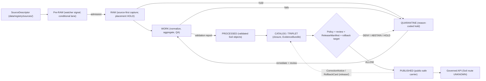

<!-- [KFM_META_BLOCK_V2]
doc_id: kfm://doc/soil-data-lifecycle
title: Soil Domain — Data Lifecycle
type: standard
version: v2.0.0
prior_version: v1.0.2
status: draft
owners: <TODO: soil domain steward; data-lifecycle steward>
created: 2026-05-19
updated: 2026-10-11
policy_label: public
owning_root: docs/
responsibility: Soil-specific application of the KFM lifecycle law — phase entry and exit gates, trust objects, support-type handling, receipt-bearing transforms, freshness, correction and rollback; not evidence, policy, release, or publication authority.
truth_posture: cite-or-abstain; CONFIRMED lifecycle doctrine, DIR-SOURCE-001 source-first capture identity and the bounded USCRN daily pilot code paths cited here / HOLD physical source-first RAW placement and Soil proof and release-dry-run automation / PROPOSED or NEEDS VERIFICATION every other Soil lifecycle implementation
related:
  - docs/doctrine/lifecycle-law.md
  - docs/doctrine/directory-rules.md
  - docs/doctrine/trust-membrane.md
  - docs/adr/ADR-0029-adopt-directory-governance-standard-v2.md
  - docs/adr/ADR-0046-owner-self-release-for-admitted-public-soil-data.md
  - docs/domains/soil/README.md
  - docs/domains/soil/CANONICAL_PATHS.md
  - docs/domains/soil/CONTINUITY_INVENTORY.md
  - docs/domains/soil/SOURCES.md
  - docs/domains/soil/SOURCE_REGISTRY.md
  - docs/domains/soil/IDENTITY_MODEL.md
  - docs/domains/soil/CATALOG_CLOSURE.md
  - docs/domains/soil/API_CONTRACTS.md
  - docs/domains/soil/PRESERVATION_MATRIX.md
  - docs/domains/soil/VERIFICATION.md
  - docs/domains/soil/VERIFICATION_BACKLOG.md
  - docs/runbooks/soil/SOURCE_REFRESH_RUNBOOK.md
  - data/raw/README.md
  - data/raw/soil/README.md
  - data/registry/sources/soil/README.md
  - data/registry/sources/soil/noaa-uscrn.yaml
  - tools/local_data/uscrn_daily_pilot.py
  - tools/release/soil_release.py
  - .github/workflows/domain-soil.yml
tags: [kfm, domain, soil, lifecycle, support-type, receipts, release, rollback]
notes:
  - "v2.0.0 (2026-10-11): replaces the placeholder body, which was a verbatim copy of CONTINUITY_INVENTORY.md, with Soil lifecycle doctrine; CONTINUITY_INVENTORY.md remains the authoritative artifact inventory."
  - "Repository facts were read from the working tree on 2026-10-11 (main lineage through c64ee431); every path below was checked for presence, and implementation claims cite the inspected file."
  - "This document applies docs/doctrine/lifecycle-law.md and Directory Rules sections 11 and 12 to Soil; it does not amend them, select a RAW placement, admit a source, or authorize release."
  - "Data stores written by the USCRN pilot live in an operator-private store outside the Git checkout; paths shown for that slice are relative to that external root."
[/KFM_META_BLOCK_V2] -->

<a id="top"></a>

# Soil Domain — Data Lifecycle

> How Soil material moves through **RAW → WORK / QUARANTINE → PROCESSED → CATALOG / TRIPLET → PUBLISHED**: what each phase accepts, which gate lets it leave, which trust object proves the move, and which Soil-specific distinctions (support type, survey lineage, depth, vintage) must survive every step.


| Field | Value |
|---|---|
| Status | `draft` |
| Owners | `<TODO: soil domain steward>`, `<TODO: data-lifecycle steward>` — unassigned (`SOIL-VB-001`) |
| Governing doctrine | [Lifecycle Law](../../doctrine/lifecycle-law.md), [Directory Rules](../../doctrine/directory-rules.md) §§11–12, [Trust Membrane](../../doctrine/trust-membrane.md) |
| Inventory of Soil artifacts | [Continuity Inventory](CONTINUITY_INVENTORY.md) (authoritative register; this file does not repeat it) |
| Last updated | 2026-10-11 |

> [!IMPORTANT]
> **Current determination (2026-10-11).** One Soil source is admitted: NOAA USCRN daily soil moisture and soil temperature for two Kansas reference stations ([`noaa-uscrn.yaml`](../../../data/registry/sources/soil/noaa-uscrn.yaml), `review_state: approved`, `registry_state: active`, `release_state: candidate`). Its pilot code can capture, normalize, validate, package and write a release **decision**, but it writes nothing to PROCESSED or PUBLISHED and activates nothing. Every other Soil source is a `PROPOSED` placeholder. No released Soil carrier, Soil proof producer or Soil governed-API route was found. RAW physical placement is **HOLD**.

---

## Contents

1. [Purpose, scope, and authority](#1-purpose-scope-and-authority)
2. [Lifecycle at a glance](#2-lifecycle-at-a-glance)
3. [Support types and knowledge character](#3-support-types-and-knowledge-character)
4. [Phase contracts](#4-phase-contracts)
5. [Trust objects and their homes](#5-trust-objects-and-their-homes)
6. [Soil transforms that require receipts](#6-soil-transforms-that-require-receipts)
7. [Implemented slice: USCRN daily soil pilot](#7-implemented-slice-uscrn-daily-soil-pilot)
8. [Versioning, freshness, and supersession](#8-versioning-freshness-and-supersession)
9. [Correction, withdrawal, and rollback](#9-correction-withdrawal-and-rollback)
10. [Rights, sensitivity, and publication posture](#10-rights-sensitivity-and-publication-posture)
11. [Catalog and triplet closure; governed delivery](#11-catalog-and-triplet-closure-governed-delivery)
12. [Anti-patterns](#12-anti-patterns)
13. [Validation and verification](#13-validation-and-verification)
14. [Open questions and verification items](#14-open-questions-and-verification-items)
15. [Related docs](#15-related-docs)
16. [Changelog](#16-changelog)

---

## 1. Purpose, scope, and authority

This document answers one question for Soil: *what has to be true before Soil material may cross each lifecycle boundary, and what record proves that it did?*

| This document decides | It defers to |
|---|---|
| How the lifecycle invariant applies to Soil support types, survey hierarchy (MUKEY → COKEY → CHKEY), depth, vintage and station time | [Lifecycle Law](../../doctrine/lifecycle-law.md) for stage names, the publication transition and failure outcomes |
| Which Soil transforms must leave a receipt | [Canonical Paths](CANONICAL_PATHS.md) and Directory Rules for where any file lives |
| Soil-specific entry and exit expectations per phase | `contracts/` and `schemas/` for object meaning and shape; `policy/` for allow/deny |
| How freshness, correction and rollback apply to Soil sources | `release/` for every release, correction, withdrawal and rollback **decision** |
| Which lifecycle claims are implemented versus proposed | [Verification](VERIFICATION.md) and [Verification backlog](VERIFICATION_BACKLOG.md) for test evidence and open items |

Out of scope: source admission procedure ([Source registry guide](SOURCE_REGISTRY.md)), operational refresh steps ([Source refresh runbook](../../runbooks/soil/SOURCE_REFRESH_RUNBOOK.md)), API envelopes ([API contracts](API_CONTRACTS.md)) and the per-artifact register ([Continuity Inventory](CONTINUITY_INVENTORY.md)).

[Back to top](#top)

---

## 2. Lifecycle at a glance

**CONFIRMED doctrine.** Soil follows the shared invariant; promotion is a governed state transition, never a copy, move, filename, job completion or alias change (Lifecycle Law §6; `DIR-DATA-004`). The lifecycle is a state machine, not a demand that every artifact visit every directory: valid material need not pass through QUARANTINE, and TRIPLETS are optional (`DIR-DATA-002`, `DIR-DATA-003`).



Reading rules for Soil:

- **Support type is set at the edge and travels.** It is recorded at capture and never upgraded by a later phase ([§3](#3-support-types-and-knowledge-character)).
- **Receipts, proofs and registry records run alongside the phases;** they are not phases (Directory Rules §11.1).
- **Public reach exists only at PUBLISHED, through a governed interface.** Pre-RAW, RAW, WORK, QUARANTINE, PROCESSED and unreleased CATALOG / TRIPLET records are `DENY` for public clients (Lifecycle Law §4).

[Back to top](#top)

---

## 3. Support types and knowledge character

Support type is the Soil lane's anti-collapse control: static survey, gridded derivative, station observation, satellite or model grid, pedon evidence and interpretation **cannot masquerade as one surface** (README; [Canonical Paths §9](CANONICAL_PATHS.md#9-sensitivity-rights-and-publication-posture)). The lifecycle consequence is that every phase must be able to say which support a value has, at what scale, depth and time.

| Support family | Sources (repository records) | Knowledge character | Must travel through every phase | Must never become |
|---|---|---|---|---|
| Static survey polygons | NRCS SSURGO; SDA query results | Surveyed, mapped interpretation of components within map units — not a point measurement | MUKEY / COKEY / CHKEY lineage, component percent, horizon top/bottom depth and unit, survey vintage; for SDA also query text, query hash and retrieval time | A field-uniform property, a station reading, or a parcel attribute |
| Gridded survey derivatives | gSSURGO, gNATSGO | Rasterized survey; precision is the underlying survey's, not the cell's | Product and edition, cell size, CRS, resampling method, derivation lineage, inherited survey vintage | Authoritative keyed SSURGO evidence (the yearly-diff contract denies this explicitly) |
| Station point-at-depth observations | Kansas Mesonet, NRCS SCAN, NOAA USCRN | Observed, single point, single depth, single interval | Station identity, sensor depth, unit, observation time and source timezone, QC flags, withheld/missing state | An area, field, county or map-unit value |
| Satellite / model grids | NASA SMAP (L4 is model assimilation) | Modeled or retrieved grid; surface (0–5 cm) and root zone (0–100 cm) are different supports | Product version, cadence class (NRT vs standard quality), grid identity, QA, uncertainty, surface vs root-zone label | A station or in-situ field measurement |
| Modeled property grids | ISRIC SoilGrids | ML prediction with uncertainty layers (250 m, per its catalog page) | Model/release version, depth band, uncertainty reference, attribution | Observed soil property |
| Pedon / profile evidence | Pedon and NASIS-type profiles (runbook source table) | Local vertical evidence | Sample identity, sampling date, lab/source lineage | Regional or map-unit truth without a declared derivation |
| Interpretations | Hydrologic soil group, erosion risk, suitability | Method- and purpose-bound derivative | Derivation rule, inputs, scope of validity, caveats | Streamflow, hazard, crop, engineering or legal truth |

> [!CAUTION]
> **Vocabulary is not converged (`SOIL-VB-002`, `PARTIAL / CONFLICTED`).** The public-safe smoke profile accepts `static_survey`, `station_observation`, `satellite_grid` and `modeled_derivative`; richer profiles use `authoritative_static_soil`, `station_soil_moisture`, `satellite_grid_soil_moisture` and others; the yearly-diff profile uses `AUTHORITATIVE_STATIC_SOIL_SURVEY` and `GRIDDED_DERIVATIVE_SOIL`. Use the exact token of the bound schema at each phase and do not invent aliases (see [Glossary](GLOSSARY.md#vocabulary-conflicts)).

Two time axes are also lifecycle-critical and must not be swapped: **vintage / observation time** (what the value represents) and **retrieval time** (when the bytes were obtained). A fresh retrieval can carry an old survey ([Glossary](GLOSSARY.md#time-quality-and-identity)).

[Back to top](#top)

---

## 4. Phase contracts

Status labels: **CONFIRMED** = doctrine or inspected code; **PROPOSED** = described but not implemented; **HOLD** = deliberately unresolved.

| Phase | Soil material that enters | Entry gate | Exit gate | Required trust objects | Must not read it |
|---|---|---|---|---|---|
| **Pre-RAW** (conditional) | Watcher change signals (e.g. SSURGO package drift), admission candidates | Registered or proposed `SourceDescriptor` | Admission decision | `EventRunReceipt` (Lifecycle Law name; OQ-LL-04 open) | Public, AI, UI |
| **RAW** | Source-native SSURGO exports, SDA query payloads, gridded rasters, station files, SMAP granules, SoilGrids tiles — once each, source-first | Admitted `SourceDescriptor`; digest | Normalization decision or quarantine | `IntakeReceipt` / ingest run receipt; payload digest | Public, AI context, UI layers, normalized records |
| **WORK** | Normalized intermediates: key reconciliation, unit/depth conversion, aggregation, resampling, generalization trials | Governed reference to a RAW capture | `ValidationReport` pass, or quarantine reason | `TransformReceipt` (plus `AggregationReceipt` / `RedactionReceipt` where applied) | Public API/UI, release aliases |
| **QUARANTINE** | Unresolved rights, missing support type, broken survey lineage, unit/depth/QC defects, unreviewed cross-support aggregation | Any failed gate, from any phase | Remediation through WORK **plus** review, or denial | `QuarantineReceipt` with reason code | Public (`DENY`); stewards and reviewers only |
| **PROCESSED** | Validated Soil objects (map units, components, horizons, properties, moisture series, interpretations) | Validation pass, policy pass | Catalog closure | `ProcessingReceipt` **and** `ValidationReport`; `EvidenceRef`; digest closure | Public (`DENY` until release) |
| **CATALOG / TRIPLET** | Domain catalog records, STAC/DCAT/PROV projections, `EvidenceBundle`, optional graph projections | Processed artifact + digest | Release gate | `CatalogBuildReceipt` / `GraphBuildReceipt`; resolvable `EvidenceBundle` | Public except released records |
| **PUBLISHED** | Released public-safe Soil carriers, support-type separated | `ReleaseManifest`, `PolicyDecision`, review, correction path, rollback target | Correction, supersession or withdrawal **with notice** | `PublicationReceipt`; `ReleaseManifest` + proof under `release/` | — (public via governed routes only) |

### 4.1 Pre-RAW and admission

- **CONFIRMED doctrine:** watchers report change; they never promote (Lifecycle Law §3.0; README invariants).
- **CONFIRMED code:** the SSURGO watcher at [`tools/ingest/ssurgo_watch/`](../../../tools/ingest/ssurgo_watch/ssurgo_watch.py) is fixture-only and no-network; it separates `spec_hash` from `content_hash` so a new retrieval timestamp alone is not a material change ([Identity model §4.2](IDENTITY_MODEL.md#42-fixture-only-ssurgo-watcher-hashes)).
- **CONFIRMED:** no `data/pre_raw/` lane exists; per `DIR-DATA-001` it stays absent until a durable pre-RAW queue is implemented.
- Admission is a registry decision under `data/registry/sources/` (`DIR-SOURCE-003`), not a lifecycle write. A placeholder YAML is not admission ([Sources](SOURCES.md)).

### 4.2 RAW — source-first, placement HOLD

- **CONFIRMED rule (`DIR-SOURCE-001`, `DIR-SOURCE-002`):** one registered `source_id`, one source-first capture; a capture used by Soil and Agriculture (SSURGO, Kansas Mesonet, SCAN, USCRN, SMAP) is stored once and referenced by both ([`data/raw/README.md`](../../../data/raw/README.md#overlapping-lanes-that-must-share-one-capture)).
- **HOLD:** the physical source-first RAW home is undecided (`OPEN-SOIL-09`). No RAW path is named here, and none may be inferred.
- **CONFIRMED:** [`data/raw/soil/`](../../../data/raw/soil/README.md) is a compatibility/reference lane holding a README only; it must not receive payloads, copies, checksums or source-run directories.
- RAW is append-only. A unit fix, re-projection or key repair is a WORK derivation with a receipt, never an in-place RAW edit (Lifecycle Law §14).

### 4.3 WORK and QUARANTINE

- WORK holds candidates only; every Soil-specific transform in [§6](#6-soil-transforms-that-require-receipts) runs here and leaves a receipt.
- [`data/quarantine/soil/`](../../../data/quarantine/soil/README.md) lists **PROPOSED** quarantine classes: source activation unresolved, rights unknown, support type missing or collapsed, survey lineage defect, observation unit/depth/QC defect, cross-support aggregation unreviewed, evidence open, temporal/scale/caveat defect. No child lanes are confirmed.
- Exit from QUARANTINE is remediation back through WORK plus a review record; quarantine → PROCESSED directly is a doctrine violation (Lifecycle Law §3.3).

### 4.4 PROCESSED

- [`data/processed/soil/`](../../../data/processed/soil/README.md) holds a README only. Its lane index (`map-units/`, `components/`, `horizons/`, `moisture/`, `gridded/`, `public/`, `restricted/` …) is **PROPOSED**; `public/` there would mean public-*candidate*, not published.
- A moisture value without depth, unit, time, support type, source and evidence posture fails closed (processed README guardrails).

### 4.5 CATALOG / TRIPLET and PUBLISHED

- Catalog closure for Soil is defined in [Catalog closure](CATALOG_CLOSURE.md) (eleven dimensions) and summarized in [§11](#11-catalog-and-triplet-closure-governed-delivery).
- `data/published/layers/soil/` carries README-only support-type families (`static_survey/`, `gridded_derivative/`, `satellite_grid/`, `suitability/`). Presence of these READMEs is not publication.

[Back to top](#top)

---

## 5. Trust objects and their homes

Object names follow Lifecycle Law §9. Where the repository uses a different emitted name, both are shown; naming convergence is **NEEDS VERIFICATION**.

| Trust object | Phase | Home (Directory Rules) | Soil state found 2026-10-11 |
|---|---|---|---|
| `SourceDescriptor` | Pre-RAW / admission | `data/registry/sources/soil/` | **CONFIRMED:** one admitted descriptor (`noaa-uscrn.yaml`); eight `PROPOSED` placeholders. Domain-first `data/registry/soil/sources/` is a compatibility view, not a writer (`DIR-SOURCE-004`) |
| Ingest / intake receipt | RAW (or capture hold) | `data/receipts/` | **CONFIRMED in pilot code:** `kfm.uscrn-daily-pilot-run/v1` under the external store's `data/receipts/ingest/noaa-uscrn-daily/`. Doctrine name `IntakeReceipt`; Canonical Paths says `IngestReceipt` |
| `TransformReceipt` / `AggregationReceipt` / `RedactionReceipt` | WORK | `data/receipts/` | **PROPOSED** for Soil; required by the yearly-diff profile whenever normalization changes geometry or attributes |
| `ValidationReport` | WORK → PROCESSED | `data/receipts/` / `data/proofs/` | **CONFIRMED in pilot code:** `kfm.uscrn-daily-validation/v1` under the external store's `data/receipts/validation/soil/` |
| `EvidenceRef` / `EvidenceBundle` | PROCESSED → CATALOG | `data/proofs/` | **CONFIRMED in pilot code:** one evidence bundle per station and depth (`kfm.soil-evidence-candidate/v1`). No Soil `EvidenceBundle` exists in the repository (`SOIL-VB-009`) |
| Catalog record | CATALOG | `data/catalog/` | **CONFIRMED in pilot code:** `kfm.soil-catalog-candidate/v1`, `authoritative: false`, `release_state: UNRELEASED`. [`data/catalog/domain/soil/`](../../../data/catalog/domain/soil/README.md) is README-only |
| `ReleaseManifest` / release snapshot | Release gate | `release/manifests/`, `release/candidates/soil/` | **CONFIRMED in pilot code:** immutable `kfm.soil-snapshot/v1` written to the external store's `release/candidates/soil/`. Soil `release_manifest.schema.json` is a greenfield stub |
| Release decision | Release gate | `release/` decision plane | **CONFIRMED in pilot code:** `kfm.soil-release-decision/v1` written to the external store's `release/decisions/soil/` only if the serving gate answers `ELIGIBLE` (ADR-0046) |
| `CorrectionNotice` | Post-PUBLISHED | `release/correction_notices/` | **PROPOSED**; decision carries `correction_state: ACTIVE` and `correction_ref: null` |
| `RollbackCard` | Release readiness | `release/rollback_cards/` (`DIR-RELEASE-003`) | **PROPOSED**; snapshot accepts an optional `rollback_target`. Soil `rollback_card.schema.json` is a stub |
| `PublicationReceipt` | PUBLISHED | `data/receipts/` | **UNKNOWN** — no Soil publication path found |

[Back to top](#top)

---

## 6. Soil transforms that require receipts

Every transform below changes what a value means or which support it stands on, so each must leave a receipt naming inputs, method, parameters and outputs (Lifecycle Law §3.2). Status reflects the inspected repository.

| Transform | Why it is lifecycle-significant | Receipt / record | Repository status |
|---|---|---|---|
| **Component aggregation** (map unit from components) | A dominant-component pick hides minor components; weighted averages depend on component-percent closure | `AggregationReceipt` (PROPOSED); method recorded on the candidate | **CONFIRMED fixture profile:** [`MukeyProperties`](../../../contracts/domains/soil/mukey_properties.md) uses component-percent weighting with 99–101 % closure; the contract says it is not an accepted real-data rule |
| **Horizon depth-weighting** | Values apply to depth intervals; windows (0–100 cm root zone, 0–5 cm surface) change the answer | Same as above | **CONFIRMED fixture profile:** arithmetic depth weighting, then component weighting; horizons must be ordered, gap-free and non-overlapping ([validator](../../../tools/validators/domains/soil/mukey_properties/validate_mukey_properties.py)) |
| **Hydrologic soil group** | Interpretation, not observation | Source-carried basis | **CONFIRMED:** `hydrologic_group` stays source-carried (`source_muaggatt`); no Ksat threshold is invented |
| **Raster resampling, reprojection, zonal statistics** | ~10 m SSURGO, ~30 m gSSURGO/gNATSGO, ~250 m SoilGrids and ~1 km SMAP cannot be silently put on one grid | `TransformReceipt` with source resolution and resampling method | **PROPOSED** only ([Canonical Paths §7 note](CANONICAL_PATHS.md#7-source-families); runbook §3). No Soil resampling code found |
| **Station unit, QC and time handling** | Missing sentinels, impossible values, local-standard-time days vs UTC instants | Validation report | **CONFIRMED (USCRN):** missing sentinels become `MISSING`, out-of-range values `OUT_OF_RANGE`, never zero; `observation_date` is the station's local-standard-time day ([contract](../../../contracts/domains/soil/daily_soil_observation.md)). **CONFIRMED fixture profile** for the generic station moisture validator |
| **Version diff** (survey refresh) | A refreshed survey changes keyed records; a mutable "current" view hides which edition was used | Snapshot receipts, validation receipt, `TransformReceipt` when normalized | **CONFIRMED fixture-only:** [yearly-diff profile](../../../contracts/domains/soil/ssurgo_yearly_diff_profile.md), [builder](../../../tools/generators/build_soil_yearly_diff.py) and [validator](../../../tools/validators/domains/soil/validate_ssurgo_yearly_diff_profile.py); output limited to WORK or QUARANTINE; consecutive years only |
| **SDA micro-snapshot diff** | Separates material change from a new retrieval timestamp | Diff report | **CONFIRMED fixture-only:** [contract](../../../contracts/domains/soil/ssurgo_sda_micro_snapshot.md); `content_spec_hash` vs `retrieval_hash`; outcomes `NO_MATERIAL_CHANGE`, `PROPOSED_WORK_RECORD`, `VALIDATION_HOLD`, `ERROR` |
| **Generalization / redaction** | Precision reduction before public use | `RedactionReceipt` | **PROPOSED** (runbook §10.2); public-safe fixture profile denies precise-location aliases |

> [!WARNING]
> Cross-support aggregation (for example a "soil-condition view" mixing survey, station and satellite values) is denied unless an explicit, reviewed derivation step exists and every contributing value keeps its support-type and resolution tag ([Architecture §6](ARCHITECTURE.md#6-support-type-separation--the-soil-specific-invariant)).

[Back to top](#top)

---

## 7. Implemented slice: USCRN daily soil pilot

**CONFIRMED code, bounded scope.** This is the only Soil path that runs end to end through capture, candidate, package and release decision. It operates on an operator-private store that must be outside the Git checkout (`external_root` refuses the repository and its parents). Paths are relative to that store.

| Step | Code | Writes (external store) | Lifecycle meaning |
|---|---|---|---|
| Capture | [`uscrn_daily_capture.py`](../../../connectors/noaa/src/noaa/uscrn_daily_capture.py) | — (returns bytes and a digest-closed manifest) | Connector selects and admits nothing |
| Stage captured bytes | [`uscrn_daily_pilot.py`](../../../tools/local_data/uscrn_daily_pilot.py) | `data/quarantine/noaa-uscrn-daily/objects/sha256/<digest>/payload`, `…/runs/<run>/manifest.json` | Source-first, digest-addressed **QUARANTINE** capture — not RAW |
| Normalize + validate | `uscrn_daily_normalize.py`, `uscrn_daily_validate.py` | `data/work/soil/noaa-uscrn-daily/<id>/candidate.json`, `data/receipts/validation/soil/<id>/validation.json` | WORK candidate (`review_state: PENDING`, `release_state: UNRELEASED`) |
| Run receipt | same | `data/receipts/ingest/noaa-uscrn-daily/<run>/…json` | `promoted`, `released`, `published` all `false` |
| Package | [`soil_release.py`](../../../tools/release/soil_release.py) `prepare` | `release/candidates/soil/<package>/snapshot.json` | Catalog candidate + evidence bundles + validation, one bundle per station-depth |
| Decide | `soil_release.py` `decide` | `release/decisions/soil/<package>/<released_at>.json` | Written only if the serving gate answers `ELIGIBLE` and every bundle replays; `activated: false` |

Gate conditions **CONFIRMED** from code and [ADR-0046](../../adr/ADR-0046-owner-self-release-for-admitted-public-soil-data.md): admission is read only when the descriptor is approved, active, `verified_open`, `public` and release-allowed (otherwise `SOURCE_NOT_ADMITTED`); without `--admitted-source` packages keep the rights hold; owner self-release requires every bundle to be `public` and carry the single admitted NOAA licence, otherwise `INDEPENDENT_REVIEW_REQUIRED`; a decision is valid for 1–30 days (default 7).

**Not established:** a PROCESSED artifact, a PUBLISHED carrier, an activated release pointer, a Soil governed-API route, or hosted serving. Tests: `tests/domains/soil/test_uscrn_daily_candidate.py`, `tests/tools/test_uscrn_daily_pilot.py`, `tests/tools/test_soil_release.py` (run by `domain-soil.yml` with `KFM_NO_NETWORK=1` on synthetic fixtures).

[Back to top](#top)

---

## 8. Versioning, freshness, and supersession

| Source family | Version / cadence posture | Freshness rule | Supersession | Status |
|---|---|---|---|---|
| SSURGO | Annual Soils Refresh aligned to the NRCS Oct 1 cycle; weekly metadata watcher | Survey-area refresh lapse | New edition is a new capture; yearly diff binds two consecutive editions | PROPOSED ([catalog page](../../sources/catalog/nrcs/ssurgo.md)) |
| SDA live query | Query-time results over survey tables | Reproducible only with query text, query hash and retrieval time | ASR snapshots and SDA live queries emit **separate receipts** | PROPOSED (`query_hash` rule open, Architecture `OPEN-SOIL-02`) |
| gSSURGO / gNATSGO | Tracks the SSURGO release cycle; inherits survey vintage | Requires `SoilTimeCaveat` on join | Edition-pinned | PROPOSED ([gSSURGO page](../../sources/catalog/nrcs/gssurgo.md)) |
| NOAA USCRN daily01 | Daily; NOAA may revise values | Stale three days after the latest moisture value (`mark_stale`) | Record `id` stable across revisions; `record_digest` changes when a value is revised | **CONFIRMED** (descriptor + contract) |
| Kansas Mesonet, SCAN | 5-minute / hourly / daily native resolution | Heartbeat freshness per station | Native resolution preserved; roll-ups need an aggregation receipt | PROPOSED |
| NASA SMAP | NRT (LANCE) and standard quality | Cadence class carried on every value | NRT superseded by reprocessed standard quality | PROPOSED ([SMAP page](../../sources/catalog/nasa/nasa-smap.md)) |
| ISRIC SoilGrids | Versioned releases | Static between releases | One descriptor per release; source role never edited in place | PROPOSED ([SoilGrids page](../../sources/catalog/isric/isric-soilgrids.md)) |

Rules that apply to every family: historical readers see the edition they cite, not a silently refreshed current; stale material yields `ABSTAIN freshness.stale` with a `SOURCE_STALE` UI state (Lifecycle Law §8); a changed retrieval timestamp alone is not a new product ([Sources](SOURCES.md#refresh-and-troubleshooting)); the time-caveat profile holds an over-age current-condition candidate and denies one declared `FRESH` despite its age ([contract](../../../contracts/domains/soil/time_caveat_profile.md)).

[Back to top](#top)

---

## 9. Correction, withdrawal, and rollback

- **CONFIRMED doctrine:** a published artifact without a correction path is an `ERROR`; a manifest without `correction_path` or rollback target is `DENY release.unreviewed` (Lifecycle Law §6.1).
- **CONFIRMED placement:** `RollbackCard` lives only under `release/rollback_cards/`; executed rollback and cache-invalidation records go to `data/receipts/rollback/`; generic `data/rollback/` is deprecated (`DIR-RELEASE-003`, `DIR-RELEASE-004`). [`data/rollback/soil/`](../../../data/rollback/soil/README.md) exists as a README describing data-plane support under draft ADR-0015; treat it as a classification candidate, not a rollback authority.
- **Soil-specific correction scope:** a correction must enumerate dependents — tiles, COGs, catalog projections, graph edges, exports and cached answers — that carry the corrected MUKEY, edition, station series or derived metric ([Preservation matrix](PRESERVATION_MATRIX.md); runbook §11).
- **Rollback is not deletion or erasure;** prior meanings stay inspectable. A Site deployment rollback, a Git revert and a governed data rollback are separate operations ([Catalog closure — Correction and rollback](CATALOG_CLOSURE.md#correction-and-rollback)).
- **Gate behaviour (CONFIRMED, `policy_runtime.serving_gate`):** a soil decision whose `correction_state` is not `ACTIVE` returns `CORRECTION_HOLD`; a non-null `correction_ref` or non-`APPROVED` decision returns `RELEASE_NOT_APPROVED`.
- **Policy rollback (CONFIRMED, ADR-0046):** emptying `SOIL_SELF_RELEASE_LICENSES` returns owner-only soil decisions to `INDEPENDENT_REVIEW_REQUIRED`.

[Back to top](#top)

---

## 10. Rights, sensitivity, and publication posture

Quoted from repository records; nothing here verifies live terms.

| Source | Documented posture | Lifecycle effect |
|---|---|---|
| NOAA USCRN (admitted scope) | `verified_open`; "U.S. Public Domain (NOAA federal station data, 17 U.S.C. 105); USCRN data subject to revision"; attribution and NCEI citation required; `sensitivity_default: public` | May reach a release decision under ADR-0046; every release keeps citation and revision notice |
| SSURGO, SDA, gSSURGO | "Public; verify publisher terms" (runbook); rights NEEDS VERIFICATION | No admission → no capture beyond fixtures |
| ISRIC SoilGrids | CC-BY-4.0 at family level (catalog page); attribution required | Per-release terms NEEDS VERIFICATION at refresh |
| Kansas Mesonet | Written operator consent required; unknown rights default to DENY (catalog page) | Held until consent is recorded in the descriptor |
| NASA SMAP | Earthdata credentials required (runbook) | Credentials stay in `infra/` / `configs/`, never in lifecycle data |

Sensitive joins fail closed regardless of source openness: soil × private parcel or owner, soil × archaeology site, soil × rare-species location, and soil × critical infrastructure are `DENY` or `RESTRICT` for exact public combination (runbook §10). Style filters are not policy; sensitive geometry is generalized or removed before tile generation. Field-specific, owner-specific, proprietary or operational sensor data requires rights and sensitivity review before release (Architecture §9).

[Back to top](#top)

---

## 11. Catalog and triplet closure; governed delivery

- **Closure set (CONFIRMED doctrine):** processed artifact + digest → domain catalog record → STAC / DCAT / PROV where applicable → triplet where applicable → `SourceDescriptor` + `EvidenceBundle` + validation + policy + review → `PromotionDecision` / `ReleaseManifest` → released carrier → correction and rollback target ([`data/catalog/domain/soil/`](../../../data/catalog/domain/soil/README.md#projection-and-release-closure)).
- **CONFIRMED fixture check:** the [catalog-closure assessment](CATALOG_CLOSURE.md) validates eleven declared dimensions (`READY_FOR_REVIEW`, `HOLD`, `ERROR`) but does not dereference references.
- **Placement notes:** `data/catalog/domain/` is a migration candidate against the canonical `data/catalog/domains/` (Directory Rules §12.3); Soil triplet shape is open (`OPEN-SOIL-02`) and `data/triplets/soil/` holds only `.gitkeep`.
- **Delivery (CONFIRMED doctrine):** public clients consume Soil only through governed API surfaces (S1–S5 in [API contracts](API_CONTRACTS.md#4-api-surface-table)); all Soil routes are **UNKNOWN**. The Site's NASA GIBS imagery and USDA subsurface query are visual context, not a governed Soil release ([Map/UI contracts](MAP_UI_CONTRACTS.md)).

[Back to top](#top)

---

## 12. Anti-patterns

Wording follows [Canonical Paths §11](CANONICAL_PATHS.md#11-anti-patterns-specific-to-soil) where it applies.

| Anti-pattern | Why it fails | Correct shape |
|---|---|---|
| **Lifecycle skip** — RAW (the source-first capture or the legacy `data/raw/soil/` lane) written straight to `data/published/layers/soil/` | Bypasses validation, evidence, catalog, policy and release | Every applicable phase runs; promotion is a governed transition |
| **Connector publishes** — an NRCS connector writing to processed, catalog or published | Connectors may emit only to the accepted source-first RAW home (path HOLD) or QUARANTINE | Pipelines promote; connectors capture |
| **Watcher publishes** — an SSURGO ETag poller writing catalog records | Watcher-as-non-publisher | Watchers emit receipts and candidate signals |
| **Support-type fusion** — one layer mixing SSURGO, gNATSGO, Mesonet and SMAP without per-value badges | Collapses observed, modeled and survey knowledge | Separate layer families or per-value support and resolution tags |
| **Silent resampling** to a 10 m surface | Overstates precision | Tag source resolution and resampling method; expose in catalog |
| **Dominant-component shortcut** presented as map-unit truth | Hides component mixture | Declare the method; component-weight with closure, or label the dominant-component basis |
| **Duplicated RAW** — a Soil-scoped copy of a capture Agriculture also uses | Violates `DIR-SOURCE-001` | One capture, referenced by both domains |
| **Fresh retrieval treated as new edition** | Retrieval time is not vintage | Compare edition and content hashes, not timestamps |
| **Missing value stored as zero** | Fabricates dry soil | Keep `MISSING` / `OUT_OF_RANGE` withheld states |
| **Public route reads a canonical store** | Trust-membrane breach | Reads go through the governed API only |

[Back to top](#top)

---

## 13. Validation and verification

**CONFIRMED present (executable, no-network, synthetic):**

| Check | Path | Lifecycle concern |
|---|---|---|
| Public-safe fixture profile | `tools/validators/domains/soil/validate_public_safe_fixture.py` | Support type, generalized geometry, depth order, non-release state |
| Station moisture profile | `tools/validators/domains/soil/moisture/validate_soil_moisture.py` | Unit, depth, UTC + source timezone, QC, dedupe |
| SMAP L4 anti-collapse | `tools/validators/domains/soil/moisture/validate_smap_l4_fixture.py` | Surface vs root zone, NRT vs standard, grid vs station |
| MUKEY properties | `tools/validators/domains/soil/mukey_properties/validate_mukey_properties.py` | Component closure, horizon continuity, weighting recomputation |
| Yearly diff | `tools/validators/domains/soil/validate_ssurgo_yearly_diff_profile.py` | Edition pinning; WORK/QUARANTINE-only output |
| Time caveat, support type, promotion materiality, catalog closure, identity | `tools/validators/domains/soil/` (see [Verification](VERIFICATION.md)) | Time axes, vocabulary, materiality, closure declarations |
| USCRN descriptor + pilot | `validate_source_descriptor.py` on `noaa-uscrn.yaml`; pilot and release tests | Admission shape, candidate validation, serving gate |
| Release-readiness hold | `tests/domains/soil/test_release_readiness_hold.py` | Holds cannot be removed silently |

**HOLD (explicit in [`domain-soil.yml`](../../../.github/workflows/domain-soil.yml)):** `build-proof-soil` ("no accepted Soil proof producer or deterministic proof command") and `publish-dry-run-soil` ("no accepted Soil release dry-run command or candidate manifest contract").

**PROPOSED (not found):** Soil resampling/zonal-statistics checks, a bound Rego policy runtime for Soil (`SOIL-VB-008`), receipt-schema validation (Soil receipt, manifest, rollback and correction schemas are greenfield stubs), and public-surface checks for a Soil route.

```bash
PYTHONDONTWRITEBYTECODE=1 KFM_NO_NETWORK=1 python -m pytest -q \
  tests/domains/soil tests/validators/domains/soil \
  tests/tools/test_uscrn_daily_pilot.py tests/tools/test_soil_release.py
```

A pass is QA evidence for the declared profile, not admission, evidence closure, policy approval or release.

[Back to top](#top)

---

## 14. Open questions and verification items

| ID | Item | State |
|---|---|---|
| `OPEN-SOIL-09` | Physical source-first RAW placement; disposition of `data/raw/soil/` | HOLD |
| `SOIL-VB-002` | Converge support-type vocabulary across profiles | PARTIAL / CONFLICTED |
| `SOIL-VB-009`, `SOIL-VB-010` | Soil `EvidenceBundle`, proof producer and release dry-run | OPEN / HOLD |
| `SOIL-VB-011` | Governed API, MapLibre and Evidence Drawer for a released Soil carrier | OPEN / HOLD |
| `OQ-LL-04` | Canonical receipt names (`IntakeReceipt` vs `IngestReceipt` vs emitted run-receipt profiles) | NEEDS VERIFICATION |
| DLC-01 | How a USCRN release decision becomes a served, activated carrier, and where the soil serving projection lives (water and weather have projection modules; Soil reuses `water_projection.replay_evidence`) | NEEDS VERIFICATION |
| DLC-02 | Whether the pilot's capture-in-QUARANTINE pattern is the accepted interim for source-first RAW | NEEDS VERIFICATION |
| DLC-03 | Drift: `CANONICAL_PATHS.md` still lists `data/rollback/soil/` and `data/catalog/domain/soil/`; the work, processed and source-registry READMEs still draw `data/raw/soil` as a RAW node; `SOURCE_REGISTRY.md` predates the USCRN admission | NEEDS VERIFICATION (documentation follow-up) |
| `OPEN-SOIL-04` | Canonical resolution for derived Soil products | OPEN |

[Back to top](#top)

---

## 15. Related docs

- [Lifecycle Law](../../doctrine/lifecycle-law.md) · [Directory Rules](../../doctrine/directory-rules.md) · [Trust Membrane](../../doctrine/trust-membrane.md) · [Corrections first-class](../../doctrine/corrections-first-class.md) · [Derived stays derived](../../doctrine/derived-stays-derived.md)
- [ADR-0029](../../adr/ADR-0029-adopt-directory-governance-standard-v2.md) · [ADR-0046](../../adr/ADR-0046-owner-self-release-for-admitted-public-soil-data.md)
- Soil: [README](README.md) · [Canonical paths](CANONICAL_PATHS.md) · [Continuity inventory](CONTINUITY_INVENTORY.md) · [Architecture](ARCHITECTURE.md) · [Identity model](IDENTITY_MODEL.md) · [Sources](SOURCES.md) · [Source registry](SOURCE_REGISTRY.md) · [Catalog closure](CATALOG_CLOSURE.md) · [Cross lanes](CROSS_LANES.md) · [Preservation matrix](PRESERVATION_MATRIX.md) · [Definition of done](DEFINITION_OF_DONE.md)
- Runbooks: [Source refresh](../../runbooks/soil/SOURCE_REFRESH_RUNBOOK.md) · [Promotion](../../runbooks/soil/PROMOTION_RUNBOOK.md) · [Rollback](../../runbooks/soil/ROLLBACK_RUNBOOK.md) · [No-network tests](../../runbooks/soil/NO_NETWORK_TEST_RUNBOOK.md)
- Data lanes: [RAW root](../../../data/raw/README.md) · [Soil RAW reference lane](../../../data/raw/soil/README.md) · [WORK](../../../data/work/soil/README.md) · [QUARANTINE](../../../data/quarantine/soil/README.md) · [PROCESSED](../../../data/processed/soil/README.md) · [Catalog](../../../data/catalog/domain/soil/README.md) · [Receipts](../../../data/receipts/soil/README.md) · [Proofs](../../../data/proofs/soil/README.md) · [Published](../../../data/published/soil/README.md) · [Source registry](../../../data/registry/sources/soil/README.md) · [Release candidates](../../../release/candidates/soil/README.md)

[Back to top](#top)

---

## 16. Changelog

| Version | Date | Change |
|---|---|---|
| v2.0.0 | 2026-10-11 | Replaced the placeholder body (a verbatim copy of `CONTINUITY_INVENTORY.md`) with Soil lifecycle doctrine: phase contracts, trust objects, support types, receipt-bearing transforms, the USCRN daily pilot, freshness, correction/rollback, rights posture, anti-patterns and verification status. Removed the placeholder note. |
| v1.0.2 | 2026-10-11 | Title and responsibility marked the file as a placeholder holding a copy of the inventory. |
| earlier | 2026-05-19 to 2026-10-11 | Placeholder lineage; see [CHANGELOG.md](CHANGELOG.md) and Git history. |

[Back to top](#top)
