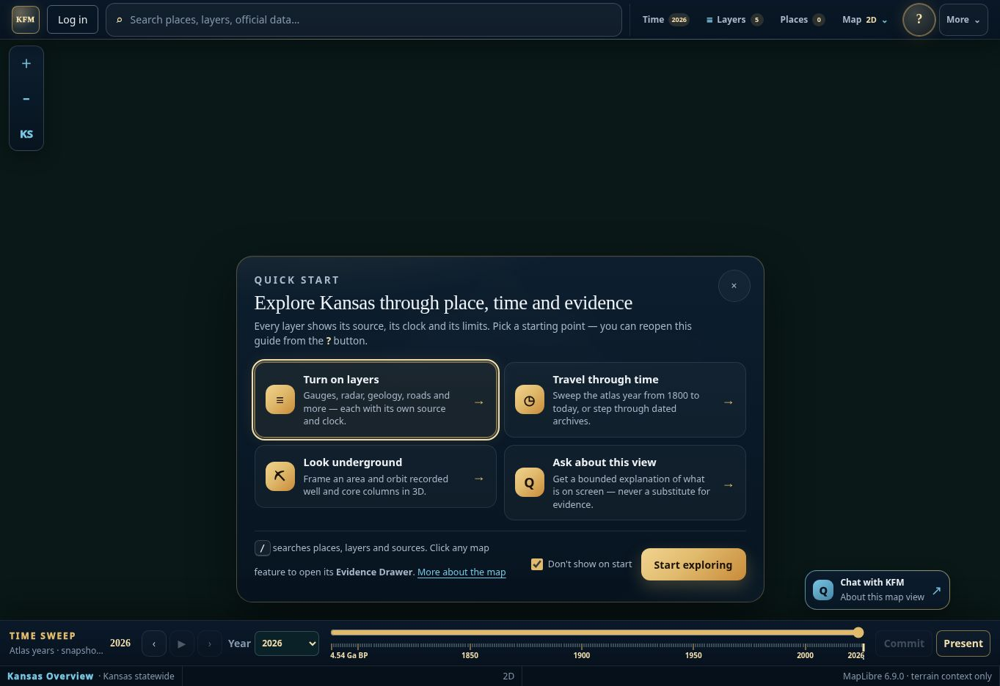
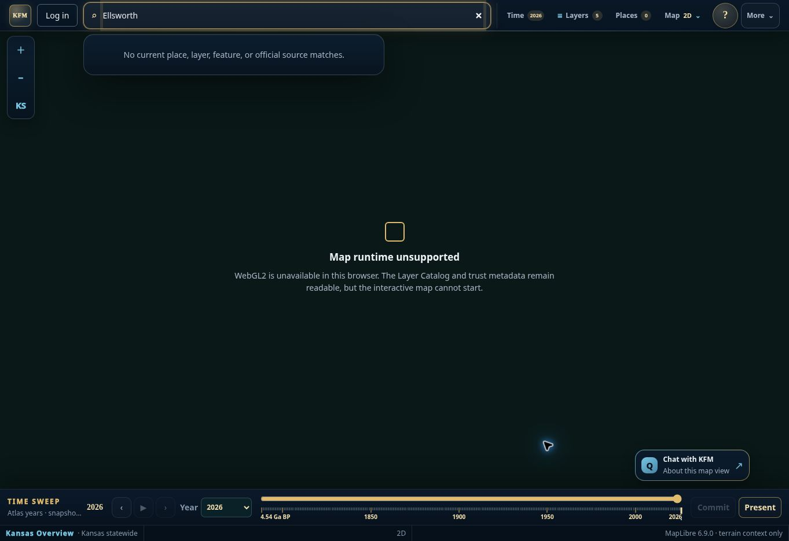
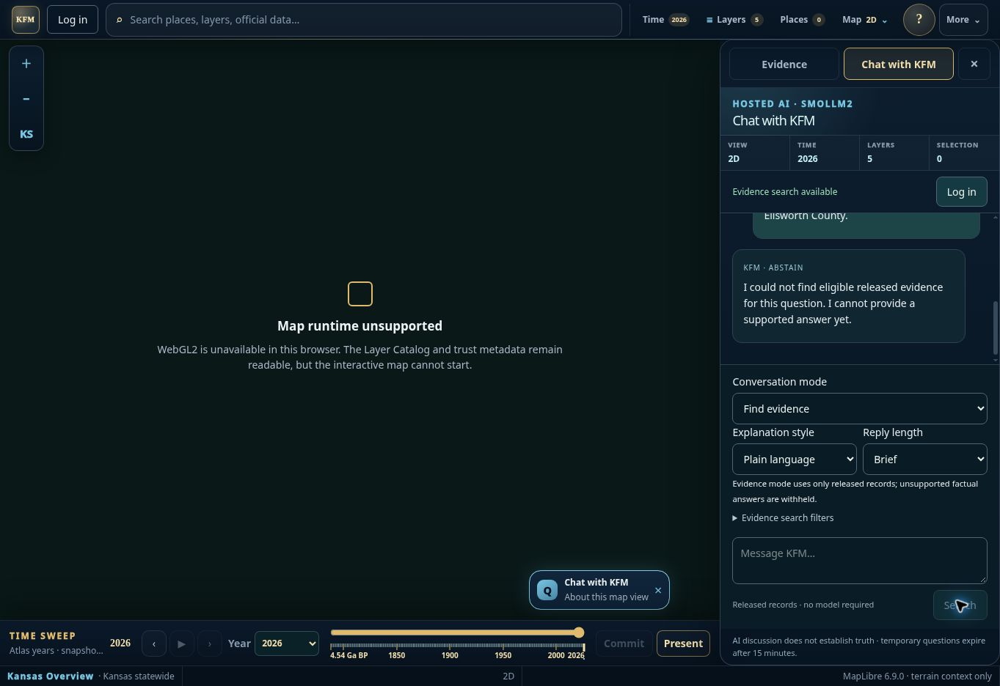
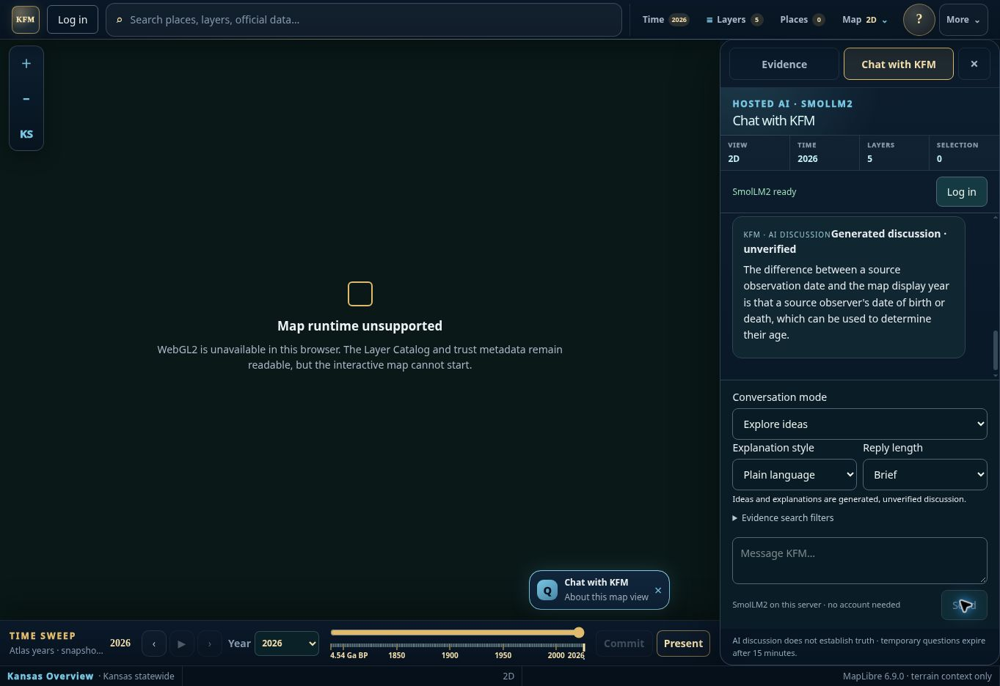

<!-- [KFM_META_BLOCK_V2]
doc_id: kfm://doc/site/investigation-handoff-20261018
title: County discovery and checked investigation exports
type: implementation-verification-record
version: v0.1
status: draft
owning_root: docs/
responsibility: Record this standalone application's bounded visitor-workflow implementation, evidence, limits and rollback.
truth_posture: CONFIRMED local implementation and named observations; NEEDS VERIFICATION rendered candidate and production acceptance.
[/KFM_META_BLOCK_V2] -->

# County discovery and checked investigation exports

Recorded 2026-10-18 UTC. This is a draft application change, not deployment,
source admission, model qualification or independent review. A complete
release-backed factual-AI investigation is still held. The implemented slice
connects existing county discovery with inspection and makes the existing
selected-source workflow exportable without promoting context into evidence.

## Source identity and overlap

| Surface | Current inspection | Meaning |
| --- | --- | --- |
| Monorepo default branch | `main@cefd19e66857f8bf98b4d6995174c14801deb629` | Different application layout and release responsibilities. |
| Authoring base | `a0-hosted-ai-web-20261017@663eedb7845f1a8cd2f4ffeca884c5130c62ac6e` | Exact standalone Node application, including merged #5230, #5233, #5248 and #5250. |
| Production review branch | `codex/published-kfm-4b3cc-20261017@57bf6c8b3b2c09cb489ee939bb28ceab1318c97f` | Separate #5245/#5249 lineage; not imported wholesale into this change. |
| Existing public staging | project `appgprj_6acd1aafe0d88191a4306ea2ab44ed91`, v7, source `8fd126d2f0acc3a7ae99a66c4a37bb258c7840bd` | Sites reports succeeded deployment `appgdep_6ad4226fba8881919d8ca0699ff604b6`, custom audience. Its provider deployment URL is distinct from GoDaddy. |
| Preserved original Explorer | project `appgprj_6aa0b1c41bc08191bfd86003920f1631` | Connector returned NOT_FOUND. This does not establish deletion or authorize replacement. |
| Public application | anonymous browser at `https://kansasfrontiermatrix.com/` | Runtime inspected; exact source remains UNKNOWN. `/api/build` returned the branded 404. |

PRs [#5230](https://github.com/bartytime4life/Kansas-Frontier-Matrix/pull/5230)
and [#5233](https://github.com/bartytime4life/Kansas-Frontier-Matrix/pull/5233)
already supply record/page context and source rechecks. This change reuses them.
[#5250](https://github.com/bartytime4life/Kansas-Frontier-Matrix/pull/5250)'s
read buffer, cancellation, retry and guest boundaries remain in place.
[#5245](https://github.com/bartytime4life/Kansas-Frontier-Matrix/pull/5245)'s
production identity work remains a separate review/publication lineage.
The open-PR query returned none before authoring and again before handoff.
The separately noted `ac575d9` continuation candidate is not bundled.

The GoDaddy connector exposes domain availability/suggestion tools, not hosting
inspection or deployment. Existing configuration names GoDaddy app `q9r9beo47t`;
no provider dashboard, source activation, deployment or setting change occurred.
No original Site identity, bindings, audience, stores or private model changed.

## Captured public journey and chosen priority

All images below are the exact accepted current-run captures, 1363 × 936 pixels.
They show the existing public application, not the candidate. No mobile viewport,
screen-reader acceptance or WebGL rendering is claimed.

| Step | Observed health | Candidate behavior and limit |
| --- | --- | --- |
| 1. Enter Explorer | Guide, source/time cues and keyboard-labeled controls are present. Browser reports WebGL2 unavailable. | Keep the existing design; no renderer replacement or fabricated map. |
| 2. Choose Ellsworth | Search returns no place while the county feed reports 105 loaded features. | Search the loaded Census counties by name/suffix/FIPS; open the current record in Evidence. A failed/removed feed cannot reopen its stale search row. |
| 3. Inspect source/time | Existing drawer/selected-sample context exists in source. Actual map feature clicks cannot be tested in this browser. | Reuse that drawer and source resolver. County choice does not change active time; the Census edition remains explicit. |
| 4. Ask a question | Anonymous evidence search abstains. A time-definition question receives an incorrect unverified model reply. | Retain abstention and model-quality holds. Existing KGS sample summaries use original fields without inference. |
| 5. Preserve the result | Branch UI copies only an interpretation outline; selected-source summaries have no download path. | Copy investigation, Download Markdown and Download investigation JSON. Recheck the selected job before every action. Rendered candidate/download completion remains unverified. |

Priority is discovery plus preservation of an attributed result. The first
failure is a missing connection to already-loaded source records, not missing
geocoding infrastructure. The final failure blocks reuse of source summaries.
No redesign, new provider or paid service is needed for this slice.

## Implemented behavior

County results are bounded to seven and use only the existing successful
Census payload. Selecting a row re-resolves it against current payload/state,
opens the established drawer and frames its supplied geometry when a map exists.
The year is preserved. County polygons are reference geography from their named
edition, not historical boundaries, present population or KFM claim evidence.

Each completed chat turn has explicit copy/Markdown/JSON investigation actions.
Saving performs one existing job GET, with no new question, inference, network
provider or data admission. The export uses that GET's result and the context
captured when its question was submitted, rather than a later map selection.
Buttons retain the current styles, visible focus and at least 44-pixel height.

The draft contains the chosen question, permitted frame/layers/filter/compare
and record identifiers, checked timestamp, response fingerprint, source links,
separate context/search release IDs when available, source summary or clearly
unverified discussion, and limitations. The fingerprint binds the checked response;
it does not authenticate a provider, admit evidence or approve release.
No raw job/session ID, account, camera, browser location, private notes, full
conversation or free-form display attributes enter this projection. Model prose
does not become a factual `answer`. Markdown escapes authored/model HTML and
link markup; source links retain the established allowlist.

If the source changed, the saved draft records withholding and omits its old
summary, question, scope and source references. If rechecking fails or is
throttled, no copy/download occurs. Guest expiry, cancellation and ownership
checks remain with the existing server. No store or schema migration is needed.

## Validation and failure attribution

| Check | Result | Boundary |
| --- | --- | --- |
| Focused/adjacent Node inventory | 110 PASS, 0 FAIL/SKIP | County selection action, export actions, retained submitted scope, withdrawal, failed recheck, private-field omission, guest/rate/queue controls and existing map/report/mobile contracts. |
| Production build | PASS | Existing Vinext build; unchanged dependencies/lockfile. Inherited chunk-size/static-analysis warnings remain. |
| TypeScript | PASS | `npx tsc --noEmit --incremental false`. |
| Changed-file ESLint | 0 errors; 40 inherited page warnings | Unchanged-base page lint also reports 0 errors/40 warnings. No blanket clean-lint claim. |
| Built routes | 4 PASS | Two production Fetch-handler and two actual Node HTTP tests, including disabled-host/origin/private-account boundaries. |
| Real shipped KGS source | PASS | Local HTTP: `tile-163-257` / `wwc5-1000`, interval 0; source date 1984-07-11, archive edition 2026-09-11, recorded 0–40 ft description. Not an admitted release; no surrounding-geology or county-membership inference. |
| Missing/time/policy behavior | PASS | Missing record, pre-record map frame and sensitive question remain withheld. Zero model invocations in this source/export replay. |
| Whitespace | PASS | `git diff --check`. |
| Exact-head CI | Pending at authoring | Record the actual PR-head run separately; local results are not hosted checks. |
| Candidate browser/mobile/WebGL/download | NOT VERIFIED | Managed preview starts this composition on port 3000 instead of its required 4173; no passing after-image or rendered download is fabricated. |
| Independent review, live deployment and publication | Not performed | Draft only; existing holds remain. |

An adjacent test initially failed because it asserted that the asynchronous
second evidence resolver had already entered immediately after receiving a
202 response. The identical test failed on unchanged base `663eedb`. Its
bounded wait now observes the actual pending operation before checking
cancellation/expiry. The assertion and finite-result behavior are retained.

The relevant resource bound is unchanged: county search adds no provider request;
each explicit save adds one source-rechecking GET, no POST and no inference.
The export was replayed over real local HTTP with existing shipped KGS bytes.
A three-read-per-tree timing sample is diagnostic only, too small to establish
production performance. Browser FPS, startup, long-session and mobile acceptance
remain open; no 60-FPS or performance-regression acceptance is asserted.

## Model/evidence decision packet

The live question asked for the difference between map display year and source
observation date. The model instead described an observer's birth/death date and
age. That is a failed relevance/correctness observation, not a source fact or a
complete evaluation of all model tasks. The public geology evidence query
abstained. Source notes still describe a missing Node released-knowledge binding.

PROPOSED next dependent slice: implement a Node adapter for the existing governed
knowledge contract without activating it, then separately review a minimal
rights-cleared/public-safe release. Evaluate fixed expected sources and outcomes
for supported, missing, stale, withdrawn, scope-change and sensitive questions
before any model or resource change. Continue using deterministic source fields
for record summaries. Do not enable factual model output or select a replacement
model from this single failed response.

## Placement, coordination and rollback

Accepted [ADR-0029](https://github.com/bartytime4life/Kansas-Frontier-Matrix/blob/cefd19e66857f8bf98b4d6995174c14801deb629/docs/adr/ADR-0029-adopt-directory-governance-standard-v2.md)
and the adopted Directory Rules §§10–12 route this composition to existing
`app/`, `server/`, `tests/`, `docs/`, `.github/` and
`data/receipts/generated/` responsibilities. The new helpers are application
display/export projections, not parallel source, schema, policy or release homes.
The original `.openai/hosting.json` is preserved and not used to publish this
GoDaddy composition.

The [Drive charter](https://docs.google.com/document/d/1WCjGPXvvvSoWLno9anUKzFlaKlR1aLh0u14_1oz61oI/edit)
and [Notion Living Atlas coordination](https://app.notion.com/p/3d2a92021bf681d68e6dfad0564d8687)
inform source roles and the intended journey; their dated checkpoints are not
new implementation or deployment evidence. Existing design lineage is retained.

Rollback is to close the unmerged draft or revert this bounded application,
test/CI, documentation and receipt change through normal review. There are no
database, model, source-release, DNS or audience changes to undo. No deployment
or rollback rehearsal was performed. Keep separate production dependency and
model-quality holds, existing private stores, and retained recovery artifacts.
