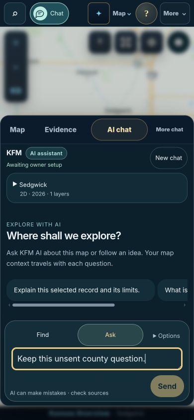
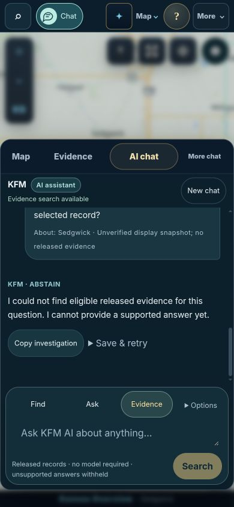

# Live investigation review — 2026-11-19

Status: local candidate and dated public observations. This record does not
authorize deployment, source admission, promotion, publication, or policy changes.

## Identity and starting evidence

- Repository: `bartytime4life/Kansas-Frontier-Matrix`.
- Authoring base: hosted branch `a0-hosted-ai-web-20261017` at
  `657606ea88989b1043320e4a0039d3666fce5133`.
- Public application: <https://kansasfrontiermatrix.com/>; `/api/build` reports
  app `urdng3v1vk`, 1,377 source inputs and digest
  `sha256:7f756f86e94af0660403a373adb2c523d5c8a2ea2badec6aa229922222fc80e9`.
  The served identity reports `WORKTREE_MODIFIED` and a null source commit.
- Running `applicationIdentity()` against the clean aviation checkout at
  `7b5ce00ec53a5421dc1ff7a2bcd97bc9014522a9` produced the same digest and file
  count. That commit's Git tree equals the hosted base tree. This confirms
  parity of the identity algorithm's application inputs, not build bytes,
  provider settings, model identity, live data, or a deployed Git revision.
- The original monorepo checkout contains unrelated unfinished work and was
  preserved. Authoring reuses a clean detached checkout on a new
  `codex/record-ask-handoff-20261119` branch.
- Open-PR inspection found only #5941, a separate `main` CI workflow change;
  no application-file overlap was observed.

## Experience brief

Visitor: someone who finds a county, inspects its record and chooses to ask
about that record.

Problem: after Find → Sedgwick County → Evidence, **Ask AI about this record**
opens the companion in Find. The visitor must manually switch to Ask before
the selected-record context is visible. The same source pattern exists in
explicit subsurface Ask callbacks.

Bounded outcome: explicit record Ask actions select Ask, focus the composer,
and retain the selected record, map, time, layers, conversation and unsent draft.
They never submit a question automatically. Generic panel/tab switches retain
the visitor's chosen mode; explicit Find continues to select Find.

Visual direction: use the existing Find/Ask/Evidence controls and context card.
No new panel or visual treatment is needed.

Acceptance: exercise the actual page callbacks for explicit Ask, including
repeat use and transitions from Find and Evidence; confirm context/draft
preservation and no automatic submission. Check the resulting rendered local
behavior separately from live observations.

Non-goals: inference/provider changes, a new gazetteer, export schema changes,
welcome redesign, source promotion, release, or deployment.

## Public walkthrough findings

All findings below were observed on 2026-11-19. Browser layout checks used
1440 × 900 and 390 × 844 viewport emulation; this is not physical-device or
complete accessibility acceptance.

| State | Observation | Meaning / next action |
| --- | --- | --- |
| CONFIRMED | The new welcome exposes themed previews and a search destination selector on desktop. | Current live behavior, not inferred from a merge. |
| CONFIRMED | Searching Wichita offers Wichita County, rather than the city. | Discovery coverage gap; do not substitute the county for the city. A future fix needs an attributed place source. |
| CONFIRMED | Sedgwick search selects the 2020 Census county record, preserves map time 2026 and exposes source, edition, limits and missing EvidenceBundle. | County-to-evidence path works. |
| CONFIRMED | Explicit record Ask retains the previous Find mode. | This candidate's bounded implementation target. |
| CONFIRMED | Chat message box and actions remain visible at 390 × 844. | No recurrence of the original clipped-composer problem in this observed scenario. |
| CONFIRMED | `/api/ai/status` reports ready through `home-ollama`, model `qwen3.5:9b-q4_K_M`. | The public browser can submit without a local browser companion, but inference depends on the configured home relay. This is not independent cloud compute. |
| CONFIRMED | One Ask reply identifies the 2020 baseline, avoids claiming present-day conditions, and is labelled AI DISCUSSION / UNVERIFIED. | One successful live response, not model qualification or a latency benchmark. |
| CONFIRMED | Evidence mode abstains: no eligible released evidence supports this selected record. | Unsupported-answer handling works for this question. |
| CONFIRMED | Save investigation reports that the place was added to Places on this device. | Browser-local save; no publication. |
| CONFIRMED | Public-safe JSON downloads and retains the missing-evidence, correction and demonstration labels. | Download is operational; its metadata is incomplete as described below. |
| CONFIRMED | Downloaded JSON sets `featureOrSourceYear: 2026` while its source text names the 2020 Census baseline. Its `layers` array is empty, and the selected-record payload omits the Census organization, source URL and attribution. | Separate export fidelity defect. Preserve source edition and selected-source attribution independently of catalog-layer visibility in a follow-up; do not call the current export fully attributed. |
| CONFIRMED | At 390 × 844 the welcome heading and place-search summary remain in accessibility output but each measures only 1 CSS pixel wide; attempts to focus the place field fail. | Separate responsive/focus defect. Keyboard and screen-reader consequences still need targeted verification; no complete accessibility diagnosis is claimed. |

The downloaded artifact was inspected as data. It is not a released evidence
bundle and is not added to the source tree.

## Placement, ownership and rollback

Existing standalone `app/`, `tests/` and authored `docs/` responsibilities are
used, following root `AGENTS.md`, the adopted Directory Rules placement
protocol (ADR-0029), and adjacent implementation records. No new authority root,
parallel schema, registry, source, or proof lane is created. The preserved
`apps/site/source/` mirror is not edited by this candidate.

Creative Lead owns this brief and live observations. Lead Developer verified
base, source parity and overlap. Master Coder owns `app/page.tsx` and focused
regression coverage. An independent reviewer must assess the final diff.

Rollback: revert the bounded candidate. No storage migration, data mutation,
hosting configuration or release transition is involved.

## Candidate validation and delivery

Implementation changes only three explicit Ask callbacks in `app/page.tsx`:
the record button, Underground's Ask callback and SubsurfaceInspector's Ask
callback. Each now uses existing `openAtlasComposer("explore")`, which requests
Ask mode, preserves the current draft and focuses the composer. Generic panel
switches and explicit Find are unchanged.

The regression executes the actual page callbacks/helpers captured through
TypeScript's AST and the real `AssistantWorkspace` in the existing component
harness. It checks Find and Evidence transitions, repeated use, draft and
conversation retention, context, focus destination and absence of automatic job
submission. Its parent-state/DOM/timer stubs are not full renderer evidence.

Final local validation uses a fresh `npm ci --no-audit --no-fund` without
changing the manifest or lockfile:

| Check | Result |
| --- | --- |
| `npm run build`, with only ignored `dist/` and `public/assets/` cleared first | PASS |
| `tsc --noEmit --incremental false` | PASS |
| `eslint app/page.tsx` | Zero errors; 42 existing warnings on unchanged lines |
| Four focused files: chat composer, assistant context, sitewide assistant and global search | 42 passed; zero failures or skips |
| Independent reviewer: `tests/chat-composer-reach.test.mjs` and whitespace check | 15 passed; no actionable findings |
| Full Node 22.13.1 suite | 3,163 passed, 13 failed, 23 skipped; 3,199 total |
| The three failing files on the untouched, source-equivalent aviation checkout | Same 13 failure names; seven passed |
| Full Node 24.11.1 suite against the same fresh build | 3,176 passed, zero failed, 23 skipped; 3,199 total |

Those thirteen failures concern SQLite RTree and FTS5, which this installed
Node 22.13.1 does not provide. The installed Node 24.11.1 supports both modules;
its full-suite result is recorded separately above. Skips remain unavailable
coverage and are not reported as passing.

Browser acceptance used a production build served on `127.0.0.1:4193` with an
empty environment, no operational stores and no inference configuration.
Find → Sedgwick County → record Ask activates Ask, exposes Sedgwick's context
and focuses the message box. Repeating from Find with an unsent draft retains
that exact draft. Map year 2026 and the selected county layer remain intact.
The resulting layout was inspected at 1440 × 900 and 390 × 844. Local Send is
disabled because inference is unconfigured; no local AI response is claimed.

The independent reviewer authored no patch and reported no correctness,
security, accessibility or material performance findings in source review.
Physical-device use, screen-reader output, full concurrent scheduling and
the subsurface provider scenarios were not independently browser-tested.
Public behavior above belongs to the observed source digest; it must not be
presented as acceptance of this later local candidate.

Proposed next priorities are: (1) selected-source year and attribution in
exports; (2) accessible mobile welcome discovery; (3) attributed city discovery.
These are separate work packages, not implied fixes or release acceptance.

## Independent availability sample

A separate reviewer performed sequential public GETs at 18:55:44–18:55:58 UTC
on 2026-11-19, using curl 8.18.0 on Linux x86_64, HTTP/2, verified TLS, fresh
connections, one-second gaps and uncompressed bodies. No inference jobs or
load test were run.

| Endpoint | Successful samples | Bytes per response | Total HTTP elapsed, milliseconds |
| --- | --- | --- | --- |
| `/` | 2 / 2 | 389,044 | 608 / 592 |
| `/api/build` | 3 / 3 | 356 | 229 / 264 / 381 |
| `/api/ai/status` | 3 / 3 | 220 | 235 / 335 / 389 |
| `/data-library` | 3 / 3 | 51,119 | 408 / 314 / 265 |

All eleven requests returned HTTP 200. Build identity and AI readiness were
consistent across their three samples. An earlier sandbox DNS error did not
reach the site. Timings include connection and transfer overhead; they are not
browser rendering measurements. There is no comparable pre-update baseline,
so this sample cannot establish a performance regression or whole-site approval.
