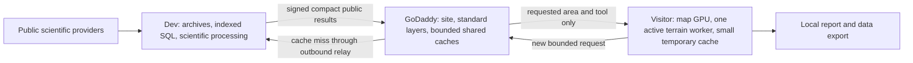

# KFM resource placement and loading

**Status:** Accepted design; first implementation prepared for the existing GoDaddy application. Publication must be verified separately.
**Date:** 2026-11-24
**Direction:** Owner-requested optimization of the public KFM site, dev DATA14TB storage, and visitors' active work. No new paid services, subscriptions, hosting plan changes, or required local installation.

## Decision

GoDaddy serves the website and small, reusable public results. Dev retains authoritative archives, full scientific datasets, ingestion, expensive derivations and local AI. Each visitor's browser draws and inspects only their current view, with bounded temporary storage. Standard browsing should become less dependent on a round trip to dev; new high-resolution analysis can still require it.

The production destination remains `https://kansasfrontiermatrix.com`, app `urdng3v1vk`, branch `a0-hosted-ai-web-20261017`. The original Sites composition is preserved. This is a production architecture, not a new localhost product.

## Placement by workload

| Workload | GoDaddy | Dev | Visitor experience |
|---|---|---|---|
| Site shell, styles, icons, legends and code | Versioned, precompressed assets; optional tool modules on demand | Source/build work only | Open the map before downloading optional tools |
| Terrain Ground overview | Bundled dated Kansas overview; prepared public view cache | Source rasters, reprojection and new detailed views | Progressive terrain, same source values and NoData; readable scale and provenance |
| Surface and canopy | Compact prepared grids and their parent receipts | Classified returns, complete native support, scientific derivation and validation | Show supported areas; explicit gaps where a defensible surface is unavailable |
| Raw LiDAR and source archives | Keep out of normal page delivery | DATA14TB originals, manifests, checksums and reproducible processing | Optional inspection of a bounded selection; no statewide raw download on page load |
| Data Library and station catalogues | Persist reusable public first pages and definitions; retain existing in-memory cache | Full indexed databases, later pages and queries | Familiar collections can reopen after a host restart without another dev trip |
| Science tools | Shared source descriptions, compact validated inputs, prepared summaries | Large regional jobs, spatial joins and expensive statistics | Small selected-region calculations, linked inspection and exports; cancel obsolete work |
| Live weather, radar, aviation, alerts and gauges | Existing source-specific short-lived requests/caches | Existing archive ingestion where applicable | Preserve observation time and existing refresh cadence; do not relabel saved observations as live |
| AI and evidence retrieval | Existing signed relay and bounded request queue | Existing local model and indexed retrieval | Chat module loads on first opening; draft survives closing; inactive workspace cancels its work |
| Reports, Places and investigations | Public templates and allowed shared references | Existing source evidence where required | Keep personal drafts and free exports with the visitor; never put them into the public host cache |
| Videos, thumbnails and large specialist readers | Static media and lazy specialist modules already hosted | Original media/archive material | Load only visible or requested media/readers; inventory size is not page-download size |
| Backups, credentials and operational logs | Existing host-private configuration only | Existing private backups and operations | No credential or operational-data download to visitors |

The host cache is a disposable delivery copy, not a second authoritative database. The current public dataset allowlist and source permissions remain the authority. Adding a cache does not admit a pending dataset or certify scientific accuracy.

## Implemented bounds

| Resource | Bound and behavior |
|---|---|
| Standard Kansas Ground overview | 195,650 bytes; 96 × 96 dated output grid; not native statewide 1 m coverage |
| Prepared terrain on GoDaddy | Existing 1 GiB / 2,048 entries; validated receipt/grid pairs, 24-hour freshness and seven-day stale fallback |
| Public archive pages on GoDaddy | New 512 MiB / 2,048 entries; at most 1,004,096 expanded bytes per file; 15-minute freshness and seven-day stale fallback |
| Host hot data | Existing shared 64 MiB / 500-answer process cache; identical requests share a dev trip |
| Disk headroom | Each cache refuses a write below a 512 MiB filesystem reserve; failed/full storage falls back to existing delivery. Filesystem free space does not prove remaining account quota |
| Retained application assets | Existing 256 MiB / 4,096 immutable-file build limit. Retention protects already-open tabs; do not delete old hashes casually |
| Visitor temporary terrain data | Existing 8 MiB conservative / 16 MiB capable-device serialized-payload limit; 24 entries; 2 MiB each; shared across same-origin tabs; five-minute reuse |
| Visitor terrain preparation | Existing one latest-only worker per visible tab; bounded 96² grid and geometry allocation; 15-second deadline; obsolete/hidden work cancelled |
| Visitor display | Existing normal/light framebuffer limits; visual quality can decrease without changing scientific values or picking IDs |

The owner reports roughly 100 GB of hosting storage; remaining quota has not been independently verified. These additions reserve no paid capacity. The two data caches together have a 1.5 GiB logical ceiling. They stop adding copies at their limits and do not remove source files or other host content. Automatic cache-only expiry reclamation and a single global storage dashboard remain follow-up work.

The new archive policy accepts only unfiltered first pages of GHCN stations and IEM wind stations, the GHCNDEX definition dictionary, and first pages of the existing public recovered collections. Arbitrary searches, geographic queries, pagination cursors, long-field requests, live observation endpoints, AI messages, worker jobs and pending datasets are excluded. Files live under `public/assets/kfm-archive-cache-v1`, which is deliberately public. Every saved answer is bound to its dataset, normalized query, schema, source descriptor, origin and original cache time. The gateway's signature is checked before saving; stored copies have an independent HMAC and bounded gzip expansion. The API checks these again after restart.

The browser never takes work on behalf of other visitors. Browser quota denial, private browsing or unavailable workers must leave ordinary website use available. Explicitly saved radar/fire material and investigations are separate from the replaceable temporary terrain cache; a cleanup of one must not silently delete the other. Total browser RAM and GPU memory cannot be guaranteed by a website.

## Why not put every Kansas LiDAR product on GoDaddy?

Storage depends primarily on resolution, layers and dates, not just the small pilot. A simple uncompressed raster calculation is:

`bytes ≈ land area in m² ÷ cell width² × bytes per value × number of layers × number of dates`

Using Census Kansas land area of 81,758.59 square miles and four bytes per Float32 value gives approximately **847 GB per 1 m layer**, **8.47 GB per 10 m layer**, or **0.94 GB per 30 m layer**. Three complete 1 m layers would be about 2.54 TB before masks, metadata, overview levels or additional dates. This is a scale estimate, not a download inventory: compression, water/NoData, actual coverage and source products change real sizes. A coarser hosting pyramid can be practical; statewide raw returns and complete native products belong on dev.

Sources: [Census Kansas land area](https://www.census.gov/quickfacts/fact/table/KS/LND110220); [GoDaddy persistent public/assets and existing-app publication workflow](https://www.godaddy.com/help/deploy-my-cursor-or-claude-app-with-nodejs-hosting-42908).

## Measured first implementation

- The current public site was read successfully during this audit: expected app `urdng3v1vk`, 22 public dataset families, dev relay online. Its source digest was still `sha256:b26501a968d54ac1e786ae593355ce9bdf24c921ec2939577ba87308c1db4aff`; this candidate was not yet confirmed published.
- The audited checkout's public tree was about 406 MB, including about 221 MB of welcome media and 123 MB of retained client builds. Those are stored inventory totals, not an initial browser download. Current welcome acceptance confirms retired footage players are not mounted.
- The map's static JavaScript dependency graph fell from 2,792,001 to 2,750,944 decoded bytes, and from 854,708 to 841,278 gzip bytes: **41,057 decoded bytes / 13,430 gzip bytes deferred**. This is a modest initial improvement; the approximately 2 MB main map module still warrants further separation by actual tool ownership. Lazy loading shifts chat code to first use rather than eliminating it.
- Four actual public API responses contained 100 GHCN stations, 26 climate-index definitions, 68 wind stations and 20 archive records: 61,892 source JSON bytes became 12,637 bytes across four signed compressed cache files. All values and source metadata matched after restoration. Local restarted-cache reads took 0.265–0.705 ms in that small run. These are local disk measurements, not GoDaddy latency, first-source preparation, a throughput benchmark or scientific validation.
- Complete local regression: 3,569 passed, zero failed, 25 explicit skips. TypeScript and changed-file lint passed. New desktop (1440 px) and mobile (390 px) browser journeys passed, checking no initial chat download, close-during-download behavior, keyboard focus, one module request and retained drafts. Exact-head remote CI and publication remain separate checks.

## Next optimization sequence

1. **Publish and measure the existing candidate on the actual host.** Verify `/api/build`, public API source/cache metadata and the new on-demand module. Record host cache hit/miss, first preparation time and browser frame/interaction timing separately. Collect aggregate operational timings, not search strings, personal locations or chat text.
2. **Replace exact-viewport preparation with reusable geographic tiles.** Establish a standard Kansas tile grid and level-of-detail pyramid on dev; publish compact versioned tiles and a coverage manifest to GoDaddy. Adjacent pans should reuse tiles. Start with Ground overview levels, then supported Surface/Canopy. Select a bounded batch only after checking actual quota and packed size. Do not download or precompute all resolutions speculatively.
3. **Preserve the science through tiling.** Bind each product to source edition, CRS, vertical datum, units, processing recipe and NoData mask. Compute derivatives in projected metric coordinates with neighboring-cell support; do not calculate slope in raw longitude degrees. Use a tile halo for lighting/derivatives to avoid seams. Keep display exaggeration separate from measurement; never subtract incompatible survey datums or synthesize canopy from sparse coverage. Report overview spacing and source resolution separately.
4. **Split the main map by deliberate tool opening.** Use the measured import graph to isolate timeline-specialist, report, analysis and other optional code. Do not unmount a controller that owns active map layers. Preserve drafts, keyboard return and cancellation, as tested for chat. Keep essential map navigation available while a tool loads or fails.
5. **Share one visitor resource policy across tools.** Extend the existing terrain budgets to requested radar frames, charts, specialist readers and transient analysis. Prioritize visible interaction; cancel superseded work; limit concurrent decodes. Keep explicit user-saved data separately reported and managed. Consider cross-tab worker arbitration only if measured simultaneous-tab load justifies it.
6. **Improve resilience and maintenance.** Add a bounded expired-copy reclaimer restricted to authenticated cache files, with replacement/rollback tests. Provide owner-readable cache usage and queue diagnostics. Persist only the reviewed public catalogue projection if offline catalogue status becomes a measured problem. Keep the existing dev warmer and indexed query paths; do not add duplicate warming jobs or full-table scans.

Acceptance targets for subsequent work: visible input remains responsive during processing; navigation cancels old requests; no unnecessary data fetch for hidden tools; cold and warm results are visibly distinguished; pan/zoom increases detail progressively without losing source identity. Establish low-end device and actual WAN baselines before claiming a numerical performance gain. Reduced rendering workload must never silently reduce the accuracy of displayed readings.

## Alternatives and consequences

| Option | Benefits | Costs and limits |
|---|---|---|
| Everything on dev | One data store; inexpensive existing capacity | Ordinary page availability and latency depend on home connectivity and dev readiness |
| Everything on GoDaddy | Central delivery | Full archives/native products exceed a sensible small host footprint; heavy science/AI competes with web serving; migration and quota uncertainty |
| Everything in visitors' browsers | Less central computation | Repeated downloads, uneven devices, battery/memory pressure and weak shared reuse |
| **Bounded hybrid, selected** | Reuses prepared public work close to visitors; keeps heavy processing on existing hardware; small active browser workload | Requires explicit versions, cache budgets, freshness and honest partial/offline states |

Rollback of the new delivery behavior is a source rollback of the archive-cache factory wiring and optional assistant loader. Existing raw data, SQL, credentials, DNS and source archives are unchanged. Saved public cache files are expendable; a missing or rejected copy falls through to existing delivery. Never roll back unrelated site work to reverse an optimization.

Related implementation detail: [Terrain hosting and visitor budgets](terrain-hosting-plan.md), [local SQL relay](local-data-relay.md), [layer lifecycle performance](layer-lifecycle-performance.md). Browser caching and lazy-module references: [MDN HTTP caching](https://developer.mozilla.org/en-US/docs/Web/HTTP/Guides/Caching), [React lazy loading](https://react.dev/reference/react/lazy). The implementation uses a retryable module loader so failure can be retried and the mounted draft can be retained.
