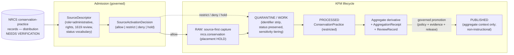

<!-- [KFM_META_BLOCK_V2]
doc_id: kfm://doc/sources-catalog-nrcs-conservation-practice-records
title: NRCS — Conservation Practice Records
type: product-page
version: v0.3.0
prior_version: v0.2.1
status: draft
owners: TODO — Source registry steward + Soil domain steward + Agriculture domain steward
created: 2026-10-09
updated: 2026-10-11
policy_label: public
owning_root: docs/
responsibility: Human-readable product page for NRCS conservation-practice records (administrative practice records) as a candidate KFM source; does not admit, activate, or publish a source.
truth_posture: cite-or-abstain; repository claims cite the file read; upstream product facts, rights, and Section 1619 applicability NEEDS VERIFICATION; repository paths PROPOSED unless stated; sensitivity fail-closed
related:
  - docs/sources/catalog/nrcs/README.md
  - docs/sources/catalog/nrcs.md
  - docs/sources/catalog/README.md
  - docs/sources/catalog/IDENTITY.md
  - docs/sources/catalog/RIGHTS-AND-SENSITIVITY-MAP.md
  - docs/sources/catalog/OPEN-QUESTIONS.md
  - docs/sources/SOURCE_DESCRIPTOR_STANDARD.md
  - docs/doctrine/directory-rules.md
  - docs/domains/agriculture/README.md
  - docs/domains/agriculture/SOURCE_REGISTRY.md
  - docs/domains/agriculture/SENSITIVITY.md
  - docs/domains/agriculture/OBJECTS.md
  - docs/domains/agriculture/RELEASE_INDEX.md
  - docs/domains/agriculture/CROSS_LANE.md
  - docs/domains/soil/README.md
  - connectors/nrcs/README.md
  - data/raw/README.md
  - data/registry/sources/agriculture/nrcs.yaml
  - data/registry/sources/soil/README.md
  - schemas/contracts/v1/agriculture/README.md
  - policy/sensitivity/
tags: [kfm, sources, catalog, nrcs, agriculture, soil, conservation-practice, administrative, privacy, fail-closed, product-page]
notes:
  - "v0.3.0 (2026-10-11): replaced the placeholder body, which was a verbatim copy of the NRCS family entry (nrcs/README.md), with product-specific content; the placeholder NOTE was removed."
  - "created was TODO; 2026-10-09 is the earliest commit in available history containing this file, not a known authoring date."
  - "RAW placement wording follows accepted DIR-SOURCE-001 (source-first capture; physical placement HOLD; data/raw/agriculture/ and data/raw/soil/ are compatibility/reference lanes, not payload destinations)."
  - "Section 1619 (7 U.S.C. 8791) is not documented anywhere in the repository; its scope and applicability are NEEDS VERIFICATION and KFM handling is PROPOSED."
  - "Human-readable catalog page. Does NOT decide source admission; admission and activation live in the source registry and policy/."
[/KFM_META_BLOCK_V2] -->

# 🌱 NRCS — Conservation Practice Records

> Records of NRCS conservation practices associated with agricultural land — an **`administrative`** candidate source for the Agriculture lane (with Soil and Habitat adjacencies) whose public value lies in **aggregate context** and whose producer-, landowner-, and field-level detail is **denied for public exposure by default**.

| Field | Value |
|---|---|
| **Status** | `draft` v0.3.0 — PROPOSED product page; source **not** admitted or activated |
| **Family** | [`nrcs`](./README.md) |
| **Short ref** | `nrcs.conservation` (PROPOSED — as listed in the family table, [`README.md` §3](./README.md#3--nrcs-source-families)) |
| **Proposed `source_role`** | `administrative` (family entry §3–§4); vocabulary conflict recorded in [§3](#3--source-role-and-support-type) |
| **Primary domain** | Agriculture (`[DOM-AG]`) — owns `ConservationPractice` |
| **Adjacent domains** | Soil (context; never soil-property truth) · Habitat (framing only) · Hydrology (riparian edge, PROPOSED) |
| **Owners** | TODO — Source registry steward + Soil domain steward + Agriculture domain steward |
| **Last updated** | 2026-10-11 |

---

### Quick jump

- [§0 — Status & Authority](#0--status--authority)
- [§1 — Identity](#1--identity)
- [§2 — What this product is and is not](#2--what-this-product-is-and-is-not)
- [§3 — Source role and support type](#3--source-role-and-support-type)
- [§4 — Knowledge-character cautions](#4--knowledge-character-cautions)
- [§5 — Spatial and temporal granularity](#5--spatial-and-temporal-granularity)
- [§6 — Access and retrieval posture](#6--access-and-retrieval-posture)
- [§7 — Rights and sensitivity](#7--rights-and-sensitivity)
- [§8 — Lifecycle and admission flow](#8--lifecycle-and-admission-flow)
- [§9 — Cross-lane use and object families](#9--cross-lane-use-and-object-families)
- [§10 — Connector and registry status](#10--connector-and-registry-status)
- [§11 — Anti-patterns](#11--anti-patterns)
- [§12 — Open questions and verification register](#12--open-questions-and-verification-register)
- [§13 — Related docs](#13--related-docs)
- [§14 — Changelog](#14--changelog)

---

## 0 — Status & Authority

| Aspect | This product page | Authoritative home |
|---|---|---|
| Human explanation of `nrcs.conservation` in KFM | ✅ This file | `docs/` |
| Source identity, role, rights, cadence, sensitivity record | ❌ | `SourceDescriptor` — only a status-`PROPOSED` placeholder exists at [`data/registry/sources/agriculture/nrcs.yaml`](../../../../data/registry/sources/agriculture/nrcs.yaml) |
| Admission decision (allow / restrict / deny / hold) | ❌ | `SourceActivationDecision` under `policy/` (none located for this product) |
| Sensitivity tiers and deny rules | ❌ | [`policy/sensitivity/`](../../../../policy/sensitivity/) and Agriculture [`SENSITIVITY.md`](../../../domains/agriculture/SENSITIVITY.md) |
| Object meaning / machine shape | ❌ | `contracts/` and `schemas/contracts/v1/...` (`ConservationPractice` schema NEEDS VERIFICATION) |
| Fetch + admission code | ❌ | [`connectors/nrcs/`](../../../../connectors/nrcs/README.md) — no conservation-practice lane exists |
| Lifecycle data | ❌ | Source-first capture for `nrcs.conservation` (physical source-first RAW placement **HOLD** under `DIR-SOURCE-001`; `data/raw/agriculture/` and `data/raw/soil/` are compatibility/reference lanes, not payload destinations) |

> [!NOTE]
> This is a **product page**, not a `SourceDescriptor`. The family overview is [`./README.md`](./README.md); the family-wide catalog profile is [`../nrcs.md`](../nrcs.md); identity rules are in [`../IDENTITY.md`](../IDENTITY.md). If anything here conflicts with the registry or `policy/`, those win.

[↥ Back to top](#-nrcs--conservation-practice-records)

---

## 1 — Identity

| Identity element | Value | Label | Basis |
|---|---|---|---|
| Product short ref | `nrcs.conservation` | PROPOSED | [`README.md` §3](./README.md#3--nrcs-source-families) |
| Page slug | `conservation-practice-records` | CONFIRMED (file path) | This file |
| Collection id | `kfm-nrcs-conservation` | PROPOSED | `kfm-<org>-<product>` pattern, [`../IDENTITY.md`](../IDENTITY.md) |
| Namespace | `kfm:` | PROPOSED — unresolved | OPEN-DSC-03, [`../IDENTITY.md`](../IDENTITY.md) |
| Native record key | Unknown (practice id / contract id / plan id?) | NEEDS VERIFICATION | [`../IDENTITY.md`](../IDENTITY.md) lists `nrcs` native ids only for SSURGO keys |
| Practice code | NRCS practice code where applicable (`practice_code`) | PROPOSED | [`OBJECTS.md` §6.6](../../../domains/agriculture/OBJECTS.md#66-conservationpractice); [`../nrcs.md`](../nrcs.md) descriptor template |
| Object identity | `source_id` + role + practice period + normalized digest | PROPOSED | [`IDENTITY_MODEL.md`](../../../domains/agriculture/IDENTITY_MODEL.md) |

> [!IMPORTANT]
> **Records are not standards.** [`../nrcs.md`](../nrcs.md) separately profiles `nrcs:conservation-practice-standards` — public NRCS technical standards — and states that a standard "does not prove implementation on land". This page covers **records of practices associated with land or operations**. A standard citation must never be used to imply that a practice exists on a particular property, and a practice record must never be cited as the standard.

---

## 2 — What this product is and is not

### 2.1 What it IS (PROPOSED reading of repo doctrine)

- An agency **record of program/practice activity** — the family entry calls it a "compilation of agency-implemented practice records" ([`README.md` §3](./README.md#3--nrcs-source-families)); the Agriculture registry calls it a "conservation-practice roster" ([`SOURCE_REGISTRY.md` §6](../../../domains/agriculture/SOURCE_REGISTRY.md)).
- The intended upstream for the Agriculture-owned object family `ConservationPractice` (cover crop, no-till, contour, riparian buffer, terrace — examples from [`OBJECTS.md` §6.6](../../../domains/agriculture/OBJECTS.md#66-conservationpractice)).
- A source whose public use is **aggregate context**: "Conservation practices where permitted — `ConservationPractice` aggregate — Operator joins denied" ([`RELEASE_INDEX.md` §13](../../../domains/agriculture/RELEASE_INDEX.md)).

### 2.2 What it IS NOT

- ❌ **Not observed soil properties.** "These are agency records of activity, not direct soil observations. They must never be cited as observed soil events" ([`README.md` §4](./README.md#4--source-roles-at-admission)); "not soil property truth or public compliance finding" ([`data/registry/sources/soil/README.md`](../../../../data/registry/sources/soil/README.md)).
- ❌ **Not proof of current practice or effectiveness.** The NRCS connector boundary: Agriculture use "does not prove current practice, yield, management effectiveness, compliance, or private-land conditions" ([`connectors/nrcs/README.md`](../../../../connectors/nrcs/README.md)).
- ❌ **Not an instruction to land managers.** Conservation-practice surfaces "MUST NOT be presented as alerts, regulatory guidance, or instructions to land managers" ([`agriculture/policy/README.md`](../../../domains/agriculture/policy/README.md)).
- ❌ **Not a compliance, eligibility, payment, or program-participation determination.** [`../nrcs.md`](../nrcs.md) withholds USDA program participation, eligibility, payment, contract, and compliance status.
- ❌ **Not parcel, ownership, or tenancy truth.**

[↥ Back to top](#-nrcs--conservation-practice-records)

---

## 3 — Source role and support type

The family entry proposes `administrative`. Other repo documents describe the role differently; the conflict is **unresolved** and must be settled in the `SourceDescriptor` (ADR-S-04 is named as the resolution path in [`SOURCE_REGISTRY.md` §5](../../../domains/agriculture/SOURCE_REGISTRY.md)).

| Repo source | Role statement for NRCS conservation-practice data |
|---|---|
| [`nrcs/README.md` §3–§4](./README.md#4--source-roles-at-admission) | `administrative`; descriptor field `role_authority` |
| [`agriculture/SOURCE_REGISTRY.md` §5](../../../domains/agriculture/SOURCE_REGISTRY.md) | primary `administrative`; secondary `observed` per practice record |
| [`schemas/contracts/v1/agriculture/README.md`](../../../../schemas/contracts/v1/agriculture/README.md) | `administrative` or `observed`, source dependent |
| [`data/registry/sources/soil/README.md`](../../../../data/registry/sources/soil/README.md) | `administrative` |
| [`agriculture/RELEASE_INDEX.md` §10](../../../domains/agriculture/RELEASE_INDEX.md) | observation · context |
| [`agriculture/OBJECTS.md` §6.6](../../../domains/agriculture/OBJECTS.md#66-conservationpractice) | `authority` (when public) · `model` (RS-classified) · `context` |

**Page posture (PROPOSED):** admit as `administrative`. A secondary `observed` reading is not accepted by this page until a steward shows that a specific record type documents an on-site verification — and even then it is an observation of a *recorded status*, not of soil condition or outcome. A remote-sensing-classified practice (CDL/HLS) is a separate `modeled` source, not this product.

**Support type (PROPOSED):** a practice record attached to an administrative unit — a field, tract, contract, or plan (exact unit **NEEDS VERIFICATION**; [`OBJECTS.md`](../../../domains/agriculture/OBJECTS.md) lists `support_geometry` and [`RELEASE_INDEX.md`](../../../domains/agriculture/RELEASE_INDEX.md) lists polygon / point). Support is not a survey sample, station, or grid cell, and it must travel with every derivative.

> [!CAUTION]
> Source role is **fixed at admission and never edited in place**; aggregation produces a new `aggregate` derivative carrying `role_aggregation_unit` + `AggregationReceipt` ([`README.md` §4](./README.md#4--source-roles-at-admission)). It does not relabel the underlying records.

---

## 4 — Knowledge-character cautions

| Caution | Rule | Label |
|---|---|---|
| **Record ≠ implementation** | A recorded practice shows that an agency record exists, not that the practice is on the ground today. | CONFIRMED doctrine (connector + catalog sources in §2.2) |
| **Record ≠ outcome** | No erosion, water-quality, habitat, or yield effect may be inferred from a practice record alone; any such claim is `modeled` with a `ModelRunReceipt`. | PROPOSED (follows the anti-collapse rule in [`README.md` §4](./README.md#4--source-roles-at-admission)) |
| **Status must not collapse** | If upstream distinguishes planned, applied, and certified (or similar) practice states, each is preserved as a separate field; a planned practice is never rendered as applied, and an applied practice is never rendered as certified. | PROPOSED — upstream status vocabulary NEEDS VERIFICATION |
| **Standard ≠ record** | Practice-standard text does not show adoption on any property. | CONFIRMED ([`../nrcs.md`](../nrcs.md)) |
| **Time-bound** | A practice has a valid period (installation, lifespan, contract term); stale records are badged, not silently carried forward. | PROPOSED (`valid_time_range` in [`OBJECTS.md` §6.6](../../../domains/agriculture/OBJECTS.md#66-conservationpractice)) |
| **Non-instructional** | Practice context is framing for analysis, never guidance. | CONFIRMED ([`CROSS_LANE.md`](../../../domains/agriculture/CROSS_LANE.md); [`agriculture/policy/README.md`](../../../domains/agriculture/policy/README.md)) |

[↥ Back to top](#-nrcs--conservation-practice-records)

---

## 5 — Spatial and temporal granularity

| Dimension | What the repo says | Label |
|---|---|---|
| Native spatial unit | Polygon / point practice geometry tied to a field or operation | PROPOSED ([`RELEASE_INDEX.md`](../../../domains/agriculture/RELEASE_INDEX.md)); upstream unit NEEDS VERIFICATION |
| Public spatial unit | County / HUC / grid aggregate meeting thresholds; field-level detail denied by default | CONFIRMED doctrine ([`README.md` §5.2](./README.md#52-sensitivity-posture-soil--agriculture-lanes)); thresholds open (`AG-EXP-ME01`) |
| Native temporal unit | Practice period / contract or plan dates | NEEDS VERIFICATION |
| Cadence | "Agency-program-driven; variable" — per-program cadence in descriptor | NEEDS VERIFICATION ([`README.md` §6](./README.md#6--cadence--freshness-expectations)) |
| Temporal columns | Keep source, valid (practice period), retrieval, release, and correction times distinct | PROPOSED (sibling page convention) |
| Coverage | Kansas; national extracts would be clipped at admission | NEEDS VERIFICATION |

---

## 6 — Access and retrieval posture

- **Endpoint / distribution:** NOT recorded in the repo. The family register leaves "conservation practice data" URLs intentionally unpinned (V1 in [`README.md` §11](./README.md#11--open-verification-items)). **NEEDS VERIFICATION.**
- **Public vs restricted distribution:** UNKNOWN. Whether any record-level conservation-practice data is publicly distributed, or only aggregate summaries, has not been established in the repo; `AG-EXP-ME03` in [`EXPANSION_BACKLOG.md`](../../../domains/agriculture/EXPANSION_BACKLOG.md) asks for rights clarification "at public-release granularity" (priority H).
- **Restricted-access data** (cooperator, agreement, or FOIA-style access) is out of scope for this page. It must not enter KFM without a named agreement, a `SourceActivationDecision`, and steward review.
- **Retrieval discipline (PROPOSED):** no-network-by-default, fixture-first, descriptor-gated retrieval, consistent with the [`connectors/nrcs/`](../../../../connectors/nrcs/README.md) boundary.

[↥ Back to top](#-nrcs--conservation-practice-records)

---

## 7 — Rights and sensitivity

Default posture: **fail closed.** Unknown rights deny admission; producer-, landowner-, operator-, and field-level exposure is denied publicly unless a ratified policy says otherwise. **Do not restate policy here** — see [`policy/sensitivity/`](../../../../policy/sensitivity/) and [`../RIGHTS-AND-SENSITIVITY-MAP.md`](../RIGHTS-AND-SENSITIVITY-MAP.md).

> [!WARNING]
> The `nrcs` row in [`../RIGHTS-AND-SENSITIVITY-MAP.md`](../RIGHTS-AND-SENSITIVITY-MAP.md) gives a **T0** default only for SSURGO / gSSURGO / gNATSGO / SCAN public layers. It does **not** cover conservation-practice records, so it must not be read as a T0 grant for this product.

### 7.1 Repo-documented sensitivity rules

| Case | Repo outcome | Source |
|---|---|---|
| Conservation Practice — aggregate context | `T0` | [`SENSITIVITY.md`](../../../domains/agriculture/SENSITIVITY.md) |
| Conservation Practice — operator-supplied detail | **`T4`**; `RedactionReceipt` + steward review → at most `T2` | [`SENSITIVITY.md`](../../../domains/agriculture/SENSITIVITY.md) |
| Operator-supplied practice detail attached to an identifiable parcel | **DENY** | [`SENSITIVITY.md`](../../../domains/agriculture/SENSITIVITY.md) |
| `ConservationPractice` operator-identified | `T4`; aggregation / de-identification → `T1` | [`RELEASE_INDEX.md` §12.1](../../../domains/agriculture/RELEASE_INDEX.md) |
| `ConservationPractice` default | `T1`; `T2` if operator-resolvable | [`OBJECTS.md` §6.6](../../../domains/agriculture/OBJECTS.md#66-conservationpractice) |
| Private farm/producer/landowner/tenant/tract info; practice locations tied to private land; program participation, payment, contract, compliance status | Withhold / quarantine | [`../nrcs.md`](../nrcs.md) |
| Person–parcel joins | DENY by default | [`README.md` §5.2](./README.md#52-sensitivity-posture-soil--agriculture-lanes) |

> [!CAUTION]
> The tier defaults above differ between documents (`T1` vs `T4` for operator-resolvable records; `T1` vs `T2` as the post-transform ceiling). Until `OQ-AG-01` in [`RELEASE_INDEX.md`](../../../domains/agriculture/RELEASE_INDEX.md) is ratified, this page applies the **most restrictive** reading: any record that can resolve to a producer, operator, landowner, tenant, tract, or field is `T4` and denied public exposure.

### 7.2 Farm Bill Section 1619 (statutory disclosure limit)

The repo does **not** document Section 1619. Web search in this session pointed to Section 1619 of the Food, Conservation, and Energy Act of 2008, codified at 7 U.S.C. 8791 ("Information gathering"), which limits USDA disclosure of information that producers or owners provide to take part in USDA programs and of related geospatial information about their land or operations. Search results also described exceptions for cooperating parties and for statistical or aggregate releases. The official text could not be retrieved from this environment (egress to `govinfo.gov` and `ecfr.gov` was denied), so the statute's **scope, exceptions, and applicability to any KFM-held data are NEEDS VERIFICATION**:

- Official text to check: <https://www.govinfo.gov/link/uscode/7/8791> (7 U.S.C. 8791; not read in the drafting session because the network proxy blocked it — **NEEDS VERIFICATION** against the statute text).

**KFM handling (PROPOSED):** treat any record-level conservation-practice data as presumptively Section 1619–protected until a rights reviewer records otherwise in the `SourceDescriptor`. Admit only publicly released or aggregate material. Never reconstruct record-level detail by joining aggregates to parcels, imagery, or other sources. Quarantine anything that arrives with producer, landowner, contract, or precise practice-location fields.

### 7.3 Public-safe transform requirements (PROPOSED)

1. Strip direct identifiers (names, contract/plan ids, tract/field ids) in QUARANTINE.
2. Aggregate to county / HUC / grid only when thresholds are met (`AG-EXP-ME01` open); suppress small cells.
3. Emit `AggregationReceipt` or `RedactionReceipt`, plus `ReviewRecord` and `PolicyDecision` for any tier transition.
4. Deny aggregate-to-record joins at the trust membrane; AI ABSTAINs on per-place questions.

[↥ Back to top](#-nrcs--conservation-practice-records)

---

## 8 — Lifecycle and admission flow

The flow is **doctrine**, not evidence that any connector or pipeline exists.

- **RAW:** one source-first capture identity per `DIR-SOURCE-001` ([`directory-rules.md`](../../../doctrine/directory-rules.md)); physical placement **HOLD** ([`data/raw/README.md`](../../../../data/raw/README.md)). `data/raw/agriculture/` and `data/raw/soil/` are compatibility/reference lanes and must not receive these payloads or duplicate bytes.
- **QUARANTINE / WORK:** the default landing for any record carrying identifying or precise-location fields.
- **Receipts:** capture/ingest receipt at RAW; `RedactionReceipt` / `AggregationReceipt` at transforms; `ReviewRecord` + `PolicyDecision` on tier change; `ReleaseManifest` + `EvidenceBundle` at release.
- **Release target (PROPOSED):** `data/published/layers/agriculture/conservation_practice/` with operator-resolvable variants DENY ([`PIPELINE.md`](../../../domains/agriculture/PIPELINE.md), `OF-AG-06`). The public map feature uses indicator key `conservation_practice_context_class` ([`schemas/contracts/v1/domains/agriculture/public_safe_map_feature.schema.json`](../../../../schemas/contracts/v1/domains/agriculture/public_safe_map_feature.schema.json)).

---

## 9 — Cross-lane use and object families

| Lane | Use | Constraint | Source |
|---|---|---|---|
| **Agriculture** (owner) | `ConservationPractice` aggregate context; cropland practice context | Context only; operator joins denied | [`OBJECTS.md`](../../../domains/agriculture/OBJECTS.md); [`RELEASE_INDEX.md`](../../../domains/agriculture/RELEASE_INDEX.md) |
| **Soil** | Context for erosion-related analysis (`OBJECTS.md` lists a Soil "erosion outcomes" edge) | Not soil-property truth; any outcome claim is `modeled` | [`data/registry/sources/soil/README.md`](../../../../data/registry/sources/soil/README.md); [`README.md` §4](./README.md#4--source-roles-at-admission) |
| **Habitat** | Habitat-quality scores *frame* practice candidates | Never instruction; validator `validate_conservation_practice_not_instruction` PROPOSED | [`CROSS_LANE.md`](../../../domains/agriculture/CROSS_LANE.md) |
| **Hydrology / water quality** | Riparian edge listed in `OBJECTS.md` §6.6 | PROPOSED only; no water-quality use is documented in the repo; NEEDS VERIFICATION | [`OBJECTS.md` §6.6](../../../domains/agriculture/OBJECTS.md#66-conservationpractice) |
| **People / land** | None | Person–parcel and operator joins DENY | [`README.md` §5.2](./README.md#52-sensitivity-posture-soil--agriculture-lanes) |

[↥ Back to top](#-nrcs--conservation-practice-records)

---

## 10 — Connector and registry status

| Surface | Observed state | Label |
|---|---|---|
| [`connectors/nrcs/`](../../../../connectors/nrcs/README.md) | Product lanes are `sda/`, `scan/`, `ssurgo/`, `gssurgo/`, `gnatsgo/` only; "other NRCS programs or documents do not become connector lanes merely because they exist in source documentation" | CONFIRMED — **no conservation-practice connector** |
| [`data/registry/sources/agriculture/nrcs.yaml`](../../../../data/registry/sources/agriculture/nrcs.yaml) | `status: PROPOSED`; "Placeholder created from docs/domains markdown inventory"; mapped to NRCS conservation-practice data by [`FILE_SYSTEM_PLAN.md`](../../../domains/agriculture/FILE_SYSTEM_PLAN.md) | CONFIRMED placeholder — not a descriptor |
| `data/registry/sources/soil/` | No conservation-practice descriptor | CONFIRMED absent |
| Agriculture refresh profile | "Conservation-practice … sources" are `HOLD` until source-specific review ([`SOURCE_REFRESH_RUNBOOK.md`](../../../runbooks/agriculture/SOURCE_REFRESH_RUNBOOK.md)) | CONFIRMED HOLD |
| `ConservationPractice` schema | "None by that name"; schema NEEDS VERIFICATION ([`schemas/contracts/v1/agriculture/README.md`](../../../../schemas/contracts/v1/agriculture/README.md)) | NEEDS VERIFICATION |
| Cross-domain descriptor duplication risk | Agriculture/Soil placeholder duplication logged in [`DRIFT_REGISTER.md`](../../../registers/DRIFT_REGISTER.md) | Do not create a second descriptor under `soil/` |

A new connector lane requires verified identity, Directory Rules review, a descriptor and activation, rights/sensitivity review, fixture-first tests, CI, and migration notes ([`connectors/nrcs/README.md`](../../../../connectors/nrcs/README.md)).

---

## 11 — Anti-patterns

| Anti-pattern | Required response |
|---|---|
| Practice record cited as an observed soil event or soil property | DENY; role stays `administrative` |
| Planned/applied/certified status collapsed into "has practice" | DENY at validation; preserve status field |
| Practice standard used to imply a practice exists on private land | Suppress implementation claim ([`../nrcs.md`](../nrcs.md)) |
| Practice record presented as proof of erosion or water-quality outcome | DENY or require `modeled` derivative + `ModelRunReceipt` |
| Field-, tract-, producer-, or landowner-level practice published | DENY; quarantine; `T4` |
| Aggregate cell joined back to a parcel or operator | DENY at trust membrane; AI ABSTAIN |
| Practice context rendered as instruction or advice | DENY (`agriculture-no-instructional-surface-tests`, PROPOSED) |
| Program participation, payment, or compliance status inferred or displayed | Withhold |
| Payload written to `data/raw/agriculture/` or `data/raw/soil/` | Reject; source-first capture only, placement HOLD |
| Connector writes to processed / catalog / published | Reject; connectors do not publish |

[↥ Back to top](#-nrcs--conservation-practice-records)

---

## 12 — Open questions and verification register

| # | Item | Label | Owner / route |
|---|---|---|---|
| CP-1 | Which upstream NRCS dataset(s) does this product mean, and where are they distributed? | NEEDS VERIFICATION | Source registry steward (family V1) |
| CP-2 | Is any record-level data publicly distributed, or only aggregates? | UNKNOWN | Rights reviewer (`AG-EXP-ME03`) |
| CP-3 | Section 1619 / 7 U.S.C. 8791 scope, exceptions, and applicability to each candidate dataset | NEEDS VERIFICATION | Rights / privacy reviewer |
| CP-4 | Settle `source_role` (`administrative` vs `observed` vs `authority`/`context` vocabularies) | OPEN — CONFLICTED | ADR-S-04 |
| CP-5 | Ratify sensitivity tier defaults for operator-resolvable records | OPEN | `OQ-AG-01` |
| CP-6 | Upstream practice-status vocabulary (planned / applied / certified or other) and its mapping | NEEDS VERIFICATION | Agriculture domain steward |
| CP-7 | Native record key and support unit (practice, contract, plan, field, tract) | NEEDS VERIFICATION | Source registry steward |
| CP-8 | Public aggregation thresholds and small-cell suppression rules | OPEN | `AG-EXP-ME01` |
| CP-9 | Short ref `nrcs.conservation` vs page slug `conservation-practice-records` — align identity | OPEN | Source registry steward |
| CP-10 | Whether a Hydrology / water-quality edge is in scope | NEEDS VERIFICATION | Hydrology + Agriculture stewards |
| CP-11 | Accepted source-first RAW placement for NRCS captures | HOLD | `DIR-SOURCE-001` placement decision |
| CP-12 | Accountable owners for this page | UNKNOWN | Docs steward |

---

## 13 — Related docs

- [`./README.md`](./README.md) — NRCS family entry (§3 product table, §4 roles, §5.2 sensitivity).
- [`../nrcs.md`](../nrcs.md) — NRCS family catalog profile; practice-standards vs private-record withholding.
- Sibling product pages: [`ssurgo.md`](./ssurgo.md) · [`gssurgo.md`](./gssurgo.md) · [`soil-data-access.md`](./soil-data-access.md) · [`scan-soil-climate.md`](./scan-soil-climate.md) · [`web-soil-survey.md`](./web-soil-survey.md).
- [`../IDENTITY.md`](../IDENTITY.md) · [`../RIGHTS-AND-SENSITIVITY-MAP.md`](../RIGHTS-AND-SENSITIVITY-MAP.md) · [`../OPEN-QUESTIONS.md`](../OPEN-QUESTIONS.md).
- Agriculture: [`SOURCE_REGISTRY.md`](../../../domains/agriculture/SOURCE_REGISTRY.md) · [`SENSITIVITY.md`](../../../domains/agriculture/SENSITIVITY.md) · [`OBJECTS.md`](../../../domains/agriculture/OBJECTS.md) · [`RELEASE_INDEX.md`](../../../domains/agriculture/RELEASE_INDEX.md) · [`CROSS_LANE.md`](../../../domains/agriculture/CROSS_LANE.md).
- Soil: [`docs/domains/soil/README.md`](../../../domains/soil/README.md) · [`data/registry/sources/soil/README.md`](../../../../data/registry/sources/soil/README.md).
- Lifecycle: [`data/raw/README.md`](../../../../data/raw/README.md) · [`directory-rules.md`](../../../doctrine/directory-rules.md).
- Connector: [`connectors/nrcs/README.md`](../../../../connectors/nrcs/README.md).

---

## 14 — Changelog

| Version | Date | Change |
|---|---|---|
| v0.3.0 | 2026-10-11 | Replaced the placeholder body (a verbatim copy of the NRCS family entry) with product-specific content: identity, role/support, knowledge-character cautions, granularity, access posture, fail-closed sensitivity including a Section 1619 note (NEEDS VERIFICATION), lifecycle, cross-lane use, connector/registry status, and a verification register. Placeholder NOTE removed. |
| v0.2.1 | 2026-10-11 | Placeholder state: RAW placement wording aligned to `DIR-SOURCE-001`; required meta-block fields added. |

**Status:** draft (PROPOSED, v0.3.0; updated 2026-10-11). **Owners:** TODO — Source registry steward + Soil domain steward + Agriculture domain steward. This is human-readable product-page documentation; it does not decide source admission, rights, sensitivity, or release. For activation, see the source registry and `policy/`.

[↥ Back to top](#-nrcs--conservation-practice-records)
