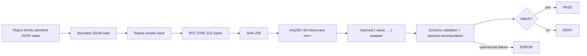

<!-- [KFM_META_BLOCK_V2]
doc_id: kfm://doc/standards/canonicalization
title: KFM Canonicalization Guidance — Current Implementation and Migration Boundary
type: standard
version: v1.2
status: "draft; repository-grounded; non-authoritative"
owners: ["@bartytime4life"]
created: 2026-05-14
updated: 2026-10-12
policy_label: repository-facing
owning_root: docs/
current_path: docs/standards/CANONICALIZATION.md
responsibility: "Explain current RFC 8785 JCS plus SHA-256 behavior, the executable spec_hash grammar, its trust boundary, and governed migration requirements."
truth_posture: "CONFIRMED path, implementation, package/CLI, schemas, validator, tests, workflow, and proposed ADR state / PROPOSED migration target, RDF support, and doctrine-era proposals carried from the merged sibling / UNKNOWN exhaustive consumers and deployed use / NEEDS VERIFICATION stewardship and cross-language parity"
evidence_snapshot_repository: bartytime4life/Kansas-Frontier-Matrix
evidence_snapshot_base_commit: 89ef13c4a14578a1813954b096496cbc5d003e2b
evidence_snapshot_prior_target_blob: 393a4450f64993c26b20d727656a1e6b6494db4e
evidence_snapshot_standards_readme_blob: a8cbe5d183448d5f0de37f8a4eacd6fcaca0d71b
evidence_snapshot_hashing_core_blob: a609eac44b1a5f24bd9ba449afedfeec7dd17e8e
evidence_snapshot_spec_hash_schema_blob: 80b496b01b8de8c0e8ba67bf020977e6b1f3c652
evidence_snapshot_spec_hash_validator_blob: e83a8707548c35411d1fc61911f499ac7ca6d517
evidence_snapshot_spec_hash_tests_blob: ce981cede288facfa449026e422acfe60a6e4d5d
evidence_snapshot_spec_hash_workflow_blob: 1da612211bf0d2e0bf339561bc06f336111d614e
supersedes:
  - kfm://doc/standards/canonicalization-redirect
related:
  - docs/standards/README.md
  - docs/standards/canonicalization.md
  - docs/doctrine/directory-rules.md
  - docs/adr/ADR-0013-spec_hash-and-run_id-identity-grammar.md
  - docs/adr/ADR-0001-schema-home--schemas-contracts-v1-is-canonical.md
  - docs/architecture/identity-and-spec-hash.md
  - docs/registers/VERIFICATION_BACKLOG.md
  - contracts/common/spec_hash.md
  - contracts/evidence/evidence_bundle.md
  - schemas/contracts/v1/common/spec_hash.schema.json
  - schemas/contracts/v1/runtime/run_receipt.schema.json
  - schemas/contracts/v1/evidence/evidence_bundle.schema.json
  - schemas/evidence/spec_normalization.md
  - packages/hashing/src/hashing/core.py
  - tools/spec_hash/README.md
  - tools/validators/validate_spec_hash.py
  - tests/validators/test_validate_spec_hash.py
  - .github/workflows/spec-hash.yml
tags: [kfm, standards, canonicalization, rfc8785, jcs, rdfc, sha256, spec-hash, identity, migration, case-collision]
notes:
  - "2026-10-12: merged unique content from docs/standards/canonicalization.md (which shared this doc_id) — owner-directed duplicate removal"
  - "STD-DRIFT-001 disposition: this uppercase path is canonical; docs/standards/canonicalization.md is now a redirect stub with its own doc_id."
  - "Doctrine-era content folded from the lowercase sibling (v1-draft, 2026-05-14) is labelled PROPOSED and does not override current executable behavior."
  - "Current executable behavior is RFC 8785 JCS plus SHA-256 with sha256:<64-lowercase-hex>."
  - "Proposed ADR-0013's jcs:sha256:<hex> target is not adopted or implemented by this change."
  - "No RDF canonicalizer, authority decision, lifecycle transition, release, deployment, or publication is created."
[/KFM_META_BLOCK_V2] -->

<a id="top"></a>
<a id="kfm-canonicalization-standard--jcs-urdna2015-and-spec_hash"></a>

# KFM Canonicalization Guidance — Current Implementation and Migration Boundary

> **Operating rule.** Canonicalize the admitted JSON value with RFC 8785 JCS, hash the canonical UTF-8 bytes with SHA-256, and compare only values produced under the same declared hash domain and canonicalization profile.


> [!IMPORTANT]
> **Human-readable guidance only.** Contracts define meaning, schemas define shape, policy decides admissibility, code and tests establish bounded behavior, and governed release records decide release. This page owns none of those decisions.

> [!NOTE]
> **Case collision merged (2026-10-12, owner-directed).** This file is the canonical canonicalization guide. Unique content from the former lowercase sibling [`canonicalization.md`](./canonicalization.md) (v1-draft, 2026-05-14) was folded in here — mostly doctrine-era proposals, now labelled **PROPOSED** wherever they differ from current executable behavior (see [Appendix D](#appendix-d--merged-from-record)). The lowercase path remains only as a redirect stub with its own `doc_id` so existing links resolve. The `STD-DRIFT-001` row in [`docs/standards/README.md`](./README.md) awaits a matching index update.

> [!WARNING]
> **A matching digest is not truth.** It proves only equality under the same admitted value, hash domain, canonicalization profile, and algorithm. Source authority, evidence, rights, sensitivity, policy, review, promotion, release, publication, and fitness for use remain separate gates.

## Current status

| Surface | Current state | Posture |
|---|---|---|
| Generic JSON path | RFC 8785 JCS through `rfc8785==0.1.4`, then SHA-256 | **CONFIRMED implemented** |
| Executable scalar grammar | `sha256:<64-lowercase-hex>` | **CONFIRMED implemented** |
| Common wrapper | `{"value":"sha256:<hex>"}` | **CONFIRMED proposed schema** |
| Candidate grammar | `jcs:sha256:<hex>` | **PROPOSED by ADR-0013** |
| RDF path | No executable path verified | **UNKNOWN / NEEDS IMPLEMENTATION** |
| Validator | Finite `PASS`, `DENY`, `ERROR` | **CONFIRMED implemented** |
| Dedicated workflow | No-network tests and fixture validation | **CONFIRMED checked in** |
| Stewardship | Default repository review route exists | **NEEDS VERIFICATION** |
| Case collision (`STD-DRIFT-001`) | Merged into this file; lowercase path is a redirect stub | **Owner-directed, 2026-10-12** |

**Quick navigation:** [Purpose](#1-purpose) · [Authority](#2-scope-and-authority) · [Flow](#3-doctrinal-summary) · [Decision matrix](#4-decision-matrix--jcs-vs-urdna2015) · [JCS](#5-canonical-form-jcs-default) · [RDF](#6-rdf-canonical-form-urdna2015-reserved) · [`spec_hash`](#7-spec_hash-format-and-recording-rules) · [Hash domain](#8-field-inclusion-and-exclusion) · [Parity](#9-promotion-gates-and-parity-rule) · [Failures](#10-failure-modes-and-error-codes) · [Tests](#11-test-vectors-and-determinism-guarantees) · [Tooling](#12-tooling) · [Migration](#13-versioning-and-migration) · [Open work](#14-open-questions-and-unresolved-tensions) · [Related](#15-related-docs) · [Glossary](#appendix-c--glossary) · [Merge record](#appendix-d--merged-from-record)

---

## 1. Purpose

Canonicalization converts an admitted data value into deterministic bytes so independent runs can compute and compare the same digest.

This revision:

1. documents the **current executable** JCS plus SHA-256 behavior;
2. separates it from ADR-0013's **proposed** `jcs:sha256:` target;
3. makes object-family field selection and normalization boundaries explicit; and
4. records the owner-directed merge of the former lowercase sibling (v1.2), keeping its doctrine-era proposals visible but labelled.

The prior text described implemented utilities, validators, fixtures, and tests as proposals and treated `jcs:sha256:` as current. Repository evidence now shows a bounded implementation using the bare `sha256:` grammar. This is a documentation correction, not an executable or authority change.

> [!NOTE]
> Canonicalization is **about bytes, not semantics.** Two documents that "mean the same thing" do not necessarily share a `spec_hash`. The guarantee is narrower: the same admitted value, sent through the same canonical pipeline, always produces the same bytes and therefore the same digest. *(Carried from the merged lowercase sibling.)*

[Back to top](#top)

---

## 2. Scope and authority

### 2.1 In scope

- RFC 8785 JCS and SHA-256 behavior.
- Current `sha256:<hex>` grammar and common wrapper.
- Bounded JSON input controls.
- Compute, verify, fixture, test, and workflow surfaces.
- Generic canonicalization versus object-family normalization.
- Future RDF and identity-migration requirements.
- The record of the case-collision merge and the doctrine-era proposals it carried in.

Doctrine (the merged sibling, citing SRC-P10 C1-02) names the object families expected to carry a `spec_hash`: `EvidenceBundle`, `EvidenceRef`, `SourceDescriptor`, `RunReceipt`, `PromotionDecision`, `ReleaseManifest`, and `RollbackCard`, plus checked-in contracts, schemas, and model specs that take part in promotion gates. This list is **PROPOSED**. Which families actually produce or consume `spec_hash` today is `CANON-Q3` (`UNKNOWN`); only the common wrapper and the `RunReceipt` schema are verified consumers in this slice.

### 2.2 Out of scope

- Object meaning or field-level machine authority.
- Generic inclusion/exclusion policy for every object family.
- Evidence, rights, sensitivity, or release decisions.
- Signature, key, transparency-log, and attestation policy.
- Source activation, promotion, release, deployment, or publication.
- ADR-0013 acceptance.
- Code style, file naming, or human-readable formatting.

### 2.3 Authority map

| Question | Owner |
|---|---|
| Guidance placement | Adopted Directory Rules and `docs/standards/README.md` |
| `spec_hash` meaning | `contracts/common/spec_hash.md` |
| Machine-valid shape | `schemas/contracts/v1/common/spec_hash.schema.json` and consuming schemas |
| Current behavior | `packages/hashing/`, tools, validator, tests, and workflow |
| Candidate grammar | ADR-0013 decision state |
| Admissibility | `policy/` plus governed review |
| Release | Evidence, proof, review, and `release/` authorities |
| Case collision | Owner-directed merge, 2026-10-12: this file is canonical and the lowercase path is a redirect stub |

The same-path update remains under `docs/standards/`, the accepted human-readable standards lane. Reusable code stays under `packages/`; the operator wrapper under `tools/`; semantic meaning under `contracts/`; machine shape under `schemas/`; enforceability under fixtures and tests. No parallel authority home is created.

Normative keywords (MUST / SHOULD / MAY) follow RFC 2119 usage. As a standards doc, this page explains and does not decide alone (Directory Rules §13 anti-pattern).

[Back to top](#top)

---

## 3. Doctrinal summary



Two separations are essential:

- **Projection before canonicalization.** The shared library does not decide which fields are meaning-bearing, transient, rounded, redacted, or excluded.
- **Integrity before governance.** A digest match can support later review; it cannot become evidence, policy, promotion, or release authority.

The implementation creates no lifecycle transition and does not turn a RAW, WORK, QUARANTINE, PROCESSED, CATALOG/TRIPLET, or release-support object into a stronger state.

The doctrine-era pipeline from the merged sibling has the same order: **project** the object onto its meaning-bearing fields, **canonicalize** (JCS by default; RDFC-1.0 opt-in), **hash** with SHA-256, then **tag** the result with the algorithm and record it in the `RunReceipt`. Only the first three steps match current code. The tag step (`jcs:` / `rdfc:` prefixes) is **PROPOSED** and not implemented (see §7.2).

> [!WARNING]
> Hashing developer-formatted JSON is **not** acceptable. Whitespace, key order, number formatting, and Unicode escaping all vary by tool. JCS exists to remove that variance; skipping it breaks reproducibility and quietly invalidates any gate that compares digests.

[Back to top](#top)

---

## 4. Decision matrix — JCS vs URDNA2015

This heading is retained for link compatibility. Current terminology and implementation evidence narrow the decision:

| Concern | Disposition |
|---|---|
| JSON and JSON-shaped JSON-LD | RFC 8785 JCS + SHA-256 — **implemented** |
| Active wire grammar | `sha256:<hex>` — **implemented** |
| Candidate profile-tagged grammar | `jcs:sha256:<hex>` — **proposed, not adopted** |
| RDF external standard | W3C RDFC-1.0 Recommendation — **current external reference** |
| URDNA2015 | Predecessor name and lineage for RDFC-1.0 |
| KFM RDF implementation | **Not verified** |
| JSON/RDF dual identity | **No adopted rule or implementation verified** |
| Algorithm negotiation | **Not supported by current common schema** |

> [!IMPORTANT]
> JCS is the only verified KFM canonicalization implementation in this slice. Do not emit `jcs:`, `rdfc:`, or `urdna2015:` merely because documentation discusses them.

The W3C Recommendation published in 2024 names the algorithm **RDFC-1.0** and describes its relationship to URDNA2015. Any KFM adoption still requires a wire grammar, bounded implementation, test vectors, producer/consumer closure, and a governed migration decision.

### 4.1 Selection criteria (doctrine, PROPOSED)

Carried from the merged sibling (doctrine C8-05). This explains *when* RDF canonicalization would be justified; it does not activate an RDF path.

| Dimension | JCS *(RFC 8785)* | RDFC-1.0 / URDNA2015 *(W3C)* |
|---|---|---|
| Operates on | JSON values (strings, numbers, arrays, objects) | RDF datasets (triples / quads with blank nodes) |
| Output | Canonical UTF-8 JSON bytes | Canonical N-Quads bytes |
| KFM role | Default for every `spec_hash` — **implemented** | Opt-in for RDF-semantic equivalence — **not implemented** |
| Cost | Cheap; linear in document size | Potentially expensive; blank-node labelling is bounded by graph-isomorphism difficulty |
| Library maturity | Wide (Python, TypeScript, Go, Rust, Java) | Narrower; edge-case handling varies |
| Failure mode if mis-chosen | N/A — universal default | Verification fails quietly when paired with a JCS-hashed object |
| Proposed algorithm tag | `jcs` *(not emitted today)* | `rdfc` *(not emitted today)* |

> [!CAUTION]
> The two algorithms can produce **different hashes for the same logical content**, because JSON-LD round-tripping is not an identity transformation. Never mix them for one artifact. That is why doctrine wants the algorithm recorded with the digest; today that context must come from the surrounding contract or receipt (§7.3).

**Use JCS when:** the artifact is JSON or JSON-LD consumed and verified as JSON; the contract is "bytes match if and only if the admitted value matches"; or the artifact takes part in standard KFM promotion gates (almost always).

**Consider RDFC-1.0 only when all of these hold:** the artifact is genuinely consumed as an RDF dataset (for example federated SPARQL merging KFM and non-KFM RDF); a non-KFM consumer requires RDF-semantic equivalence; and an accepted ADR records the opt-in, the affected object family, and the verifier path (§6.3). Until then, JCS is the only canonical form for KFM-produced `spec_hash` values.

[Back to top](#top)

---

## 5. Canonical form (JCS, default)

### 5.1 Current implementation contract

`packages/hashing/src/hashing/core.py` currently provides:

| Property | Behavior |
|---|---|
| Input | Parsed JSON value or bounded regular-file JSON |
| Encoding | UTF-8 |
| Canonicalization | `rfc8785.dumps(value)` |
| Digest | SHA-256 over canonical bytes |
| Output | `sha256:<64-lowercase-hex>` |
| Comparison | `hmac.compare_digest` |
| Network | None |
| Authority | Integrity computation only |

`packages/hashing/pyproject.toml` declares `kfm-hashing` `0.1.0`, Python 3.11 or later, `rfc8785==0.1.4`, and the `kfm-spec-hash` entry point.

### 5.2 Input controls

The loader rejects or bounds:

- non-regular or unsafe file inputs;
- more than 1,000,000 bytes;
- invalid UTF-8;
- duplicate object keys;
- `NaN` and infinities;
- excessively long integer text;
- values outside the admitted RFC 8785 number domain;
- depth above 64; and
- more than 4,096 document nodes.

These are package bounds, not universal KFM limits. Object-family contracts may be stricter.

### 5.3 JCS consequences

RFC 8785 constrains data to I-JSON, deterministically sorts object properties, emits no insignificant whitespace, preserves string data rather than applying Unicode normalization, and uses ECMAScript-compatible number serialization.

Therefore:

- key order and whitespace do not change the digest;
- array order remains meaningful;
- duplicate keys are rejected;
- non-interoperable high-precision numbers need an explicit object-family representation; and
- `json.dumps(sort_keys=True)` is not the implementation of record.

### 5.4 Deliberate non-effects

The generic canonicalizer does not select fields, remove timestamps, round coordinates, normalize units or dates, transform CRS or geometry, redact sensitivity, choose an object-family preimage, or create a receipt, signature, EvidenceBundle, proof, or release record.

The caller must construct and document the admitted hash-domain value before invoking it.

### 5.5 Commands

```bash
python tools/spec_hash/spec_hash.py compute path/to/subject.json

python tools/spec_hash/spec_hash.py verify \
  path/to/subject.json \
  path/to/spec_hash.json

python tools/validators/validate_spec_hash.py --fixtures

python tools/validators/validate_spec_hash.py \
  --candidate path/to/spec_hash.json \
  --subject path/to/subject.json
```

Use the shared package or thin wrapper. Do not reimplement canonicalization from illustrative snippets.

[Back to top](#top)

---

## 6. RDF canonical form (URDNA2015, reserved)

### 6.1 External status

W3C published **RDF Dataset Canonicalization (RDFC-1.0)** as a Recommendation on 21 May 2024. It produces canonical N-Quads and includes complexity and dataset-poisoning considerations. URDNA2015 is predecessor terminology documented by the Recommendation.

**Naming reconciliation (from the merged sibling).** KFM doctrine (C8-05) says "URDNA2015". The Recommendation describes URDNA2015 as essentially the same algorithm as RDFC-1.0: URDNA2015 implementations should generally be compatible, with minor differences in how some control characters are escaped in canonical N-Quads. For doctrine, KFM treats the two names as one algorithm family. Any future implementation SHOULD target RDFC-1.0. This operationalizes doctrine against the current standard rather than overriding it. An ADR is recommended to freeze the naming.

### 6.2 Current KFM status

No current executable path was verified for:

- RDF parsing and admitted input shape;
- RDFC-1.0 or URDNA2015 output;
- a KFM RDF digest prefix;
- W3C test-suite integration;
- complexity limits and timeouts;
- validator, workflow, producer, or consumer; or
- dual JSON/RDF identity and correction.

This guide therefore reserves no active RDF prefix.

### 6.3 Future admission gate

A future RDF slice must define the external version and test snapshot, in-scope object families, N-Quads contract, digest grammar, resource limits, positive and negative fixtures, cross-implementation parity, migration lineage, consumers, correction, and rollback. An accepted ADR is required when shared identity grammar changes.

[Back to top](#top)

---

## 7. `spec_hash` format and recording rules

### 7.1 Current grammar and wrapper

```text
sha256:<64 lowercase hexadecimal characters>
```

```json
{
  "value": "sha256:d3626ac30a87e6f7a6428233b3c68299976865fa5508e4267c5415c76af7a772"
}
```

The common schema uses the object wrapper. The current `RunReceipt` schema carries the same grammar as a scalar `spec_hash` string.

### 7.2 Candidate grammar

ADR-0013 proposes `jcs:sha256:<hex>`. It remains proposed and conflicts with current contracts, schemas, fixtures, validators, code, receipts, and consumers. This page cannot authorize that migration.

The merged sibling went further and recorded this doctrine-era grammar (C1-02) as if it were settled:

```text
spec_hash := "<algo>:sha256:<64-lowercase-hex-chars>"
algo      := "jcs" | "rdfc"
```

It also said new artifacts MUST use the prefixed form so verifiers can detect algorithm drift, and treated bare hex or bare `sha256:` as legacy. **Conflict recorded, not resolved here:** current code, schemas, and fixtures emit and accept only bare `sha256:<hex>`, so the doctrine statement is kept as **PROPOSED** input to ADR-0013. Its rationale still holds: an unprefixed digest cannot say which canonicalization produced it.

### 7.3 Meaning boundary

A `spec_hash` asks:

> Are these parties referring to the same admitted representation under the same hash-domain and canonicalization profile?

It does not prove the preimage was complete, a meaning-bearing field was included, evidence is sufficient, policy allows use, a signature is valid, or a release is public-safe.

Because the common schema does not carry a profile field, surrounding contracts and receipts must provide enough object-family, version, and profile context for comparison.

### 7.4 Intended placement and uses (doctrine, PROPOSED)

Carried from the merged sibling. Except for `RunReceipt`, none of these placements is verified in current schemas.

| Expected location | Role |
|---|---|
| `RunReceipt` | Every promotion run *(scalar `spec_hash` — verified in schema)* |
| `EvidenceBundle` | As `kfm:spec_hash`; also used to derive the content-addressed path (C4-04) |
| `EvidenceRef` | The pointer that resolves to a bundle |
| `PromotionDecision`, `ReleaseManifest`, `RollbackCard` | Identify exactly which object is being acted on |
| Catalog index | `spec_hash` as primary key; mutable paths never the primary key |

Intended uses: **reproducibility** (CI recomputes the digest from the checked-in spec and compares it to the receipt — the C5-04 spec-hash-match gate); **drift detection** (a mismatch between ref and bundle is a hard signal); **idempotency** (promotion can short-circuit when the digest is unchanged — C3-04); **tombstoning** (revocations name exactly which spec was retracted); and **cross-store portability** (identity does not depend on backend, path, or timestamp). Each use still inherits the §7.3 boundary.

[Back to top](#top)

---

## 8. Field inclusion and exclusion

### 8.1 Current rule

The shared implementation hashes the **entire parsed value supplied by the caller**. It has no universal inclusion list, exclusion list, or implemented `spec_normalization_set` registry.

The prior edition's global field tables were proposals, not executable behavior.

### 8.2 Object-family declaration

A consequential hash domain should declare:

- object family and version;
- included and excluded fields;
- array-order semantics;
- numeric and string representation;
- spatial CRS, axis, precision, and geometry rules;
- temporal fields;
- redaction and sensitivity transforms; and
- compatibility and migration behavior.

If producers cannot show that they used the same preimage rules, equivalence remains `NEEDS VERIFICATION` and cannot authorize publication.

If a meaning-bearing field was omitted, correct the owning contract/profile, implementation, fixtures, validator, records, and rollback lineage. Do not relabel the old digest.

The separate GeoJSON feature-digest path demonstrates this design: explicit spatial preparation occurs before the shared JCS hash primitive.

### 8.3 Doctrine candidate checklist (SRC-NI-2026-05-08 D1, PROPOSED)

The merged sibling listed these as normative global sets. Code has no global inclusion or exclusion registry, so they are kept here as a **checklist** for object-family authors, not as executable rules.

**Candidate meaning-bearing fields (include):** `object_type`, `schema_version`, `source_refs`, `dataset_refs`, `evidence_refs`, `object_refs`, `policy_label`, `rights_status`, `sensitivity`, and any other field that changes the object's evidentiary or admissibility meaning.

**Candidate transport, runtime, and transient fields (exclude):**

- wall-clock timestamps (fetch, build, sign time);
- storage URLs, S3 paths, OCI tags, IPFS gateways;
- signatures, attestation envelopes, transparency-log entries;
- nonces, run IDs, orchestrator-assigned identifiers;
- HTTP validators (`ETag`, `Last-Modified`) — these belong in the receipt, not the hash domain;
- pretty-printing artifacts (whitespace, key order, number formatting), which JCS removes by construction.

| Failure | Cause | Outcome |
|---|---|---|
| Hash rotates on every run | A timestamp or run ID leaked into the hash domain | Digest comparison never matches; no promotion is idempotent |
| Hash fails to rotate on real change | A meaning-bearing field was excluded | Should be denied (doctrine code `NormalizationError.field_exclusion_violation`, §10.1) |
| Same logical object, two hashes | One pipeline included transport fields and another did not | Drift entry; correction notice; possible rollback |

### 8.4 Proposed per-schema declaration hook

Doctrine says every schema whose instances carry a `spec_hash` MUST declare its hash domain explicitly. The attribute names below are **PROPOSED** and are not present in current schemas. The proposed home for a narrative register is [`schemas/evidence/spec_normalization.md`](../../schemas/evidence/spec_normalization.md), itself a draft compatibility path with conflicted placement. Schema home follows [ADR-0001](../adr/ADR-0001-schema-home--schemas-contracts-v1-is-canonical.md) (`schemas/contracts/v1/...`).

```jsonc
// schemas/contracts/v1/evidence/evidence_bundle.schema.json  (PROPOSED extension keys only)
{
  "$id": "kfm://schema/evidence/evidence_bundle/v1",
  "x-kfm-spec-normalization-set": "v1",
  "x-kfm-spec-included-fields": [
    "object_type", "schema_version", "source_refs", "dataset_refs",
    "evidence_refs", "object_refs", "policy_label", "rights_status", "sensitivity"
  ],
  "x-kfm-spec-excluded-fields": [
    "fetched_at", "storage_url", "signatures", "run_id", "transform_git_sha"
  ]
}
```

[Back to top](#top)

---

## 9. Promotion gates and parity rule

### 9.1 Implemented parity slice

The validator can:

1. validate the common wrapper against its JSON Schema;
2. load an optional subject through the bounded loader;
3. recompute JCS plus SHA-256;
4. compare expected and actual values; and
5. return `PASS`, `DENY`, or `ERROR`.

The CLI separately reports creation, match, mismatch, invalid input, invalid format, and canonicalization failure.

### 9.2 Workflow scope

`.github/workflows/spec-hash.yml` uses read-only permissions and `KFM_NO_NETWORK=1`, installs declared test dependencies through the repository CI helper, runs `test_validate_spec_hash*.py`, validates fixtures, and verifies one generated authoring receipt.

Its path filters cover hashing implementation, tools, contract, schema, fixtures, tests, workflow, and selected receipts. They do not include this document.

> [!CAUTION]
> The workflow does not prove every KFM producer uses the same hash domain or that every promotion recomputes the digest. Universal producer/consumer and required-check closure remain `UNKNOWN`.

[Back to top](#top)

---

## 10. Failure modes and error codes

| Current status or finding | Class |
|---|---|
| `SPEC_HASH_CREATED` | Success |
| `SPEC_HASH_MATCH` | Success |
| `SPEC_HASH_MISMATCH` | Mismatch / `DENY` |
| `SPEC_HASH_SCHEMA_INVALID` | `DENY` |
| `SPEC_HASH_FORMAT_INVALID` | Error |
| `VALID_FIXTURE_REJECTED` / `INVALID_FIXTURE_ACCEPTED` | `DENY` |
| `CANDIDATE_JSON_INVALID` / `SUBJECT_JSON_INVALID` | `ERROR` |
| `JSON_INPUT_INVALID` | Error |
| `CANONICALIZATION_ERROR` | `ERROR` |
| `SCHEMA_UNAVAILABLE` | `ERROR` |

Response rules:

- On mismatch, inspect the subject, stored value, profile, and lineage; do not guess.
- Do not coerce duplicate keys, non-finite values, unsafe numbers, or malformed text.
- When the hash domain is unknown, abstain from equivalence claims.
- For consequential use, fail closed rather than hash developer-formatted bytes.
- Preserve historical records and corrections; do not rewrite history to match current bytes.

Validator outcomes create no source, evidence, policy, review, promotion, release, or publication authority.

### 10.1 Doctrine-proposed error taxonomy (not implemented)

The merged sibling defined a richer, resolution-aware taxonomy. **None of these codes is emitted by current code.** They are kept as input for future resolver and identity validators.

| # | Failure | Validator outcome | Policy outcome | Proposed code |
|---|---|---|---|---|
| F1 | Missing bundle for an `EvidenceRef` | `ABSTAIN` | `DENY` (publication) | `ResolutionError.missing_bundle` |
| F2 | `EvidenceRef.spec_hash` ≠ `EvidenceBundle.spec_hash` | `ABSTAIN` | `DENY` | `ResolutionError.hash_mismatch` |
| F3 | Non-deterministic serialization (same value, different bytes) | `ERROR` | `DENY` | `NormalizationError.nondeterministic_serialization` |
| F4 | Meaning-bearing field excluded from the hash domain | n/a | `DENY` | `NormalizationError.field_exclusion_violation` |
| F5 | Unexpected algorithm tag (neither `jcs` nor `rdfc`) | `ERROR` | `DENY` | `HashAlgoUnsupported` |
| F6 | Algorithm tag present but body not canonical | `ERROR` | `DENY` | `NormalizationError.algo_tag_mismatch` |

F5 and F6 depend on the unadopted prefixed grammar (§7.2). F1, F2, and F4 belong to resolver or object-family validators, not to the generic canonicalizer.

> [!WARNING]
> Doctrine treats a canonicalization `DENY` as non-overridable on the normal public path. Any admin shortcut that bypasses canonicalization checks would need an ADR, constraints, auditing, and to stay off the public route (Directory Rules §11 / §16).

[Back to top](#top)

---

## 11. Test vectors and determinism guarantees

`tests/validators/test_validate_spec_hash.py` checks:

1. known canonical bytes and key-order invariance;
2. SHA-256 agreement over JCS bytes;
3. valid/invalid fixture polarity;
4. match and mismatch recomputation;
5. input immutability;
6. unsafe-integer rejection;
7. duplicate-key rejection;
8. non-finite-number rejection;
9. deterministic CLI compute/verify output; and
10. validator fixture execution.

The inspected slice does **not** prove cross-language parity, RDF behavior, every object-family profile, every producer/consumer, universal promotion enforcement, deployed use, or full upstream conformance.

Any identity migration should add immutable positive and negative vectors binding the input, projection profile, expected canonical bytes where safe, digest, finite outcome, implementation version, and migration lineage.

### 11.1 Doctrine-proposed enforcement set (SRC-NI-2026-05-08 §5)

The merged sibling proposed this v1 test contract: deterministic, no network access, and CI blocking publication on any failure. The status column maps it to the implemented slice above.

| ID | Test | Asserts | Current status |
|---|---|---|---|
| T1 | Round-trip determinism across Python, TypeScript, Go | Identical hex; identical derived IDs | **Not implemented** (Python only) |
| T2 | Whitespace and key-order irrelevance | Variants give the same digest | Covered by items 1–2 above |
| T3 | Semantic change rotates the hash | Changing a meaning-bearing field (e.g. `rights_status`) changes the digest | Partially covered (mismatch recomputation) |
| T4 | Resolution happy path | `EvidenceRef.spec_hash` → catalog lookup → match → `ANSWER` | **Not implemented** |
| T5 | Missing bundle | Lookup miss emits `ResolutionError.missing_bundle` | **Not implemented** |
| T6 | Hash mismatch | Forced mismatch → `DENY` | Covered as `SPEC_HASH_MISMATCH` / `DENY`; resolver form not implemented |
| T7 | Cross-host stability | Recompute on other machines/containers → identical hex | **NEEDS VERIFICATION** |
| T8 | Algorithm-tag enforcement | Non-`jcs`/`rdfc` input → `DENY` with `HashAlgoUnsupported` | **Not applicable** until a prefixed grammar is adopted |

Doctrine also proposes a pre-commit hook that warns when a checked-in spec is not already canonical (C5-04; proposed location `tools/spec_hash/`). No such hook was verified.

[Back to top](#top)

---

## 12. Tooling

| Responsibility | Current path |
|---|---|
| Reusable library | `packages/hashing/src/hashing/` |
| Package/dependency pin | `packages/hashing/pyproject.toml` |
| Thin CLI wrapper | `tools/spec_hash/spec_hash.py` |
| Operator guidance | `tools/spec_hash/README.md` |
| Validator | `tools/validators/validate_spec_hash.py` |
| Semantic contract | `contracts/common/spec_hash.md` |
| Common schema | `schemas/contracts/v1/common/spec_hash.schema.json` |
| RunReceipt consumer shape | `schemas/contracts/v1/runtime/run_receipt.schema.json` |
| Fixtures | `fixtures/contracts/v1/common/spec_hash/` |
| Tests | `tests/validators/test_validate_spec_hash*.py` |
| Workflow | `.github/workflows/spec-hash.yml` |

The package exposes `kfm-spec-hash = hashing.cli:main`. Callers should reuse it rather than duplicate canonicalization logic.

A change to the pinned JCS dependency requires upstream/security review, golden replay, canonical-byte parity, package validation, affected-record analysis, and rollback. A dependency change that changes canonical bytes is an identity migration.

Canonicalization remains local and deterministic: no source fetch, external EvidenceBundle resolution, policy evaluation, signing, release, or publication.

### 12.1 Doctrine-era tooling proposals (from the merged sibling)

| Proposal | Status against current repository |
|---|---|
| `tools/spec_hash/jcs_hash.py` and `tools/spec_hash/kfm_hash_cli.py` exposing a `kfm-hash` command (`kfm-hash <file>`, `--check <file> <expected>`, `--pre-commit`) | **Superseded in practice.** The implemented surface is `tools/spec_hash/spec_hash.py` (`compute` / `verify`) plus the `kfm-spec-hash` entry point, and it emits `sha256:` rather than `jcs:sha256:`. No pre-commit mode was verified. |
| Python: pin `rfc8785` or `jcs` in `pyproject.toml` | **Implemented**: `rfc8785==0.1.4` |
| TypeScript / Node: `canonicalize` (RFC 8785 community implementation) | PROPOSED |
| Go: `gopkg.in/jsontoolkit/jcs.v1` or equivalent | PROPOSED — NEEDS VERIFICATION |
| Rust: an RFC 8785 crate | PROPOSED — NEEDS VERIFICATION |
| RDFC-1.0 / URDNA2015 library | ADR required first; implementations differ in blank-node and datatype-literal handling |
| `tools/validators/identity/jcs_spec_hash.py`, `tools/validators/evidence/validate_identity.py` | Paths exist only as generated **PROPOSED placeholders**; they are not the implementation of record |

Each language ecosystem that needs parity MUST pin exactly one JCS implementation, and adding one is a §13.2 change.

### 12.2 Derived short IDs (PROPOSED, SRC-NI-2026-05-08 D2)

```text
bundle_id        = "eb-" + base32(lowercase(SHA-256(spec_hash)))[:26]
evidence_ref_id  = "er-" + base32(lowercase(SHA-256(target_bundle.spec_hash)))[:26]
```

Short IDs would derive **only** from the digest; environment entropy must not participate. `spec_hash` itself is never truncated, and short IDs are convenience handles only. Not implemented. Note that the input string, and so the short ID, would change if the scalar grammar changed (§13.2).

[Back to top](#top)

---

## 13. Versioning and migration

### 13.1 Current bounded behavior

- Profile: `RFC8785-JCS`
- Digest: `SHA-256`
- Scalar grammar: `sha256:<64-lowercase-hex>`
- Common wrapper: `{ "value": "<scalar>" }`
- Package: `kfm-hashing` `0.1.0`
- Dependency: `rfc8785==0.1.4`

### 13.2 Governed-change matrix

| Change | Required closure |
|---|---|
| `sha256:` → `jcs:sha256:` | Accepted ADR; contract/schema, fixtures, validators, code, receipts, consumers, compatibility, rollback |
| Add RDF grammar | Accepted decision; RDFC implementation/vectors, limits, consumers, correction, rollback |
| Change JCS implementation | Dependency review, golden replay, cross-implementation comparison, impact analysis |
| Change object-family projection | Owning contract/profile, fixtures, validator, migration receipt, correction lineage |
| Change SHA-256 | Security/architecture decision, dual-digest window, consumer migration |
| Resolve case collision | **Done 2026-10-12 (owner-directed):** content merged here, lowercase path kept as a redirect stub; inbound-link repointing and index updates tracked separately (`CANON-Q11`) |

### 13.3 Migration sequence

1. Freeze old and candidate forms.
2. Inventory writers, readers, schemas, contracts, fixtures, receipts, catalogs, releases, and external consumers.
3. Accept the compatibility decision.
4. Implement dual-read or dual-record behavior only where specified.
5. Preserve historical records and emit migration receipts.
6. Prove replay and negative paths.
7. Switch writers only after readers are ready.
8. Preserve correction and rollback targets.
9. Retire compatibility only after verified zero-consumer closure.

### 13.4 Doctrine migration requirements (from the merged sibling)

These doctrine statements are consistent with §13.2–§13.3 and add detail:

- **Algorithm freeze.** For v1 the hash function is SHA-256 and JSON canonicalization is RFC 8785 JCS. Changing either requires an ADR.
- **Dual-hash window.** A move to a new hash algorithm MUST include a compatibility window: receipts carry both old and new digests, the index can query both, and consumers get a documented transition period.
- **Backfill of pre-v1 objects.** Bundles created before this standard without a `spec_hash` MUST be backfilled offline through a dual index (`old_id` → new `spec_hash`), with a correction notice, before policy is switched to require v1.
- **Rename ≠ migration.** A rename that changes object identity is a content change, not a placement change, and follows Directory Rules §14.3.
- **Algorithm changes are release events.** They go through promotion gates with separation of duties, emit `RunReceipt`s, and stay reversible through a documented `RollbackCard`.

### 13.5 Rollback

This documentation update can be reverted together with the redirect stub at `docs/standards/canonicalization.md` (restore both files from the prior revision). It changes no contract, schema, code, dependency, fixture, validator, workflow, source, lifecycle state, release, deployment, or publication.

For a future failed identity migration, prefer a reviewed forward fix or restore the documented compatibility window. Do not blindly restore incompatible writers.

[Back to top](#top)

---

## 14. Open questions and unresolved tensions

| ID | Question | Status |
|---|---|---|
| `CANON-Q1` | Which case variant survives, and what compatibility artifact is required? | `RESOLVED` 2026-10-12 — uppercase canonical; lowercase redirect stub |
| `CANON-Q2` | Is ADR-0013 accepted, revised, or rejected? | `PROPOSED` |
| `CANON-Q3` | Which object families currently produce or consume `spec_hash`? | `UNKNOWN` |
| `CANON-Q4` | Which projection profiles are authoritative? | `NEEDS VERIFICATION` |
| `CANON-Q5` | Which runtimes require cross-language parity? | `NEEDS VERIFICATION` |
| `CANON-Q6` | Does any current consumer need RDF-dataset equivalence? | `UNKNOWN` |
| `CANON-Q7` | What RDFC limits and test snapshot would KFM adopt? | `PROPOSED` |
| `CANON-Q8` | Is the dedicated workflow required for every affected producer? | `NEEDS VERIFICATION` |
| `CANON-Q9` | Who is the accountable canonicalization steward? | `NEEDS VERIFICATION` |
| `CANON-Q10` | Which adjacent docs still contain stale grammar or implementation claims? | `NEEDS VERIFICATION` |
| `CANON-Q11` | Should inbound links be repointed to this file and the redirect stub later retired? The two paths still differ only by case, so they collide on case-insensitive checkouts until the stub is removed or renamed. | `OPEN` |
| `CANON-Q12` | Where should per-family inclusion/exclusion sets live — schema `x-kfm-` extensions, `schemas/evidence/spec_normalization.md`, or `control_plane/object_family_register.yaml`? *(from merged sibling)* | `OPEN` |
| `CANON-Q13` | Does JCS recomputation pass for every published evidence bundle, or are there latent drifts? *(from merged sibling; SRC-P10 §11.4)* | `UNKNOWN` |
| `CANON-Q14` | One hashing CLI or several language ports? *(from merged sibling; SRC-P10 §11.3.)* A Python package (`kfm-hashing`) now exists; other ports are unresolved. | `OPEN` |
| `CANON-Q15` | Do fixtures carry an algorithm tag? *(from merged sibling)* Current fixtures use bare `sha256:`, so a backfill is needed only if ADR-0013 is accepted. | `ANSWERED` for current state |

None authorizes a rename, grammar migration, source activation, or release. Open items should be tracked in [`docs/registers/VERIFICATION_BACKLOG.md`](../registers/VERIFICATION_BACKLOG.md) and settled through an ADR or the owning root's README.

[Back to top](#top)

---

## 15. Related docs

### Governance and identity

- [`docs/standards/README.md`](./README.md) — lane boundary and `STD-DRIFT-001`.
- [`docs/doctrine/directory-rules.md`](../doctrine/directory-rules.md) — adopted placement law.
- [`docs/adr/ADR-0013-spec_hash-and-run_id-identity-grammar.md`](../adr/ADR-0013-spec_hash-and-run_id-identity-grammar.md) — proposed identity grammar.
- [`docs/adr/ADR-0001-schema-home--schemas-contracts-v1-is-canonical.md`](../adr/ADR-0001-schema-home--schemas-contracts-v1-is-canonical.md) — schema-home rule (proposed).
- [`docs/architecture/identity-and-spec-hash.md`](../architecture/identity-and-spec-hash.md) — lineage with stale implementation claims requiring separate reconciliation.
- [`docs/standards/canonicalization.md`](./canonicalization.md) — redirect stub for the former lowercase sibling, merged here 2026-10-12.

### Meaning, shape, implementation, and proof

- [`contracts/common/spec_hash.md`](../../contracts/common/spec_hash.md)
- [`contracts/evidence/evidence_bundle.md`](../../contracts/evidence/evidence_bundle.md) — semantic contract for a doctrine-named `spec_hash` carrier.
- [`schemas/contracts/v1/common/spec_hash.schema.json`](../../schemas/contracts/v1/common/spec_hash.schema.json)
- [`schemas/contracts/v1/runtime/run_receipt.schema.json`](../../schemas/contracts/v1/runtime/run_receipt.schema.json)
- [`schemas/contracts/v1/evidence/evidence_bundle.schema.json`](../../schemas/contracts/v1/evidence/evidence_bundle.schema.json) — proposed home of the §8.4 hook.
- [`schemas/evidence/spec_normalization.md`](../../schemas/evidence/spec_normalization.md) — draft normalization-set register (conflicted placement).
- [`packages/hashing/pyproject.toml`](../../packages/hashing/pyproject.toml)
- [`packages/hashing/src/hashing/core.py`](../../packages/hashing/src/hashing/core.py)
- [`tools/spec_hash/README.md`](../../tools/spec_hash/README.md)
- [`tools/validators/validate_spec_hash.py`](../../tools/validators/validate_spec_hash.py)
- [`tests/validators/test_validate_spec_hash.py`](../../tests/validators/test_validate_spec_hash.py)
- [`.github/workflows/spec-hash.yml`](../../.github/workflows/spec-hash.yml)

### Forward references from the merged sibling (paths not present)

`docs/standards/run-receipt.md` (receipt format recording `spec_hash`), `docs/standards/stac-dwc-profile.md` (STAC × DwC profile using `spec_hash` in `kfm:evidence_ref`), and `policy/promotion/spec_hash_match.rego` (the proposed C5-04 promotion gate). All are `PROPOSED`; none exists at this revision.

[Back to top](#top)

---

## Appendix A — Current worked example

Both inputs parse to the same value:

```json
{"b":1,"a":2}
```

```json
{
  "a": 2,
  "b": 1
}
```

Canonical bytes:

```text
{"a":2,"b":1}
```

Current digest:

```text
sha256:d3626ac30a87e6f7a6428233b3c68299976865fa5508e4267c5415c76af7a772
```

Current common wrapper:

```json
{
  "value": "sha256:d3626ac30a87e6f7a6428233b3c68299976865fa5508e4267c5415c76af7a772"
}
```

Array order remains meaningful, and semantic change rotates the digest. Do not relabel this value as `jcs:sha256:` without the migration in §13.

### A.2 EvidenceBundle-shaped example (from the merged sibling)

<details>
<summary><strong>Expand: two textual variants of one admitted value</strong></summary>

Variant 1 *(developer-formatted)*:

```json
{
  "schema_version": "v1",
  "object_type": "EvidenceBundle",
  "rights_status": "controlled",
  "sensitivity": "review_required",
  "source_refs": [
    "kfm://source/kshs/kansas-memory",
    "kfm://source/usgs/nhdplus-v2"
  ],
  "policy_label": "public"
}
```

Variant 2 *(re-ordered, re-spaced)*:

```json
{"object_type":"EvidenceBundle","policy_label":"public","rights_status":"controlled","schema_version":"v1","sensitivity":"review_required","source_refs":["kfm://source/kshs/kansas-memory","kfm://source/usgs/nhdplus-v2"]}
```

JCS canonical bytes *(both variants)*:

```text
{"object_type":"EvidenceBundle","policy_label":"public","rights_status":"controlled","schema_version":"v1","sensitivity":"review_required","source_refs":["kfm://source/kshs/kansas-memory","kfm://source/usgs/nhdplus-v2"]}
```

Digest in the current grammar:

```text
sha256:75891e4416312f369961074da544293dc534c6f4f43ca5191668e365c2b81bb2
```

The merged sibling showed an all-zero placeholder under the proposed `jcs:sha256:` prefix. The value above is SHA-256 over the canonical bytes shown, computed with `sha256sum` during the 2026-10-12 merge. Because the value has only ASCII strings and no numbers, JCS output equals this sorted, whitespace-free text. Confirm with `tools/spec_hash/spec_hash.py compute` before you rely on it (**NEEDS VERIFICATION**). The field set illustrates §8.3; it is not a verified `EvidenceBundle` hash domain.

**Superseded reference snippet.** The sibling included this approximation. It is preserved for the record only; it is **not** RFC 8785-conformant for numbers or Unicode, and §5.3 says `json.dumps(sort_keys=True)` is not the implementation of record. Use `packages/hashing/` instead.

```python
# SUPERSEDED — illustrative only; do not use.
import hashlib, json

def kfm_spec_hash(obj: dict) -> str:
    canonical = json.dumps(obj, sort_keys=True, separators=(",", ":"), ensure_ascii=False).encode("utf-8")
    return f"jcs:sha256:{hashlib.sha256(canonical).hexdigest()}"  # proposed prefix; current grammar is "sha256:"
```

</details>

[Back to top](#top)

---

## Appendix B — References and change record

External references:

- [RFC 8785 — JSON Canonicalization Scheme](https://www.rfc-editor.org/rfc/rfc8785.html), June 2020.
- [W3C RDF Dataset Canonicalization — RDFC-1.0](https://www.w3.org/TR/rdf-canon/), Recommendation of 21 May 2024.
- URDNA2015 — W3C Credentials Community Group Final Report; predecessor of RDFC-1.0, superseded for new work.
- SHA-256 — FIPS 180-4, Secure Hash Standard.

| Version | Date | Change |
|---|---|---|
| `v1` | 2026-05-14 | Initial draft |
| `v1.1` | 2026-08-18 | Repository-grounded same-path reconciliation; current JCS implementation and `sha256:` grammar; ADR/RDF/collision boundaries retained |
| `v1.2` | 2026-10-12 | Owner-directed merge of `docs/standards/canonicalization.md` (shared `doc_id`): folded its selection criteria, intended placements/uses, candidate field checklist, proposed error taxonomy, T1–T8 test contract, tooling/short-ID proposals, migration requirements, open questions, worked example, and glossary, each labelled against current behavior; lowercase path made a redirect stub; meta block flattened |

**Non-effects:** no ADR acceptance, contract/schema/policy/code/dependency/test/workflow change, source activation, lifecycle transition, release, deployment, or publication. The v1.2 collision disposition is limited to documentation.

[Back to top](#top)

---

## Appendix C — Glossary

*(Carried from the merged sibling; definitions follow current behavior where the two differ.)*

| Term | Definition |
|---|---|
| **Canonicalization** | A deterministic transformation from an admitted value to a single byte representation. |
| **JCS** | JSON Canonicalization Scheme, RFC 8785. Works at the JSON layer; the only implemented KFM profile. |
| **RDFC-1.0** | RDF Dataset Canonicalization 1.0, W3C Recommendation (2024). Works at the RDF layer; not implemented in KFM. |
| **URDNA2015** | Historical name for the algorithm now formally identified as RDFC-1.0; documented as essentially compatible. |
| **`spec_hash`** | Digest produced by canonicalizing the admitted, meaning-bearing projection of an object and hashing it with SHA-256. Current grammar: `sha256:<hex>`. |
| **Algorithm tag** | Proposed `jcs` / `rdfc` prefix recording which canonicalization produced a digest. Not emitted today (§7.2). |
| **Inclusion set** | Fields that contribute to the hash domain for an object family; declared by that family (§8.2). |
| **Exclusion set** | Transport, runtime, and transient fields that must not contribute to the hash domain. |
| **EvidenceBundle / EvidenceRef** | Object families doctrine expects to anchor in `spec_hash`. See `contracts/evidence/`. |
| **RunReceipt** | Run receipt that carries `spec_hash` (verified scalar field in its schema). |
| **PromotionDecision / ReleaseManifest / RollbackCard** | Governed release-state objects that doctrine expects to reference `spec_hash`. |

[Back to top](#top)

---

## Appendix D — Merged-from record

**Source:** `docs/standards/canonicalization.md`, v1-draft, created and updated 2026-05-14. It was titled "KFM Canonicalization Standard — spec_hash, JCS, and the RDF Canonicalization Path" and shared `doc_id` `kfm://doc/standards/canonicalization`. Its doctrine basis was SRC-P10 C1-02, C3-04, C4-04, C5-04, C8-04, C8-05 and SRC-NI-2026-05-08 D1–D5.

| Topic | Lowercase sibling said | Kept here | Why |
|---|---|---|---|
| Wire grammar | `jcs:sha256:<hex>` "CONFIRMED in doctrine"; prefixed form mandatory | `sha256:<hex>` current; prefixed form PROPOSED (§7.2) | Code, schemas, fixtures, and validator emit bare `sha256:`; ADR-0013 remains proposed |
| Global inclusion/exclusion sets | Normative MUST lists | Checklist only (§8.3) | No global registry is implemented; the hash domain is caller-declared |
| Error codes F1–F6 | Required behavior | Proposed taxonomy (§10.1) | Not emitted by current code |
| Tests T1–T8 | Proposed v1 enforcement set | Mapped to implemented tests (§11.1) | Partial overlap only |
| `kfm-hash` CLI | Doctrinally required utility | Superseded by `spec_hash.py` / `kfm-spec-hash` (§12.1) | Different command and grammar |
| Worked example digest | All-zero placeholder | Real `sha256:` digest (A.2) | Computed during the merge; NEEDS VERIFICATION by the CLI |
| `policy_label` | `public` | `repository-facing` | Canonical file's more recent label kept |
| Owners | `TBD-kfm-evidence-stewards` (placeholder) | `@bartytime4life` | Canonical file's value kept; steward is `CANON-Q9` |

Nothing from the sibling was dropped. Statements that conflict with current evidence are kept above with their status, not deleted.

[Back to top](#top)