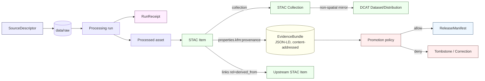
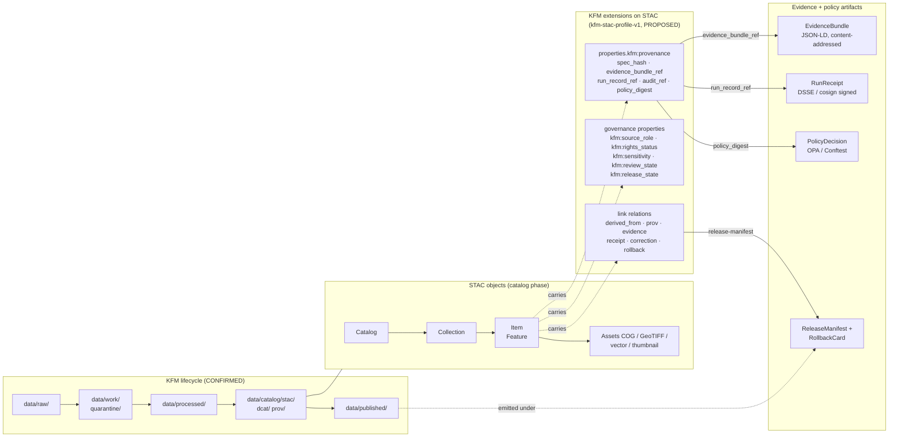
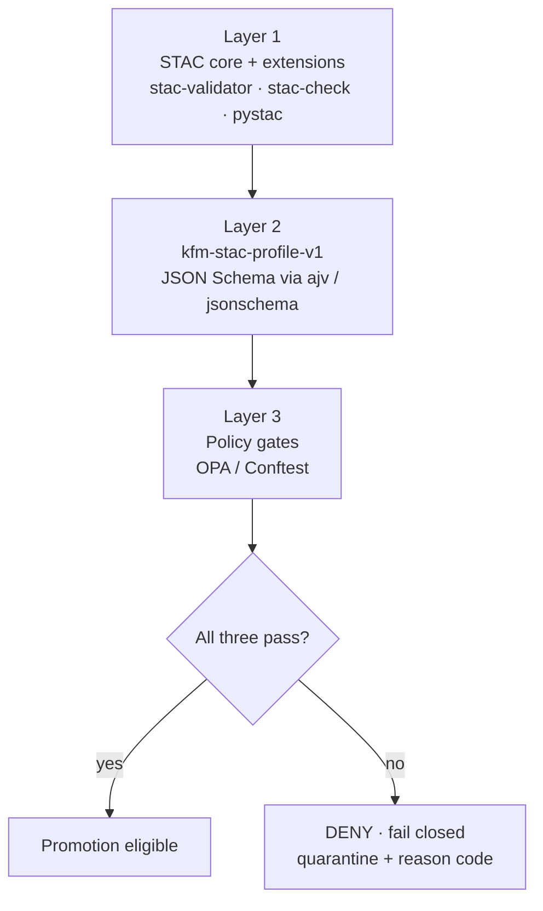

<!-- [KFM_META_BLOCK_V2]
doc_id: kfm://doc/docs-standards-stac
title: STAC — SpatioTemporal Asset Catalog (KFM Adoption Reference)
type: standard
version: v0.2
status: draft
owners: <TODO: docs-standards-owners>
created: 2026-05-14
updated: 2026-10-19
policy_label: public
related:
  - docs/standards/DCAT.md
  - docs/standards/PROV.md
  - docs/standards/STAC_KFM_PROFILE.md
  - docs/standards/Darwin_Core.md
  - docs/standards/CANONICALIZATION.md
  - docs/standards/STAC_DWC_PROFILE.md
  - contracts/evidence/
  - schemas/contracts/v1/
  - policy/promotion/
tags: [kfm, standards, stac, catalog, provenance]
notes:
  - "kfm: vs ks-kfm: namespace decision is OPEN; see §9."
  - "Path is PROPOSED until repo evidence is mounted."
  - "Distinct from STAC_KFM_PROFILE.md (strict profile + schemas)."
  - "2026-10-19: owner-directed case-collision removal. This uppercase path is canonical (STD-DRIFT-004). Unique content of the former lowercase sibling docs/standards/stac.md (doc_id kfm://doc/standards/stac, v1, updated 2026-10-12) is merged as sections 11-17 and Appendix B; the lowercase file was deleted and inbound links repointed."
  - "Merged statements that conflict with sections 1-10 or with current repository evidence are kept and labelled, not resolved."
owning_root: docs/
responsibility: "Documentation for STAC — SpatioTemporal Asset Catalog (KFM Adoption Reference); not evidence, policy, release, or publication authority."
truth_posture: NEEDS VERIFICATION — owning_root, responsibility, and truth_posture were added during a 2026-09-29 link repair; the document's claims were not re-reviewed.
[/KFM_META_BLOCK_V2] -->

<a id="top"></a>

# STAC — SpatioTemporal Asset Catalog (KFM Adoption Reference)

> How KFM uses the **SpatioTemporal Asset Catalog (STAC)** spec to catalog spatiotemporal assets, thread provenance through `kfm:` namespaces, and gate publication on validation. This document is the **adoption reference**; the strict profile lives in [`STAC_KFM_PROFILE.md`](./STAC_KFM_PROFILE.md) (PROPOSED).


<!-- Shields above are placeholders; replace with live build/validate badges when CI gates land. -->

**Status:** draft · **Owners:** `<TODO: docs-standards-owners>` · **Last updated:** 2026-10-19

> [!NOTE]
> **Case collision resolved (2026-10-19, owner-directed).** This file is the canonical STAC standards doc. The former lowercase sibling `stac.md` ("STAC in KFM — Standard Conformance and `kfm-stac-profile-v1`") was merged into §§11–17 and deleted, because the two paths overwrite each other on case-insensitive filesystems. See [Appendix B](#appendix-b--merged-from-record).

---

## Contents

- [1. Purpose and scope](#1-purpose-and-scope)
- [2. Where this fits](#2-where-this-fits)
- [3. STAC core in 60 seconds](#3-stac-core-in-60-seconds)
- [4. Required STAC fields for KFM ingestion](#4-required-stac-fields-for-kfm-ingestion)
- [5. The KFM STAC profile](#5-the-kfm-stac-profile)
- [6. Provenance and evidence integration](#6-provenance-and-evidence-integration)
- [7. STAC × Darwin Core hybrid (biodiversity)](#7-stac--darwin-core-hybrid-biodiversity)
- [8. Validation and promotion gates](#8-validation-and-promotion-gates)
- [9. Open questions and PROPOSED decisions](#9-open-questions-and-proposed-decisions)
- [10. Worked examples](#10-worked-examples)
- [11. Profile detail carried from the former `stac.md`](#11-profile-detail-carried-from-the-former-stacmd)
- [12. `kfm-stac-profile-v1` field groups](#12-kfm-stac-profile-v1-field-groups)
- [13. Assets, link relations, and evidence binding](#13-assets-link-relations-and-evidence-binding)
- [14. Three-layer validation and CI posture](#14-three-layer-validation-and-ci-posture)
- [15. Anti-patterns](#15-anti-patterns)
- [16. Additional open questions](#16-additional-open-questions)
- [17. Profile-shaped worked sketches](#17-profile-shaped-worked-sketches-illustrative)
- [Related docs](#related-docs)
- [Appendix A — Field reference](#appendix-a--field-reference)
- [Appendix B — Merged-from record](#appendix-b--merged-from-record)

---

## 1. Purpose and scope

This document **explains** how KFM adopts the SpatioTemporal Asset Catalog (STAC) specification across the lifecycle:

```text
RAW → WORK/QUARANTINE → PROCESSED → CATALOG/TRIPLET → PUBLISHED
                                          ▲
                                    STAC lives here
```

> [!NOTE]
> KFM doctrine treats **STAC as the catalog envelope for spatiotemporal assets**, paired with DCAT for non-spatial datasets and the JSON-LD `EvidenceBundle` as the content-addressed provenance object attached to each catalog record. [CONFIRMED — Pass 10 §6.4]

**This document does**:

- Define KFM's adoption posture toward STAC 1.0.0.
- Name the `kfm:` namespace(s) used inside STAC Item and Collection JSON.
- Specify how `EvidenceRef`, `EvidenceBundle`, `RunReceipt`, `SourceDescriptor`, `spec_hash`, and policy digests thread through STAC objects.
- Point at the validator and CI gate that enforces it.

**This document does not**:

- Define the JSON Schema for the profile — that belongs in `schemas/contracts/v1/` per ADR-0001, and the human profile description belongs in [`STAC_KFM_PROFILE.md`](./STAC_KFM_PROFILE.md). [PROPOSED]
- Define DCAT, PROV-O, Darwin Core, or JSON-LD canonicalization — those live in sibling standards docs. [PROPOSED]
- Replace `contracts/` meaning docs for `EvidenceBundle`, `RunReceipt`, etc.

---

## 2. Where this fits



> [!IMPORTANT]
> The diagram shows the **intended responsibility boundaries**. Per Directory Rules §0, any repo-shaped placement (`data/raw/`, `release/`, etc.) is PROPOSED until verified against a mounted repository.

---

## 3. STAC core in 60 seconds

STAC defines three nested JSON object types plus assets and links. KFM uses all of them.

| Object | Role | KFM use |
|---|---|---|
| **Catalog** | Loose grouping; navigational root | Per-deployment root catalog, governance scoping |
| **Collection** | Dataset family with shared metadata, license, extent | Stable handle Items reference; KFM namespace and policy label declared here |
| **Item** | A single GeoJSON `Feature` with spatial geometry, datetime, and assets | Atomic spatiotemporal record; carries `properties.kfm:provenance` |
| **Asset** | A file (COG, GeoParquet, PMTiles, thumbnail, etc.) attached to an Item | Carries `file:checksum`; roles bind renderable vs metadata vs data |
| **Link** | Typed relation to another resource | Carries `derived_from`, `was_generated_by`, evidence-bundle pointers |

> [!TIP]
> Collections are the **stable handle**. Renaming a Collection breaks links throughout the catalog. Treat Collection IDs as identity-bearing, not display strings. [CONFIRMED — Pass 10 §C4-02]

---

## 4. Required STAC fields for KFM ingestion

Every Item promoted into a KFM catalog MUST carry the STAC core fields. Items that fail this check are rejected by the validator (see §8).

| Area | Required fields | KFM relevance |
|---|---|---|
| Identity | `id`, `type`, `stac_version` | Stable EvidenceRef anchoring |
| Spatial | `geometry`, `bbox` | Map-first query integrity |
| Temporal | `properties.datetime` *or* `start_datetime` + `end_datetime` | Time-aware claims |
| Assets | `assets[*].href`, `assets[*].type`, `assets[*].roles` | Durable artifact resolution, role-based rendering |
| Navigation | `links[]` with `rel` set | Traversable lineage; STAC API `/search` traversal |
| Collection | `collection` (Item → Collection backref) | Governance scoping |
| Extensions | `stac_extensions[]` | Validator compatibility for `kfm:*` fields |
| Lifecycle | `properties.license`, `properties.created`, `properties.updated` | Rights + lifecycle posture |

> [!WARNING]
> **Do not invent free-form top-level fields.** STAC clients can drop unknown top-level properties. All KFM extensions live inside `properties` under namespaced keys (`kfm:*`) and declare themselves in `stac_extensions[]`. [INFERRED from STAC core behavior + KFM doctrine]

---

## 5. The KFM STAC profile

The KFM STAC profile extends the STAC core with governance, provenance, and policy fields. Two namespaces are in play:

| Namespace | Role | Status |
|---|---|---|
| `kfm:provenance:*` | Per-Item provenance: `spec_hash`, `evidence_bundle_ref`, `run_record_ref`, `audit_ref`, `policy_digest` | CONFIRMED in doctrine [Pass 10 §C4-01] |
| `kfm:care:*` | CARE / Indigenous data sovereignty fields surfaced from `MetaBlock v2` (steward_org, authority_to_control, consent, obligations, benefit_commitments) | CONFIRMED in doctrine [Pass 10 §C15-02] |
| `file:checksum` | Per-asset SHA-256 (file extension, not KFM-specific) | CONFIRMED — STAC `file` extension |
| `kfm:` vs `ks-kfm:` | Short-name vs Kansas-scoped prefix | **OPEN** — see §9 |

### 5.1 Item shape (skeleton)

```json
{
  "type": "Feature",
  "stac_version": "1.0.0",
  "stac_extensions": [
    "https://stac-extensions.github.io/file/v2.1.0/schema.json",
    "https://stac-extensions.github.io/projection/v1.1.0/schema.json",
    "https://stac-extensions.github.io/processing/v1.1.0/schema.json",
    "kfm://stac/extensions/provenance/v1"
  ],
  "id": "<stable-item-id>",
  "collection": "<stable-collection-id>",
  "geometry": { "type": "Polygon", "coordinates": [ /* ... */ ] },
  "bbox": [/* xmin, ymin, xmax, ymax */],
  "properties": {
    "datetime": "2025-07-01T16:22:09Z",
    "license": "<SPDX-or-policy-ref>",
    "kfm:provenance": {
      "spec_hash": "sha256:...",
      "evidence_bundle_ref": "kfm://bundle/<digest>",
      "run_record_ref":      "kfm://run/<id>",
      "audit_ref":           "kfm://attest/<id>",
      "policy_digest":       "sha256:..."
    }
  },
  "assets": {
    "data": {
      "href": "s3://.../scene.tif",
      "type": "image/tiff; application=geotiff; profile=cloud-optimized",
      "roles": ["data"],
      "file:checksum": "0x..."
    }
  },
  "links": [
    { "rel": "self",       "href": "..." },
    { "rel": "collection", "href": "..." },
    { "rel": "derived_from", "href": "kfm://item/<upstream-id>" }
  ]
}
```

> [!NOTE]
> **PROPOSED.** The extension URL `kfm://stac/extensions/provenance/v1` is illustrative. A real extension URL must resolve to a hosted JSON Schema before CI can enforce it. The exact host, version policy, and namespace short-form (`kfm:` vs `ks-kfm:`) are open per §9.

### 5.2 Collection shape (skeleton)

```json
{
  "type": "Collection",
  "stac_version": "1.0.0",
  "stac_extensions": [
    "kfm://stac/extensions/provenance/v1",
    "kfm://stac/extensions/care/v1"
  ],
  "id": "<stable-collection-id>",
  "title": "<human-readable family name>",
  "description": "Deterministically built <product> with KFM governance.",
  "license": "<SPDX-or-policy-ref>",
  "extent": {
    "spatial":  { "bbox":      [/* ... */] },
    "temporal": { "interval":  [/* ... */] }
  },
  "summaries": {
    "kfm:namespace": "kfm",
    "kfm:policy_label": "<public|restricted|...>"
  },
  "providers": [ /* ... */ ],
  "links": [ /* ... */ ]
}
```

> [!IMPORTANT]
> The Collection `description` should declare both the **deterministic build property** ("Deterministically built …") and the **governance posture** ("…with KFM governance"). This is doctrinal: Collections are also where partners read what a dataset family *is* and how it is built. [CONFIRMED — Pass 10 §C4-02]

---

## 6. Provenance and evidence integration

KFM provenance threads through STAC at three layers — Item properties, asset checksums, and typed links.

```mermaid
flowchart TD
  ITEM[STAC Item.properties]
  ITEM -->|kfm:provenance.evidence_bundle_ref| BUNDLE[EvidenceBundle<br/>JSON-LD, content-addressed]
  ITEM -->|kfm:provenance.run_record_ref|       RUN[RunReceipt]
  ITEM -->|kfm:provenance.audit_ref|            ATT[Signed attestation<br/>SLSA / OPA / cosign]
  ITEM -->|kfm:provenance.policy_digest|        POL[Policy bundle snapshot]
  ITEM -->|kfm:provenance.spec_hash|            SPEC[Deterministic build hash]
  ASSET[Asset.file:checksum] -.->|per-file integrity| BYTES[(Asset bytes)]
  LINKS[Item.links rel=derived_from] -.->|lineage edge| UPSTREAM[Upstream Item]
```

**Rule of thumb.** If a field governs **publication, reproducibility, rights, or sensitivity**, it belongs in `properties.kfm:*`. If it identifies an external resource (upstream Item, receipt, attestation), it belongs in `links[]` with a typed `rel`.

> [!CAUTION]
> An `EvidenceRef` (`kfm://evidence/...` or `kfm://bundle/...`) must resolve to an actual `EvidenceBundle` when claims depend on evidence. A STAC Item whose `evidence_bundle_ref` does not resolve is a **broken-evidence** condition and MUST fail the promotion gate. [CONFIRMED — KFM core invariants; Pass 10 §C5-02 default-deny]

---

## 7. STAC × Darwin Core hybrid (biodiversity)

Biodiversity occurrence records use STAC as the spatiotemporal envelope and Darwin Core (DwC) as the biological semantics carrier. DwC terms live **inside `properties.taxon`**, not at the top level. [CONFIRMED — Pass 10 §C4-03]

```json
{
  "type": "Feature",
  "stac_version": "1.0.0",
  "stac_extensions": [
    "kfm://stac/extensions/provenance/v1",
    "kfm://stac/extensions/biodiversity/v1"
  ],
  "id": "<occurrence-id>",
  "collection": "<biodiversity-collection-id>",
  "geometry": { "type": "Point", "coordinates": [/* lon, lat */] },
  "bbox": [/* ... */],
  "properties": {
    "datetime": "2024-06-12T08:30:00Z",
    "taxon": {
      "scientific_name":  "<binomial>",
      "common_name":      "<vernacular>",
      "itis_tsn":         "<TSN>",
      "gbif_taxon_key":   "<key>",
      "kdwp_status":      "<state-status>",
      "sensitivity_rank": "<rank>"
    },
    "redaction_profile": "<profile-id>",
    "kfm:provenance": { /* see §5.1 */ }
  }
}
```

> [!WARNING]
> Rare-species locations, raptor nest sites, and culturally restricted taxa carry **sensitivity obligations**. Items whose `redaction_profile` requires generalization MUST not publish exact geometry until policy allows it. The default posture is **quarantine, redact, generalize, or deny**, not publish-and-correct. [CONFIRMED — KFM publication/sensitivity rules]

Event records (surveys with effort) follow the DwC `Event` shape with `eventID`, `eventDate`, `samplingProtocol`, `sampleSizeValue`, and linked `MeasurementOrFact` rows. The same `properties.taxon` + `kfm:provenance` pattern applies. [CONFIRMED — Pass 10 §C4-03]

---

## 8. Validation and promotion gates

STAC objects flow through the same gate matrix as every other promoted artifact. The catalog-relevant gates are:

| Gate | Check | Outcome on fail |
|---|---|---|
| **Schema** | Item / Collection validates against STAC 1.0.0 + every URL listed in `stac_extensions` | `ERROR` / quarantine |
| **Meaning** | Required `kfm:provenance` fields present and well-typed | `ERROR` / review |
| **Source** | `SourceDescriptor` exists; source role, rights, cadence, sensitivity known | `DENY` / quarantine |
| **Evidence** | `evidence_bundle_ref` resolves; bundle hash matches | `ABSTAIN` |
| **Spec-hash** | Recomputed `spec_hash` matches claimed `spec_hash` (C5-04) | `DENY` |
| **Policy** | Policy bundle allows exposure given user, purpose, release class | `DENY` |
| **Lifecycle** | Object is in correct lifecycle phase for promotion | `DENY` |
| **Receipt** | `RunReceipt`, `PromotionDecision`, and decision logs present | `ERROR` |
| **Release** | `ReleaseManifest` includes proof, correction path, rollback target | `DENY` |

> [!IMPORTANT]
> Validators MUST exercise **negative paths** — `DENY`, `ABSTAIN`, `ERROR`, quarantine, stale, restricted, review-needed — not only the happy path. A STAC validator that only proves Items validate is incomplete. [CONFIRMED — KFM negative-state rule]

### 8.1 CI gate (PROPOSED)

```yaml
# .github/workflows/stac-validate.yml — PROPOSED
- name: STAC core validate
  run: pystac validate <path>

- name: KFM extension validate
  run: tools/validators/stac_kfm_validate.py <path>

- name: Spec-hash match
  run: tools/validators/spec_hash_match.py <path>

- name: Negative-path fixtures
  run: pytest tests/standards/stac/negative/
```

> [!NOTE]
> **PROPOSED.** Workflow path, validator paths, and the `pystac` / Conftest / OPA toolchain choice are not yet verified against repo state. ADR/repo evidence is required before any of this is cited as the live gate.

---

## 9. Open questions and PROPOSED decisions

| # | Question | Default / preferred | Decides where |
|---|---|---|---|
| 9.1 | Namespace short-form: **`kfm:`** or **`ks-kfm:`**? | `kfm:` (KFM-global) preferred for portability; `ks-kfm:` if Kansas-scoping is required | ADR — see §5 |
| 9.2 | Extension URL host (`kfm://...` vs `https://...`) | Resolvable HTTPS once a host is chosen; `kfm://` accepted internally | ADR / `docs/standards/STAC_KFM_PROFILE.md` |
| 9.3 | Collection ID convention | `kfm-<org>-<product>` (PROPOSED) | STAC profile doc |
| 9.4 | Collection-level `kfm:promotion_state` summary field? | OPEN — would aggregate the highest zone any Item has reached | ADR |
| 9.5 | DwC-A round-trip vs STAC × DwC as canonical form | OPEN | Profile + biodiversity domain doc |
| 9.6 | Submit `kfm:care` upstream to STAC-extensions registry? | OPEN | Governance decision |
| 9.7 | Dual STAC + DCAT registration policy | STAC for spatiotemporal, DCAT for everything else, with a DCAT mirror of every STAC Collection (PROPOSED) | `docs/standards/DCAT.md` |
| 9.8 | Canonical schema home for the profile JSON Schema | `schemas/contracts/v1/standards/stac/` per ADR-0001 (PROPOSED) | ADR-0001 / schema home |

> [!CAUTION]
> Items 9.1 and 9.2 are **blocking** for shipping a fail-closed STAC linter into CI. A linter cannot reject unknown namespaces if the canonical namespace is still ambiguous.

---

## 10. Worked examples

<details>
<summary><b>Example A — Landsat surface-reflectance scene (Item)</b></summary>

```json
{
  "type": "Feature",
  "stac_version": "1.0.0",
  "stac_extensions": [
    "https://stac-extensions.github.io/file/v2.1.0/schema.json",
    "https://stac-extensions.github.io/projection/v1.1.0/schema.json",
    "https://stac-extensions.github.io/processing/v1.1.0/schema.json",
    "kfm://stac/extensions/provenance/v1"
  ],
  "id": "LC09_L2SP_028033_20250701_20250702_02_T1_SR",
  "collection": "kfm-usgs-landsat9-sr",
  "geometry": { "type": "Polygon", "coordinates": [/* ... */] },
  "bbox": [-99.2, 38.1, -97.9, 39.0],
  "properties": {
    "datetime": "2025-07-01T16:22:09Z",
    "license": "PDDL-1.0",
    "proj:epsg": 32614,
    "processing:level": "L2SP",
    "kfm:provenance": {
      "spec_hash":           "sha256:b3a1...",
      "evidence_bundle_ref": "kfm://bundle/0b4c...",
      "run_record_ref":      "kfm://run/aa31...",
      "audit_ref":           "kfm://attest/77f9...",
      "policy_digest":       "sha256:c2d4..."
    }
  },
  "assets": {
    "SR_B4": {
      "href": "s3://kfm/canon/landsat9/.../SR_B4.tif",
      "type": "image/tiff; application=geotiff; profile=cloud-optimized",
      "roles": ["data", "reflectance"],
      "file:checksum": "0x..."
    },
    "thumbnail": {
      "href": "s3://kfm/canon/landsat9/.../thumb.png",
      "type": "image/png",
      "roles": ["thumbnail"]
    }
  },
  "links": [
    { "rel": "self",       "href": "..." },
    { "rel": "collection", "href": "..." },
    { "rel": "derived_from", "href": "kfm://item/LC09_L1TP_028033_20250701..." }
  ]
}
```

</details>

<details>
<summary><b>Example B — Collection skeleton with KFM governance</b></summary>

```json
{
  "type": "Collection",
  "stac_version": "1.0.0",
  "stac_extensions": ["kfm://stac/extensions/provenance/v1"],
  "id": "kfm-usgs-landsat9-sr",
  "title": "USGS Landsat 9 Surface Reflectance (KFM build)",
  "description": "Deterministically built Landsat 9 L2SP surface reflectance scenes over Kansas with KFM governance.",
  "license": "PDDL-1.0",
  "extent": {
    "spatial":  { "bbox":     [[-102.05, 36.99, -94.59, 40.00]] },
    "temporal": { "interval": [["2021-10-31T00:00:00Z", null]] }
  },
  "summaries": {
    "kfm:namespace":    "kfm",
    "kfm:policy_label": "public"
  },
  "providers": [
    { "name": "USGS",                "roles": ["producer", "licensor"] },
    { "name": "Kansas Frontier Matrix", "roles": ["processor", "host"]    }
  ],
  "links": [
    { "rel": "self", "href": "..." },
    { "rel": "root", "href": "..." }
  ]
}
```

</details>

<details>
<summary><b>Example C — Biodiversity occurrence (STAC × Darwin Core hybrid)</b></summary>

```json
{
  "type": "Feature",
  "stac_version": "1.0.0",
  "stac_extensions": [
    "kfm://stac/extensions/provenance/v1",
    "kfm://stac/extensions/biodiversity/v1"
  ],
  "id": "kbs-occ-2024-06-12-00042",
  "collection": "kfm-kbs-vascular-occurrences",
  "geometry": { "type": "Point", "coordinates": [-98.7012, 38.7203] },
  "bbox": [-98.7012, 38.7203, -98.7012, 38.7203],
  "properties": {
    "datetime": "2024-06-12T08:30:00Z",
    "license": "CC-BY-4.0",
    "taxon": {
      "scientific_name":  "Asclepias tuberosa",
      "common_name":      "butterfly milkweed",
      "itis_tsn":         "30317",
      "gbif_taxon_key":   "5414732",
      "kdwp_status":      "secure",
      "sensitivity_rank": "S5"
    },
    "redaction_profile": "public-county-centroid",
    "kfm:provenance": { /* see §5.1 */ }
  }
}
```

</details>

<details>
<summary><b>Example D — Negative-path fixture (broken evidence)</b></summary>

A fixture that **must fail** the validator: the Item declares `evidence_bundle_ref` but the referenced bundle does not exist. Expected gate outcome: `ABSTAIN` from the evidence gate, escalating to `DENY` at promotion.

```json
{
  "type": "Feature",
  "stac_version": "1.0.0",
  "id": "broken-evidence-fixture-01",
  "properties": {
    "datetime": "2025-01-01T00:00:00Z",
    "kfm:provenance": {
      "spec_hash":           "sha256:deadbeef",
      "evidence_bundle_ref": "kfm://bundle/does-not-exist",
      "run_record_ref":      "kfm://run/does-not-exist",
      "audit_ref":           "kfm://attest/does-not-exist",
      "policy_digest":       "sha256:deadbeef"
    }
  }
}
```

</details>

[Back to top](#stac--spatiotemporal-asset-catalog-kfm-adoption-reference)

---

## 11. Profile detail carried from the former `stac.md`

> [!NOTE]
> **Merged 2026-10-19 (owner-directed case-collision removal).** Sections 11–17 carry the unique content of the former lowercase sibling `docs/standards/stac.md` ("STAC in KFM — Standard Conformance and `kfm-stac-profile-v1`", v1, `doc_id` `kfm://doc/standards/stac`). That file was deleted so the uppercase and lowercase paths no longer overwrite each other on case-insensitive checkouts. Where its statements conflict with §§1–10 or with current repository evidence, both are kept and the conflict is labelled; nothing is silently resolved. See [Appendix B](#appendix-b--merged-from-record).

**Golden rule (CONFIRMED doctrine, carried):** *STAC is the interoperable discovery envelope. The EvidenceBundle is the reconstructable truth object. Policy decides publication admissibility. Release state governs exposure. Corrections never erase lineage.*

| Field | Value carried from the sibling |
|---|---|
| Profile identifier | `kfm-stac-profile-v1` (PROPOSED) |
| Companion deliverables | Profile schema, `policy/stac/publication.rego`, and [`STAC_KFM_PROFILE.md`](./STAC_KFM_PROFILE.md) as the deep profile (all PROPOSED). Repository check 2026-10-19: `schemas/contracts/v1/stac/` exists and holds `kfm-profile-v1.schema.json` (not the `kfm-stac-profile-v1.schema.json` filename the sibling named); `policy/stac/` does not exist. |
| Catalog placement | STAC records live in `data/catalog/stac/` (PROPOSED placement per Directory Rules §9.1; the directory exists). |
| Doctrine basis cited by the sibling | Pass 10 §6.4 (C4-01..C4-05), Master MapLibre v1.8 (ML-062-030..034, ML-063-007), `directory-rules.md` §6.1. |

### 11.1 Lifecycle and extension binding



Promotion is a **governed state transition, not a file move** (CONFIRMED doctrine, `directory-rules.md` §0, §9.1).

### 11.2 Authority and source hierarchy

| Layer | Authority | Applies to |
|---|---|---|
| **External standard** | OGC STAC 1.0.0 specification | STAC core fields: `type`, `stac_version`, `id`, `geometry`, `bbox`, `properties.datetime`, `assets`, `links`, `stac_extensions`. *(EXTERNAL — [stacspec.org](https://stacspec.org).)* |
| **Official STAC extensions** | `projection`, `eo`, `raster`, `processing`, `checksum`, `version`, at versions pinned in the profile | Imagery, raster, lineage, integrity fields. *(EXTERNAL — [stac-extensions.github.io](https://stac-extensions.github.io/).)* |
| **`kfm-stac-profile-v1`** (PROPOSED) | KFM doctrine | `kfm:provenance` block, governance posture properties, KFM link relations, enum vocabularies, required-fields list. |
| **`policy/stac/*.rego`** (PROPOSED home; absent) | OPA / Conftest | Publication admissibility: rights, sensitivity, review state, release state, signed receipt presence, spec-hash match. |
| **`contracts/` and `schemas/`** (Directory Rules §6.3–§6.4) | Object meaning and shape | What `EvidenceRef`, `EvidenceBundle`, `RunReceipt`, `ReleaseManifest`, `RollbackCard` resolve to. |

Custom fields must be either inside an accepted official STAC extension or prefixed `kfm:*` and declared via `stac_extensions` (same rule as §4).

**Namespace working choice (PROPOSED, sibling's rationale):** `kfm:` — compact, stable, and consistent with the New Ideas 5-8-26 namespace primer and existing Pass 10 examples. The choice is ADR-class under `directory-rules.md` §2.4; open item 9.1 still governs.

### 11.3 Required STAC core fields per object type *(EXTERNAL — STAC 1.0.0)*

| Object | Required core fields | KFM relevance |
|---|---|---|
| **Catalog** | `type` (`Catalog`), `id`, `stac_version`, `description`, `links` | Top-level discovery surface. |
| **Collection** | All Catalog fields + `extent` (spatial + temporal), `license`, `summaries` (where applicable) | Stable handle for an asset family. Renaming breaks every Item link. |
| **Item** | `type` (`Feature`), `id`, `stac_version`, `geometry`, `bbox`, `properties.datetime` (or `start_datetime` + `end_datetime`), `assets`, `links` | Atomic spatiotemporal asset; the unit at which KFM provenance attaches. |

### 11.4 Extensions pinned by the profile *(PROPOSED versions — verify at profile-schema PR)*

| Extension | Purpose | KFM use |
|---|---|---|
| `projection` | CRS, transform, shape | Required for all raster Items. |
| `eo` | Bands, cloud cover | Required for optical-EO Items (Landsat, Sentinel, HLS). |
| `raster` | Band statistics, sampling | Required for COG-backed Items. |
| `processing` | `processing:facility`, `processing:version`, `processing:lineage` | Encodes pipeline lineage; use `derived_from` links alongside. |
| `checksum` | `checksum:multihash` per asset | Required — per-asset integrity. |
| `version` | Item / Collection version, supersession | Required for any record that may be corrected or rolled back. |
| `kfm-stac-profile-v1` (KFM-local) | `kfm:provenance` block + governance properties | This document. |

> [!NOTE]
> **Conflict kept visible.** Appendix A.2 lists `file` (with `file:checksum`) and `datacube` and treats `eo` as "when applicable"; the sibling made `checksum` and `version` required and `eo` required for optical EO. The profile schema must pick one set.

[Back to top](#top)

---

## 12. `kfm-stac-profile-v1` field groups

### 12.1 Nested provenance vs flat posture

The profile adds two groups of fields:

1. **The `kfm:provenance` nested block** (CONFIRMED, Pass 10 C4-01): identity, integrity, and audit linkage.
2. **Flat `kfm:*` governance posture properties** (PROPOSED pattern, New Ideas 5-8-26): source role, rights, sensitivity, review state, release state.

The corpus shows both a nested `kfm:provenance` block and flat properties such as `kfm:spec_hash` and `kfm:evidence_ref`. The profile **MUST NOT** carry the same field in both shapes: identity/integrity/audit fields stay **inside** `kfm:provenance`, governance-posture fields stay **flat** on `properties`, and the profile schema must enforce that split.

### 12.2 `kfm:provenance` sources

| Field | Type (as the sibling stated it) | Source |
|---|---|---|
| `spec_hash` | string `jcs:sha256:<hex>` | C1-02 |
| `evidence_bundle_ref` | URI (`kfm://bundle/<sha256>`, `oci://…`, or `ipfs://…`) | C4-04 |
| `run_record_ref` | URI | C1-01 |
| `audit_ref` | URI (SLSA / cosign attestation set) | C4-01 |
| `policy_digest` | string `sha256:<hex>` | C4-01 |

> [!WARNING]
> **Grammar conflict.** The current executable `spec_hash` grammar is `sha256:<64-lowercase-hex>` (see [`CANONICALIZATION.md`](./CANONICALIZATION.md)); the `jcs:sha256:<hex>` form is the proposed ADR-0013 target and is **PROPOSED**, not implemented. Appendix A.1 already uses the `sha256:` form.

Per-asset integrity is recorded **outside** this block, as `file:checksum` / `checksum:multihash` on each asset.

### 12.3 Governance-posture properties (Item-level, REQUIRED) — PROPOSED

Evaluated by the policy layer at promotion time (§14.3).

| Property | Required | Enum (PROPOSED) | Notes |
|---|---|---|---|
| `kfm:source_role` | yes | `observation`, `derived`, `simulation`, `regulatory`, `interpretation`, `ai_generated`, `reference` | Anti-collapse rule (Pass 10 ADR-S-04): a `derived` Item may not later be relabeled `observation`. |
| `kfm:rights_status` | yes | `public`, `open`, `controlled`, `restricted`, `unknown` | `unknown` MUST fail closed at the rights gate. |
| `kfm:sensitivity` | yes | `public`, `generalize`, `restricted`, `review_required` | Drives geometry generalization / redaction obligations. |
| `kfm:review_state` | yes | `draft`, `in_review`, `approved`, `rejected` | Only `approved` permits release-candidate promotion. |
| `kfm:release_state` | yes | `unreleased`, `candidate`, `released`, `withdrawn`, `corrected`, `superseded` | Tracks publication lifecycle. |
| `kfm:source_id` | yes | URI / opaque id | Resolves to a `SourceDescriptor` in `data/registry/sources/`. |

These enums may differ from the controlled vocabularies in [`STAC_KFM_PROFILE.md`](./STAC_KFM_PROFILE.md) §8; reconcile there before a schema pins them.

> [!WARNING]
> **Cite-or-abstain (CONFIRMED doctrine).** An Item with `kfm:rights_status: unknown`, a missing `kfm:provenance.evidence_bundle_ref`, or `kfm:review_state` other than `approved` MUST NOT be promoted to `published/`.

### 12.4 Collection-level fields

| Field | Status | Notes |
|---|---|---|
| `description` declares the deterministic-build property and governance posture | CONFIRMED (C4-02) | Same rule as §5.2. |
| `license` | CONFIRMED (STAC core) | Use SPDX identifiers (e.g. `CC0-1.0`, `CC-BY-4.0`, `PDDL-1.0`). |
| `summaries["kfm:profile"]` | PROPOSED | Pins the active profile URI for the Collection. |
| `summaries["kfm:namespace"]` | PROPOSED | Records the namespace choice in force. |
| `links[rel=conformsTo]` to the profile schema | PROPOSED | Discoverability for downstream validators. |

[Back to top](#top)

---

## 13. Assets, link relations, and evidence binding

### 13.1 Asset roles *(CONFIRMED pattern, Master MapLibre v1.8 ML-062-030)*

| Role | Asset shape | Notes |
|---|---|---|
| `data` | COG (raster), GeoParquet (vector) | The canonical, normalized delivery. |
| `thumbnail` | PNG / JPEG | Preview only — never a truth surface. |
| `metadata` | JSON / JSON-LD | Sidecar metadata if not inline. |
| `overview` | Downsampled COG / PMTiles | Discovery aid; not the truth surface. |
| `data-source` (PROPOSED, KFM-local role) | As-delivered original geometry | Per ML-062-029: store as-delivered and normalized outputs both. |

**COG compliance is a release gate (ML-062-031, CONFIRMED doctrine).** Raster Items MUST NOT load downstream if the COG layout or its STAC metadata fails validation. The sibling named `tools/validators/cog_validate.py` as the reference validator; that path does not exist (checked 2026-10-19).

### 13.2 Asset integrity

```json
"assets": {
  "image": {
    "href": "s3://kfm/processed/eo/landsat/2025/.../sr.tif",
    "type": "image/tiff; application=geotiff",
    "roles": ["data"],
    "checksum:multihash": "<multihash-encoded digest>",
    "file:checksum": "<hex digest>",
    "kfm:temporal": { "start": "2025-07-01T16:22:09Z", "end": "2025-07-01T16:22:09Z" }
  }
}
```

- Asset-level `kfm:temporal` is **PROPOSED** (New Ideas 5-8-26 §1). When clients do not recognize it, mirror it to `properties.start_datetime` / `properties.end_datetime`.
- The `alternate` mechanism MAY carry public/edge HTTPS URLs alongside the canonical S3 URI **only** when policy permits.

### 13.3 Link relations

| `rel` | Target | Status | Purpose |
|---|---|---|---|
| `self`, `parent`, `root`, `collection`, `item`, `child` | STAC objects | CONFIRMED (STAC core) | Catalog navigation. |
| `derived_from` | Upstream Item / RunReceipt URI | CONFIRMED pattern (Processing ext.) | Lineage edge. |
| `prov` | EvidenceBundle URI | PROPOSED | Primary evidence pointer. |
| `evidence` | EvidenceBundle URI | PROPOSED | Alias of `prov`; prefer `prov`. |
| `receipt` | Signed RunReceipt URI | PROPOSED | DSSE / cosign-signed run receipt. |
| `correction` | CorrectionNotice URI | PROPOSED | Public correction trail. |
| `rollback` | RollbackCard URI | PROPOSED | Rollback target for this release. |
| `release-manifest` | ReleaseManifest URI | PROPOSED | The release this Item was published under. |
| `policy` | PolicyDecision URI | PROPOSED | Governing policy decision record. |

> [!NOTE]
> **Conflict kept visible.** Appendix A.3 names the same pointers `kfm:evidence-bundle`, `kfm:run-receipt`, `kfm:correction-notice`, and `kfm:rollback-target`, and adds `was_generated_by` and `cite-as`. Pick one vocabulary in the profile schema.

Provenance pointers ride as `links` rather than opaque properties because STAC API clients (pgstac, stac-fastapi, pystac-client, STAC Browser, Franklin) traverse `links` with custom `rel` values, while they may drop unknown top-level properties.

### 13.4 Darwin Core hybrid — sibling notes

- The canonical form for occurrences (STAC × DwC hybrid vs DwC-A archive) is **OPEN** (C4-03); see open item 9.5.
- The sibling wrote DwC terms in Darwin Core casing (`taxonID`, `scientificName`, `kingdom`, …, `taxonRank`) inside `properties.taxon`; §7 uses snake_case keys. The biodiversity profile ([`STAC_DWC_PROFILE.md`](./STAC_DWC_PROFILE.md)) must settle the casing.
- Sensitive-species coordinates MUST be generalized before publication (Pass 10 §6.6, ML-062-033).

### 13.5 EvidenceBundle binding

Every promoted catalog record references an **EvidenceBundle** (CONFIRMED doctrine, C4-04): a JSON-LD document containing the entity graph, sources, run receipt, and computed `spec_hash`, stored at a content-addressed URI and surfaced as `kfm:provenance.evidence_bundle_ref`. The binding is deterministic and resolvable:

1. `kfm:provenance.evidence_bundle_ref` is the content-addressed URI.
2. The fetched bundle's recomputed `spec_hash` MUST equal the URI's digest portion.
3. The bundle's `kfm:run_receipt_ref` MUST equal the Item's `kfm:provenance.run_record_ref`.
4. If any check fails, the Item is **broken provenance** and the publication gate denies it.

**EvidenceRef ≠ EvidenceBundle.** An `EvidenceRef` is a pointer; an `EvidenceBundle` is the inspectable object it must resolve to. STAC records carry the ref, never the bundle inline; verifiers fetch the bundle by content address and validate offline.

### 13.6 `spec_hash` input for STAC Items

`spec_hash` is RFC 8785 JCS over the identity-bearing fields, then SHA-256 over the canonical bytes. For STAC records:

- The hash input is a deterministic subset of the Item — at minimum `id`, `collection`, `geometry`, `bbox`, `properties.datetime`, `properties.kfm:source_role`, `properties.kfm:source_id`, and the asset `checksum:multihash` set (PROPOSED inclusion set). Transient fields (serialization timestamps, storage URLs, signatures, runtime nonces) MUST be excluded.
- Whitespace, key ordering, and number-representation variance are erased by JCS.
- A change to any identity-bearing field rotates the hash and therefore the Item's identity.
- JCS vs URDNA2015/RDFC-1.0 for JSON-LD evidence bundles remains OPEN (C8-05); see [`CANONICALIZATION.md`](./CANONICALIZATION.md).

[Back to top](#top)

---

## 14. Three-layer validation and CI posture



### 14.1 Layer 1 — STAC core and extension validation

Validates against the public STAC 1.0.0 schema and the pinned extensions (§11.4) with `stac-validator`, `stac-check`, and `pystac` (PROPOSED; pin versions at PR time). Any failure is **DENY**.

### 14.2 Layer 2 — profile schema validation

Validates against the profile schema under `schemas/contracts/v1/stac/` (schema home per ADR-0001). Checks: `kfm:provenance` present and complete (all five fields); governance properties present with enum values from §12.3; `spec_hash` grammar; required link relations (`prov`, `receipt`, `collection`); `stac_extensions` includes the profile schema URL.

### 14.3 Layer 3 — policy gates (PROPOSED working set)

| Rule | Decision on failure | Source doctrine |
|---|---|---|
| `default deny` | DENY | C5-02 default-deny promotion |
| `kfm:rights_status != "unknown"` | DENY (`RIGHTS_UNKNOWN`) | C5-01, §24.6.3 reason codes |
| `kfm:sensitivity == "restricted"` ⇒ geometry generalized | DENY (`SENSITIVITY_UNRESOLVED`) | Pass 10 C6, ML-062-033 |
| `kfm:review_state == "approved"` | DENY (`REVIEW_INSUFFICIENT`) | §24.6.3 |
| `kfm:release_state ∈ {candidate, released}` at publication | DENY otherwise | C4-02, §24.6 |
| `spec_hash` recompute matches recorded value | DENY (`SCHEMA_MISMATCH` / `SPEC_HASH_DRIFT`) | C5-04 |
| Signed `receipt` link resolves and verifies (DSSE / cosign) | DENY (`MISSING_RECEIPT` / `ATTESTATION_INVALID`) | C1-03, ML-063-003 |
| `evidence_bundle_ref` resolves and matches recorded hash | DENY (`MISSING_EVIDENCE` / `HASH_MISMATCH`) | C4-04 |

**Policy parity (C5-03, CONFIRMED doctrine).** The same OPA bundle MUST be evaluated in CI (Conftest) and at runtime (admission webhook); drift between the two is itself a gate failure.

### 14.4 CI jobs (PROPOSED)

The sibling proposed `.github/workflows/stac-catalog-gate.yml`; §8.1 proposes `stac-validate.yml`. Neither exists (checked 2026-10-19).

| Job | What it does | Failure |
|---|---|---|
| `stac-validate` | Layer 1 over `data/catalog/stac/**/*.json`. | DENY merge. |
| `kfm-profile-validate` | Layer 2 over the same files. | DENY merge. |
| `policy-conftest` | Layer 3 — `conftest test --policy policy/stac/`. | DENY merge. |
| `negative-fixtures` | Known-bad fixtures must fail the right gate with the right reason code. | DENY merge if any negative fixture passes. |
| `spec-hash-recompute` | Recompute `spec_hash` for every changed Item (C5-04). | DENY merge on mismatch. |
| `receipt-verify` | Verify DSSE / cosign signatures on linked receipts. | DENY merge on missing or invalid attestation. |

### 14.5 Reason codes — STAC subset (PROPOSED catalog, KFM Atlas §24.6.3)

| Family | Reason code | Fires where |
|---|---|---|
| Missing artifact | `MISSING_RECEIPT`, `MISSING_EVIDENCE`, `MISSING_REVIEW` | Layer 3 |
| Schema / contract | `SCHEMA_MISMATCH`, `CONTRACT_DRIFT`, `SPEC_HASH_DRIFT` | Layers 1, 2, 3 |
| Rights / sensitivity | `RIGHTS_UNKNOWN`, `SENSITIVITY_UNRESOLVED` | Layer 3 |
| Source-role collapse | `ROLE_COLLAPSE`, `ROLE_DOWNCAST_FORBIDDEN` | Layer 3 |
| Review state | `REVIEW_NEEDED`, `REVIEW_INSUFFICIENT`, `REVIEW_REJECTED` | Layer 3 |
| Release infrastructure | `RELEASE_MANIFEST_INVALID`, `ROLLBACK_TARGET_MISSING` | Layer 3 |

[Back to top](#top)

---

## 15. Anti-patterns

| Anti-pattern | Why it's wrong | Counter-doctrine |
|---|---|---|
| Inventing free-form top-level Item properties (no extension, no namespace) | Clients drop unknown fields silently; provenance disappears in federation. | §4, §11.2 |
| Putting `kfm:rights_status` etc. inside `kfm:provenance` | `kfm:provenance` is for identity / integrity / audit; posture lives flat. | §12.1 |
| Embedding the EvidenceBundle JSON-LD inside the Item | Breaks deduplication, makes integrity unverifiable, bloats the catalog. | C4-04, §13.5 |
| Hashing developer-formatted JSON for `spec_hash` | Whitespace/ordering rotates the hash spuriously; must use JCS. | C1-02, §13.6 |
| Shipping a STAC Item without a signed `receipt` link | Collapses governed and ungoverned content into one path. | C1-01, C5-08 |
| Auto-promoting `kfm:source_role: ai_generated` Items to `published/` | AI outputs do not establish truth, bypass steward review, or publish. | KFM Governed AI Rule |
| Renaming a Collection to fix a typo | Breaks every Item's `collection` link; use supersession via the `version` extension. | C4-02 |
| A single happy-path validator fixture | Gates are only as strong as their negative paths. | C5-02, §14.4 |
| Using a tile cache or PMTiles archive as a substitute for the catalog | Tiles are renderable downstream carriers, not sources of truth. | UIAI §10–12 doctrine |

[Back to top](#top)

---

## 16. Additional open questions

These extend the §9 table with the sibling's unique items (its Q1, Q3, and Q6 duplicate 9.1, 9.5, and 9.7).

| # | Question | Status | Suggested ADR title |
|---|---|---|---|
| 9.9 | JCS vs URDNA2015/RDFC-1.0 default for JSON-LD evidence bundles linked from STAC | OPEN — ADR-class (C8-05) | *Canonicalization default v1* |
| 9.10 | Profile schema URL — KFM-hosted vs registered with the stac-extensions community | OPEN (C15-02) | *Profile schema hosting v1* |
| 9.11 | Asset-level `kfm:temporal` — keep KFM-local or propose upstream | OPEN | *Asset temporal coverage policy v1* |
| 9.12 | Pinned versions for `stac-validator`, `stac-check`, `pystac` in CI | NEEDS VERIFICATION | n/a — pin in `.github/workflows/` |
| 9.13 | Which vocabulary wins where §§1–10 and §§11–15 conflict: `spec_hash` grammar, link `rel` names, required extensions, DwC key casing, governance enums | OPEN | Settle in the profile schema / [`STAC_KFM_PROFILE.md`](./STAC_KFM_PROFILE.md) |

[Back to top](#top)

---

## 17. Profile-shaped worked sketches *(ILLUSTRATIVE)*

The JSON below shows the shape the sibling's profile expected, with placeholder digests and URIs; it is not a working catalog record. Its `jcs:sha256:` prefix is the PROPOSED grammar (§12.2), and `https://kfm.example/...` is a placeholder host.

<details>
<summary><b>Example E — Item with provenance block and governance posture</b></summary>

```json
{
  "type": "Feature",
  "stac_version": "1.0.0",
  "stac_extensions": [
    "https://stac-extensions.github.io/projection/v1.0.0/schema.json",
    "https://stac-extensions.github.io/eo/v1.0.0/schema.json",
    "https://stac-extensions.github.io/raster/v1.1.0/schema.json",
    "https://stac-extensions.github.io/processing/v1.1.0/schema.json",
    "https://stac-extensions.github.io/checksum/v1.0.0/schema.json",
    "https://stac-extensions.github.io/version/v1.2.0/schema.json",
    "https://kfm.example/stac/kfm-stac-profile-v1/schema.json"
  ],
  "id": "kfm-landsat-c2l2-2025-07-01-p028r033",
  "collection": "kfm-landsat-c2l2-sr",
  "geometry": { "type": "Polygon", "coordinates": [[[-99.0, 38.0],[-98.0, 38.0],[-98.0, 39.0],[-99.0, 39.0],[-99.0, 38.0]]] },
  "bbox": [-99.0, 38.0, -98.0, 39.0],
  "properties": {
    "datetime": "2025-07-01T16:22:09Z",

    "kfm:provenance": {
      "spec_hash":           "jcs:sha256:0000000000000000000000000000000000000000000000000000000000000000",
      "evidence_bundle_ref": "kfm://bundle/0000000000000000000000000000000000000000000000000000000000000000",
      "run_record_ref":      "kfm://run/00000000-0000-0000-0000-000000000000",
      "audit_ref":           "kfm://audit/cosign/00000000-0000-0000-0000-000000000000",
      "policy_digest":       "sha256:0000000000000000000000000000000000000000000000000000000000000000"
    },

    "kfm:source_id":       "kfm://source/usgs-landsat-c2-l2",
    "kfm:source_role":     "observation",
    "kfm:rights_status":   "public",
    "kfm:sensitivity":     "public",
    "kfm:review_state":    "approved",
    "kfm:release_state":   "released",

    "processing:facility": "kfm-pipeline",
    "processing:version":  "v0.1.0",
    "version":             "1"
  },
  "assets": {
    "image": {
      "href": "s3://kfm/processed/eo/landsat/2025/p028r033/.../sr.tif",
      "type": "image/tiff; application=geotiff",
      "roles": ["data"],
      "checksum:multihash": "<multihash digest>",
      "file:checksum":      "<hex digest>",
      "kfm:temporal":       { "start": "2025-07-01T16:22:09Z", "end": "2025-07-01T16:22:09Z" }
    },
    "thumbnail": {
      "href": "https://cdn.kfm.example/thumbs/kfm-landsat-c2l2-2025-07-01-p028r033.jpg",
      "type": "image/jpeg",
      "roles": ["thumbnail"]
    }
  },
  "links": [
    { "rel": "self",             "href": "./item.json" },
    { "rel": "collection",       "href": "../collection.json" },
    { "rel": "parent",           "href": "../collection.json" },
    { "rel": "root",             "href": "../../catalog.json" },
    { "rel": "prov",             "href": "kfm://bundle/0000000000000000000000000000000000000000000000000000000000000000", "type": "application/ld+json" },
    { "rel": "receipt",          "href": "kfm://run/00000000-0000-0000-0000-000000000000",                              "type": "application/json" },
    { "rel": "derived_from",     "href": "kfm://source/usgs-landsat-c2-l2",                                              "type": "application/json" },
    { "rel": "release-manifest", "href": "kfm://release/2025-Q3-eo",                                                     "type": "application/json" }
  ]
}
```

</details>

<details>
<summary><b>Example F — Collection pinning the profile</b></summary>

```json
{
  "type": "Collection",
  "stac_version": "1.0.0",
  "stac_extensions": [
    "https://kfm.example/stac/kfm-stac-profile-v1/schema.json"
  ],
  "id": "kfm-landsat-c2l2-sr",
  "title": "Landsat Collection-2 Level-2 Surface Reflectance — KFM governed",
  "description": "Deterministically built SR scenes with KFM governance. Each Item carries a kfm:provenance block resolving to a content-addressed EvidenceBundle and a signed RunReceipt. Publication is gated by the KFM STAC profile and policy/stac/publication.rego.",
  "license": "PDDL-1.0",
  "extent": {
    "spatial":  { "bbox":     [[-102.05, 36.99, -94.59, 40.00]] },
    "temporal": { "interval": [["1972-07-23T00:00:00Z", null]] }
  },
  "summaries": {
    "kfm:profile":   ["https://kfm.example/stac/kfm-stac-profile-v1/schema.json"],
    "kfm:namespace": ["kfm:"],
    "platform":      ["LANDSAT_5", "LANDSAT_7", "LANDSAT_8", "LANDSAT_9"]
  },
  "links": [
    { "rel": "self",       "href": "./collection.json" },
    { "rel": "root",       "href": "../catalog.json" },
    { "rel": "conformsTo", "href": "https://kfm.example/stac/kfm-stac-profile-v1/schema.json" }
  ]
}
```

</details>

[Back to top](#top)

---

## Related docs

- [`docs/standards/STAC_KFM_PROFILE.md`](./STAC_KFM_PROFILE.md) — strict KFM STAC profile (JSON Schema + required fields). **PROPOSED**.
- [`docs/standards/DCAT.md`](./DCAT.md) — DCAT for non-spatial datasets and DCAT mirror of STAC Collections. **PROPOSED**.
- [`docs/standards/PROV.md`](./PROV.md) — PROV-O / OpenLineage relationship to STAC links. **PROPOSED**.
- [`docs/standards/Darwin_Core.md`](./Darwin_Core.md) — Darwin Core hybridization rules. **PROPOSED**.
- [`docs/standards/Evidence_Bundle.md`](EVIDENCE_BUNDLE.md) — content-addressed JSON-LD bundles referenced from STAC. **PROPOSED**.
- [`docs/doctrine/lifecycle-law.md`](../doctrine/lifecycle-law.md) — RAW → PUBLISHED lifecycle.
- [`docs/doctrine/directory-rules.md`](../doctrine/directory-rules.md) — where this document lives and why.
- [`contracts/evidence/`](../../contracts/evidence/) — meaning of `EvidenceRef`, `EvidenceBundle`. **PROPOSED path per ADR-0001**.
- [`schemas/contracts/v1/`](../../schemas/contracts/v1/) — machine-checkable shape. **PROPOSED path per ADR-0001**.
- [`docs/standards/CANONICALIZATION.md`](./CANONICALIZATION.md) — JCS + SHA-256 `spec_hash` grammar and the JCS vs RDFC-1.0 boundary.
- [`docs/standards/STAC_DWC_PROFILE.md`](./STAC_DWC_PROFILE.md) — biodiversity hybrid profile (expands §7 and §13.4).
- [`docs/doctrine/truth-posture.md`](../doctrine/truth-posture.md) — cite-or-abstain.

---

## Appendix A — Field reference

<details>
<summary><b>A.1 — <code>properties.kfm:provenance</code> fields</b></summary>

| Field | Type | Source object | Notes |
|---|---|---|---|
| `spec_hash` | `string` (e.g. `sha256:…`) | Deterministic build of the asset spec | Must match recomputed value at the spec-hash gate (C5-04). |
| `evidence_bundle_ref` | URI (`kfm://bundle/<digest>`) | `EvidenceBundle` (JSON-LD, content-addressed) | MUST resolve; broken refs fail the evidence gate. |
| `run_record_ref` | URI (`kfm://run/<id>`) | `RunReceipt` | Links to the run that produced this asset. |
| `audit_ref` | URI (`kfm://attest/<id>`) | Signed attestation (SLSA / OPA / cosign) | Tamper-evident proof of build provenance. |
| `policy_digest` | `string` (e.g. `sha256:…`) | Snapshot of the policy bundle at promotion time | Lets reviewers reconstruct policy state. |

[CONFIRMED structure — Pass 10 §C4-01; field semantics ride alongside core STAC fields as first-class governance carriers.]

</details>

<details>
<summary><b>A.2 — Recommended STAC core extensions</b></summary>

| Extension | Why KFM uses it |
|---|---|
| `file` | Per-asset SHA-256 (`file:checksum`) and size. |
| `projection` | CRS, transform, shape — required for raster lineage. |
| `processing` | `processing:facility`, `processing:version`, `processing:lineage`, `derived_from` URLs. |
| `raster` | Band stats, nodata, dtype for raster assets. |
| `datacube` | When the asset describes a regularly-sampled cube. |
| `eo` | When applicable to satellite imagery. |

[INFERRED appropriateness — Pass 10 + Master MapLibre evidence; exact pinned versions are PROPOSED until set in the profile.]

</details>

<details>
<summary><b>A.3 — Typed link relations used by KFM</b></summary>

| `rel` | Used for |
|---|---|
| `self`, `root`, `parent`, `collection`, `item` | STAC core navigation |
| `derived_from` | Upstream Item this asset was produced from |
| `was_generated_by` | Process / run reference |
| `cite-as` | DOI or formal citation for the asset |
| `kfm:evidence-bundle` | (PROPOSED) Direct link to the `EvidenceBundle` |
| `kfm:run-receipt` | (PROPOSED) Direct link to the `RunReceipt` |
| `kfm:correction-notice` | (PROPOSED) Link to a `CorrectionNotice` if applicable |
| `kfm:rollback-target` | (PROPOSED) Link to the `RollbackCard` for this release |

</details>

---

## Appendix B — Merged-from record

**Source:** `docs/standards/stac.md`, v1, created 2026-05-14, updated 2026-10-12, titled "STAC in KFM — Standard Conformance and `kfm-stac-profile-v1`", `doc_id` `kfm://doc/standards/stac`. Merged here and deleted on 2026-10-19 by owner direction (`STD-DRIFT-004`). Its full text remains in Git history.

| Sibling section | Where it lives now | Notes |
|---|---|---|
| Golden rule, §0 status table | §11 | Repository checks added for named paths. |
| §1 Purpose ("canonical reference") | §1, §11 | The sibling's self-description as the canonical home is superseded by this file. |
| §2 diagram | §11.1 | |
| §3 Authority hierarchy, namespace rationale | §11.2 | Open item 9.1 still governs. |
| §4.1 core fields per object, §4.2 extension pins | §11.3, §11.4 | Required-extension set conflicts with Appendix A.2 (open item 9.13). |
| §5 profile field groups | §12 | `jcs:sha256:` grammar labelled PROPOSED against current `sha256:`. |
| §6 assets and integrity | §13.1, §13.2 | |
| §7 link relations | §13.3 | `rel` vocabulary conflicts with Appendix A.3 (open item 9.13). |
| §8 DwC hybrid | §7, §13.4 | Key casing conflict noted. |
| §9 EvidenceBundle binding | §13.5 | |
| §10 canonicalization | §13.6 | |
| §11–§12 validation, CI, reason codes | §14 | Workflow and policy paths checked absent. |
| §13 anti-patterns | §15 | |
| §14 open questions | §9, §16 | Q1/Q3/Q6 duplicated 9.1/9.5/9.7; others added as 9.9–9.12. |
| §15 related docs | Related docs | Lowercase `dcat.md` / `prov.md` names resolved to `DCAT.md` / `PROV.md`. |
| Appendices A–B | §17 | |
| `owners` (`Docs steward + Catalog/Standards subsystem owner`, placeholder) | Not adopted | This file's `owners` placeholder kept; stewardship remains NEEDS VERIFICATION. |

Nothing from the sibling was dropped.

---

**Related:** [STAC_KFM_PROFILE.md](./STAC_KFM_PROFILE.md) · [DCAT.md](./DCAT.md) · [Darwin_Core.md](./Darwin_Core.md) · [PROV.md](./PROV.md) · [Evidence_Bundle.md](EVIDENCE_BUNDLE.md)
**Last updated:** 2026-10-19
[Back to top](#stac--spatiotemporal-asset-catalog-kfm-adoption-reference)
