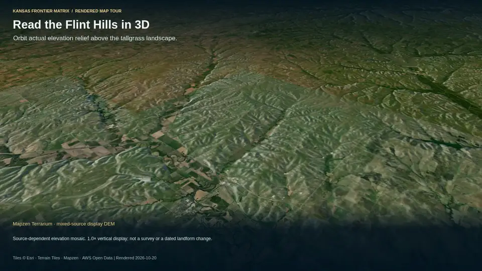

<!--
KFM_WIKI_SOURCE
page_id: Home
title: Kansas Frontier Matrix — place, time, evidence
status: source-grounded documentation candidate; independent review pending
updated: 2026-11-23
authority: orientation-only; repository evidence and adopted authority outrank this page
source_path: docs/wiki/Home.md
evidence_checkpoint: main@d4d84171653a2f2582b48ece511dc010857fde15; historical-hosted@bbcec824fe57e6be0409ba1e35d737fa99581560
publication_effect: none until reviewed source is separately synchronized
-->

# Kansas Frontier Matrix

## New on the public site — November 23, 2026

The public site gained six things this month, each read back against its source in the
[hosting runbook](https://github.com/bartytime4life/Kansas-Frontier-Matrix/blob/main/docs/runbooks/godaddy-node-hosting.md#public-readback-2026-11-23-third):

- **[A page for every county](https://kansasfrontiermatrix.com/counties).** Population, income, age, homes and bridges for
  each of the 105 Kansas counties, every figure with its source.
- **[Kansas records](https://kansasfrontiermatrix.com/records).** The extremes in the datasets behind the map.
- **Counted circles on the map.** Bridges, National Register places, trail sites and walk-in
  hunting tracts draw as numbered circles that split as you zoom, and the status bar counts what
  is in view.
- **[Frontier trails](https://kansasfrontiermatrix.com/explore/frontier-trails)** and the other plain-language map guides.
- **A repaired drought history.** The Kansas week-by-week Drought Monitor chart reads again after
  its provider changed how it is asked.
- **Clearer failures.** When a provider is down, the page now shows the reason instead of a bare
  error code.

The [root README](https://github.com/bartytime4life/Kansas-Frontier-Matrix/blob/main/README.md#new-on-the-public-site--november-2026) shows each one, and the
[changelog](https://github.com/bartytime4life/Kansas-Frontier-Matrix/blob/main/CHANGELOG.md) lists every change. This source update does not synchronize the
native wiki.

## Repository update — November 11, 2026

Main `d4d84171653a2f2582b48ece511dc010857fde15` includes merged Explorer
recovery, replay-inspection and Flight/Zod corrections. The
[repository review](https://github.com/bartytime4life/Kansas-Frontier-Matrix/blob/main/docs/reports/documentation-currentness-review-20261111.md)
separates current source and recorded validation from the historical public
website and media qualification below. Use the
[Explorer guide index](https://github.com/bartytime4life/Kansas-Frontier-Matrix/blob/main/apps/site/source/docs/README.md)
for current usage. This source update does not synchronize the native wiki or
establish a new deployed version.

**A living atlas of Kansas. An inspectable path from place to source.**

[Open the Explorer](https://kansasfrontiermatrix.com/) · [Take the moving tour](visual-tour.md) · [Run the program](Getting-Started.md) · [Inspect the test record](https://github.com/bartytime4life/Kansas-Frontier-Matrix/blob/a27c45354b461cd2fd5978efe7a7aacfc5f064ac/docs/reports/documentation-showcase-qualification-20261027.md)

<picture><source media="(prefers-reduced-motion: reduce)" srcset="https://raw.githubusercontent.com/bartytime4life/Kansas-Frontier-Matrix/974d3b340e619effc91d8da98cf9e67d95119df9/docs/brand/readme/kfm-tour-terrain.jpg" /></picture>

*Recorded Flint Hills renderer tour, October 20. Mixed-source DEM at 1.0× display;
not a survey or real-time speed recording. [Still](https://raw.githubusercontent.com/bartytime4life/Kansas-Frontier-Matrix/974d3b340e619effc91d8da98cf9e67d95119df9/docs/brand/readme/kfm-tour-terrain.jpg) · [Media lineage](https://github.com/bartytime4life/Kansas-Frontier-Matrix/blob/974d3b340e619effc91d8da98cf9e67d95119df9/docs/brand/readme/README.md#recorded-map-tours--october-27-2026).*

## Choose a way in

| You are here to… | Start here |
|---|---|
| Experience the map | [Visual Tour](visual-tour.md): terrain, water, aquifers, history and forecast wind |
| Understand what has been demonstrated | [Project Status](Project-Status.md): exact source, performed tests and remaining checks |
| Build or contribute | [Getting Started](Getting-Started.md) → [Development and Validation](Development-and-Validation.md) |
| Evaluate the work | [Builder profile](builder-profile.md) → [Engineering case studies](engineering-case-studies.md) |
| Inspect the trust model | [Governance and Evidence](Governance-and-Evidence.md) → [Data Lifecycle](Data-Lifecycle.md) |
| Design a scientific investigation | [Scientific Methods](scientific-methods.md): uncertainty, validation, causal questions, and four proposed Kansas studies |

## Scientific questions behind the map

The new [Scientific Methods](scientific-methods.md) reading path develops seven
analytical directions with primary references and explicit failure tests. Begin
with a defined quantity and support, compare against a baseline, and test on
held-out evidence. These are proposed studies, not newly implemented engines
or claims that the Science Pack has been scientifically qualified.

## Historical public experience — October 27, 2026

The public welcome was inspected October 27: a real-map starting screen, nineteen
categories, place search and source-aware category details. The water dialog exposed
the Kansas River valley and Tuttle Creek tours with their source limits. This is a
bounded Chrome observation; it does not certify every provider, device or interaction.

The public Node application is a separate source tree from this monorepo and the
preserved Sites mirror. This edition built and tested hosted source
[`bbcec824`](https://github.com/bartytime4life/Kansas-Frontier-Matrix/tree/bbcec824fe57e6be0409ba1e35d737fa99581560): **1,934 passed, 19 skipped, zero failed**;
TypeScript passed separately. [Read exactly what that covers](Project-Status.md).

## Explore, then inspect

A compelling display should make the next question easier: Which source? Which time?
What does this view support? KFM keeps external context, source observations, model
guidance, AI discussion and governed releases distinct. Maps and language are carriers.
They cannot perform source admission, policy review or publication by themselves.

[Architecture](Architecture.md) · [Domains](Domains.md) · [Repository Map](Repository-Map.md) · [Security and Sensitivity](Security-and-Sensitivity.md)

This is a reviewable orientation source. The native wiki is updated separately after
source review; older technical pages retain their stated historical checkpoints.
