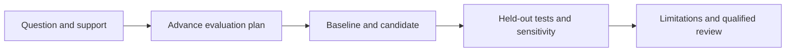

<!-- [KFM_META_BLOCK_V2]
doc_id: kfm://doc/wiki/scientific-methods
title: Scientific Methods
type: wiki
version: v0.1.0
status: proposed; orientation only; review required
owners: ["@bartytime4life"]
created: 2026-10-29
updated: 2026-10-29
policy_label: public
owning_root: docs/
responsibility: Provide a reader-oriented projection of the scientific-analysis explanation and proposed Kansas studies.
truth_posture: "CONFIRMED cited references and inspected repository interfaces; PROPOSED scientific studies; NEEDS VERIFICATION qualification and integration"
related:
  - ../architecture/scientific-analysis.md
  - ./README.md
  - ./Domains.md
  - ./Development-and-Validation.md
[/KFM_META_BLOCK_V2] -->

<!--
KFM_WIKI_SOURCE
page_id: Scientific-Methods
title: Scientific Methods
status: proposed scientific program; orientation only; independent review pending
updated: 2026-10-29
authority: explanatory orientation; no scientific qualification, policy, or release authority
source_path: docs/wiki/scientific-methods.md
evidence_checkpoint: main@01bf54386be6d4c727373726587e32a24a73e6af; analysis-guide@496a97280e72b22a5c83d48725e51828ab9c7237
publication_effect: public documentation only; no analytical engine, source admission, deployment, or data release
-->

# Scientific Methods

**Turn an interesting map pattern into a question that can be tested.**

KFM's scientific opportunity is to connect Kansas observations, models, and
historical records without losing how each was obtained or what it can support.
Their use in KFM and the studies below are **PROPOSED**. They are not an installed
Science Pack or newly qualified application features.

The [repository scientific-analysis guide](https://github.com/bartytime4life/Kansas-Frontier-Matrix/blob/496a97280e72b22a5c83d48725e51828ab9c7237/docs/architecture/scientific-analysis.md)
contains the detailed explanations, eight primary references, repository anchors,
assumptions, and validation limits. It is the maintained explanation; this page
is its shorter reading path.

## Seven ideas worth building carefully

| Scientific direction | What a KFM study would examine | A useful challenge to the result |
|---|---|---|
| Measurement support | What quantity was observed, over which place and interval, using which procedure? | Does the conclusion survive restoring each source's actual support and units? |
| Uncertainty propagation | How do input errors, shared calibration, and transformations affect a derived value? | Does the conclusion depend on an unjustified independence assumption? |
| Spatial and temporal validation | How well does a method predict a withheld region, station, or future period? | Does it outperform a simple baseline without neighboring-record or future-data leakage? |
| Bayesian model checking | Which assumptions, priors, and likelihoods explain the observations? | Do prior sensitivity, computational diagnostics, or held-out checks expose a weak model? |
| Causal study design | What would differ under a defined intervention and comparison? | Could confounding, selection, timing, or spillovers explain the association? |
| Inverse problems | Which different subsurface or process explanations fit the available evidence? | Do alternative parameter choices fit equally well but predict differently? |
| Experimental design | Which permitted observations or controlled comparisons would distinguish hypotheses? | Would the proposed study actually discriminate between the alternatives? |

The guide connects these directions to
[OGC observation concepts](https://www.ogc.org/standards/om/),
[JCGM measurement uncertainty](https://www.bipm.org/en/publications/guides),
[structured cross-validation](https://onlinelibrary.wiley.com/doi/full/10.1111/ecog.02881),
[Bayesian workflow](https://arxiv.org/abs/2011.01808),
[causal inference](https://miguelhernan.org/whatifbook),
[USGS inverse-model uncertainty](https://www.usgs.gov/publications/approaches-highly-parameterized-inversion-a-guide-using-pest-model-parameter-and),
and [NIST experimental design](https://www.itl.nist.gov/div898/handbook/pri/section1/pri11.htm).
These are methodological references, not adopted KFM standards.

## Four Kansas investigations to propose

| Investigation | A bounded first question | Keep this limit visible |
|---|---|---|
| Rainfall and river flow | Does a declared method improve a specified flow prediction over persistence or seasonality? | Test held-out catchments and future periods; do not infer flood safety or causal land-use effects. |
| Soil, vegetation, and heat | How does a stated vegetation proxy compare with its seasonal baseline? | Retain phenology, cloud gaps, aggregation, and proxy limits; avoid field-level diagnosis. |
| Groundwater and geology | Which alternative models remain compatible with withheld observations? | Display uncertainty and identifiability limits; a smooth 3D surface is not independent evidence. |
| Historical roads | Is a feature difference supported across two registered source editions? | Separate registration error and missing coverage from actual change; do not invent an event date. |

These are designs for review. No live data was acquired and no scientific study
was executed by this documentation update. Start with synthetic, public-safe
experiments before requesting any new source or collection.

## A number with its assumptions attached

In the guide's **synthetic** water-level example, the change is `-0.5 m`.
With a stated positive error correlation, the derived standard uncertainty is
approximately `0.1414 m`; assuming independent errors gives `0.2828 m`.
Neither value is automatically a 95% interval. The point is to disclose and test
the error model, rather than pick the more attractive number.

## How a study would become inspectable

Keep exploratory work separate from the final evaluation. Record rejected models,
missing coverage, and deviations from the plan. Review scientific fitness
separately from software correctness and KFM release eligibility.

Existing repository candidates provide narrower pieces: precommitted synthetic
evaluation, proxy-disclosure coherence, and model documentation. They do not
establish authentic observations, calibrated predictions, or an integrated
scientific engine. Follow the guide's
[implementation-boundary table](https://github.com/bartytime4life/Kansas-Frontier-Matrix/blob/496a97280e72b22a5c83d48725e51828ab9c7237/docs/architecture/scientific-analysis.md#existing-repository-anchors-and-their-limits)
before proposing code. AI can assist an investigation; it cannot supply missing
measurements, independent review, or permission to release.

**Continue:** [Domains](Domains.md) · [Development and Validation](Development-and-Validation.md) · [Governance and Evidence](Governance-and-Evidence.md) · [Glossary](Glossary.md).
